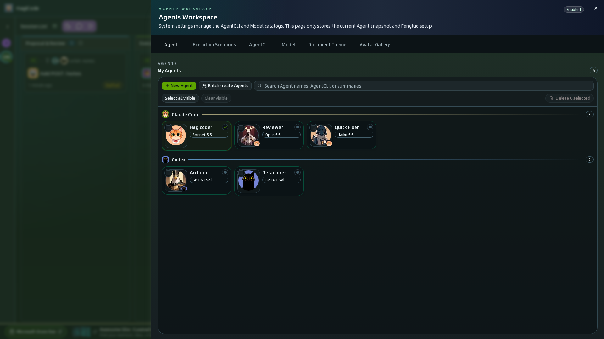
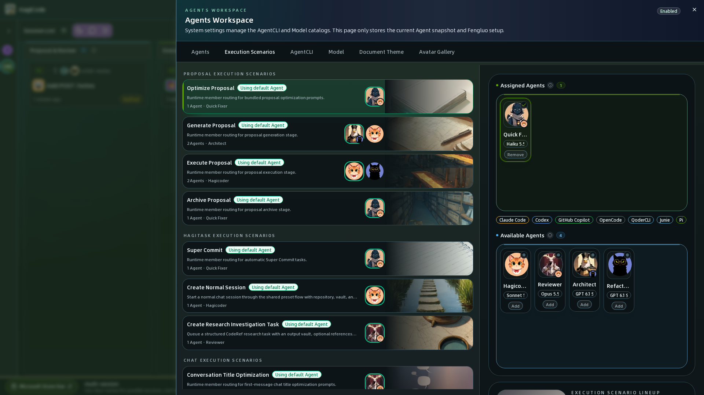

import { CardGrid, LinkCard } from '@astrojs/starlight/components';

**Agent** 是 HagiCode 的核心：会话由 Agent 运行，开始工作之前至少需要一个。本页是一份概览，帮你看懂 Agent 由什么组成、不同类型的工作由谁来做，以及与 Agent 相关的配置分散在哪些地方。逐项操作请看 [Agents 工作台指南](/user-guide/agents)。

## 功能概览

- 一个 **Agent = Agent CLI + 模型 + 可选的性格文本**。Agent CLI 是实际执行的命令行工具（例如 Claude Code、Codex），模型是它使用的模型，性格文本（Trait 和 Soul）用来塑造工作方式和说话风格。
- 你可以创建多个 Agent，例如一个用 Opus 做审查，一个用 Haiku 做快速修改，一个用 Codex 做重构。
- 每类工作用哪个 Agent，由**执行场景**决定；没有合适成员时，由**兜底班组**接手。
- Agent 的检查和调优分布在 **Agents 工作台**和**设置**里：前者管 Agent、场景、CLI 和模型，后者管重试、内存和 CPU 上限等运行时行为。

## Agent 列表

点击顶栏的 **Agents** 打开 **Agents Workspace**。**Agents** 标签页里的 **My Agents** 按 Agent CLI 分组列出你的 Agent，每张卡片显示头像、名称和模型。在这里你可以：

1. 用 **New Agent** 创建一个 Agent：选择 AgentCLI 和兼容的模型，可选地写入 Trait（知识与行为）和 Soul（语言风格）。
2. 用 **Batch create Agents** 一次创建多个，或用搜索框按名称、CLI 或简介过滤。
3. 通过 **Battle ready** 开关启用或停用某个 Agent。

创建过程的完整说明见 [Agents](/user-guide/agents#创建-agent)。

## 分工：执行场景与兜底班组

**Execution Scenarios** 标签页决定每类工作由哪些 Agent 来做。场景按用途分组：

| 分组 | 场景 |
| --- | --- |
| **Proposal** | 优化、生成、执行和归档提案 |
| **HagiTask** | Super Commit、创建普通会话、创建代码调研任务 |
| **Chat** | 会话标题优化 |

点击一个场景，右侧的 **Assigned Agents** 显示它的编组，**Available Agents** 显示可以加入的 Agent，点 **Add** 或 **Remove** 即可调整。**Fallback Crew**（兜底班组）是安全网：当某个场景自己的编组里没有合适的 Agent 时，HagiCode 会从兜底班组里挑选符合条件的成员。**在兜底班组至少有一个已启用的 Agent 之前，其他场景都保持锁定。** 初始化向导会自动把你的第一个 Agent 加进去。

一个常见的搭配：

1. 把擅长长上下文和审查的 Agent 放进 **Generate Proposal**。
2. 把执行力强、成本合适的 Agent 放进 **Execute Proposal**。
3. 把便宜、快速的 Agent 放进 **Super Commit** 和 **Conversation Title Optimization**。
4. 让兜底班组保留一个稳定的通用 Agent。

## 相关配置在哪里

| 想做的事 | 去哪里 |
| --- | --- |
| 创建、编辑、启用或停用 Agent | **Agents** → **Agents** 标签页 |
| 给每类工作分配 Agent、维护兜底班组 | **Agents** → **Execution Scenarios** |
| 查看 Agent CLI 是否已安装、是否健康、是否启用 | **Agents** → **AgentCLI**，状态栏的 AI Monitoring 弹层 |
| 浏览或添加某个 CLI 可用的模型 | **Agents** → **Model** |
| 换头像、换文案主题 | **Agents** → **Avatar Gallery** / **Document Theme** |
| 失败运行的自动重试 | **设置** → **Error Retry** |
| 生成提示词里是否声明“本次运行非交互” | **设置** → **AgentCLI Interactive Control** |
| 限制每个 Agent 能用的内存和 CPU | **设置** → **Agent resource limits** |
| 把多个 OpenAI 兼容模型接到同一个本地网关 | **设置** → **OmniRoute** |

各设置项的作用见[设置](/user-guide/settings)。

## 适用场景与边界

- 当你想让不同阶段用不同的模型或 CLI（例如审查和执行分开），就按场景分工。
- 只有一个 Agent 也完全可以使用：把它放进兜底班组，所有场景都会用它。
- Agent 只决定**由谁执行**。要执行什么，仍然来自你创建的会话、提案或计划。

## 继续阅读

<CardGrid>
  <LinkCard
    title="Agents 工作台"
    href="/user-guide/agents"
    description="逐个标签页了解如何创建 Agent、分配场景、检查 AgentCLI 和模型。"
  />
  <LinkCard
    title="初始化向导设置"
    href="/quick-start/wizard-setup"
    description="查看新用户如何在向导里创建第一个 Agent 并加入兜底班组。"
  />
  <LinkCard
    title="设置"
    href="/user-guide/settings"
    description="重试、内存和 CPU 上限、AgentCLI 交互控制和 OmniRoute 等与 Agent 相关的设置。"
  />
  <LinkCard
    title="产品概述"
    href="/product-overview"
    description="返回产品总览，了解 HagiCode 的整体工作方式。"
  />
</CardGrid>
