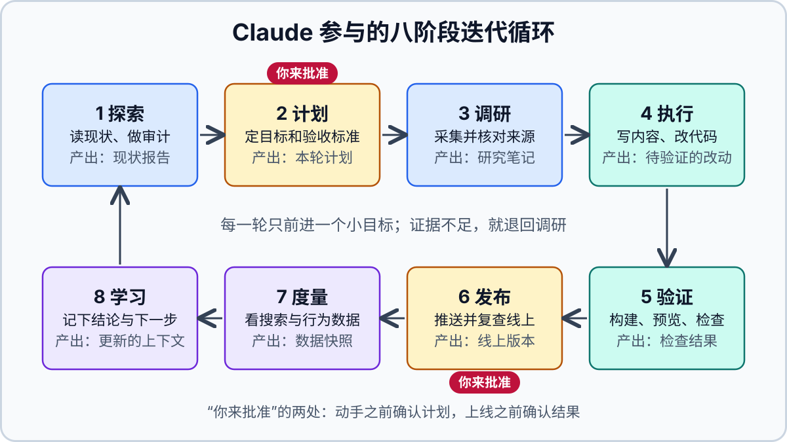
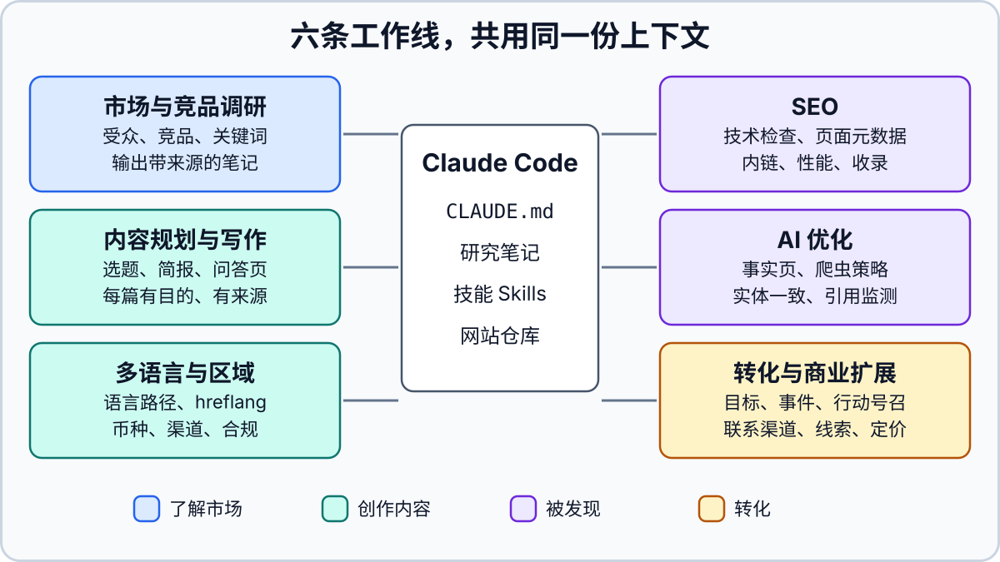
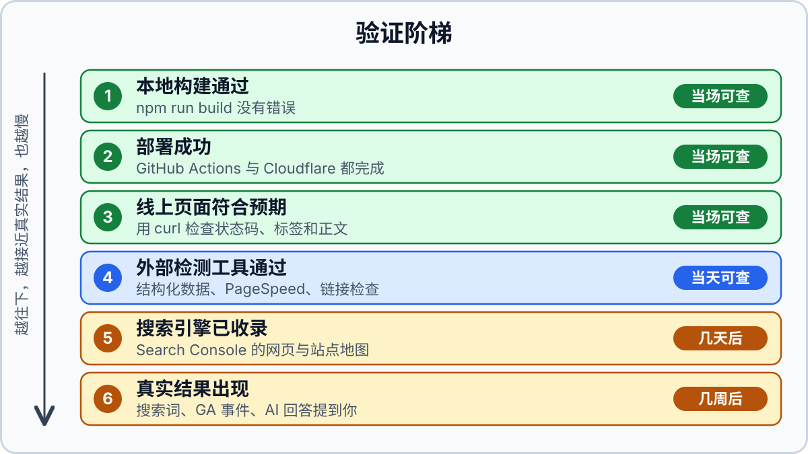
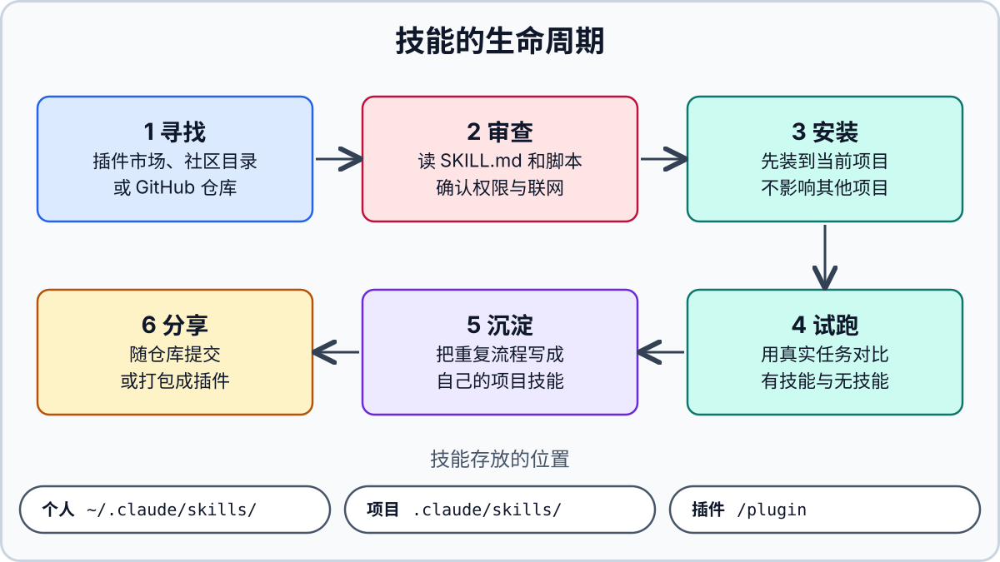
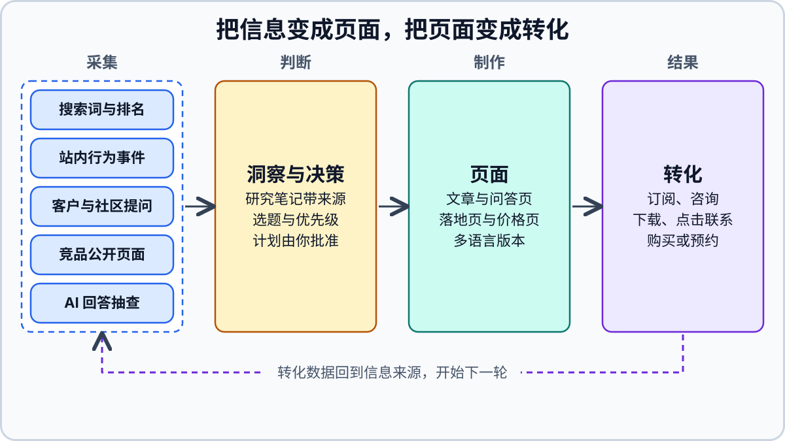
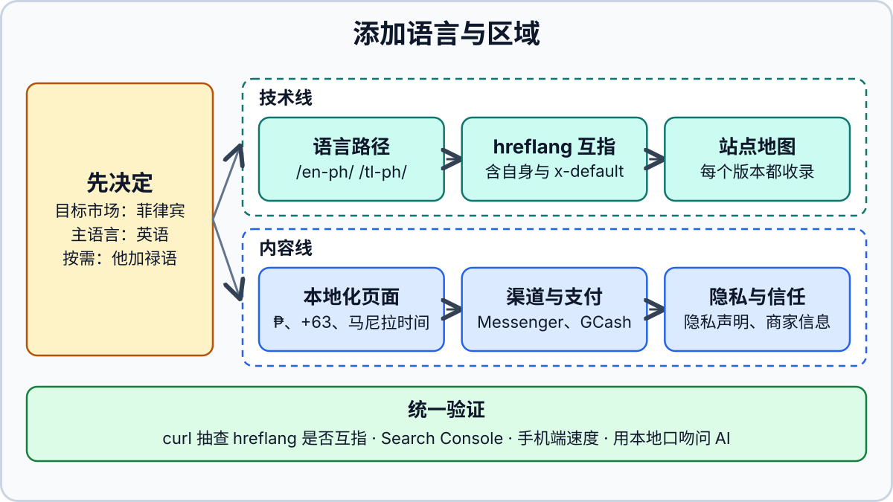

[第一篇指南](/blog/2026-11-23-mac-astro-site-claude-github-cloudflare/)带你从一台干净的 Mac 做出了上线的 Astro 网站。[第二篇指南](/blog/2026-11-25-astro-site-google-analytics-search-console-seo-claude/)接入了 Google Analytics、Search Console、站点地图、社交标签和 favicon。现在网站已经上线、可以衡量，理论上也能被搜索引擎找到。

它还缺少两样东西：让访客留下来的理由，以及知道下一步该写什么的办法。这两个问题不会有一次性的答案，需要一个循环：看证据，决定一个改动，做出来，证明它有效，再从结果里学习。

本指南展示如何用 Claude Code 运行这个循环，让你以后可以自己持续推进。这里没有固定的清单，而是一种你每周都能重复的工作方式。

读完之后，你会知道如何：

1. 让 Claude 记住你的网站，使每次会话都从已知信息开始。
2. 为任何改进运行八阶段循环：探索、计划、调研、执行、验证、发布、度量、学习。
3. 寻找、审查、安装、测试并编写自己的 Claude 技能（skill）。
4. 把循环应用到六条工作线：市场调研、内容、语言与区域、SEO、AI 可见度和转化。
5. 添加新语言和区域市场，本文以菲律宾为例。
6. 让循环保持安全：来源、批准、隐私和合理的节奏。

## 本指南适合谁

适合已经完成前两篇指南的人：你有一个位于 GitHub 仓库中的 Astro 网站，每次推送到 `main` 都会自动部署，已经设置好 Google Analytics 和 Search Console，并安装了 Claude Code。

示例假设网站使用英语，面向菲律宾的访客，域名为 `example.com`。请把市场、语言和域名换成你自己的。这套方法与国家无关。

## 全貌：一个循环，六条工作线

### 循环

从一个新页面到一种新语言，每个改进都经过同样的八个阶段。



| 阶段 | Claude 做什么 | 你做什么 | 留下什么 |
| --- | --- | --- | --- |
| 1. 探索 | 阅读网站和笔记，审计现状，不改任何东西 | 决定哪个问题最重要 | 一份审计报告 |
| 2. 计划 | 提出一个目标、步骤和成功的检验方式 | 批准、删减或否决 | 一份计划文件 |
| 3. 调研 | 收集来源、比较选项，标注未经核实的内容 | 抽查来源 | 带日期的研究笔记 |
| 4. 执行 | 分小步编写内容或代码 | 审阅改动 | 待验证的改动 |
| 5. 验证 | 构建、预览并运行检查 | 查看结果 | 一份通过的检查清单 |
| 6. 发布 | 提交、推送、等待部署并检查线上网站 | 批准发布 | 一个线上版本 |
| 7. 度量 | 读取你导出的数据 | 导出数据 | 一份数据快照 |
| 8. 学习 | 记录哪些有效、接下来试什么 | 决定下一个目标 | 更新后的笔记与上下文 |

有三条规则让循环保持诚实。

1. **每一轮只做一个小目标。** 一个页面、一组标题、一种语言。小的一轮容易验证，也容易撤销。
2. **每一轮都留下可以检查的证据。** 一个文件、一段命令输出、一个数字、一个链接。指不出来，就等于没发生。
3. **决定权在你。** Claude 负责探索、调研、写作和检查。你在动手之前批准计划，在上线之前批准结果。

### 六条工作线

循环是引擎，你要它处理的事情可以分成六条工作线。它们共用同一份上下文：你的笔记、规则、技能和仓库。



后面每条工作线都有单独的小节。先打好基础。

## 步骤 1：让 Claude 记住你的网站

Claude 每次会话开始时对你的网站一无所知，文件就是它的记忆。有两类文件起作用：

- 项目根目录的 `CLAUDE.md`。Claude Code 在会话开始时会读取它，所以把稳定的事实和规则放在这里。
- `research/` 和 `plans/` 中带日期的笔记，记录你学到了什么、决定了什么。

一个可行的目录布局：

```text
my-astro-site/
├── CLAUDE.md          # 网站为谁服务、语气、规则、工作流程
├── research/          # 带来源的日期笔记，以及导出的指标
├── plans/             # 每一轮一份简短计划
├── src/               # 网站本身
└── .claude/skills/    # 项目技能（见步骤 3）
```

在项目文件夹中启动 Claude，让它起草这个文件。Claude Code 也有 `/init` 命令，可以根据仓库生成第一版 `CLAUDE.md`。无论哪种方式，都要把结果改成符合你自己的实际情况。

```text
请为这个网站创建 CLAUDE.md，并创建空的 research/ 和 plans/ 文件夹，每个文件夹放一份简短的 README。

CLAUDE.md 需要包含：
- 网站的用途、服务对象，以及我们希望访客采取的那一个行动。
- 主要市场：菲律宾。语言：先英语，之后再加菲律宾语。大多数访客使用手机。
- 语气：朴实、友好、具体。不夸张，不编造数字。
- 规则：笔记或内容中的每个事实都要有来源网址和你看到它的日期。无法核实的内容标记为“未核实”。未经我批准计划和结果，绝不发布。绝不把访客的个人数据放进笔记或提示词。
- 工作流程：小改动、npm run build、提交、推送到 main、等待两处部署完成、用 curl 验证线上网站。
- 各类文件放在哪里。

保存之前先给我看这个文件。
```

检查：打开一个新的 Claude 会话，说“总结你对这个网站的了解”。回答应该与 `CLAUDE.md` 一致。如果不一致，问题出在文件不清楚，而不是 Claude。

## 步骤 2：八个阶段的实际做法

### 1. 探索

从只读审计开始。什么都不会改，所以没有需要撤销的东西。

```text
请探索这个网站并汇报。不要修改任何文件。

涵盖：页面列表和页面之间的链接关系、每个页面的用途、标题和描述、行动号召的位置、已经追踪了哪些事件，以及任何看起来单薄、重复或损坏的地方。

把报告写入 research/YYYY-MM-DD-audit.md，并给出最值得改进的五件事，按优先级排序并说明原因。
```

### 2. 计划

把 Claude Code 切换到计划模式（按 Shift+Tab 切换模式），这样它可以阅读和提议，但不能编辑。好的计划一页就够。

```text
请根据 research/YYYY-MM-DD-audit.md，为这一轮提出一个目标。

写入 plans/YYYY-MM-DD-goal.md，包含：
- 目标：一句话。
- 原因：来自我们笔记或数据的证据。
- 步骤：最多五步，每一步小到可以验证。
- 验收标准：我们如何知道它有效，包括发布之后立刻能看到的，以及几周之后才能看到的。
- 不做什么：明确排除在外的事。
- 回滚：如何撤销。

写完计划后停下来，等待我的批准。
```

这是第一个批准点。把计划删减到你能一口气讲清楚为止。

### 3. 调研

AI 市场调研和竞品调研就发生在这里，也是 AI 最容易误导你的地方，所以要给它规则。

```text
请为这个计划调研下面的问题：菲律宾的人在寻找 [你的主题] 时会搜索和询问什么？排名前三的竞争网站提供什么？

规则：
- 只使用公开页面。不要登录任何地方，也不要绕过任何限制。
- 每个论断都要有来源网址和你看到它的日期。
- 把“在页面上找到的”和“我的推断”分开。
- 不要编造统计数字。找不到数字就写“未核实”。
- 按下面的模板保存到 research/YYYY-MM-DD-topic.md。

模板：
# 问题
# 发现（论断、来源网址、查看日期、可信度：高、中或低）
# 未核实
# 这对计划有什么改变
```

Claude Code 可以搜索网页和抓取页面，可能会请你批准这些工具。完成之后，打开其中三个来源，检查它们是否真的支持笔记里的说法。只要有一个对不上，就对整份笔记保持怀疑，让 Claude 重做。

真实的客户问题是最好的调研输入。可以把客服问题或社区讨论放进 `research/`，但先去掉姓名、邮箱和任何个人信息。

### 4. 执行

现在由 Claude 按计划一步一步写。

```text
请只做 plans/YYYY-MM-DD-goal.md 的第 1 步，不要做别的。遵守 CLAUDE.md。运行 npm run build，通过后把 diff 给我看。
```

写作时，先要简报，再要草稿，然后由你修改。AI 草稿只是起点。让一个页面值得阅读的，是只有你才有的部分：真实的价格、真实的案例、你自己的截图、你自己的观点。这些要由你来补。

### 5. 验证

验证是一个阶梯。每一级都更接近真实结果，出结果也更慢。



第 1 到 3 级当场就能完成，Claude 可以替你做。第 4 级当天用外部工具完成。第 5 和 6 级取决于搜索引擎和访客，需要几天甚至几周。没爬到的那一级，就不要声称爬到了。“构建成功”不等于“已经上线”，“已经上线”也不等于“有效”。

```text
请在三个层面验证这个改动，并汇报你检查了什么、哪些没能检查：
1. npm run build 通过，没有错误。
2. 部署完成后，用 curl 请求线上网址，确认状态码、标题、描述、canonical 链接以及所有 JSON-LD。
3. 对该页面的手机版运行 Lighthouse 或 PageSpeed 检查，列出所有低于 90 分的项目。
```

### 6. 发布

发布是第二个批准点。你批准之后，由 Claude 完成机械性的工作并证明结果，就像前两篇指南中那样。

```text
请用清晰的说明提交，推送到 main，等待 GitHub Pages 工作流和 Cloudflare 构建都完成，然后用 curl 请求线上页面，确认改动已经在上面。逐项汇报检查结果。
```

对于重要的新页面，打开 Search Console，把网址粘贴到网址检查框中，请求编入索引。Bing 等搜索引擎还支持用 IndexNow 协议通知新页面。Google 不使用 IndexNow。

### 7. 度量

Claude 不能替你登录 Google。最简单可靠的办法是自己导出数据，放进仓库。

1. 在 Search Console 中打开 **效果**，设置日期范围，把国家/地区筛选为菲律宾，导出搜索词和页面。
2. 在 Google Analytics 中导出关键事件的次数。
3. 把两份文件保存到 `research/metrics/`，文件名带上日期。

```text
请读取 research/metrics/ 中最新的文件，并与上一次快照比较。

写入 research/YYYY-MM-DD-metrics.md，涵盖：展示次数上升或下降的搜索词、展示多但点击少的页面、触发了哪些事件，以及对每个明显变化的一个假设。每个假设都要标明是假设。
```

对于新网站，数字会很小。不要过度解读只有几次点击的变化，要看几周内的方向。

### 8. 学习

最后一个阶段是大多数人会跳过的，也是让循环产生复利的关键。

```text
请结束这一轮。把以后几轮应该知道的内容更新到 CLAUDE.md 或研究笔记中：我们试了什么、证据说明什么、哪些不会再试以及原因。然后提出下一个目标并附上证据，然后停下。
```

## 步骤 3：技能：寻找、审查、测试、沉淀、分享

技能是一个带有 `SKILL.md` 文件的文件夹，用来教 Claude 做一件可重复的任务。文件开头有一小段包含 `name` 和 `description` 的 front matter，后面是具体说明。Claude 通过描述来判断什么时候该用这个技能，你也可以输入 `/skill-name` 直接调用。



技能可以放在三个位置：

| 范围 | 位置 | 适合 |
| --- | --- | --- |
| 个人 | `~/.claude/skills/<name>/SKILL.md` | 在所有项目中使用的个人习惯 |
| 项目 | `.claude/skills/<name>/SKILL.md` | 这个网站的固定流程，通过 git 共享 |
| 插件 | 用 `/plugin` 安装 | 由别人打包和维护的技能 |

Claude Code 会监视个人和项目的技能文件夹，所以新技能通常会在当前会话中出现。如果没有出现，运行 `/reload-skills`。输入 `/skills` 可以查看当前可用的技能。

### 寻找

有三个地方可以找：插件市场（打开 `/plugin` 浏览，用 `/plugin marketplace add owner/repo` 添加市场）、社区技能目录，以及 GitHub 仓库。有面向营销工作的技能集合，例如 SEO 审计、文案编辑、竞品调研和 AI 搜索优化。一个公开的例子是 `coreyhaines31/marketingskills` 仓库，其中包含 `seo-audit` 和 `ai-seo`。它是第三方作品，所以要像对待任何不是你自己写的代码一样对待它。

### 审查

技能是说明，有时还带有会在你机器上运行的脚本。安装之前先读一遍。

```text
我想评估 coreyhaines31/marketingskills 仓库里的 seo-audit 和 ai-seo 技能。现在先不要安装任何东西。

请阅读每个 SKILL.md 以及它包含的所有脚本或参考文件，然后告诉我：
- 这个技能做什么，用两句话说明。
- 它要求运行哪些工具或命令，其中有没有 shell 命令。
- 它是否读取或写入本项目之外的文件，或发起网络请求。
- 任何看起来与其声明的用途无关的地方。

然后建议我是否安装。
```

你的审查清单：能说出名字的来源、你读过的 `SKILL.md`、没有你看不懂的脚本、没有意外的网络访问，以及用途单一。

### 安装并试跑

先安装到项目范围，这样不会影响你的其他工作。按仓库自己的 README 使用准确的命令，或者让 Claude 来做并把它运行的命令给你看。

然后用一个真实的任务测试并对比：

```text
请审计首页和一篇博客文章。先不使用任何技能直接回答。然后使用 seo-audit 技能再做一次同样的审计。比较两份报告：技能发现了哪些普通回答遗漏的问题，又有哪些地方出错或凑字数？把比较结果保存到 research/。
```

如果技能不会自动触发，用 `/seo-audit` 直接调用，并检查它的 `description` 是否清楚地说明了适用场景。

### 沉淀自己的技能

你每次重复的流程，都是一个等着被写出来的技能。下面这个技能发布一篇文章并证明它已经上线。因为发布有副作用，它设置了 `disable-model-invocation: true`，所以只有在你输入 `/publish-post` 时才会运行。

```markdown
---
name: publish-post
description: Publish a finished blog post on this site and prove it is live. Use when the user asks to publish, ship or release a post.
disable-model-invocation: true
---

发布用户指定的文章。

1. 运行 `npm run build`。失败就停止。
2. 检查 front matter 中有标题、描述和日期。
3. 用清晰的说明提交，并推送到 `main`。
4. 等待两处部署：先 `gh run watch`，再等 Cloudflare 构建。
5. 用 `curl -s` 请求线上网址，确认标题、描述和 JSON-LD 块都存在。
6. 汇报你检查了什么，以及哪些没能检查。
```

把它保存为 `.claude/skills/publish-post/SKILL.md` 并提交，它就成了项目的一部分。接下来值得写成技能的有：每周指标报告、竞品刷新和 hreflang 检查。

### 分享

项目技能通过提交来共享。要在多个网站之间或与他人共享技能，把它们打包成插件并发布一个市场文件，具体方法见 [Claude Code 插件文档](https://code.claude.com/docs/en/discover-plugins)。完整的 front matter 选项见[技能文档](https://code.claude.com/docs/en/skills)。

## 步骤 4：在六条工作线上运行循环

它们的起点都一样：下面的总提示词，让 Claude 在你指定的工作线上运行一轮循环。

```text
请为这个网站运行一轮改进，聚焦于 [工作线]。

1. 阅读 CLAUDE.md，以及 research/ 和 plans/ 中最新的文件。
2. 提出这一轮的一个目标和支持它的证据。停下来等待我的批准。
3. 我批准之后，先写计划文件，再做调研，然后执行，最后验证。在发布之前停下，把结果给我看。
4. 我批准发布之后，发布并验证线上网站。
5. 记录我们学到的东西，并提出下一个目标。
```

信息在循环中的流动方式是一致的：来源变成洞察，洞察变成页面，页面带来转化，转化数据又回到来源。



### A. 市场与竞品调研

- **目标：** 知道你服务的是谁、他们问什么，以及替代方案提供什么。
- **输入：** Search Console 的搜索词、客户问题、竞品的公开页面，以及 AI 助手对你的主题给出的回答。
- **一轮的例子：** “比较三个竞品如何解释定价，以及它们没有说什么。”
- **检查：** 每个论断都有来源和日期，并且你打开过其中三个。
- **产出：** 一份喂给内容计划的研究笔记。

### B. 内容与问答页

- **目标：** 比替代方案更好地回答真实问题。
- **做法：** 每个真实问题一个页面，第一段直接给出答案，后面再展开细节。增加把事实说清楚的页面：你提供什么、怎么运作、多少钱、有什么限制。为“A 还是 B”这样的问题制作对比页。
- **问题要有来源**：来自 Search Console、客户消息、社区讨论，以及 AI 助手给出的回答。不要为了填模板而编造问题。
- **不要批量生产页面。** 搜索引擎对大量低价值的生成内容有明确的政策。几个好页面胜过一百个单薄的页面。
- **检查：** 每个页面都有目的，每个事实都有来源，并且包含只有你能写出来的内容。

### C. 语言与区域（以菲律宾为例）

先确定市场和语言，然后并行运行两条线，最后一起验证。



**技术线。** 给每种语言和区域一个独立的 URL 路径，例如 `/en-ph/` 表示菲律宾的英语。用 `hreflang` 把每个版本与其他所有版本互相链接。Google 的规则很具体：

- 语言是 ISO 639-1 代码，可选的区域是 ISO 3166-1 alpha-2 代码，例如 `en-PH`。只支持 ISO 639-1 的语言代码，所以菲律宾语的 `fil` 无效。如果要添加菲律宾语版本，使用 `tl`（他加禄语），写成 `tl-PH`，并在 Search Console 中确认它的表现。
- 每个版本必须列出自己和所有其他版本。如果页面 X 指向页面 Y，页面 Y 必须指回 X，否则这些标签会被忽略。
- 为不匹配任何版本的访客添加 `x-default` 条目。
- 你可以在页面 head、HTTP 头或站点地图中声明这一切。

Astro 内置了国际化路由，它的站点地图集成也可以把语言替代版本写入站点地图。让 Claude 根据你已安装的版本查阅文档，不要凭猜测。

```text
请在 /en-ph/ 路径下添加网站的英语（菲律宾）版本，并为以后在 /tl-ph/ 下添加菲律宾语版本做好准备。使用 Astro 的 i18n 路由，按我们安装的版本查阅当前文档，并且：
- 为每个有多个版本的页面添加 hreflang 替代链接，包括指向自身的链接和 x-default。
- 让站点地图列出每个语言版本及其替代版本。
- 添加可见的语言切换器。不要按 IP 地址自动重定向访客。
- 构建、提交、推送、等待部署，然后用 curl 请求两个页面并打印它们的 hreflang 链接，证明每个页面都链接到对应的版本。
```

**内容线。** 翻译不等于本地化。针对菲律宾，请先用你自己的分析数据和客户反馈确认以下几点，不要想当然：

- 以比索（₱）标价，电话号码使用 `+63` 格式，时间使用菲律宾时间（UTC+8）。
- 人们实际使用的联系和支付渠道，例如 Facebook Messenger 或 Viber，以及用 GCash 或 Maya 付款。
- 页面在手机和弱网络下加载要快。手机访客通常占多数。
- 人们真正使用的措辞，常常是英语和菲律宾语混用。关键页面上的菲律宾语文本要请母语者审校。对于要促成成交的页面，只靠 AI 翻译不够。
- 清晰的隐私声明。菲律宾有《2012 年数据隐私法》（Republic Act 10173），由国家隐私委员会（National Privacy Commission）执行，请查看该委员会的网站，了解哪些要求适用于你的网站。另外，把真实的商家信息，例如注册名称和联系方式，放在访客能找到的地方。以上是一般性信息，不构成法律意见。

**一起验证。** 部署之后，用 `curl` 确认 hreflang 链接是互相指向的；在 Search Console 中检查新路径上的 hreflang 和收录问题；在一部中端手机上测试页面；并用本地人的口吻向 AI 助手提出你的目标问题，看看你有没有出现。

### D. SEO

用同样的循环做每月审计。第二篇指南打好了基础：站点地图、canonical 链接、元数据和结构化数据。每月的工作是找出哪些地方跑偏了或被遗漏了。

```text
请审计网站的 SEO，并把按优先级排序的清单保存到 research/YYYY-MM-DD-seo.md。检查：站点地图中缺失的页面、重复或缺失的标题和描述、损坏的内部链接、没有任何内部链接指向的页面、没有 alt 文本的图片，以及手机上最慢的页面。先不要修复任何东西。按预期价值给我最值得做的三个修复。
```

修三件事，验证，发布，然后继续往前走。不要追求满分。

### E. AI 可见度

AI 助手和 AI 搜索功能通过阅读并总结网页来回答问题。你无法保证被提到，但可以让你的页面更容易被找到、读懂和信任。

- **允许合适的爬虫。** AI 公司会公布它们爬虫的名称，有些还把搜索或用户触发的抓取与模型训练分开。查阅每家公司当前的文档，然后决定 `robots.txt` 应该允许什么。允许搜索类爬虫、同时区别对待训练类爬虫，是合理的选择。
- **为回答而写。** 使用问题式的标题，先给出直接的答案，给出带数字和日期的具体事实，用清晰的表格做对比。
- **对“你是谁”保持一致。** 在所有地方使用同样的名称、简介和链接，添加带有官方主页链接的 `Organization` 结构化数据，并保留一个有真实作者的“关于”页面。
- **在别处赢得提及。** 评测、社区讨论和目录页面往往是助手引用的对象。这与社区和外联工作直接相关。
- **`llms.txt` 是可选的。** 它是一个为语言模型总结你网站的拟议文件。目前没有可靠证据表明主流 AI 搜索产品依赖它，所以把它当作低成本的附加项，不要当作优先事项。
- **通过提问来度量。** 保留一份固定的 10 到 20 个问题清单，包括菲律宾用户的说法。每月向几个助手提问，记录你是否被提到以及它们引用了哪些来源，并在 Google Analytics 中留意来自 AI 产品的引荐流量。

```text
请创建 research/ai-answer-checks.md，列出 15 个菲律宾访客会就我们的主题提出的问题，措辞要自然。留出这些列：助手、日期、我们是否被提到、它引用的来源。然后对照本指南中的 AI 可见度要点审计网站，并列出最大的三个差距。
```

### F. 转化与商业扩展

- **选定一个主要转化。** 订阅、咨询、下载或购买。其他一切都为它服务。
- **与事件对应。** 使用第二篇指南中的事件追踪，这样你能看到有多少人到达，以及他们在哪里流失。
- **每个页面一个清晰的行动号召。** 把人们偏好的联系渠道放在容易触达的位置，例如一个 Messenger 链接。
- **一次只改一件事。** Claude 可以提出假设并写出不同的版本，由你决定试哪一个。有意义的测试需要真实的流量，所以在小网站上，优先做明确的改进并观察趋势。
- **注意隐私。** 在收集线索之前，先添加同意和隐私说明。

```text
请为首页提出三个转化假设。对每一个说明：改动内容、它所依据的证据、将显示它是否有效的事件，以及达到什么数字才算成功。在我选定一个之前，不要构建任何东西。
```

## 步骤 5：节奏与护栏

### 合理的节奏

| 什么时候 | 做什么 |
| --- | --- |
| 每次发布之后 | 验证线上页面。为重要的新页面请求编入索引。 |
| 每周 | 导出 Search Console 和 Analytics 的数据，运行度量和学习阶段，选定一个目标。 |
| 每月 | SEO 审计、AI 回答检查、刷新竞品笔记，回顾你实际用过哪些技能。 |
| 每季度 | 重新审视受众和市场的假设，删除或合并薄弱的页面，决定是否添加一种语言。 |

读取数据的部分可以自动化。Claude Code 有非交互模式 `claude -p "提示词"`，可以从调度器中运行。限制它能使用的工具，并且只让它写入 `research/`。发布要保持手动。

### 护栏

- **事实需要来源。** 没有来源就没有论断。始终要抽查。
- **批准两次。** 动手之前批准计划，上线之前批准结果。
- **最小权限。** 不要给 Claude 超出任务需要的访问权限。安装技能之前先审查。
- **不要放入个人数据。** 不要把访客或客户的个人数据粘贴到提示词或笔记中。
- **质量优先于数量。** 一百个什么也没说的生成页面可能会损害整个网站。
- **及时止损并学习。** 如果一轮失败了，写下原因，回滚改动，继续往前。有记录的失败也是进步。

## 常见问题

- **Claude 的调研数字与我找到的对不上。** 把它们当作未经核实。为每个数字要来源网址和日期，重新检查。如果给不出，就删掉这个论断。
- **技能不触发。** 检查它的 `description` 是否清楚地说明了何时使用，用 `/skill-name` 直接调用，如果是新技能就运行 `/reload-skills`。设置了 `disable-model-invocation: true` 的技能只有在你调用时才会运行。
- **Claude 在会话之间会忘事。** 这是正常的。把重要的内容放进 `CLAUDE.md` 或 `research/`。
- **我的流量太小，看不出效果。** 拉长周期，主要依靠阶梯的第 1 到 4 级。增加定性检查：问五位真实用户，或者阅读你的客户消息。
- **hreflang 似乎不起作用。** 检查每个版本是否都链接了自己和其他所有版本、代码是否有效，以及网址是否是绝对地址并返回 200。
- **没有 AI 助手提到我的网站。** 对新网站来说这很正常。继续制作能回答真实问题的页面，在别处赢得提及，并用同一份问题清单持续度量。

## 本周可以做什么

1. 创建 `CLAUDE.md`、`research/` 和 `plans/`（步骤 1）。
2. 运行一轮探索和计划，选定一个目标（步骤 2）。
3. 从步骤 4 中选一条工作线，对它运行总提示词。
4. 把你刚刚重复做过的一个流程变成项目技能。

模式与前两篇指南的结尾一样：描述最终状态，让 Claude 做出修改，让它推送并等待，在线上网站证明结果，再用外部工具确认。本指南只是在前面加上调研，在后面加上学习，然后再来一遍。
