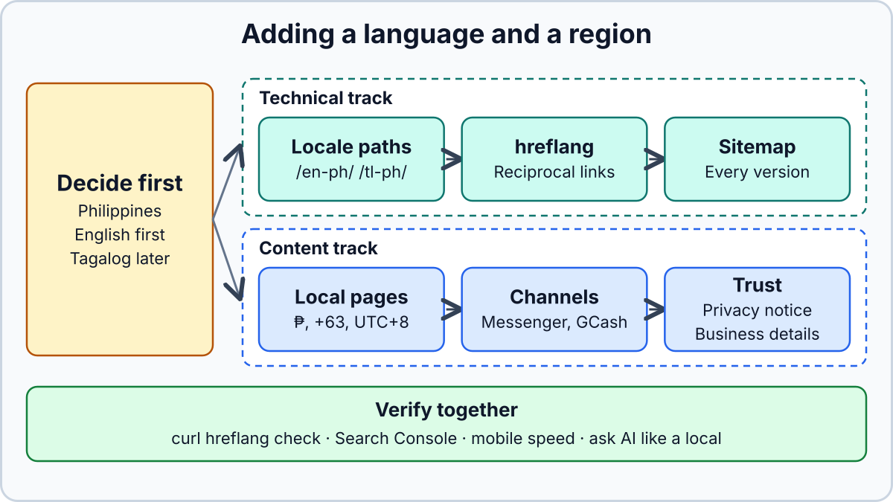

The [first guide](/en-US/blog/2026-11-23-mac-astro-site-claude-github-cloudflare/) took you from a clean Mac to a live Astro site. The [second guide](/en-US/blog/2026-11-25-astro-site-google-analytics-search-console-seo-claude/) added Google Analytics, Search Console, a sitemap, social tags and favicons. Your site is live, measured and findable in principle.

What it does not have yet is a reason for anyone to stay, or a way for you to know what to write next. Those questions never get a one-time answer. They need a loop: look at the evidence, decide on one change, make it, prove it worked, and learn from the result.

This guide shows how to run that loop with Claude Code so that you can keep going on your own. You will not follow a fixed checklist. You will set up a way of working that you can repeat every week.

By the end you will know how to:

1. Give Claude a memory of your site, so every session starts informed.
2. Run an eight-stage loop for any improvement: explore, plan, research, build, verify, publish, measure, learn.
3. Find, review, install, test and write your own Claude skills.
4. Apply the loop to six workstreams: market research, content, language and region, SEO, AI visibility and conversion.
5. Add a new language and a regional market, using the Philippines as the worked example.
6. Keep the loop safe: sources, approvals, privacy and a sensible rhythm.

## Who this guide is for

You finished the first two guides. You have a live Astro site in a GitHub repository, deployments on every push to `main`, Google Analytics and Search Console set up, and Claude Code installed.

The examples assume an English-language site aimed at visitors in the Philippines, hosted at `example.com`. Replace the market, the languages and the domain with your own. The method does not depend on the country.

## The big picture: one loop, six workstreams

### The loop

Every improvement, from a new page to a new language, goes through the same eight stages.


| Stage | What Claude does | What you do | What it leaves behind |
| --- | --- | --- | --- |
| 1. Explore | Reads the site and your notes, audits the current state, changes nothing | Decide which question matters | An audit report |
| 2. Plan | Proposes one goal, the steps and how success is checked | Approve, trim or reject | A plan file |
| 3. Research | Gathers sources, compares options, labels what is unverified | Spot-check the sources | Dated research notes |
| 4. Build | Writes content or code in small steps | Review the diff | Changes ready to verify |
| 5. Verify | Builds, previews and runs checks | Look at the result | A list of checks that passed |
| 6. Publish | Commits, pushes, waits for deployment, checks the live site | Approve the release | A live version |
| 7. Measure | Reads the data you export | Export the numbers | A data snapshot |
| 8. Learn | Writes down what worked and what to try next | Decide the next goal | Updated notes and context |

Three rules keep the loop honest.

1. **One small goal per round.** One page, one set of titles, one language. Small rounds are easy to verify and easy to undo.
2. **Every round leaves evidence you can check.** A file, a command output, a number, a link. If you cannot point at it, it did not happen.
3. **You decide.** Claude explores, researches, writes and checks. You approve the plan before work starts and the result before it goes live.

### The six workstreams

The loop is the engine. What you point it at falls into six workstreams, which share one context: your notes, your rules, your skills and your repository.


Each workstream gets its own section later in this guide. First, the foundations.

## Step 1: Give Claude a memory of your site

Claude starts every session knowing nothing about your site. Files are its memory. Two kinds of files do the work:

- `CLAUDE.md` in the project root. Claude Code reads it at the start of a session, so put the stable facts and rules there.
- Dated notes in `research/` and `plans/`, which hold what you learn and what you decided.

A layout that works:

```text
my-astro-site/
├── CLAUDE.md          # who the site is for, voice, rules, workflow
├── research/          # dated notes with sources, plus exported metrics
├── plans/             # one short plan per round
├── src/               # the site itself
└── .claude/skills/    # project skills (see Step 3)
```

Start Claude in the project folder and ask it to draft the file. Claude Code also has an `/init` command that generates a first `CLAUDE.md` from the repository. Either way, edit the result so it says what is true for you.

```text
Create CLAUDE.md for this site, and create empty research/ and plans/ folders with a short README in each.

CLAUDE.md should cover:
- What the site is for, who it serves, and the one action we want visitors to take.
- The primary market: the Philippines. Language: English first, Filipino later. Most visitors are on mobile.
- Voice: plain, friendly, specific. No hype and no invented numbers.
- Rules: every factual claim in notes or content needs a source URL and the date you saw it. Mark anything unverified as "unverified". Never publish without my approval of the plan and of the result. Never put visitor personal data in notes or prompts.
- Workflow: small change, npm run build, commit, push to main, wait for both deployments, verify the live site with curl.
- Where things live.

Show me the file before you save it.
```

Check: open a fresh Claude session and ask, "Summarise what you know about this site." The answer should match your `CLAUDE.md`. If it does not, the file is unclear, not Claude.

## Step 2: The eight stages in practice

### 1. Explore

Start with a read-only audit. Nothing changes, so there is nothing to undo.

```text
Explore this site and report. Do not change any files.

Cover: the page list and how pages link to each other, what each page is for, the titles and descriptions, where the calls to action are, which events are tracked, and anything that looks thin, duplicated or broken.

Write the report to research/YYYY-MM-DD-audit.md with a prioritised list of the five most valuable things to improve and why.
```

### 2. Plan

Switch Claude Code to plan mode (press Shift+Tab to cycle modes) so it can read and propose but not edit. A good plan fits on one page.

```text
Using research/YYYY-MM-DD-audit.md, propose one goal for this round.

Write plans/YYYY-MM-DD-goal.md with:
- Goal: one sentence.
- Why: the evidence from our notes or data.
- Steps: at most five, each small enough to verify.
- Acceptance criteria: how we will know it worked, both right after publishing and a few weeks later.
- Not doing: what is out of scope.
- Rollback: how to undo it.

Stop after writing the plan and wait for my approval.
```

This is the first approval point. Cut the plan down until you could explain it in one breath.

### 3. Research

This is where AI market and competitor research happens. It is also where AI is most likely to mislead you, so give it rules.

```text
Research this question for the plan: what do people in the Philippines search for and ask about when they look for [your topic], and what do the top three competing sites offer?

Rules:
- Use public pages only. Do not log in anywhere or bypass anything.
- Every claim needs a source URL and the date you saw it.
- Separate "found on a page" from "my inference".
- Do not invent statistics. If you cannot find a number, write "unverified".
- Save to research/YYYY-MM-DD-topic.md using the template below.

Template:
# Question
# Findings (claim, source URL, date seen, confidence: high, medium or low)
# Not verified
# What this changes in the plan
```

Claude Code can search the web and fetch pages, and may ask you to approve those tools. After it finishes, open three of the cited sources and check that they say what the note claims. If one fails, treat the whole note with suspicion and ask Claude to redo it.

Real customer questions are the best research input of all. Paste support questions or community threads into `research/`, but strip names, emails and anything personal first.

### 4. Build

Now Claude writes, one plan step at a time.

```text
Do step 1 of plans/YYYY-MM-DD-goal.md and nothing else. Follow CLAUDE.md. Run npm run build and show me the diff when it passes.
```

For writing, ask for a brief first, then a draft, then your edits. AI drafts are a starting point. What makes a page worth reading is the part only you have: real prices, real examples, your own screenshots, your own opinion. Add those yourself.

### 5. Verify

Verification is a ladder. Each rung is closer to real results and slower to show.


Rungs 1 to 3 are instant and Claude can do them for you. Rung 4 happens the same day with external tools. Rungs 5 and 6 depend on search engines and visitors, so they take days or weeks. Never claim a rung you have not climbed. "It built" is not "it is live", and "it is live" is not "it works".

```text
Verify the change on three levels and report what you checked and what you could not check:
1. npm run build passes with no errors.
2. After deployment, curl the live URL and confirm the status code, the title, the description, the canonical link and any JSON-LD.
3. Run a Lighthouse or PageSpeed check on the mobile version of the page and list anything below 90.
```

### 6. Publish

Publishing is the second approval point. After you approve, Claude does the mechanical work and proves the result, exactly as in the first two guides.

```text
Commit with a clear message, push to main, wait for the GitHub Pages workflow and the Cloudflare build to finish, then curl the live page and confirm the change is there. Report each check.
```

For important new pages, open Search Console, paste the URL into the URL inspection box and request indexing. Bing and some other search engines also support the IndexNow protocol for announcing new pages. Google does not use IndexNow.

### 7. Measure

Claude cannot log in to Google for you. The simplest reliable method is to export the numbers yourself and drop them into the repository.

1. In Search Console, open **Performance**, set the date range, filter the country to the Philippines and export the queries and pages.
2. In Google Analytics, export the event counts for your key events.
3. Save both files in `research/metrics/` with the date in the filename.

```text
Read the newest files in research/metrics/ and compare them with the previous snapshot.

Write research/YYYY-MM-DD-metrics.md covering: queries gaining or losing impressions, pages with many impressions but few clicks, the events that fired, and one hypothesis for each notable change. Label every hypothesis as a hypothesis.
```

On a young site the numbers will be small. Do not over-read a change of a handful of clicks. Look for direction over several weeks.

### 8. Learn

The last stage is the one most people skip, and it is what makes the loop compound.

```text
Close this round. Update CLAUDE.md or the research notes with anything future rounds should know: what we tried, what the evidence says, what we will not try again and why. Then propose the next goal, with the evidence, and stop.
```

## Step 3: Skills: find, review, test, capture, share

A skill is a folder with a `SKILL.md` file that teaches Claude a repeatable task. The file has a short front matter block with a `name` and a `description`, followed by instructions. Claude reads the description to decide when a skill is relevant, and you can also call one directly by typing `/skill-name`.


Skills can live in three places:

| Scope | Location | Good for |
| --- | --- | --- |
| Personal | `~/.claude/skills/<name>/SKILL.md` | Your own habits across every project |
| Project | `.claude/skills/<name>/SKILL.md` | Routines for this site, shared through git |
| Plugin | Installed with `/plugin` | Skills other people package and maintain |

Claude Code watches the personal and project skills folders, so a new skill normally appears in the current session. If it does not, run `/reload-skills`. Type `/skills` to see what is available.

### Find

Three places to look: plugin marketplaces (open `/plugin` to browse them, and add one with `/plugin marketplace add owner/repo`), community skill directories, and GitHub repositories. There are skill collections aimed at marketing work, such as SEO audits, copy editing, competitor research and AI search optimisation. One public example is the `coreyhaines31/marketingskills` repository, which includes `seo-audit` and `ai-seo`. It is third-party, so treat it like any code you did not write.

### Review

A skill is instructions plus, sometimes, scripts that run on your machine. Read it before you install it.

```text
I want to evaluate the seo-audit and ai-seo skills from the coreyhaines31/marketingskills repository. Do not install anything yet.

Read each SKILL.md and every script or reference file it includes, then tell me:
- What the skill does, in two sentences.
- Which tools or commands it asks to run, and whether any are shell commands.
- Whether it reads or writes files outside this project, or makes network requests.
- Anything that looks unrelated to its stated purpose.

Then recommend whether to install it.
```

Your review checklist: a source you can name, a `SKILL.md` you have read, no scripts you do not understand, no surprising network access, and a narrow purpose.

### Install and try

Install to the project first, so nothing leaks into your other work. Follow the repository's own README for the exact command, or ask Claude to do it and show you what it ran.

Then test it against a real task and compare:

```text
Audit the homepage and one blog post. First answer without using any skill. Then run the same audit with the seo-audit skill. Compare the two reports: what did the skill catch that the plain answer missed, and what did it get wrong or pad out? Save the comparison to research/.
```

If the skill does not trigger by itself, call it with `/seo-audit`, and check that its `description` says clearly when it applies.

### Capture your own

Every routine you repeat is a skill waiting to be written. This one publishes a post and proves it is live. Because publishing has side effects, it sets `disable-model-invocation: true`, so it only runs when you type `/publish-post`.

```markdown
---
name: publish-post
description: Publish a finished blog post on this site and prove it is live. Use when the user asks to publish, ship or release a post.
disable-model-invocation: true
---

Publish the post the user names.

1. Run `npm run build`. Stop if it fails.
2. Check the front matter has a title, a description and a date.
3. Commit with a clear message and push to `main`.
4. Wait for both deployments: `gh run watch`, then the Cloudflare build.
5. Fetch the live URL with `curl -s` and confirm the title, the description and the JSON-LD block are present.
6. Report what you checked and what you could not check.
```

Save it as `.claude/skills/publish-post/SKILL.md`, commit it, and it becomes part of the project. Good candidates for your next skills: a weekly metrics report, a competitor refresh, and a hreflang check.

### Share

A project skill is shared by committing it. To share skills across many sites or with other people, package them as a plugin and publish a marketplace file; the [Claude Code plugin documentation](https://code.claude.com/docs/en/discover-plugins) explains how. See also the [skills documentation](https://code.claude.com/docs/en/skills) for the full list of front matter options.

## Step 4: Run the loop on six workstreams

All of these start the same way: the master prompt below, which makes Claude run one round of the loop on whichever workstream you name.

```text
Run one improvement round for this site, focused on [workstream].

1. Read CLAUDE.md and the newest files in research/ and plans/.
2. Propose one goal for this round with the evidence behind it. Stop and wait for my approval.
3. After I approve, write the plan file, then do the research, then build, then verify. Stop before publishing and show me the result.
4. After I approve the release, publish it and verify the live site.
5. Record what we learned and propose the next goal.
```

Information moves through the loop in a consistent way: sources become insight, insight becomes pages, pages produce conversions, and conversion data goes back to the sources.


### A. Market and competitor research

- **Goal:** know who you serve, what they ask, and what the alternatives offer.
- **Inputs:** Search Console queries, customer questions, competitor public pages, and what AI assistants answer for your topic.
- **Round example:** "Compare how three competitors explain pricing and what they leave out."
- **Check:** every claim has a source and a date, and you opened three of them.
- **Output:** a research note that feeds the content plan.

### B. Content and Q&A pages

- **Goal:** answer real questions better than the alternatives.
- **How:** one page per real question, with the direct answer in the first paragraph and the detail after it. Add pages that state facts plainly: what you offer, how it works, what it costs, what the limits are. Build comparison pages for questions like "A or B".
- **Source your questions** from Search Console, customer messages, community threads and the answers AI assistants give. Do not invent questions to fill a template.
- **Do not mass-produce pages.** Search engines have policies against large volumes of low-value generated content. A few good pages beat a hundred thin ones.
- **Check:** each page has a purpose, a source for every fact, and something only you could write.

### C. Language and region (the Philippines as the example)

Decide the market and languages first, then run two tracks in parallel and verify them together.



**Technical track.** Give each language and region its own URL path, such as `/en-ph/` for English in the Philippines. Link every version to every other version with `hreflang`. Google's rules are specific:

- The language is an ISO 639-1 code and the optional region is an ISO 3166-1 alpha-2 code, for example `en-PH`. Only ISO 639-1 language codes are supported, so Filipino's `fil` is not valid. If you add a Filipino-language version, use `tl` (Tagalog), as in `tl-PH`, and confirm it behaves in Search Console.
- Each version must list itself and all the others. If page X points to page Y, page Y must point back, or the tags are ignored.
- Add an `x-default` entry for visitors who match no version.
- You can declare all of this in the page head, in HTTP headers or in the sitemap.

Astro has built-in internationalised routing, and its sitemap integration can write language alternates into the sitemap. Ask Claude to check the documentation for the versions you have installed instead of guessing.

```text
Add an English (Philippines) version of the site under /en-ph/ and prepare for a Filipino version later under /tl-ph/. Use Astro's i18n routing, check the current docs for the versions we have installed, and:
- Add hreflang alternates, including self-references and x-default, to every page that has more than one version.
- Make the sitemap list every language version with its alternates.
- Add a visible language switcher. Do not redirect visitors automatically by IP address.
- Build, commit, push, wait for deployment, then curl two pages and print their hreflang links to prove each page links to its counterpart.
```

**Content track.** Translation is not localisation. For the Philippines, check these with your own analytics and customers before assuming:

- Prices in pesos (₱), phone numbers in `+63` format, and times in Philippine time (UTC+8).
- Contact and payment channels people actually use, such as Facebook Messenger or Viber, and GCash or Maya for payment.
- Pages that load quickly on a phone and on a weak connection. Mobile visitors are typically the majority.
- Wording people really use, which often mixes English and Filipino. Have a native speaker review any Filipino text on your key pages. AI translation alone is not enough for pages that sell.
- A clear privacy notice. The Philippines has the Data Privacy Act of 2012 (Republic Act 10173), enforced by the National Privacy Commission, so check the commission's website for what applies to your site. Also put real business details, such as your registered name and contact information, where visitors can find them. This is general information, not legal advice.

**Verify together.** After deployment, use `curl` to confirm hreflang links are reciprocal; check Search Console for hreflang and indexing problems on the new paths; test the pages on a mid-range phone; and ask an AI assistant your target questions the way a local would phrase them, to see whether you show up.

### D. SEO

Run a monthly audit with the same loop. The second guide built the foundations: sitemap, canonical links, metadata and structured data. The monthly job is to find what drifted or was missed.

```text
Audit the site for SEO and save a prioritised list to research/YYYY-MM-DD-seo.md. Check: pages missing from the sitemap, duplicate or missing titles and descriptions, broken internal links, pages with no internal links pointing to them, images without alt text, and the slowest pages on mobile. Do not fix anything yet. Give me the top three fixes by expected value.
```

Fix three things, verify, publish, and move on. Do not chase a perfect score.

### E. AI visibility

AI assistants and AI search features answer questions by reading and summarising web pages. You cannot guarantee a mention, but you can make your pages easy to find, read and trust.

- **Allow the right crawlers.** AI companies publish the names of their crawlers, and some separate search or user-initiated fetching from model training. Check each company's current documentation, then decide what `robots.txt` should allow. Allowing search crawlers while treating training crawlers differently is a legitimate choice.
- **Write for answers.** Question-style headings, a direct answer first, specific facts with numbers and dates, and clear tables for comparisons.
- **Be consistent about who you are.** Use the same name, description and links everywhere, add `Organization` structured data with links to your official profiles, and keep an About page with real authors.
- **Earn mentions elsewhere.** Reviews, community discussions and directories are often what assistants cite. This links back to community and outreach work.
- **`llms.txt` is optional.** It is a proposed file that summarises your site for language models. There is no solid evidence that major AI search products rely on it, so treat it as a cheap extra, not a priority.
- **Measure by asking.** Keep a fixed list of 10 to 20 questions, including the way Filipino users phrase them. Ask several assistants each month, record whether you are mentioned and which sources they cite, and watch Google Analytics for referrals from AI products.

```text
Create research/ai-answer-checks.md with 15 questions a visitor in the Philippines would ask about our topic, phrased naturally. Leave columns for the assistant, the date, whether we were mentioned, and the sources it cited. Then audit the site against the AI visibility points in this guide and list the top three gaps.
```

### F. Conversion and business growth

- **Pick one primary conversion.** A subscription, an enquiry, a download or a purchase. Everything else supports it.
- **Match it to events.** Use the event tracking from the second guide so you can see how many people reach it, and where they drop off.
- **One clear call to action per page.** Put the contact channel people prefer in reach, for example a Messenger link.
- **Change one thing at a time.** Claude can propose hypotheses and write variants. You decide which to try. Meaningful tests need real traffic, so on a small site, prefer clear improvements and read the trend.
- **Mind privacy.** Add consent and privacy details before you collect leads.

```text
Propose three conversion hypotheses for the homepage. For each: the change, the evidence it is based on, the event that will show whether it worked, and what number would count as success. Do not build anything until I choose one.
```

## Step 5: A rhythm and some guardrails

### A sensible rhythm

| When | What to do |
| --- | --- |
| After every publish | Verify the live page. Request indexing for important new pages. |
| Weekly | Export Search Console and Analytics numbers, run the measure and learn stages, choose one goal. |
| Monthly | SEO audit, AI answer check, refresh competitor notes, review which skills you actually used. |
| Quarterly | Revisit the audience and market assumptions, prune or merge weak pages, decide whether to add a language. |

You can automate the reading parts. Claude Code has a non-interactive mode, `claude -p "prompt"`, which you can run from a scheduler. Restrict the tools it may use and have it write only to `research/`. Keep publishing manual.

### Guardrails

- **Facts need sources.** No source, no claim. Spot-check, always.
- **Approve twice.** The plan before work starts and the result before it goes live.
- **Least privilege.** Do not give Claude more access than the task needs. Review skills before installing them.
- **Keep personal data out.** Do not paste visitor or customer personal data into prompts or notes.
- **Quality over volume.** A hundred generated pages that say nothing can hurt the whole site.
- **Stop and learn.** If a round fails, write down why, revert the change and move on. A recorded failure is still progress.

## Common questions

- **Claude's research numbers do not match what I find.** Treat them as unverified. Ask for the source URL and the date for each number and re-check. If it cannot give one, delete the claim.
- **A skill does not trigger.** Check that its `description` says clearly when to use it, call it directly with `/skill-name`, and run `/reload-skills` if it is new. Skills with `disable-model-invocation: true` only run when you call them.
- **Claude forgets things between sessions.** It is supposed to. Put anything that matters in `CLAUDE.md` or `research/`.
- **My traffic is too low to see any effect.** Lengthen the cycle and lean on rungs 1 to 4 of the ladder. Add qualitative checks: ask five real users, or read your customer messages.
- **hreflang does not seem to work.** Check that every version links to itself and to every other version, that the codes are valid, and that the URLs are absolute and return 200.
- **No AI assistant mentions my site.** That is normal for a young site. Keep building pages that answer real questions, earn mentions elsewhere, and keep measuring with the same question list.

## What to do this week

1. Create `CLAUDE.md`, `research/` and `plans/` (Step 1).
2. Run an explore and plan round and choose one goal (Step 2).
3. Pick one workstream from Step 4 and run the master prompt on it.
4. Turn one routine you just repeated into a project skill.

The pattern is the same one the first two guides ended on: describe the end state, let Claude make the change, let it push and wait, prove the result on the live site, then confirm with an outside tool. This guide just wraps a research step before it and a learning step after it, and runs it again.
