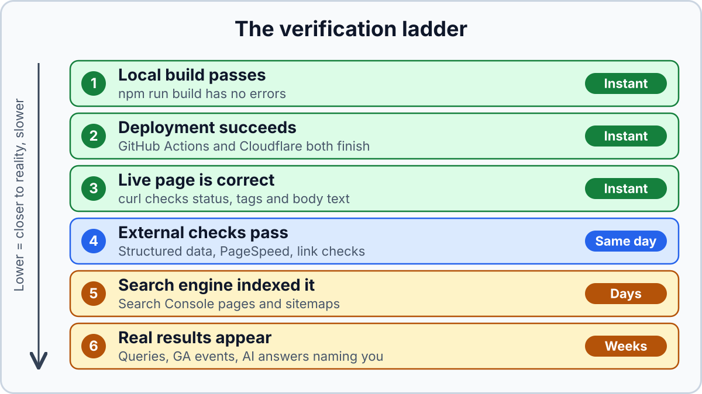

La [primera guía](/es-ES/blog/2026-11-23-mac-astro-site-claude-github-cloudflare/) te llevó desde un Mac limpio hasta un sitio Astro publicado. La [segunda guía](/es-ES/blog/2026-11-25-astro-site-google-analytics-search-console-seo-claude/) añadió Google Analytics, Search Console, el mapa del sitio, las etiquetas para redes sociales y el favicon. Ahora el sitio está publicado, puedes medirlo y, en teoría, los buscadores pueden encontrarlo.

Todavía le faltan dos cosas: un motivo para que los visitantes se queden y una forma de saber qué escribir a continuación. Ninguna de las dos tiene una respuesta definitiva de una sola vez. Necesitas un ciclo: observar la evidencia, decidir un cambio, hacerlo, demostrar que funciona y aprender del resultado.

Esta guía muestra cómo ejecutar ese ciclo con Claude Code, para que después puedas seguir avanzando por tu cuenta. No hay una lista fija de tareas; es una forma de trabajar que puedes repetir cada semana.

Al terminar, sabrás cómo:

1. Hacer que Claude recuerde tu sitio, para que cada sesión parta de información conocida.
2. Ejecutar un ciclo de ocho fases para cualquier mejora: explorar, planificar, investigar, ejecutar, verificar, publicar, medir y aprender.
3. Encontrar, revisar, instalar, probar y escribir tus propias habilidades (skills) de Claude.
4. Aplicar el ciclo a seis líneas de trabajo: investigación de mercado, contenido, idioma y región, SEO, visibilidad en IA y conversión.
5. Añadir nuevos idiomas y mercados regionales; esta guía usa Filipinas como ejemplo.
6. Mantener el ciclo seguro: fuentes, aprobaciones, privacidad y un ritmo razonable.

## Para quién es esta guía

Es para quien ya completó las dos guías anteriores: tienes un sitio Astro en un repositorio de GitHub que se despliega automáticamente con cada envío a `main`, Google Analytics y Search Console configurados, y Claude Code instalado.

El ejemplo supone que el sitio está en inglés, dirigido a visitantes de Filipinas, y que el dominio es `example.com`. Sustituye el mercado, el idioma y el dominio por los tuyos. El método no depende del país.

## Panorama general: un ciclo, seis líneas de trabajo

### El ciclo

Desde una página nueva hasta un idioma nuevo, cada mejora pasa por las mismas ocho fases.


| Fase | Qué hace Claude | Qué haces tú | Qué queda registrado |
| --- | --- | --- | --- |
| 1. Explorar | Lee el sitio y tus notas, audita la situación actual y no cambia nada | Decides qué problema es más importante | Un informe de auditoría |
| 2. Planificar | Propone un objetivo, pasos y una forma de comprobar el éxito | Apruebas, recortas o rechazas | Un archivo de plan |
| 3. Investigar | Reúne fuentes, compara opciones y marca lo que no está verificado | Compruebas algunas fuentes | Notas de investigación con fecha |
| 4. Ejecutar | Escribe contenido o código en pasos pequeños | Revisas los cambios | Cambios listos para verificar |
| 5. Verificar | Compila, previsualiza y ejecuta las comprobaciones | Revisas los resultados | Una lista de comprobaciones superadas |
| 6. Publicar | Hace commit, envía, espera el despliegue y revisa el sitio en producción | Apruebas la publicación | Una versión en línea |
| 7. Medir | Lee los datos que exportaste | Exportas los datos | Una instantánea de datos |
| 8. Aprender | Registra qué funcionó y qué probar después | Decides el siguiente objetivo | Notas y contexto actualizados |

Tres reglas mantienen el ciclo honesto.

1. **Un objetivo pequeño por vuelta.** Una página, un conjunto de títulos o un idioma. Las vueltas pequeñas son fáciles de verificar y fáciles de deshacer.
2. **Cada vuelta deja evidencia que se puede revisar.** Un archivo, una salida de comando, un número o un enlace. Si no puedes señalarlo, no ocurrió.
3. **Tú decides.** Claude explora, investiga, escribe y comprueba. Tú apruebas el plan antes de empezar y el resultado antes de publicarlo.

### Las seis líneas de trabajo

El ciclo es el motor; las cosas que quieres mejorar se dividen en seis líneas de trabajo. Todas comparten el mismo contexto: tus notas, reglas, habilidades y el repositorio.


Cada una de estas líneas tiene su propia sección más adelante. Primero, la base.

## Paso 1: Haz que Claude recuerde tu sitio

Claude no sabe nada de tu sitio al empezar cada sesión; sus archivos son su memoria. Dos tipos de archivos cumplen esa función:

- `CLAUDE.md` en la raíz del proyecto. Claude Code lo lee al iniciar la sesión, así que aquí van los hechos estables y las reglas.
- Notas con fecha en `research/` y `plans/`, que registran lo que aprendiste y lo que decidiste.

Una estructura de carpetas que funciona:

```text
my-astro-site/
├── CLAUDE.md          # Para quién es el sitio, tono, reglas, flujo de trabajo
├── research/          # Notas con fecha y fuentes, además de métricas exportadas
├── plans/             # Un plan corto por vuelta
├── src/               # El propio sitio
└── .claude/skills/    # Habilidades del proyecto (ver el paso 3)
```

Inicia Claude en la carpeta del proyecto y pídele que redacte el archivo. Claude Code también tiene el comando `/init`, que genera un primer `CLAUDE.md` a partir del repositorio. En cualquiera de los dos casos, ajusta el resultado a tu situación real.

```text
Crea CLAUDE.md para este sitio, y crea las carpetas vacías research/ y plans/, cada una con un README breve.

CLAUDE.md debe incluir:
- Para qué sirve el sitio, a quién se dirige y la única acción que queremos que realice el visitante.
- El mercado principal: Filipinas. Idioma: primero inglés; más adelante, filipino. La mayoría de los visitantes usa el móvil.
- Tono: sencillo, amable y concreto. Nada exagerado, sin cifras inventadas.
- Reglas: cada dato de una nota o de un contenido debe incluir la URL de origen y la fecha en que lo viste. Lo que no puedas verificar se marca como "no verificado". Nunca publicar sin que yo apruebe el plan y el resultado. Nunca poner datos personales de visitantes en las notas ni en los prompts.
- Flujo de trabajo: cambios pequeños, npm run build, commit, push a main, esperar a que se completen los dos despliegues y verificar el sitio en producción con curl.
- Dónde va cada tipo de archivo.

Muéstrame el archivo antes de guardarlo.
```

Comprobación: abre una sesión nueva de Claude y escribe "resume lo que sabes de este sitio". La respuesta debería coincidir con `CLAUDE.md`. Si no coincide, el problema está en que el archivo no es lo bastante claro, no en Claude.

## Paso 2: Las ocho fases en la práctica

### 1. Explorar

Empieza con una auditoría de solo lectura. No cambia nada, así que no hay nada que deshacer.

```text
Explora este sitio e informa. No modifiques ningún archivo.

Cubre: la lista de páginas y cómo se enlazan entre sí, el propósito de cada página, los títulos y descripciones, dónde aparecen las llamadas a la acción, qué eventos se registran y cualquier lugar que parezca escaso, duplicado o roto.

Guarda el informe en research/AAAA-MM-DD-audit.md y termina con las cinco cosas más valiosas para mejorar, ordenadas por prioridad y con su motivo.
```

### 2. Planificar

Cambia Claude Code al modo de planificación (pulsa Shift+Tab para cambiar de modo), para que pueda leer y proponer, pero no editar. Un buen plan cabe en una página.

```text
Con base en research/AAAA-MM-DD-audit.md, propón un objetivo para esta vuelta.

Escríbelo en plans/AAAA-MM-DD-goal.md e incluye:
- Objetivo: una frase.
- Motivo: evidencia de nuestras notas o datos.
- Pasos: cinco como máximo, cada uno lo bastante pequeño como para verificarlo.
- Criterios de aceptación: cómo sabremos que funciona, tanto lo que se ve justo después de publicar como lo que tardará semanas en verse.
- Lo que no haremos: lo que queda explícitamente fuera.
- Reversión: cómo deshacerlo.

Cuando termines el plan, detente y espera mi aprobación.
```

Esta es la primera aprobación. Recorta el plan hasta que puedas explicarlo de un vistazo.

### 3. Investigar

La investigación de mercado y de la competencia con IA se hace aquí, y es donde la IA más fácilmente te engaña, así que hay que darle reglas.

```text
Investiga para este plan la siguiente pregunta: ¿qué buscan y preguntan las personas en Filipinas cuando buscan [tu tema]? ¿Qué ofrecen los tres sitios competidores mejor posicionados?

Reglas:
- Usa solo páginas públicas. No inicies sesión en ningún sitio ni evites ninguna restricción.
- Cada afirmación debe incluir la URL de origen y la fecha en que la viste.
- Separa lo que encontraste en la página de lo que tú infieres.
- No inventes estadísticas. Si no encuentras una cifra, escribe "no verificado".
- Guarda el resultado en research/AAAA-MM-DD-topic.md, siguiendo esta plantilla.

Plantilla:
# Pregunta
# Hallazgos (afirmación, URL de origen, fecha de consulta, confianza: alta, media o baja)
# No verificado
# Qué cambia esto en el plan
```

Claude Code puede buscar en la web y leer páginas, y es posible que te pida aprobar esas herramientas. Cuando termine, abre tres de las fuentes y comprueba que realmente respaldan lo que dicen las notas. Si una sola no coincide, desconfía de toda la nota y pide a Claude que la rehaga.

Las preguntas reales de los clientes son la mejor materia prima para la investigación. Puedes poner preguntas de soporte o debates de la comunidad en `research/`, pero antes elimina nombres, correos y cualquier dato personal.

### 4. Ejecutar

Ahora Claude escribe según el plan, paso a paso.

```text
Haz solo el paso 1 de plans/AAAA-MM-DD-goal.md y nada más. Respeta CLAUDE.md. Ejecuta npm run build y, si pasa, muéstrame el diff.
```

Al escribir, primero pide un esquema, luego un borrador, y después revísalo y modifícalo tú. El borrador de la IA es solo un punto de partida. Lo que hace que una página valga la pena leer es lo que solo tú puedes aportar: precios reales, casos reales, tus propias capturas de pantalla y tu propia opinión. Esas partes tienes que ponerlas tú.

### 5. Verificar

La verificación es una escalera. Cada peldaño está más cerca del resultado real, pero tarda más en darlo.



Los niveles 1 a 3 se pueden completar en el momento y Claude puede hacerlos por ti. El nivel 4 se completa el mismo día con herramientas externas. Los niveles 5 y 6 dependen de los buscadores y de los visitantes, y pueden tardar días o semanas. Si no llegaste a un nivel, no digas que lo alcanzaste. "La compilación pasó" no significa "está publicado", y "está publicado" no significa "funciona".

```text
Verifica este cambio en tres niveles e informa de lo que comprobaste y de lo que no pudiste comprobar:
1. npm run build pasa sin errores.
2. Tras el despliegue, pide la URL en línea con curl y confirma el código de estado, el título, la descripción, el enlace canónico y todos los bloques JSON-LD.
3. Ejecuta Lighthouse o PageSpeed en la versión móvil de la página y enumera todo lo que obtenga menos de 90.
```

### 6. Publicar

Publicar es la segunda aprobación. Una vez que apruebas, Claude se encarga del trabajo mecánico y demuestra el resultado, igual que en las guías anteriores.

```text
Haz commit con un mensaje claro, envía a main, espera a que terminen el flujo de GitHub Pages y la compilación de Cloudflare, y luego pide la página en línea con curl para confirmar que el cambio ya está. Informa de cada comprobación.
```

En el caso de páginas nuevas importantes, abre Search Console, pega la URL en la herramienta de inspección de URL y solicita la indexación. Bing y otros buscadores también admiten el protocolo IndexNow para avisar de páginas nuevas. Google no usa IndexNow.

### 7. Medir

Claude no puede iniciar sesión en Google por ti. La forma más sencilla y fiable es exportar los datos tú mismo y guardarlos en el repositorio.

1. En Search Console, abre **Rendimiento**, establece el intervalo de fechas, filtra por país o región Filipinas y exporta las consultas y las páginas.
2. En Google Analytics, exporta el número de veces que se registraron los eventos clave.
3. Guarda ambos archivos en `research/metrics/` con la fecha en el nombre.

```text
Lee el archivo más reciente de research/metrics/ y compáralo con la instantánea anterior.

Escribe research/AAAA-MM-DD-metrics.md, que cubra: las consultas cuyas impresiones suben o bajan, las páginas con muchas impresiones y pocos clics, qué eventos se activaron y una hipótesis para cada cambio evidente. Indica siempre que cada hipótesis es una hipótesis.
```

En un sitio nuevo, los números serán pequeños. No sobreinterpretes cambios de unos pocos clics; fíjate en la dirección a lo largo de varias semanas.

### 8. Aprender

La última fase es la que más personas se saltan, y es la que hace que el ciclo se acumule.

```text
Cierra esta vuelta. Actualiza CLAUDE.md o las notas de investigación con lo que deben saber las próximas vueltas: qué probamos, qué dice la evidencia, qué no volveremos a probar y por qué. Después propón el siguiente objetivo con su evidencia y detente.
```

## Paso 3: Habilidades: encontrar, revisar, probar, crear y compartir

Una habilidad es una carpeta con un archivo `SKILL.md` que enseña a Claude a realizar una tarea repetible. Al principio del archivo hay un pequeño bloque de metadatos (front matter) con `name` y `description`, seguido de instrucciones detalladas. Claude usa la descripción para decidir cuándo aplicar la habilidad, y tú también puedes invocarla directamente escribiendo `/skill-name`.


Las habilidades pueden estar en tres ubicaciones:

| Ámbito | Ubicación | Cuándo usarla |
| --- | --- | --- |
| Personal | `~/.claude/skills/<name>/SKILL.md` | Hábitos personales que usas en todos los proyectos |
| Proyecto | `.claude/skills/<name>/SKILL.md` | Flujos fijos de este sitio, compartidos mediante git |
| Plugin | Instalado con `/plugin` | Habilidades empaquetadas y mantenidas por otra persona |

Claude Code vigila las carpetas de habilidades personales y de proyecto, así que las nuevas suelen aparecer en la sesión actual. Si no aparecen, ejecuta `/reload-skills`. Escribe `/skills` para ver las habilidades disponibles.

### Encontrar

Puedes buscar en tres lugares: el mercado de plugins (abre `/plugin` para explorarlo y usa `/plugin marketplace add owner/repo` para añadir un mercado), los directorios de habilidades de la comunidad y los repositorios de GitHub. Existen colecciones de habilidades para trabajo de marketing, como auditorías SEO, edición de textos, investigación de la competencia y optimización para búsqueda con IA. Un ejemplo público es el repositorio `coreyhaines31/marketingskills`, que incluye `seo-audit` y `ai-seo`. Es obra de terceros, así que trátalo como cualquier código que no escribiste tú.

### Revisar

Una habilidad son instrucciones, y a veces incluye scripts que se ejecutan en tu máquina. Léela antes de instalarla.

```text
Quiero evaluar las habilidades seo-audit y ai-seo del repositorio coreyhaines31/marketingskills. Por ahora no instales nada.

Lee cada SKILL.md y todos los scripts o archivos de referencia que incluya, y luego dime:
- Qué hace la habilidad, en dos frases.
- Qué herramientas o comandos necesita ejecutar, incluidos los comandos de shell.
- Si lee o escribe archivos fuera de este proyecto, o si hace peticiones de red.
- Cualquier cosa que parezca no tener relación con su propósito declarado.

Después recomiéndame si debo instalarla.
```

Tu lista de revisión: saber de dónde viene, haber leído el `SKILL.md`, no tener scripts que no entiendas, no tener accesos de red inesperados y tener un propósito único y claro.

### Instalar y probar

Instálala primero en el ámbito del proyecto, para no afectar a tu trabajo en otros lugares. Usa los comandos exactos del README del repositorio, o pide a Claude que lo haga y te muestre el comando que ejecuta.

Después pruébala con una tarea real y compara:

```text
Audita la página principal y un artículo del blog. Primero responde sin usar ninguna habilidad. Después repite la misma auditoría con la habilidad seo-audit. Compara los dos informes: ¿qué problemas encontró la habilidad que la respuesta normal pasó por alto y dónde se equivocó o rellenó texto sin aportar nada? Guarda la comparación en research/.
```

Si la habilidad no se activa sola, invócala directamente con `/seo-audit` y revisa si su `description` deja claro cuándo se aplica.

### Crear tus propias habilidades

Cada flujo que repites es una habilidad que todavía no has escrito. La siguiente publica un artículo y demuestra que está en línea. Como publicar tiene efectos secundarios, define `disable-model-invocation: true`, de modo que solo se ejecuta cuando escribes `/publish-post`.

```markdown
---
name: publish-post
description: Publish a finished blog post on this site and prove it is live. Use when the user asks to publish, ship or release a post.
disable-model-invocation: true
---

Publica el artículo que indique el usuario.

1. Ejecuta `npm run build`. Si falla, detente.
2. Comprueba que el front matter tenga título, descripción y fecha.
3. Haz commit con un mensaje claro y envía a `main`.
4. Espera los dos despliegues: primero `gh run watch`, luego la compilación de Cloudflare.
5. Pide la URL en línea con `curl -s` y confirma que el título, la descripción y los bloques JSON-LD existen.
6. Informa de lo que comprobaste y de lo que no pudiste comprobar.
```

Guárdala como `.claude/skills/publish-post/SKILL.md` y haz commit: pasa a formar parte del proyecto. Las siguientes候选 para convertir en habilidad son el informe semanal de métricas, la actualización de la competencia y la comprobación de hreflang.

### Compartir

Las habilidades del proyecto se comparten mediante commits. Para compartirlas entre varios sitios o con otras personas, empaquétalas como plugin y publica un archivo de mercado. La documentación de plugins de Claude Code explica cómo hacerlo: [documentación de plugins de Claude Code](https://code.claude.com/docs/en/discover-plugins). Para todas las opciones del front matter, consulta la [documentación de habilidades](https://code.claude.com/docs/en/skills).

## Paso 4: Ejecutar el ciclo en las seis líneas de trabajo

Todas empiezan igual: el siguiente prompt general, que hace que Claude ejecute una vuelta del ciclo en la línea de trabajo que elijas.

```text
Haz una vuelta de mejora para este sitio, centrada en [línea de trabajo].

1. Lee CLAUDE.md y los archivos más recientes de research/ y plans/.
2. Propón un objetivo para esta vuelta y la evidencia que lo respalda. Detente y espera mi aprobación.
3. Cuando apruebe, escribe primero el archivo del plan, luego investiga, después ejecuta y por último verifica. Detente antes de publicar y muéstrame el resultado.
4. Cuando apruebe la publicación, publica y verifica el sitio en línea.
5. Registra lo que aprendimos y propón el siguiente objetivo.
```

El flujo de la información en el ciclo es siempre el mismo: las fuentes se convierten en conocimiento, el conocimiento se convierte en páginas, las páginas generan conversiones y los datos de conversión vuelven a las fuentes.


### A. Investigación de mercado y de la competencia

- **Objetivo:** saber a quién sirves, qué preguntan y qué ofrecen las alternativas.
- **Entradas:** consultas de Search Console, preguntas de clientes, páginas públicas de la competencia y las respuestas que dan los asistentes de IA sobre tu tema.
- **Ejemplo de vuelta:** "Compara cómo tres competidores explican sus precios y qué no dicen."
- **Comprobación:** cada afirmación tiene fuente y fecha, y abriste tres de las fuentes.
- **Resultado:** una nota de investigación que alimenta el plan de contenido.

### B. Contenido y páginas de preguntas y respuestas

- **Objetivo:** responder preguntas reales mejor que las alternativas.
- **Método:** una página por pregunta real, con la respuesta directa en el primer párrafo y los detalles después. Añade páginas que expliquen los hechos con claridad: qué ofreces, cómo funciona, cuánto cuesta y qué limitaciones tiene. Para preguntas del tipo "A o B", crea páginas comparativas.
- **Las preguntas deben tener origen:** provienen de Search Console, mensajes de clientes, debates de la comunidad y respuestas de asistentes de IA. No inventes preguntas para rellenar una plantilla.
- **No produzcas páginas en serie.** Los buscadores tienen políticas claras contra grandes volúmenes de contenido generado de poco valor. Unas pocas buenas páginas valen más que cien superficiales.
- **Comprobación:** cada página tiene un propósito, cada hecho tiene fuente y contiene algo que solo tú podrías escribir.

### C. Idioma y región (con Filipinas como ejemplo)

Primero define el mercado y el idioma, luego ejecuta dos líneas en paralelo y verifica ambas al final.


**Línea técnica.** Asigna a cada idioma y región su propia ruta de URL, por ejemplo `/en-ph/` para inglés en Filipinas. Enlaza cada versión con todas las demás mediante `hreflang`. Las reglas de Google son concretas:

- El idioma es un código ISO 639-1 y la región opcional es un código ISO 3166-1 alpha-2, por ejemplo `en-PH`. Solo se admiten códigos de idioma ISO 639-1, así que `fil` no es válido para el filipino. Si añades una versión en filipino, usa `tl` (tagalo) como `tl-PH`, y comprueba su rendimiento en Search Console.
- Cada versión debe enumerarse a sí misma y a todas las demás. Si la página X apunta a la página Y, la página Y debe apuntar de vuelta a X; si no, esas etiquetas se ignoran.
- Añade una entrada `x-default` para los visitantes que no coincidan con ninguna versión.
- Puedes declararlo todo en el `head` de la página, en las cabeceras HTTP o en el mapa del sitio.

Astro incluye enrutado internacional, y su integración de mapa del sitio también puede escribir las alternativas de idioma en el mapa. Pide a Claude que consulte la documentación de la versión que tienes instalada, en lugar de adivinar.

```text
Añade la versión en inglés (Filipinas) del sitio bajo la ruta /en-ph/, y prepara el terreno para una futura versión en filipino en /tl-ph/. Usa el enrutado i18n de Astro y consulta la documentación actual de la versión que tenemos instalada. Además:
- Añade enlaces alternativos hreflang en cada página que tenga varias versiones, incluido el enlace a sí misma y x-default.
- Haz que el mapa del sitio liste cada versión de idioma con sus alternativas.
- Añade un selector de idioma visible. No redirijas automáticamente a los visitantes según su dirección IP.
- Compila, haz commit, envía, espera el despliegue y luego pide con curl las dos páginas e imprime sus enlaces hreflang para demostrar que cada una apunta a su versión correspondiente.
```

**Línea de contenido.** Traducir no es localizar. En el caso de Filipinas, confirma lo siguiente con tus propios análisis y los comentarios de clientes, sin dar nada por supuesto:

- Precios en pesos (₱), números de teléfono en formato `+63` y hora de Filipinas (UTC+8).
- Los canales de contacto y pago que la gente realmente usa, por ejemplo Facebook Messenger o Viber, y pagos con GCash o Maya.
- Que las páginas carguen rápido en el móvil y con conexiones lentas. La mayoría de los visitantes suele usar el teléfono.
- Que el lenguaje sea el que la gente realmente usa, que a menudo mezcla inglés y filipino. Pide a un hablante nativo que revise el texto en filipino de las páginas clave. En páginas que buscan cerrar una venta, la traducción automática por sí sola no basta.
- Una declaración de privacidad clara. En Filipinas rige la Ley de Privacidad de Datos de 2012 (Republic Act 10173), aplicada por la National Privacy Commission. Revisa el sitio web de la comisión para saber qué requisitos afectan a tu sitio. Además, muestra la información real de tu negocio, como el nombre registrado y los datos de contacto, en un lugar que los visitantes puedan encontrar. Esta es información general y no constituye asesoramiento legal.

**Verificación conjunta.** Tras el despliegue, usa `curl` para confirmar que los enlaces hreflang se apuntan entre sí; revisa en Search Console los problemas de hreflang e indexación en las nuevas rutas; prueba la página en un teléfono de gama media; y haz a un asistente de IA la pregunta que quieres que te encuentre, con el tono de un hablante local, para ver si apareces.

### D. SEO

Usa el mismo ciclo para una auditoría mensual. La segunda guía sentó las bases: mapa del sitio, enlaces canónicos, metadatos y datos estructurados. El trabajo mensual consiste en detectar lo que se ha desviado o se ha pasado por alto.

```text
Audita el SEO del sitio y guarda una lista priorizada en research/AAAA-MM-DD-seo.md. Revisa: páginas que faltan en el mapa del sitio, títulos y descripciones duplicados o ausentes, enlaces internos rotos, páginas que no reciben ningún enlace interno, imágenes sin texto alternativo y las páginas más lentas en móvil. No arregles nada todavía. Dime las tres correcciones más valiosas según su impacto esperado.
```

Arregla tres cosas, verifica, publica y sigue avanzando. No persigas la perfección.

### E. Visibilidad en IA

Los asistentes de IA y las funciones de búsqueda con IA responden leyendo y resumiendo páginas web. No puedes garantizar que te mencionen, pero sí hacer que tus páginas sean más fáciles de encontrar, entender y en las que confiar.

- **Permite los rastreadores adecuados.** Las empresas de IA publican los nombres de sus rastreadores, y algunas separan el rastreo para búsqueda o por acción del usuario del rastreo para entrenamiento de modelos. Consulta la documentación actual de cada empresa y decide qué debe permitir tu `robots.txt`. Una opción razonable es permitir los rastreadores de búsqueda y tratar de forma distinta los de entrenamiento.
- **Escribe pensando en las respuestas.** Usa títulos en forma de pregunta, responde primero de forma directa, aporta datos concretos con cifras y fechas, y compara con tablas claras.
- **Mantén coherente tu identidad.** Usa el mismo nombre, descripción y enlaces en todas partes, añade datos estructurados `Organization` con un enlace a la página oficial y mantén una página "Sobre nosotros" con autores reales.
- **Gana menciones en otros sitios.** Las reseñas, los debates de la comunidad y los directorios suelen ser las fuentes que citan los asistentes. Esto está directamente relacionado con el trabajo de comunidad y de divulgación.
- **`llms.txt` es opcional.** Es un archivo propuesto para que los modelos de lenguaje resuman tu sitio. Hoy no hay pruebas sólidas de que los principales productos de búsqueda con IA dependan de él, así que tómalo como un complemento de bajo coste, no como una prioridad.
- **Mide preguntando.** Mantén una lista fija de 10 a 20 preguntas, incluidas las formas en que las usan los usuarios de Filipinas. Cada mes, pregúntalas a varios asistentes, anota si te mencionan y qué fuentes citan, y revisa en Google Analytics el tráfico de referencia procedente de productos de IA.

```text
Crea research/ai-answer-checks.md con 15 preguntas que haría un visitante de Filipinas sobre nuestro tema, redactadas de forma natural. Incluye estas columnas: asistente, fecha, si nos mencionó y qué fuente citó. Después audita el sitio frente a los puntos de visibilidad en IA de esta guía y enumera las tres brechas más grandes.
```

### F. Conversión y crecimiento del negocio

- **Elige una conversión principal.** Una suscripción, una consulta, una descarga o una compra. Todo lo demás existe para apoyarla.
- **Vincúlala a eventos.** Usa el seguimiento de eventos de la segunda guía para ver cuántas personas llegan y dónde abandonan.
- **Una llamada a la acción clara por página.** Pon el canal de contacto que la gente prefiere en un lugar fácil de alcanzar, por ejemplo un enlace de Messenger.
- **Cambia una sola cosa a la vez.** Claude puede proponer hipótesis y escribir versiones alternativas; tú decides cuál probar. Las pruebas significativas necesitan tráfico real, así que en un sitio pequeño es mejor hacer mejoras claras y observar la tendencia.
- **Cuida la privacidad.** Antes de recoger datos de contacto, añade el consentimiento y la declaración de privacidad.

```text
Propón tres hipótesis de conversión para la página principal. Para cada una indica: qué cambiaría, en qué evidencia se basa, qué evento mostrará si funciona y qué cifra definiría el éxito. No construyas nada hasta que yo elija una.
```

## Paso 5: Ritmo y salvaguardas

### Un ritmo razonable

| Cuándo | Qué hacer |
| --- | --- |
| Después de cada publicación | Verifica las páginas en línea. Solicita la indexación de las páginas nuevas importantes. |
| Cada semana | Exporta los datos de Search Console y Analytics, ejecuta las fases de medir y aprender, y elige un objetivo. |
| Cada mes | Auditoría SEO, comprobación de respuestas de IA, actualización de las notas de la competencia y revisión de las habilidades que realmente usaste. |
| Cada trimestre | Revisa las suposiciones sobre la audiencia y el mercado, elimina o fusiona las páginas débiles y decide si añades otro idioma. |

La parte de lectura de datos puede automatizarse. Claude Code tiene un modo no interactivo, `claude -p "prompt"`, que puedes ejecutar desde un programador de tareas. Limita las herramientas que puede usar y permite que escriba solo en `research/`. Mantén la publicación manual.

### Salvaguardas

- **Los hechos necesitan fuentes.** Sin fuente, no hay afirmación. Revisa siempre algunas.
- **Dos aprobaciones.** Aprueba el plan antes de empezar y el resultado antes de publicar.
- **Mínimo privilegio.** No des a Claude más acceso del que la tarea necesita. Revisa las habilidades antes de instalarlas.
- **No incluyas datos personales.** No pegues datos personales de visitantes o clientes en los prompts ni en las notas.
- **Calidad antes que cantidad.** Cien páginas generadas que no dicen nada pueden perjudicar a todo el sitio.
- **Corta a tiempo y aprende.** Si una vuelta falla, escribe por qué, revierte el cambio y sigue adelante. Un fracaso documentado también es progreso.

## Preguntas frecuentes

- **Los números de investigación de Claude no coinciden con lo que encuentro.** Trátalos como no verificados. Pide la URL de origen y la fecha de cada cifra, y vuelve a comprobarla. Si no se puede respaldar, elimina la afirmación.
- **La habilidad no se activa.** Revisa si su `description` deja claro cuándo usarla, invócala con `/skill-name` directamente o ejecuta `/reload-skills` si es nueva. Las habilidades con `disable-model-invocation: true` solo se ejecutan cuando tú las invocas.
- **Claude olvida cosas entre sesiones.** Es normal. Pon lo importante en `CLAUDE.md` o en `research/`.
- **Mi tráfico es demasiado bajo para ver resultados.** Alarga el periodo de observación y apóyate sobre todo en los niveles 1 a 4 de la escalera. Añade comprobaciones cualitativas: pregunta a cinco usuarios reales o lee los mensajes de tus clientes.
- **hreflang no parece funcionar.** Comprueba que cada versión se enlace a sí misma y a todas las demás, que los códigos sean válidos y que las URL sean absolutas y devuelvan 200.
- **Ningún asistente de IA menciona mi sitio.** Es normal en un sitio nuevo. Sigue creando páginas que respondan preguntas reales, gana menciones en otros lugares y mide continuamente con la misma lista de preguntas.

## Qué puedes hacer esta semana

1. Crea `CLAUDE.md`, `research/` y `plans/` (paso 1).
2. Ejecuta una vuelta de exploración y planificación, y elige un objetivo (paso 2).
3. Elige una línea de trabajo del paso 4 y ejecuta el prompt general sobre ella.
4. Convierte en habilidad de proyecto un flujo que acabas de repetir.

El patrón es el mismo que al final de las dos guías anteriores: describe el estado final, deja que Claude haga los cambios, que los envíe y espere, demuestra el resultado en el sitio en línea y confírmalo con herramientas externas. Esta guía solo añade la investigación al principio y el aprendizaje al final, y después vuelve a empezar.
