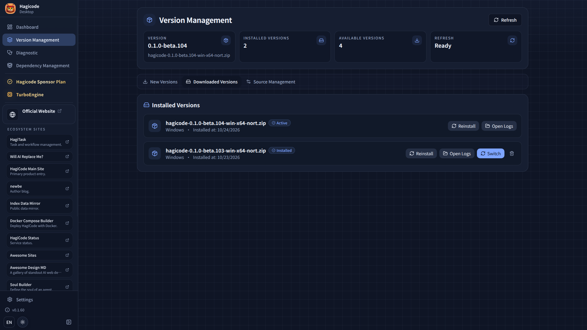
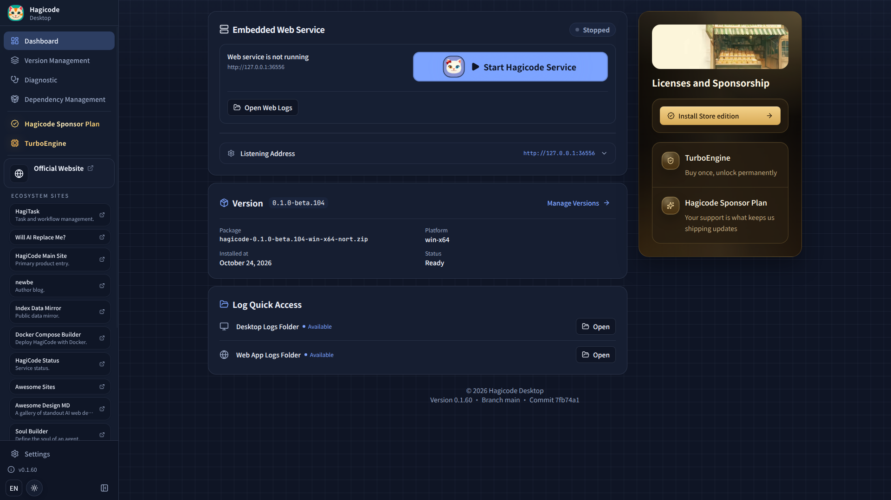

import { LinkCard, CardGrid } from '@astrojs/starlight/components';
import InstallButton from '../../../components/InstallButton';

本页说明如何安装和使用 Hagicode Desktop。它是官方桌面客户端，负责把默认本地安装流程与日常管理入口放到同一处。

:::tip[推荐方式]
macOS、Linux 以及不走商店的 Windows 用户，个人本地使用时推荐 Desktop：
- 首次启动引导会把下载与启动流程串起来
- Hagicode Server 的启动、停止与版本由程序统一管理
- 图形界面更方便查看状态与操作
- 内置版本管理，便于切换不同版本
- 默认数据留在本地，便于自行控制

Windows 用户请优先考虑 [Microsoft Store 安装](/installation/windows-store)。
:::

## 什么是 Hagicode Desktop

Hagicode Desktop 是 Hagicode 的官方桌面应用程序，支持 Windows、macOS 和 Linux。它负责下载、启动和管理本机的 Hagicode Server，并提供版本管理与日常操作入口。

### 主要优势

- **内置 .NET 运行时**：运行 Hagicode Server 所需的 `.NET` 已随 Desktop 提供，无需单独安装
- **服务管理**：内置 Hagicode Server 管理，轻松启动和停止服务
- **版本切换**：支持多版本管理，可在不同版本之间自由切换
- **本地运行**：所有数据存储在本地，保护您的隐私
- **版本检测**：自动检测可用的新版本

### 适用场景

这些场景可优先用 Desktop：
- 个人开发者希望在本地使用 Hagicode
- 希望数据和项目都留在自己机器上的用户
- 偏好图形界面、不想手写部署配置的用户
- 需要频繁切换不同版本的开发者

## 安装前准备

Desktop **不内置 Node.js**，也不再提供内部的 Node 运行环境。它会使用系统 `PATH` 中的 `node` 与 `npm`，并把 Agent CLI 等托管包安装到本机 npm 的全局目录。开始之前请先准备：

| 依赖 | 要求 | 说明 |
| --- | --- | --- |
| Node.js | **24 或更高版本** | 同时提供 `npm`，参见 [安装 Node.js](/related-software-installation/nodejs/installation) |
| Git | 任意当前稳定版本 | 启动时会检测；“新建项目”对话框里的“演示项目”需要用它克隆示例仓库，参见 [安装 Git](/installation/#安装-git) |
| Agent CLI | 至少一个，并已登录 | 向导只会列出本机已检测到的 CLI，参见 [AI Agent CLI 安装](/related-software-installation/ai-agent-cli/) |

先在终端确认版本：

```bash
node --version   # 需要 v24.0.0 或更高
npm --version
git --version
```

:::caution[装好之后再启动，或重启 Desktop]
Desktop 在启动时读取系统 `PATH`。如果在 Desktop 已打开时才安装 Node.js 或 Git，请完全退出并重新启动 Desktop，再刷新依赖页面。
:::

## 下载 Desktop

### 快速下载

Windows 用户推荐优先使用 Microsoft Store 安装；只有在您需要手动安装包、指定版本文件或 Store 不可用时，再使用下方的手动下载入口。

选择适合您操作系统的版本，直接下载安装程序：

{/* 使用 client:visible 指令确保组件在可见时进行客户端水合，避免 SSR 阶段的 React Hooks 错误 */}
<InstallButton variant="full" client:visible />

:::note[下载列表加载失败时]
如果这里暂时无法加载 Desktop 安装包列表，安装入口不会给出无效的下载链接，而是引导您前往官方版本历史页：[index.hagicode.com/desktop/history](https://index.hagicode.com/desktop/history/)。您可以在那里选择版本并下载安装包；也可以直接使用下方的 GitHub Releases。
:::

### 其他获取方式

您还可以从以下渠道获取 Hagicode Desktop 安装程序：

1. **Windows 默认推荐**：访问 [Microsoft Store 安装](/installation/windows-store) 走官方商店分发渠道
2. **官方发布页面**：访问 [Hagicode GitHub Releases](https://github.com/Hagicode-org/releases/releases) 下载手动安装包
3. **官方网站**：访问 [Hagicode 官网](https://www.hagicode.com/) 获取下载链接与安装说明

### 选择正确的版本

根据您的操作系统选择对应的安装程序：

- **Windows**：优先使用 Microsoft Store；如需手动安装文件，再下载 `.exe` 安装程序或 `.msix` 安装包
- **macOS**：下载 `.dmg` 安装程序
- **Linux**：下载 `.AppImage` 或 `.tar.gz` 安装包

:::note[系统要求]
- **Windows**：Windows 10 或更高版本（64 位）
- **macOS**：macOS 10.15 或更高版本
- **Linux**：主流 Linux 发行版（Ubuntu 20.04+、Fedora 33+ 等）
:::

:::tip[需要自行准备的依赖]
Desktop 已内置运行 Hagicode Server 所需的 `.NET` 运行时，并按当前支持的本地 SQLite 路径完成默认初始化，您无需单独安装 `.NET`。但 **Node.js 24+ 与 Git 需要您自行安装**，详见上文的[安装前准备](#安装前准备)。
:::

## 安装与启动提示

:::caution[macOS Gatekeeper 提示]
如果您已经将应用安装到默认路径 `/Applications/Hagicode.app`，但首次启动时看到"应用已损坏"、"无法打开"或类似 Gatekeeper 提示，通常是因为 macOS 为从互联网下载的应用附加了 `com.apple.quarantine` 隔离属性，而不是 Hagicode Desktop 安装向导本身出错。

您可以在终端执行以下命令。该命令需要管理员权限，会递归移除默认安装路径上应用的 quarantine 属性：

```bash
sudo xattr -dr com.apple.quarantine /Applications/Hagicode.app
```

执行完成后，请重新启动 Hagicode Desktop。
:::

## 运行 Desktop

下载完成后，打开安装程序或应用包完成安装，再启动 Hagicode Desktop。

:::note[网络要求]
确保您的网络连接正常。Desktop 需要从互联网获取版本信息和 Hagicode Server 安装包；如果下载失败，请检查网络、代理或防火墙设置后重试。
:::

## 首次启动引导

第一次打开 Desktop 时，会先进入 Desktop 自带的“首次使用引导”。它只负责把 Hagicode Server 装好并启动，依次包括：

1. **选择语言**：选择 Desktop 使用的语言。首次启动内置后端时，也会采用对应的默认语言。
2. **欢迎**：了解本次引导会完成的准备工作。
3. **确认法律文档**：确认当前版本的 EULA 与隐私政策，正式文档会在浏览器中打开阅读。
4. **下载 Hagicode Server**：下载最新的 Server 安装包并校验其摘要。

下载完成后回到 Desktop 首页，点击“启动 Hagicode 服务”即可启动 Hagicode Server，随后按首页提示打开 Web 界面。

:::note[步骤可能不完整]
部分分发渠道（例如已随安装包提供 Server 的版本），或在版本更新后只需重新确认法律文档时，引导只会显示其中的部分步骤。
:::

## 首次使用 Web 界面

首次进入 Web 界面后，会出现 **初始化向导**（与上面的 Desktop 首次使用引导是两件不同的事）。它会带您选择界面语言与主题、设置默认 Hagicoder、创建第一个项目。详细步骤请阅读：

<CardGrid>
  <LinkCard
    title="初始化向导设置"
    href="/quick-start/wizard-setup"
    description="完成语言、主题、默认 Hagicoder 与第一个项目的设置。"
  />
</CardGrid>

## 版本管理

Hagicode Desktop 支持多版本管理，您可以在不同版本之间自由切换。



### 切换版本

1. 打开 Hagicode Desktop
2. 进入"版本管理"页面
3. 打开"已下载版本"标签页
4. 在已安装版本中找到要切换的版本
5. 点击该版本右侧的"切换"按钮
6. 等待切换完成

:::note[版本切换注意事项]
- 切换版本会自动重启 Hagicode Server
- 确保在切换前保存所有工作
- 不同版本的项目配置可能会有差异
:::

## 启动和停止服务

Hagicode Desktop 提供了简单的方式来管理 Hagicode Server 服务。

### 启动服务

在 Desktop 应用程序的首页，点击"启动 Hagicode 服务"按钮即可启动 Hagicode Server。



### 停止服务

要停止 Hagicode Server，点击首页的"停止服务"按钮。

:::tip[服务状态]
Desktop 应用程序会实时显示 Hagicode Server 的运行状态，包括：
- 服务状态（运行中/已停止）
- 服务端口号
- 当前版本信息
:::

## 后续步骤

安装完成后，您可以继续以下步骤：

<CardGrid>

<LinkCard title="初始化向导设置" href="/quick-start/wizard-setup"
    description="首次启动后请在这里完成项目创建，并进入当前规范的快速开始链路。"
/>

<LinkCard title="创建普通会话" href="/quick-start/conversation-session"
    description="在默认只读模式下理解项目，再按需切换到编辑模式。"
/>

<LinkCard title="创建提案会话" href="/quick-start/proposal-session"
    description="了解提案驱动开发工作流，将抽象想法转化为结构化的实施计划。"
/>

</CardGrid>

## 故障排除

### 安装失败

如果安装过程中遇到问题：

1. **检查网络连接**：确保能够访问互联网
2. **检查磁盘空间**：确保有足够的磁盘空间
3. **以管理员身份运行**：在 Windows 上，右键点击安装程序，选择"以管理员身份运行"
4. **查看安装程序提示**：记下安装程序给出的错误信息，提交问题时一并附上

### 找不到 Node.js、npm 或 Git

如果 Desktop 提示缺少 `node`、`npm` 或 `git`，或提示 Node.js 版本过低：

1. **确认已安装**：在终端运行 `node --version`、`npm --version`、`git --version`。Node.js 需要 24 或更高版本，安装方法见 [安装 Node.js](/related-software-installation/nodejs/installation) 与 [安装 Git](/installation/#安装-git)。
2. **重启 Desktop**：Desktop 在启动时读取系统 `PATH`。安装后请完全退出并重新启动 Desktop，再刷新依赖页面。
3. **检查 PATH**：在终端能运行但 Desktop 找不到时，通常是 `PATH` 只在某个 shell 配置里生效（例如通过 nvm 或 fnm 在 `.bashrc` / `.zshrc` 中设置）。请改用系统级安装，或确保从能读到该 `PATH` 的环境启动 Desktop。
4. **手动安装 CLI 包**：Desktop 提示需要手动安装 CLI 包时，请在 Desktop 之外的终端执行它给出的命令，完成后回到 Desktop 刷新。关于外部 Node / npm 环境与 `PATH` 的行为，见 [Desktop 如何使用你的 Node 环境](/faq/desktop-node-environment)。

### 服务启动失败

如果 Hagicode Server 无法启动：

1. **检查端口占用**：Desktop 默认使用端口 **36556**（首页会显示当前实际端口），请确保它未被其他程序占用
2. **检查防火墙设置**：确保防火墙允许 Hagicode Server 访问网络
3. **重启应用程序**：尝试重启 Hagicode Desktop
4. **查看日志**：在 Desktop 应用程序中查看详细的错误日志

### 需要更多帮助？

如果您遇到此处未涵盖的问题：

1. 查看 [Desktop 的 GitHub Issues](https://github.com/HagiCode-org/desktop/issues) 寻找类似问题
2. 访问我们的[社区论坛](https://github.com/HagiCode-org/site/discussions)寻求帮助
3. 提交新的 Issue，详细描述您的问题，并附上系统版本、`node --version` 与 Desktop 日志
