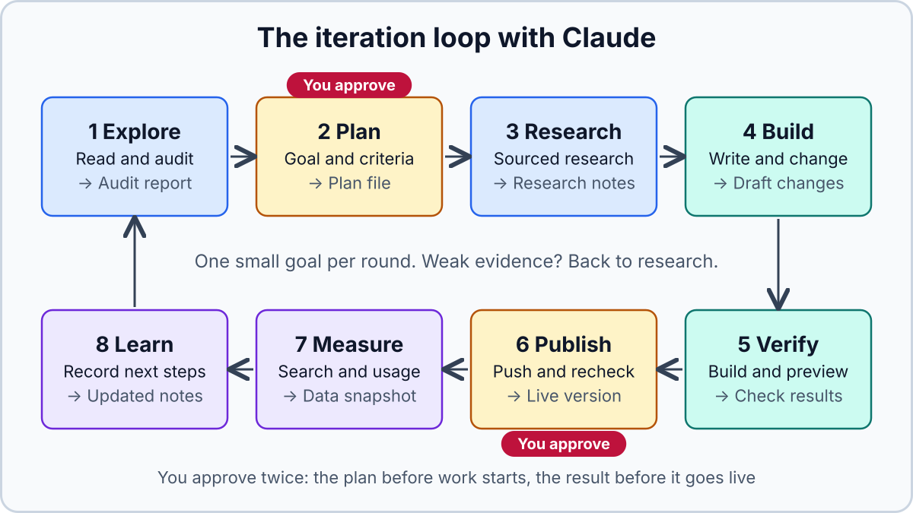
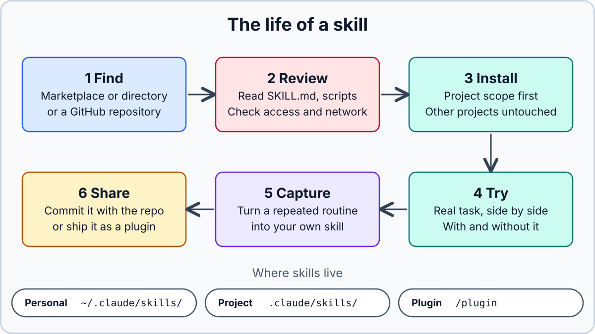
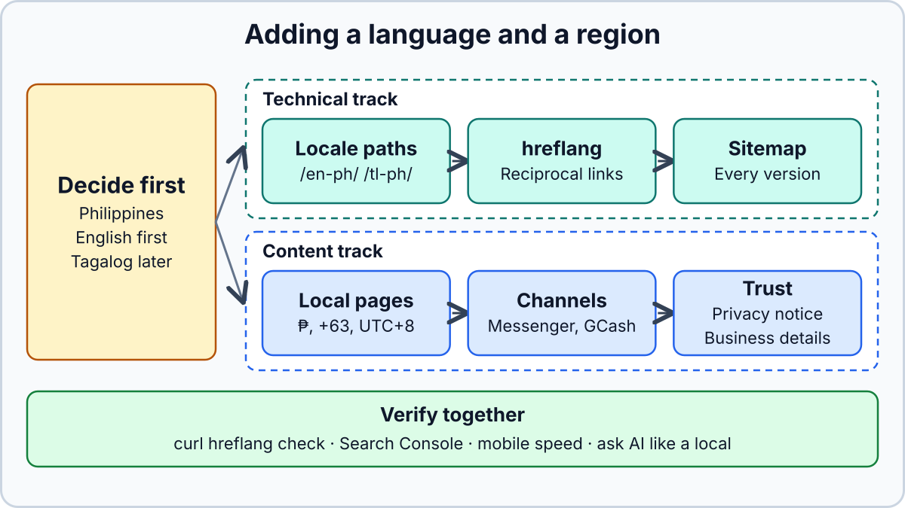

[第 1 回のガイド](/ja-JP/blog/2026-11-23-mac-astro-site-claude-github-cloudflare/)では、まっさらな Mac から公開できる Astro サイトを作りました。[第 2 回のガイド](/ja-JP/blog/2026-11-25-astro-site-google-analytics-search-console-seo-claude/)では、Google Analytics、Search Console、サイトマップ、ソーシャルタグ、favicon を設定しました。サイトは公開され、計測もでき、理屈の上では検索エンジンに見つけてもらえる状態になっています。

それでも、まだ 2 つ足りないものがあります。訪問者がとどまる理由と、次に何を書けばよいかを知る方法です。どちらも一度で答えが出る問題ではありません。証拠を見て、改善を一つ決め、作り、効果を確かめ、結果から学ぶ、というループが必要です。

このガイドでは、そのループを Claude Code で回す方法を紹介します。読み終えたあとは、自分の力で継続的に改善を進められるようになります。ここに固定のチェックリストはありません。毎週繰り返せる作業の進め方です。

このガイドを読むと、次のことができるようになります。

1. Claude にサイトのことを覚えさせ、どのセッションも既知の情報から始められるようにする。
2. どんな改善にも 8 つのフェーズのループを回す：探索、計画、調査、実行、検証、公開、計測、学習。
3. 自分用の Claude スキルを探し、レビューし、インストールし、テストし、書く。
4. このループを 6 つの作業ラインに適用する：市場調査、コンテンツ、言語と地域、SEO、AI の可視性、コンバージョン。
5. 新しい言語や地域市場を追加する。このガイドではフィリピンを例にします。
6. ループを安全に保つ：情報源、承認、プライバシー、適切なペース。

## このガイドの対象者

前の 2 つのガイドを終えている方が対象です。GitHub リポジトリにある Astro サイトがあり、`main` へのプッシュごとに自動デプロイされ、Google Analytics と Search Console を設定済みで、Claude Code をインストールしている状態を想定しています。

例では、サイトは英語で、フィリピンの訪問者を対象とし、ドメインは `example.com` だと仮定します。市場、言語、ドメインは自分のものに置き換えてください。この方法は国に依存しません。

## 全体像：1 つのループと 6 つの作業ライン

### ループ

新しいページから新しい言語まで、どの改善も同じ 8 つのフェーズを通ります。



| フェーズ | Claude がすること | あなたがすること | 残るもの |
| --- | --- | --- | --- |
| 1. 探索 | サイトとメモを読み、現状を監査する。何も変更しない | 最も重要な問題を決める | 監査レポート |
| 2. 計画 | 一つの目標、手順、成功の確かめ方を提案する | 承認、削減、または却下 | 計画ファイル |
| 3. 調査 | 情報源を集め、選択肢を比較し、未確認の内容に印を付ける | 情報源を抜き取りで確認する | 日付入りの調査メモ |
| 4. 実行 | 小さなステップに分けてコンテンツやコードを書く | 変更をレビューする | 検証待ちの変更 |
| 5. 検証 | ビルド、プレビュー、チェックを実行する | 結果を確認する | 合格したチェックリスト |
| 6. 公開 | コミット、プッシュ、デプロイの完了を待ち、公開サイトを確認する | 公開を承認する | 公開されたバージョン |
| 7. 計測 | あなたがエクスポートしたデータを読む | データをエクスポートする | データのスナップショット |
| 8. 学習 | 何が効いたか、次に何を試すかを記録する | 次の目標を決める | 更新されたメモとコンテキスト |

このループを誠実に保つ規則は 3 つです。

1. **1 回のループでは小さな目標を一つだけ扱う。** 一つのページ、一組の見出し、一つの言語。小さな単位なら検証しやすく、取り消しやすくなります。
2. **すべてのループで、確認できる証拠を残す。** ファイル、コマンドの出力、数字、リンクのいずれかです。示せないものは、起きなかったのと同じです。
3. **最終判断はあなたが持つ。** Claude は探索、調査、執筆、確認を担当します。作業を始める前の計画と、公開前の結果は、あなたが承認します。

### 6 つの作業ライン

ループはエンジンで、そこに与える仕事は 6 つの作業ラインに分けられます。どの作業ラインも同じコンテキストを共有します。メモ、ルール、スキル、リポジトリです。


以降の各作業ラインに個別のセクションを設けています。まずは土台を作りましょう。

## ステップ 1：Claude にサイトを覚えさせる

Claude は、セッションが始まるたびにあなたのサイトについて何も知りません。ファイルが Claude の記憶になります。役割を持つファイルは 2 種類です。

- プロジェクトルートの `CLAUDE.md`。Claude Code はセッションの開始時にこれを読み込みます。安定した事実とルールはここに書きます。
- `research/` と `plans/` にある日付入りのメモ。何を学び、何を決めたかを記録します。

ディレクトリの構成例は次のとおりです。

```text
my-astro-site/
├── CLAUDE.md          # サイトの対象読者、トーン、ルール、ワークフロー
├── research/          # 出典付きの日付入りメモと、エクスポートした指標
├── plans/             # ループごとの短い計画
├── src/               # サイト本体
└── .claude/skills/    # プロジェクトのスキル（ステップ 3 参照）
```

プロジェクトのフォルダで Claude を起動し、このファイルの下書きを作らせましょう。Claude Code には `/init` コマンドもあり、リポジトリから最初の `CLAUDE.md` を生成できます。どちらの方法でも、結果は自分の実際の状況に合うよう書き直してください。

```text
請為這個網站創建 CLAUDE.md，並創建空的 research/ 和 plans/ 文件夾，每個文件夾放一份簡短的 README。

CLAUDE.md 需要包含：
- 網站的用途、服務對象，以及我們希望訪客採取的那一個行動。
- 主要市場：菲律賓。語言：先英語，之後再加菲律賓語。大多數訪客使用手機。
- 語氣：樸實、友好、具體。不誇張，不編造數字。
- 規則：筆記或內容中的每個事實都要有來源網址和你看到它的日期。無法核實的內容標記為「未核實」。未經我批准計劃和結果，絕不發布。絕不把訪客的個人數據放進筆記或提示詞。
- 工作流程：小改動、npm run build、提交、推送到 main、等待兩處部署完成、用 curl 驗證線上網站。
- 各類文件放在哪裡。

保存之前先給我看這個文件。
```

確認方法：新しい Claude セッションを開き、「このサイトについて知っていることを要約して」と尋ねます。回答は `CLAUDE.md` と一致するはずです。一致しない場合、問題は Claude ではなくファイルの書き方が曖昧なことにあります。

## ステップ 2：8 つのフェーズを実際に回す

### 1. 探索

読み取り専用の監査から始めます。何も変わらないので、取り消すものもありません。

```text
請探索這個網站並匯報。不要修改任何文件。

涵蓋：頁面列表和頁面之間的鏈接關係、每個頁面的用途、標題和描述、行動號召的位置、已經追蹤了哪些事件，以及任何看起來單薄、重複或損壞的地方。

把報告寫入 research/YYYY-MM-DD-audit.md，並給出最值得改進的五件事，按優先級排序並說明原因。
```

### 2. 計画

Claude Code をプランモードに切り替えます（Shift+Tab でモードを切り替え）。これで読んで提案することはできますが、編集はできません。良い計画は 1 ページに収まります。

```text
請根據 research/YYYY-MM-DD-audit.md，為這一輪提出一個目標。

寫入 plans/YYYY-MM-DD-goal.md，包含：
- 目標：一句話。
- 原因：來自我們筆記或數據的證據。
- 步驟：最多五步，每一步小到可以驗證。
- 驗收標準：我們如何知道它有效，包括發布之後立刻能看到的，以及幾週之後才能看到的。
- 不做什麼：明確排除在外的事。
- 回滾：如何撤銷。

寫完計劃後停下來，等待我的批准。
```

ここが最初の承認ポイントです。計画は、一息で説明できるまで削ってください。

### 3. 調査

AI を使った市場調査や競合調査はここで行います。AI が最も誤解を招きやすいのもこの段階なので、ルールを与えておきます。

```text
請為這個計劃調研下面的問題：菲律賓的人在尋找 [你的主題] 時會搜索和詢問什麼？排名前三的競爭網站提供什麼？

規則：
- 只使用公開頁面。不要登錄任何地方，也不要繞過任何限制。
- 每個論斷都要有來源網址和你看到它的日期。
- 把「在頁面上找到的」和「我的推斷」分開。
- 不要編造統計數字。找不到數字就寫「未核實」。
- 按下面的模板保存到 research/YYYY-MM-DD-topic.md。

模板：
# 問題
# 發現（論斷、來源網址、查看日期、可信度：高、中或低）
# 未核實
# 這對計劃有什麼改變
```

Claude Code は Web を検索しページを取得できるため、ツールの利用許可を求められることがあります。終わったら、三つの情報源を開いて、メモの主張を本当に裏付けているかを確かめてください。一つでも合わなければ、メモ全体を疑い、Claude にやり直させます。

実際の顧客からの質問は、最良の調査材料です。カスタマーサポートへの問い合わせやコミュニティの議論を `research/` に入れてもかまいませんが、その前に氏名、メールアドレス、その他の個人情報を取り除いてください。

### 4. 実行

ここで Claude が計画に沿って、一度に一ステップずつ書きます。

```text
請只做 plans/YYYY-MM-DD-goal.md 的第 1 步，不要做別的。遵守 CLAUDE.md。運行 npm run build，通過後把 diff 給我看。
```

執筆では、まず簡単な指示を出し、次に下書きを受け取り、最後にあなたが手を入れます。AI の下書きは出発点にすぎません。ページを読む価値のあるものにするのは、あなたにしか書けない部分です。実際の価格、実際の事例、自分で撮ったスクリーンショット、自分の意見です。こうした部分はあなたが補ってください。

### 5. 検証

検証は段階的なはしごです。段が上がるほど実際の結果に近づきますが、結果が出るまでに時間がかかります。


第 1 から 3 段は、その場で完了できます。Claude が代わりに実施できます。第 4 段は外部ツールを使い、その日のうちに完了します。第 5 と 6 段は検索エンジンと訪問者次第で、数日から数週間かかることもあります。到達していない段を、到達したと主張してはいけません。「ビルドが成功した」は「公開された」ではなく、「公開された」は「効果があった」ではありません。

```text
請在三個層面驗證這個改動，並匯報你檢查了什麼、哪些沒能檢查：
1. npm run build 通過，沒有錯誤。
2. 部署完成後，用 curl 請求線上網址，確認狀態碼、標題、描述、canonical 鏈接以及所有 JSON-LD。
3. 對該頁面的手機版運行 Lighthouse 或 PageSpeed 檢查，列出所有低於 90 分的項目。
```

### 6. 公開

公開は 2 番目の承認ポイントです。承認されたら、前の 2 つのガイドと同じように、Claude が機械的な作業をこなし、結果を証明します。

```text
請用清晰的說明提交，推送到 main，等待 GitHub Pages 工作流和 Cloudflare 構建都完成，然後用 curl 請求線上頁面，確認改動已經在上面。逐項匯報檢查結果。
```

重要な新しいページの場合は、Search Console を開き、URL 検査ボックスにページの URL を貼り付けて、インデックス登録をリクエストしてください。Bing などの検索エンジンは IndexNow プロトコルで新しいページを通知できるサポートもあります。Google は IndexNow を使いません。

### 7. 計測

Claude が代わりに Google にログインすることはできません。最も単純で確実な方法は、データを自分でエクスポートしてリポジトリに入れることです。

1. Search Console で **パフォーマンス** を開き、日付範囲を設定し、国／地域のフィルターをフィリピンにして、検索クエリとページをエクスポートします。
2. Google Analytics で、主要イベントの回数をエクスポートします。
3. 2 つのファイルを、日付付きのファイル名で `research/metrics/` に保存します。

```text
請讀取 research/metrics/ 中最新的文件，並與上一次快照比較。

寫入 research/YYYY-MM-DD-metrics.md，涵蓋：展示次數上升或下降的搜索詞、展示多但點擊少的頁面、觸發了哪些事件，以及對每個明顯變化的一個假設。每個假設都要標明是假設。
```

新しいサイトでは数字が小さくなります。数回のクリックの変化を過大に解釈せず、数週間単位の傾向を見てください。

### 8. 学習

最後のフェーズは多くの人が飛ばしてしまいますが、ループに複利効果をもたらす要です。

```text
請結束這一輪。把以後幾輪應該知道的內容更新到 CLAUDE.md 或研究筆記中：我們試了什麼、證據說明什麼、哪些不會再試以及原因。然後提出下一個目標並附上證據，然後停下。
```

## ステップ 3：スキル：探す、レビューする、テストする、蓄積する、共有する

スキルは、繰り返し可能なタスクを Claude に教えるための `SKILL.md` ファイルを含むフォルダです。ファイルの先頭には `name` と `description` を含む短い front matter があり、その後に具体的な手順が続きます。Claude は description を見て、いつそのスキルを使うかを判断します。また、`/skill-name` と入力して直接呼び出すこともできます。



スキルは 3 つの場所に置けます。

| 範囲 | 場所 | 適した用途 |
| --- | --- | --- |
| 個人 | `~/.claude/skills/<name>/SKILL.md` | すべてのプロジェクトで使う個人の習慣 |
| プロジェクト | `.claude/skills/<name>/SKILL.md` | このサイトの固定のワークフロー。git で共有 |
| プラグイン | `/plugin` でインストール | 他の人がパッケージ化して保守しているスキル |

Claude Code は個人とプロジェクトのスキルフォルダを監視しているため、新しいスキルは通常、現在のセッションに表示されます。表示されない場合は `/reload-skills` を実行してください。`/skills` と入力すると、現在使えるスキルを確認できます。

### 探す

探せる場所は 3 つあります。プラグインマーケットプレイス（`/plugin` を開いて閲覧し、`/plugin marketplace add owner/repo` でマーケットプレイスを追加）、コミュニティのスキルディレクトリ、そして GitHub リポジトリです。マーケティング業務向けのスキル集もあり、SEO 監査、コピーの編集、競合調査、AI 検索の最適化などが含まれます。公開例としては、`seo-audit` と `ai-seo` を含む `coreyhaines31/marketingskills` リポジトリがあります。これはサードパーティの成果物なので、自分で書いたものではないコードと同じように扱ってください。

### レビューする

スキルは手順書ですが、自分のマシン上で実行されるスクリプトを含むこともあります。インストールする前に必ず読んでください。

```text
我想評估 coreyhaines31/marketingskills 倉庫裡的 seo-audit 和 ai-seo 技能。現在先不要安裝任何東西。

請閱讀每個 SKILL.md 以及它包含的所有腳本或參考文件，然後告訴我：
- 這個技能做什麼，用兩句話說明。
- 它要求運行哪些工具或命令，其中有沒有 shell 命令。
- 它是否讀取或寫入本項目之外的文件，或發起網絡請求。
- 任何看起來與其聲明的用途無關的地方。

然後建議我是否安裝。
```

レビューのチェックリスト：出所を名前で言えること、自分で読んだ `SKILL.md` があること、理解できないスクリプトがないこと、予期しないネットワークアクセスがないこと、用途が一つに絞られていること。

### インストールして試す

まずはプロジェクトのスコープにインストールし、他の作業に影響しないようにします。リポジトリ自身の README にある正確なコマンドを使うか、Claude に任せて実行するコマンドを見せてもらいましょう。

そのうえで、実際のタスクでテストし、比較します。

```text
請審計首頁和一篇博客文章。先不使用任何技能直接回答。然後使用 seo-audit 技能再做一次同樣的審計。比較兩份報告：技能發現了哪些普通回答遺漏的問題，又有哪些地方出錯或湊字數？把比較結果保存到 research/。
```

スキルが自動で起動しない場合は、`/seo-audit` で直接呼び出し、その `description` に適用場面が明確に書かれているかを確認してください。

### 自分のスキルを蓄積する

何度も繰り返している手順は、書かれるのを待っているスキルです。次の例は、記事を公開し、それが実際に公開されたことを証明するスキルです。公開には副作用があるため、`disable-model-invocation: true` を設定しています。そのため、`/publish-post` と入力したときにだけ実行されます。

```markdown
---
name: publish-post
description: Publish a finished blog post on this site and prove it is live. Use when the user asks to publish, ship or release a post.
disable-model-invocation: true
---

發布用戶指定的文章。

1. 運行 `npm run build`。失敗就停止。
2. 檢查 front matter 中有標題、描述和日期。
3. 用清晰的說明提交，並推送到 `main`。
4. 等待兩處部署：先 `gh run watch`，再等 Cloudflare 構建。
5. 用 `curl -s` 請求線上網址，確認標題、描述和 JSON-LD 塊都存在。
6. 匯報你檢查了什麼，以及哪些沒能檢查。
```

これを `.claude/skills/publish-post/SKILL.md` に保存してコミットすれば、プロジェクトの一部になります。次に書く価値があるスキルは、週次の計測レポート、競合情報の更新、hreflang のチェックなどです。

### 共有する

プロジェクトのスキルはコミットを通じて共有されます。複数のサイトや他の人との間で共有したい場合は、スキルをプラグインにまとめ、マーケットプレイスファイルを公開します。方法は [Claude Code プラグインのドキュメント](https://code.claude.com/docs/en/discover-plugins)にあります。front matter の完全なオプションは[スキルのドキュメント](https://code.claude.com/docs/en/skills)を参照してください。

## ステップ 4：6 つの作業ラインでループを回す

どの作業ラインも、出発点は同じです。次の総合プロンプトを使うと、指定した作業ラインで Claude が 1 回のループを回します。

```text
請為這個網站運行一輪改進，聚焦於 [工作線]。

1. 閱讀 CLAUDE.md，以及 research/ 和 plans/ 中最新的文件。
2. 提出這一輪的一個目標和支持它的證據。停下來等待我的批准。
3. 我批准之後，先寫計劃文件，再做調研，然後執行，最後驗證。在發布之前停下，把結果給我看。
4. 我批准發布之後，發布並驗證線上網站。
5. 記錄我們學到的東西，並提出下一個目標。
```

ループの中で情報は一貫して流れます。情報源が洞察になり、洞察がページになり、ページがコンバージョンを生み、コンバージョンのデータが再び情報源に戻ります。


### A. 市場と競合の調査

- **目標：** 誰に向けて提供しているのか、人々が何を尋ねるのか、代替手段が何を提供しているのかを知ること。
- **入力：** Search Console の検索クエリ、顧客からの質問、競合の公開ページ、テーマについて AI アシスタントが返す回答。
- **1 ループの例：** 「3 つの競合が価格をどう説明しているか、そして何を説明していないかを比べる。」
- **チェック：** すべての主張に情報源と日付があり、そのうち 3 つを実際に開いたこと。
- **成果物：** コンテンツ計画に渡す調査メモ。

### B. コンテンツと Q&A ページ

- **目標：** 実際の質問に、代替手段よりうまく答えること。
- **進め方：** 実際の質問一つにつきページを一つ作ります。第一段落で直接答えを示し、その後に詳細を展開します。事実を明確に説明するページも増やしてください。何を提供するか、どう機能するか、いくらか、どんな制限があるかです。「A か B か」という問いには比較ページを作ります。
- **質問には出典を持たせる。** Search Console、顧客からのメッセージ、コミュニティの議論、AI アシスタントの回答から取ります。テンプレートを埋めるために質問をでっち上げてはいけません。
- **ページを大量生産しない。** 検索エンジンは、価値の低い生成コンテンツを大量に作ることに明確な方針を持っています。100 本の薄いページより、数本の良いページのほうが効果的です。
- **チェック：** すべてのページに目的があり、すべての事実に出典があり、あなたにしか書けない内容を含んでいること。

### C. 言語と地域（フィリピンを例に）

まず市場と言語を決め、次に 2 つのラインを並行して進め、最後にまとめて検証します。



**技術ライン。** 言語と地域ごとに独立した URL パスを与えます。例えば、フィリピンの英語は `/en-ph/` です。`hreflang` で各バージョンを、他のすべてのバージョンとリンクさせます。Google のルールは具体的です。

- 言語は ISO 639-1 コード、任意の地域は ISO 3166-1 alpha-2 コードで、例えば `en-PH` のように書きます。ISO 639-1 に対応する言語コードしか使えないため、フィリピン語の `fil` は無効です。フィリピン語版を追加する場合は `tl`（タガログ語）を使い、`tl-PH` と書いて、Search Console での表示を確認してください。
- 各バージョンは、自分自身と他のすべてのバージョンを列挙しなければなりません。ページ X がページ Y を指しているなら、ページ Y は X に戻すリンクを持つ必要があります。そうでなければ、そのタグは無視されます。
- どのバージョンにも一致しない訪問者向けに、`x-default` のエントリを追加します。
- これらはすべて、ページの head、HTTP ヘッダー、またはサイトマップで宣言できます。

Astro には国際化ルーティングが組み込まれており、そのサイトマップ統合は言語の代替バージョンをサイトマップに書き込めます。推測ではなく、インストール済みのバージョンに合ったドキュメントを Claude に確認させてください。

```text
請在 /en-ph/ 路徑下添加網站的英語（菲律賓）版本，並為以後在 /tl-ph/ 下添加菲律賓語版本做好準備。使用 Astro 的 i18n 路由，按我們安裝的版本查閱當前文檔，並且：
- 為每個有多個版本的頁面添加 hreflang 替代鏈接，包括指向自身的鏈接和 x-default。
- 讓站點地圖列出每個語言版本及其替代版本。
- 添加可見的語言切換器。不要按 IP 地址自動重定向訪客。
- 構建、提交、推送、等待部署，然後用 curl 請求兩個頁面並打印它們的 hreflang 鏈接，證明每個頁面都鏈接到對應的版本。
```

**コンテンツライン。** 翻訳はローカライズと同じではありません。フィリピン向けには、推測せず、まず自分の分析データと顧客からのフィードバックで次の点を確認してください。

- ペソ（₱）で価格を表示し、電話番号は `+63` 形式、時刻はフィリピン時間（UTC+8）を使う。
- 人々が実際に使う連絡手段と決済手段。例えば Facebook Messenger や Viber、支払いは GCash や Maya など。
- モバイルや弱い回線でもページが速く読み込まれること。モバイルの訪問者が多数派であることが多いです。
- 人々が実際に使う言い回しは、英語とフィリピン語が混ざっていることがよくあります。主要ページのフィリピン語の文章は、ネイティブスピーカーに校閲してもらってください。購入につなげたいページでは、AI 翻訳だけでは不十分です。
- 明確なプライバシー表示。フィリピンには国家プライバシー委員会（National Privacy Commission）が執行する《2012 年データプライバシー法》（Republic Act 10173）があります。委員会のウェブサイトを確認し、自分のサイトにどの要件が適用されるかを確かめてください。また、登録名や連絡先などの実際の事業者情報は、訪問者が見つけられる場所に置いてください。以上は一般的な情報であり、法的助言ではありません。

**一緒に検証。** デプロイ後、`curl` で hreflang リンクが互いを指していることを確認します。Search Console で新しいパスの hreflang とインデックスの問題を確認します。中級クラスのスマートフォンでページをテストします。そして、地元の人の口調で AI アシスタントに目標の質問を投げかけ、自分が出てくるかどうかを確かめます。

### D. SEO

同じループで毎月の監査を行います。第 2 回のガイドで、サイトマップ、canonical リンク、メタデータ、構造化データの土台はできています。毎月の作業は、どこがずれたり抜けたりしているかを見つけることです。

```text
請審計網站的 SEO，並把按優先級排序的清單保存到 research/YYYY-MM-DD-seo.md。檢查：站點地圖中缺失的頁面、重複或缺失的標題和描述、損壞的內部鏈接、沒有任何內部鏈接指向的頁面、沒有 alt 文本的圖片，以及手機上最慢的頁面。先不要修復任何東西。按預期價值給我最值得做的三個修復。
```

3 つ直して、検証し、公開し、先に進みましょう。満点を目指す必要はありません。

### E. AI の可視性

AI アシスタントや AI 検索機能は、ウェブページを読んで要約することで回答します。言及されることは保証できませんが、ページを見つけやすく、読みやすく、信頼されやすくすることはできます。

- **適切なクローラーを許可する。** AI 企業は自社のクローラーの名前を公開しています。検索用やユーザーの操作による取得を、モデルの学習と区別しているところもあります。各社の現在のドキュメントを確認したうえで、`robots.txt` で何を許可するかを決めてください。検索用のクローラーは許可し、学習用のクローラーは別に扱う、というのが妥当な選択です。
- **回答されることを前提に書く。** 質問形式の見出しを使い、直接的な答えを先に示し、数字や日付を含む具体的な事実を書き、比較には明確な表を使います。
- **「あなたが何者か」を一貫させる。** どこでも同じ名前、紹介文、リンクを使い、公式ホームページへのリンクを含む `Organization` 構造化データを追加し、実在の著者がいる「about」ページを用意します。
- **ほかの場所で言及を得る。** レビュー、コミュニティの議論、ディレクトリのページは、アシスタントが引用しやすい対象です。これはコミュニティ活動やアウトリーチと直接つながります。
- **`llms.txt` は任意。** サイトを言語モデルに要約させるための提案段階のファイルです。主要な AI 検索製品がこれに依存しているという確かな証拠は今のところないため、優先事項ではなく、低コストの追加項目として扱ってください。
- **質問して計測する。** 10 から 20 問の固定の質問リストを保持し、フィリピンの利用者の言い方も含めます。毎月いくつかのアシスタントに質問し、自分が言及されるかどうか、どの情報源を引用しているかを記録します。また、Google Analytics で AI 製品からの参照トラフィックにも注意してください。

```text
請創建 research/ai-answer-checks.md，列出 15 個菲律賓訪客會就我們的主題提出的問題，措辭要自然。留出這些列：助手、日期、我們是否被提到、它引用的來源。然後對照本指南中的 AI 可見度要點審計網站，並列出最大的三個差距。
```

### F. コンバージョンとビジネスの拡大

- **主要なコンバージョンを一つ決める。** 購読、相談、ダウンロード、購入のいずれか。ほかのすべてはそれに奉仕させます。
- **イベントと対応づける。** 第 2 回のガイドのイベント計測を使い、どれだけの人が到達し、どこで離脱しているかを見えるようにします。
- **ページごとに明確な行動喚起を一つ。** 人々が好む連絡手段を、たどり着きやすい場所に置きます。例えば Messenger のリンクです。
- **一度に一つだけ変える。** Claude は仮説を立て、異なるバージョンを書くことができますが、どれを試すかはあなたが決めます。意味のあるテストには実際のトラフィックが必要なので、小さなサイトでは、明確な改善を行い、傾向を観察することを優先してください。
- **プライバシーに注意する。** リードを集める前に、同意と プライバシーの説明を追加してください。

```text
請為首頁提出三個轉化假設。對每一個說明：改動內容、它所依據的證據、將顯示它是否有效的事件，以及達到什麼數字才算成功。在我選定一個之前，不要構建任何東西。
```

## ステップ 5：ペースとガードレール

### 適切なペース

| いつ | 何をするか |
| --- | --- |
| 公開のたび | 公開ページを検証する。重要な新しいページはインデックス登録をリクエストする。 |
| 毎週 | Search Console と Analytics のデータをエクスポートし、計測と学習のフェーズを回し、目標を一つ選ぶ。 |
| 毎月 | SEO 監査、AI 回答のチェック、競合メモの更新、実際に使ったスキルの振り返り。 |
| 毎四半期 | 対象者と市場の仮定を見直し、弱いページを削除または統合し、言語を追加するかどうかを決める。 |

データを読む部分は自動化できます。Claude Code には非対話モード `claude -p "プロンプト"` があり、スケジューラーから実行できます。使えるツールを制限し、書き込み先を `research/` だけにしてください。公開は手動のままにします。

### ガードレール

- **事実には出典が必要。** 出典のない主張は存在しないものとします。必ず抜き取りで確認してください。
- **承認は 2 回。** 作業の前に計画を、公開の前に結果を承認します。
- **最小権限。** タスクに必要な範囲を超えて Claude にアクセスを与えないでください。スキルはインストールの前にレビューします。
- **個人データを入れない。** 訪問者や顧客の個人データを、プロンプトやメモに貼り付けないでください。
- **量より質。** 中身のない 100 ページの生成ページは、サイト全体を傷つけるおそれがあります。
- **早めに損切りして学ぶ。** ループが失敗したら、原因を書き留め、変更を取り消し、先に進みます。記録された失敗も前進のひとつです。

## よくある質問

- **Claude の調査の数字が、自分で見つけたものと合わない。** 未確認として扱ってください。すべての数字に出典 URL と日付を求め、再確認します。示せないなら、その主張を削除します。
- **スキルが起動しない。** `description` に使う場面が明確に書かれているか確認し、`/skill-name` で直接呼び出し、新しいスキルなら `/reload-skills` を実行してください。`disable-model-invocation: true` を設定したスキルは、あなたが呼び出したときにだけ実行されます。
- **Claude がセッション間で忘れてしまう。** これは正常です。重要なことは `CLAUDE.md` や `research/` に入れてください。
- **トラフィックが少なすぎて効果が見えない。** 期間を長く取り、はしごの第 1 から 4 段を中心にしてください。定性的なチェックを加えます。実際のユーザー 5 人に質問する、顧客からのメッセージを読む、などです。
- **hreflang が効いていないようだ。** 各バージョンが自分自身と他のすべてのバージョンにリンクしているか、コードが有効か、URL が絶対パスで 200 を返すかを確認してください。
- **AI アシスタントが自分のサイトに言及しない。** 新しいサイトではよくあることです。実際の質問に答えるページを作り続け、ほかの場所で言及を得て、同じ質問リストで計測を続けてください。

## 今週できること

1. `CLAUDE.md`、`research/`、`plans/` を作る（ステップ 1）。
2. 探索と計画のループを一回回し、目標を一つ選ぶ（ステップ 2）。
3. ステップ 4 から作業ラインを一つ選び、その総合プロンプトを実行する。
4. 今まで繰り返してきた手順を一つ、プロジェクトのスキルにする。

パターンは前の 2 つのガイドの締めくくりと同じです。最終状態を記述し、Claude に変更させ、プッシュして完了を待ち、公開サイトで結果を証明し、外部ツールで確認します。このガイドでは、その前に調査を加え、後ろに学習を加えて、もう一度繰り返します。
