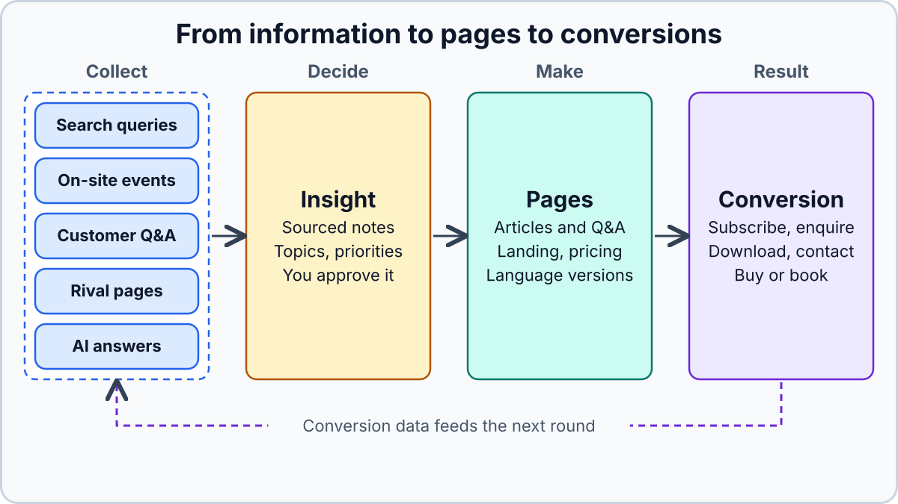
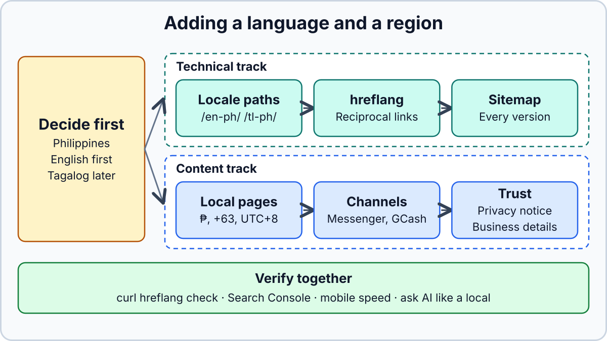

[첫 번째 가이드](/ko-KR/blog/2026-11-23-mac-astro-site-claude-github-cloudflare/)에서는 깨끗한 Mac에서 출시 가능한 Astro 웹사이트를 만들었습니다. [두 번째 가이드](/ko-KR/blog/2026-11-25-astro-site-google-analytics-search-console-seo-claude/)에서는 Google Analytics, Search Console, 사이트맵, 소셜 태그, favicon을 연결했습니다. 이제 웹사이트는 공개되었고 측정할 수 있으며, 이론적으로는 검색엔진에서 찾을 수 있습니다.

아직 두 가지가 부족합니다. 방문자가 머물 이유와, 다음에 무엇을 써야 할지 아는 방법입니다. 이 두 문제에는 한 번에 끝나는 답이 없습니다. 증거를 보고, 변경 하나를 정하고, 만들고, 효과를 증명하고, 결과에서 배우는 루프가 필요합니다.

이 가이드는 Claude Code로 이 루프를 돌리는 방법을 보여 주며, 이후에도 스스로 계속 진행할 수 있게 해 줍니다. 고정된 체크리스트는 없습니다. 매주 반복할 수 있는 작업 방식입니다.

이 글을 읽고 나면 다음을 할 수 있습니다.

1. Claude가 웹사이트를 기억하게 하여, 매 세션이 알고 있는 정보에서 시작되도록 합니다.
2. 모든 개선에 대해 여덟 단계 루프(탐색, 계획, 조사, 실행, 검증, 발행, 측정, 학습)를 실행합니다.
3. Claude 스킬을 찾고, 검토하고, 설치하고, 테스트하고, 직접 작성합니다.
4. 이 루프를 여섯 가지 작업 흐름에 적용합니다. 시장 조사, 콘텐츠, 언어와 지역, SEO, AI 가시성, 전환이 여기에 해당합니다.
5. 새로운 언어와 지역 시장을 추가합니다. 이 글에서는 필리핀을 예로 듭니다.
6. 출처, 승인, 개인정보 보호, 적절한 속도를 지키며 루프를 안전하게 유지합니다.

## 이 가이드의 대상

앞선 두 가이드를 마친 분들을 위한 내용입니다. GitHub 저장소에 Astro 웹사이트가 있고, `main`에 푸시할 때마다 자동으로 배포되며, Google Analytics와 Search Console이 설정되어 있고, Claude Code가 설치되어 있어야 합니다.

예시는 웹사이트가 영어로 되어 있고, 필리핀 방문자를 대상으로 하며, 도메인이 `example.com`이라고 가정합니다. 시장, 언어, 도메인은 자신의 것으로 바꾸세요. 이 방법은 특정 국가에 묶여 있지 않습니다.

## 전체 그림: 하나의 루프와 여섯 개의 작업 흐름

### 루프

새 페이지를 만들든 새 언어를 추가하든, 모든 개선은 같은 여덟 단계를 거칩니다.


| 단계 | Claude가 하는 일 | 사용자가 하는 일 | 남기는 결과 |
| --- | --- | --- | --- |
| 1. 탐색 | 웹사이트와 메모를 읽고 현재 상태를 점검하며, 아무것도 바꾸지 않음 | 어떤 문제가 가장 중요한지 결정 | 점검 보고서 |
| 2. 계획 | 하나의 목표, 단계, 성공을 확인하는 방법을 제안 | 승인, 축소, 거절 | 계획 파일 |
| 3. 조사 | 출처를 모으고 선택지를 비교하며, 확인되지 않은 내용을 표시 | 출처 일부를 직접 확인 | 날짜가 적힌 조사 메모 |
| 4. 실행 | 작은 단위로 콘텐츠나 코드를 작성 | 변경 사항 검토 | 검증할 변경 |
| 5. 검증 | 빌드하고, 미리 보기를 실행하고, 검사를 수행 | 결과 확인 | 통과한 점검 목록 |
| 6. 발행 | 커밋하고, 푸시하고, 배포를 기다린 뒤 실제 사이트를 확인 | 발행 승인 | 실제로 공개된 버전 |
| 7. 측정 | 내보낸 데이터를 읽음 | 데이터 내보내기 | 데이터 스냅샷 |
| 8. 학습 | 효과가 있었던 것과 다음에 시도할 것을 기록 | 다음 목표 결정 | 갱신된 메모와 컨텍스트 |

루프를 정직하게 유지하는 규칙은 세 가지입니다.

1. **한 번의 반복에는 작은 목표 하나만 둡니다.** 페이지 하나, 제목 묶음 하나, 언어 하나 정도가 적당합니다. 작은 단위는 검증하기 쉽고 되돌리기도 쉽습니다.
2. **매 반복마다 확인할 수 있는 증거를 남깁니다.** 파일, 명령 출력, 숫자, 링크 같은 것입니다. 가리킬 수 없다면 일어나지 않은 일입니다.
3. **결정권은 사용자에게 있습니다.** Claude는 탐색, 조사, 작성, 점검을 맡습니다. 사용자는 작업을 시작하기 전에 계획을 승인하고, 공개하기 전에 결과를 승인합니다.

### 여섯 개의 작업 흐름

루프는 엔진이고, 여기에 맡길 일은 여섯 개의 작업 흐름으로 나눌 수 있습니다. 이들은 같은 컨텍스트를 공유합니다. 메모, 규칙, 스킬, 저장소가 그것입니다.


각 작업 흐름은 아래에서 따로 설명합니다. 먼저 기반부터 다지겠습니다.

## 1단계: Claude가 웹사이트를 기억하게 하기

Claude는 세션이 시작될 때마다 웹사이트에 대해 아무것도 모릅니다. 따라서 파일이 기억 역할을 합니다. 여기에는 두 종류의 파일이 쓰입니다.

- 프로젝트 루트의 `CLAUDE.md`입니다. Claude Code는 세션 시작 시 이 파일을 읽으므로, 변하지 않는 사실과 규칙을 여기에 적습니다.
- `research/`와 `plans/` 폴더의 날짜가 붙은 메모입니다. 무엇을 배웠고 무엇을 결정했는지 기록합니다.

실용적인 폴더 구조는 다음과 같습니다.

```text
my-astro-site/
├── CLAUDE.md          # 웹사이트의 대상, 어조, 규칙, 작업 절차
├── research/          # 출처가 있는 날짜별 메모와 내보낸 지표
├── plans/             # 반복마다 하나씩 두는 짧은 계획
├── src/               # 웹사이트 자체
└── .claude/skills/    # 프로젝트 스킬(3단계 참고)
```

프로젝트 폴더에서 Claude를 실행하고, 이 파일의 초안을 만들어 달라고 요청하세요. Claude Code에는 `/init` 명령도 있어서, 저장소를 바탕으로 첫 번째 `CLAUDE.md`를 생성할 수 있습니다. 어떤 방법을 쓰든 결과를 자신의 실제 상황에 맞게 고치세요.

```text
이 웹사이트의 CLAUDE.md를 만들고, 비어 있는 research/ 및 plans/ 폴더도 만들어 줘. 각 폴더에는 짧은 README를 하나씩 넣어 줘.

CLAUDE.md에는 다음 내용을 포함해 줘.
- 웹사이트의 목적, 대상 독자, 그리고 방문자가 했으면 하는 행동 한 가지.
- 주요 시장: 필리핀. 언어: 먼저 영어, 나중에 필리핀어 추가. 대부분의 방문자는 휴대폰을 사용함.
- 어조: 담백하고, 친근하며, 구체적으로. 과장하지 않고, 숫자를 지어내지 않음.
- 규칙: 메모나 콘텐츠의 모든 사실에는 출처 URL과 확인한 날짜를 붙인다. 확인할 수 없는 내용은 "미확인"으로 표시한다. 내가 계획과 결과를 승인하기 전에는 절대 발행하지 않는다. 방문자의 개인정보는 메모나 프롬프트에 넣지 않는다.
- 작업 절차: 작은 변경, npm run build, 커밋, main에 푸시, 두 곳의 배포가 끝날 때까지 대기, curl로 실제 사이트 확인.
- 각 종류의 파일을 어디에 둘지.

저장하기 전에 파일 내용을 먼저 보여 줘.
```

확인 방법: 새 Claude 세션을 열고 "이 웹사이트에 대해 아는 내용을 요약해 줘"라고 말해 보세요. 답변이 `CLAUDE.md`와 일치해야 합니다. 일치하지 않는다면 문제는 Claude가 아니라 파일이 불분명하다는 데 있습니다.

## 2단계: 여덟 단계를 실제로 진행하기

### 1. 탐색

읽기 전용 점검으로 시작합니다. 아무것도 바꾸지 않으므로 되돌릴 것도 없습니다.

```text
이 웹사이트를 탐색하고 보고해 줘. 파일은 수정하지 마.

다음 내용을 포함해 줘: 페이지 목록과 페이지 사이의 링크 관계, 각 페이지의 목적, 제목과 설명, 행동 유도 문구(CTA)의 위치, 추적 중인 이벤트, 그리고 빈약하거나 중복되거나 깨져 보이는 부분.

보고서는 research/YYYY-MM-DD-audit.md에 저장하고, 가장 먼저 개선할 가치가 있는 다섯 가지를 우선순위 순으로 이유와 함께 적어 줘.
```

### 2. 계획

Claude Code를 계획 모드로 전환합니다(Shift+Tab으로 모드 전환). 이렇게 하면 Claude는 읽고 제안할 수는 있지만 편집은 할 수 없습니다. 좋은 계획은 한 페이지면 충분합니다.

```text
research/YYYY-MM-DD-audit.md를 바탕으로 이번 반복의 목표를 하나 제안해 줘.

plans/YYYY-MM-DD-goal.md에 다음 내용을 작성해 줘.
- 목표: 한 문장.
- 이유: 우리 메모나 데이터에서 나온 증거.
- 단계: 최대 다섯 단계, 각 단계는 검증할 수 있을 만큼 작게.
- 완료 기준: 성공했는지 어떻게 알 수 있는지. 발행 직후 확인할 수 있는 것과 몇 주 뒤에야 확인할 수 있는 것을 모두 포함.
- 하지 않을 일: 범위에서 명시적으로 제외할 것.
- 롤백: 되돌리는 방법.

계획을 쓴 뒤에는 멈추고 내 승인을 기다려 줘.
```

이것이 첫 번째 승인 지점입니다. 계획은 한 번에 설명할 수 있을 만큼 줄이세요.

### 3. 조사

AI를 활용한 시장 조사와 경쟁사 조사는 이 단계에서 이루어지며, AI가 가장 쉽게 잘못 안내하는 부분이기도 합니다. 그래서 규칙을 명확히 정해 줘야 합니다.

```text
이 계획을 위해 다음 질문을 조사해 줘. 필리핀 사람들은 [your topic]을 찾을 때 무엇을 검색하고 무엇을 묻는가? 상위 세 개 경쟁 웹사이트는 무엇을 제공하는가?

규칙:
- 공개된 페이지만 사용한다. 어디에도 로그인하지 않고, 어떤 제한도 우회하지 않는다.
- 모든 주장에는 출처 URL과 확인한 날짜를 붙인다.
- "페이지에서 찾은 내용"과 "내 추론"을 구분한다.
- 통계를 지어내지 않는다. 숫자를 찾지 못하면 "미확인"이라고 쓴다.
- 아래 템플릿에 맞춰 research/YYYY-MM-DD-topic.md에 저장한다.

템플릿:
# 질문
# 발견 사항 (주장, 출처 URL, 확인 날짜, 신뢰도: 높음, 중간, 낮음)
# 미확인
# 이것이 계획을 어떻게 바꾸는가
```

Claude Code는 웹을 검색하고 페이지를 가져올 수 있으며, 이때 도구 사용 승인을 요청할 수 있습니다. 완료된 후에는 출처 세 개를 직접 열어, 실제로 메모의 내용을 뒷받침하는지 확인하세요. 하나라도 맞지 않으면 메모 전체를 의심하고 Claude에게 다시 조사하게 하세요.

실제 고객 질문이 가장 좋은 조사 자료입니다. 고객 지원 문의나 커뮤니티 토론을 `research/`에 넣을 수 있지만, 먼저 이름, 이메일 주소, 기타 개인정보를 모두 지우세요.

### 4. 실행

이제 Claude가 계획에 따라 한 단계씩 작성합니다.

```text
plans/YYYY-MM-DD-goal.md의 1단계만 수행해 줘. 다른 것은 하지 마. CLAUDE.md를 따르고, npm run build를 실행한 뒤 통과하면 diff를 보여 줘.
```

작성할 때는 먼저 브리프를 받고, 그다음 초안을 받은 뒤 직접 수정하세요. AI 초안은 출발점일 뿐입니다. 페이지를 읽을 가치가 있게 만드는 것은 오직 사용자만 제공할 수 있는 부분입니다. 실제 가격, 실제 사례, 직접 찍은 스크린샷, 자신의 관점이 그렇습니다. 이 부분은 사용자가 채워야 합니다.

### 5. 검증

검증은 사다리와 같습니다. 각 단계는 실제 결과에 더 가깝지만, 결과를 얻기까지 더 오래 걸립니다.


1~3단계는 그 자리에서 끝낼 수 있으며, Claude가 대신 수행할 수 있습니다. 4단계는 외부 도구로 같은 날 확인할 수 있습니다. 5단계와 6단계는 검색엔진과 방문자에 달려 있어서 며칠에서 몇 주가 걸릴 수 있습니다. 도달하지 못한 단계는 도달했다고 주장하지 마세요. "빌드 성공"은 "공개됨"을 뜻하지 않으며, "공개됨"은 "효과 있음"을 뜻하지 않습니다.

```text
이 변경을 세 가지 수준에서 검증하고, 무엇을 확인했는지와 확인하지 못한 것이 무엇인지 보고해 줘.
1. npm run build가 오류 없이 통과한다.
2. 배포가 끝난 뒤 curl로 실제 URL을 요청해 상태 코드, 제목, 설명, canonical 링크, 모든 JSON-LD를 확인한다.
3. 해당 페이지의 모바일 버전에 Lighthouse 또는 PageSpeed를 실행하고, 90점 미만인 항목을 모두 나열한다.
```

### 6. 발행

발행은 두 번째 승인 지점입니다. 사용자가 승인하면, 앞선 두 가이드에서 했던 것처럼 Claude가 기계적인 작업을 처리하고 결과를 증명합니다.

```text
명확한 설명과 함께 커밋하고, main에 푸시한 뒤, GitHub Pages 워크플로와 Cloudflare 빌드가 모두 끝날 때까지 기다려 줘. 그다음 curl로 실제 페이지를 요청해서 변경 사항이 반영되었는지 확인해 줘. 확인 결과를 항목별로 보고해 줘.
```

중요한 새 페이지라면 Search Console을 열어 URL을 URL 검사 입력란에 붙여 넣고 색인 생성을 요청하세요. Bing 같은 일부 검색엔진은 IndexNow 프로토콜로 새 페이지를 알릴 수 있습니다. Google은 IndexNow를 사용하지 않습니다.

### 7. 측정

Claude는 사용자를 대신해 Google에 로그인할 수 없습니다. 가장 간단하고 신뢰할 수 있는 방법은 데이터를 직접 내보내서 저장소에 넣는 것입니다.

1. Search Console에서 **실적**을 열고, 날짜 범위를 설정한 뒤, 국가/지역 필터를 필리핀으로 지정해 검색어와 페이지를 내보냅니다.
2. Google Analytics에서 핵심 이벤트의 발생 횟수를 내보냅니다.
3. 두 파일을 날짜가 포함된 이름으로 `research/metrics/`에 저장합니다.

```text
research/metrics/에 있는 가장 최신 파일을 읽고, 이전 스냅샷과 비교해 줘.

research/YYYY-MM-DD-metrics.md에 다음 내용을 작성해 줘. 노출이 늘었거나 줄어든 검색어, 노출은 많지만 클릭이 적은 페이지, 발생한 이벤트, 그리고 눈에 띄는 변화마다 가설 하나. 각 가설은 가설이라고 명확히 표시할 것.
```

새 웹사이트라면 숫자가 작을 것입니다. 클릭이 몇 번뿐인 변화를 과하게 해석하지 말고, 몇 주에 걸친 방향을 보세요.

### 8. 학습

마지막 단계는 많은 사람이 건너뛰지만, 루프가 누적 효과를 내게 하는 핵심입니다.

```text
이번 반복을 마무리해 줘. 앞으로의 반복에서 알아야 할 내용을 CLAUDE.md나 조사 메모에 업데이트해 줘. 무엇을 시도했는지, 증거가 무엇을 말하는지, 어떤 것을 왜 다시 시도하지 않을지. 그다음 증거와 함께 다음 목표를 제안하고, 멈춰 줘.
```

## 3단계: 스킬 찾기, 검토하기, 테스트하기, 축적하기, 공유하기

스킬은 반복 가능한 작업을 Claude에게 가르치는 `SKILL.md` 파일이 들어 있는 폴더입니다. 파일 맨 위에는 `name`과 `description`이 담긴 짧은 front matter가 있고, 그 아래에 구체적인 지침이 이어집니다. Claude는 description을 보고 언제 스킬을 사용할지 판단하며, 사용자는 `/skill-name`을 입력해 직접 호출할 수도 있습니다.


스킬은 세 위치에 둘 수 있습니다.

| 범위 | 위치 | 적합한 용도 |
| --- | --- | --- |
| 개인 | `~/.claude/skills/<name>/SKILL.md` | 모든 프로젝트에서 쓰는 개인 습관 |
| 프로젝트 | `.claude/skills/<name>/SKILL.md` | 이 웹사이트의 고정된 절차, git으로 공유 |
| 플러그인 | `/plugin`으로 설치 | 다른 사람이 패키징하고 유지 관리하는 스킬 |

Claude Code는 개인 및 프로젝트 스킬 폴더를 감시하므로, 새 스킬은 보통 현재 세션에서 바로 나타납니다. 나타나지 않으면 `/reload-skills`를 실행하세요. `/skills`를 입력하면 현재 사용할 수 있는 스킬을 볼 수 있습니다.

### 찾기

세 곳에서 찾을 수 있습니다. 플러그인 마켓플레이스(`/plugin`을 열어 둘러보고, `/plugin marketplace add owner/repo`로 마켓플레이스 추가), 커뮤니티 스킬 디렉터리, GitHub 저장소입니다. 마케팅 작업용 스킬 모음도 있습니다. SEO 감사, 카피 편집, 경쟁사 조사, AI 검색 최적화 등이 있습니다. 공개 예시로 `coreyhaines31/marketingskills` 저장소에는 `seo-audit`과 `ai-seo`가 들어 있습니다. 이것은 제3자의 작업물이므로, 직접 작성하지 않은 코드를 다룰 때와 같은 기준으로 다루세요.

### 검토하기

스킬은 지침이며, 때로는 사용자의 컴퓨터에서 실행되는 스크립트를 포함합니다. 설치하기 전에 먼저 읽어 보세요.

```text
coreyhaines31/marketingskills 저장소의 seo-audit과 ai-seo 스킬을 평가하고 싶어. 지금은 아무것도 설치하지 마.

각 SKILL.md와, 포함된 모든 스크립트나 참고 파일을 읽은 뒤 다음을 알려 줘.
- 이 스킬이 하는 일을 두 문장으로.
- 필요한 도구나 명령. 셸 명령이 있는지 여부.
- 이 프로젝트 밖의 파일을 읽거나 쓰는지, 네트워크 요청을 보내는지.
- 선언된 목적과 맞지 않아 보이는 부분.

그다음 설치를 권장할지 말지 제안해 줘.
```

검토 체크리스트: 출처를 명확히 확인할 수 있는지, `SKILL.md`를 직접 읽었는지, 이해할 수 없는 스크립트가 없는지, 예상하지 못한 네트워크 접근이 없는지, 용도가 하나로 명확한지.

### 설치하고 시험 실행하기

먼저 프로젝트 범위로 설치하세요. 그러면 다른 작업에 영향을 주지 않습니다. 저장소의 README에 나온 정확한 명령을 사용하거나, Claude에게 설치를 맡기고 실행한 명령을 보여 달라고 하세요.

그다음 실제 작업으로 테스트하고 비교합니다.

```text
홈페이지와 블로그 글 한 편을 감사해 줘. 먼저 어떤 스킬도 사용하지 말고 답해 줘. 그다음 seo-audit 스킬을 사용해 같은 감사를 다시 해 줘. 두 보고서를 비교해 줘. 스킬이 일반 답변에서 놓친 문제는 무엇이었고, 스킬이 틀리거나 분량만 채운 부분은 어디인지. 비교 결과는 research/에 저장해 줘.
```

스킬이 자동으로 실행되지 않으면 `/seo-audit`으로 직접 호출하고, `description`이 언제 써야 하는지 분명히 말하는지 확인하세요.

### 직접 스킬 만들기

매번 반복하는 절차는 스킬로 만들기에 적합합니다. 아래 스킬은 글을 발행하고 실제로 공개되었음을 증명합니다. 발행에는 부작용이 있으므로 `disable-model-invocation: true`를 설정했습니다. 따라서 `/publish-post`를 입력할 때만 실행됩니다.

```markdown
---
name: publish-post
description: Publish a finished blog post on this site and prove it is live. Use when the user asks to publish, ship or release a post.
disable-model-invocation: true
---

사용자가 지정한 글을 발행한다.

1. `npm run build`를 실행한다. 실패하면 중단한다.
2. front matter에 제목, 설명, 날짜가 있는지 확인한다.
3. 명확한 설명과 함께 커밋하고 `main`에 푸시한다.
4. 두 곳의 배포를 기다린다. 먼저 `gh run watch`, 그다음 Cloudflare 빌드를 기다린다.
5. `curl -s`로 실제 URL을 요청해 제목, 설명, JSON-LD 블록이 모두 있는지 확인한다.
6. 무엇을 확인했고, 무엇을 확인하지 못했는지 보고한다.
```

이 내용을 `.claude/skills/publish-post/SKILL.md`로 저장해 커밋하면 프로젝트의 일부가 됩니다. 다음으로 스킬로 만들 가치가 있는 것은 주간 지표 보고서, 경쟁사 업데이트, hreflang 점검입니다.

### 공유하기

프로젝트 스킬은 커밋을 통해 공유됩니다. 여러 웹사이트나 다른 사람과 스킬을 공유하려면 플러그인으로 패키징하고 마켓플레이스 파일을 게시하세요. 자세한 방법은 [Claude Code 플러그인 문서](https://code.claude.com/docs/en/discover-plugins)를 참고하세요. front matter의 전체 옵션은 [스킬 문서](https://code.claude.com/docs/en/skills)에 있습니다.

## 4단계: 여섯 개의 작업 흐름에서 루프 실행하기

모든 작업 흐름은 같은 출발점을 공유합니다. 아래의 기본 프롬프트는 지정한 작업 흐름에서 Claude가 루프 한 번을 실행하게 합니다.

```text
이 웹사이트를 개선하는 반복 작업을 한 번 실행해 줘. 초점은 [workstream]이다.

1. CLAUDE.md와 research/, plans/ 안의 최신 파일을 읽어 줘.
2. 이번 반복의 목표 하나와 그 근거를 제안해 줘. 내 승인을 기다려 줘.
3. 내가 승인하면 먼저 계획 파일을 쓰고, 그다음 조사하고, 실행하고, 검증해 줘. 발행 전에 멈추고 결과를 보여 줘.
4. 내가 발행을 승인하면 발행하고, 실제 사이트를 검증해 줘.
5. 배운 내용을 기록하고, 다음 목표를 제안해 줘.
```

루프 안에서 정보는 일관된 방식으로 흐릅니다. 출처가 통찰이 되고, 통찰이 페이지가 되며, 페이지가 전환을 만들고, 전환 데이터가 다시 출처로 돌아갑니다.



### A. 시장 및 경쟁사 조사

- **목표:** 누구를 위해 일하는지, 그들이 무엇을 묻는지, 대안들이 무엇을 제공하는지 알기.
- **입력:** Search Console의 검색어, 고객 질문, 경쟁사의 공개 페이지, 주제에 대해 AI 어시스턴트가 주는 답변.
- **반복 예시:** "세 경쟁사가 가격을 어떻게 설명하는지, 그리고 무엇을 말하지 않는지 비교하기."
- **점검:** 모든 주장에 출처와 날짜가 있고, 그중 세 개를 직접 열어 확인했는가.
- **산출물:** 콘텐츠 계획에 들어갈 조사 메모.

### B. 콘텐츠와 Q&A 페이지

- **목표:** 실제 질문에 대해 대안보다 더 나은 답을 제공하기.
- **방법:** 실제 질문 하나당 페이지 하나를 만들고, 첫 문단에 바로 답을 적은 뒤 세부 내용을 펼칩니다. 사실을 분명히 밝히는 페이지도 추가하세요. 무엇을 제공하는지, 어떻게 작동하는지, 얼마인지, 제한 사항이 무엇인지. "A와 B 중 무엇이 나은가" 같은 질문에는 비교 페이지를 만듭니다.
- **질문에는 출처가 있어야 합니다.** Search Console, 고객 메시지, 커뮤니티 토론, AI 어시스턴트의 답변에서 가져오세요. 템플릿을 채우려고 질문을 지어내지 마세요.
- **페이지를 대량으로 찍어내지 마세요.** 검색엔진은 대량으로 생성된 저품질 콘텐츠에 대해 명확한 정책을 가지고 있습니다. 좋은 페이지 몇 개가 얇은 페이지 백 개보다 낫습니다.
- **점검:** 모든 페이지에 목적이 있고, 모든 사실에 출처가 있으며, 사용자만 쓸 수 있는 내용이 포함되어 있는가.

### C. 언어와 지역(필리핀 예시)

먼저 시장과 언어를 정하고, 두 개의 흐름을 병렬로 진행한 뒤, 마지막에 함께 검증하세요.



**기술 흐름.** 언어와 지역마다 별도의 URL 경로를 주세요. 예를 들어 필리핀의 영어는 `/en-ph/`입니다. `hreflang`으로 각 버전을 다른 모든 버전과 서로 연결합니다. Google의 규칙은 구체적입니다.

- 언어는 ISO 639-1 코드이고, 선택적 지역은 ISO 3166-1 alpha-2 코드입니다. 예를 들어 `en-PH`처럼 씁니다. ISO 639-1만 지원하므로 필리핀어 코드 `fil`은 유효하지 않습니다. 필리핀어 버전을 추가한다면 `tl`(타갈로그어)을 사용해 `tl-PH`로 쓰고, Search Console에서 실제 성과를 확인하세요.
- 각 버전은 자기 자신과 다른 모든 버전을 나열해야 합니다. 페이지 X가 페이지 Y를 가리킨다면, 페이지 Y는 X를 다시 가리켜야 합니다. 그렇지 않으면 이 태그는 무시됩니다.
- 어떤 버전과도 맞지 않는 방문자를 위해 `x-default` 항목을 추가하세요.
- 이 모든 것은 페이지의 head, HTTP 헤더, 또는 사이트맵에 선언할 수 있습니다.

Astro에는 국제화 라우팅이 내장되어 있고, 사이트맵 통합 기능으로 언어 대체 버전을 사이트맵에 넣을 수도 있습니다. 추측하지 말고, 설치된 버전에 맞는 문서를 Claude가 확인하도록 하세요.

```text
웹사이트에 /en-ph/ 경로로 영어(필리핀) 버전을 추가하고, 나중에 /tl-ph/ 아래에 필리핀어 버전을 추가할 수 있도록 준비해 줘. Astro의 i18n 라우팅을 사용하고, 설치된 버전에 맞는 최신 문서를 확인해 줘. 다음을 지켜 줘.
- 여러 버전이 있는 모든 페이지에 hreflang 대체 링크를 추가하고, 자기 자신과 x-default 링크도 포함.
- 사이트맵에 각 언어 버전과 그 대체 버전을 나열.
- 보이는 언어 전환기를 추가. 방문자를 IP 주소로 자동 리디렉션하지 않음.
- 빌드, 커밋, 푸시, 배포 대기 후, curl로 두 페이지를 요청해 hreflang 링크를 출력하고, 각 페이지가 해당 버전과 연결되어 있음을 증명.
```

**콘텐츠 흐름.** 번역은 현지화와 같지 않습니다. 필리핀을 대상으로 한다면, 추측하지 말고 자신의 분석 데이터와 고객 피드백으로 다음 사항을 먼저 확인하세요.

- 가격은 페소(₱)로 표시하고, 전화번호는 `+63` 형식을 쓰며, 시간은 필리핀 시간(UTC+8)을 씁니다.
- 사람들이 실제로 쓰는 연락 및 결제 수단. 예를 들어 Facebook Messenger나 Viber, 그리고 GCash나 Maya를 통한 결제.
- 휴대폰과 느린 네트워크에서도 페이지가 빠르게 로드되어야 합니다. 방문자 대부분은 휴대폰을 씁니다.
- 사람들이 실제로 쓰는 표현은 영어와 필리핀어가 섞인 경우가 많습니다. 핵심 페이지의 필리핀어 문구는 원어민이 검토해야 합니다. 전환을 목표로 하는 페이지에는 AI 번역만으로는 부족합니다.
- 명확한 개인정보 보호 고지. 필리핀에는 2012년 데이터 프라이버시법(Republic Act 10173)이 있고, 이는 National Privacy Commission(국가개인정보위원회)이 집행합니다. 위원회 웹사이트에서 자신의 웹사이트에 어떤 요구 사항이 적용되는지 확인하세요. 또한 등록된 상호명이나 연락처 같은 실제 사업자 정보를 방문자가 찾을 수 있는 곳에 두세요. 이상은 일반적인 정보이며 법률 자문이 아닙니다.

**함께 검증하기.** 배포 후에는 `curl`로 hreflang 링크가 서로를 가리키는지 확인하세요. Search Console에서 새 경로의 hreflang 및 색인 문제를 점검하고, 중급 수준의 휴대폰에서 페이지를 테스트하세요. 현지인의 말투로 목표 질문을 AI 어시스턴트에 던져 보고, 자신이 언급되는지 확인하세요.

### D. SEO

같은 루프를 사용해 매달 감사를 진행하세요. 두 번째 가이드에서 사이트맵, canonical 링크, 메타데이터, 구조화된 데이터의 기반을 다졌습니다. 매달의 작업은 어디가 어긋났거나 빠졌는지 찾는 것입니다.

```text
웹사이트의 SEO를 감사하고, 우선순위 순서의 체크리스트를 research/YYYY-MM-DD-seo.md에 저장해 줘. 다음을 확인해 줘. 사이트맵에서 빠진 페이지, 중복되거나 빠진 제목과 설명, 깨진 내부 링크, 내부 링크가 하나도 없는 페이지, alt 텍스트가 없는 이미지, 휴대폰에서 가장 느린 페이지. 아직 아무것도 고치지 마. 기대 가치가 가장 높은 수정 세 가지를 알려 줘.
```

세 가지를 고치고, 검증하고, 발행한 뒤 다음으로 넘어가세요. 만점을 목표로 하지 마세요.

### E. AI 가시성

AI 어시스턴트와 AI 검색 기능은 웹페이지를 읽고 요약해서 답변합니다. 언급을 보장할 수는 없지만, 페이지를 찾기 쉽고, 이해하기 쉽고, 신뢰하기 쉽게 만들 수는 있습니다.

- **적절한 크롤러는 허용하세요.** AI 기업들은 자사 크롤러의 이름을 공개하며, 일부는 검색이나 사용자 요청 기반 가져오기를 모델 학습과 구분합니다. 각 회사의 현재 문서를 확인한 뒤 `robots.txt`에서 무엇을 허용할지 결정하세요. 검색용 크롤러는 허용하고 학습용 크롤러는 다르게 다루는 것이 합리적인 선택입니다.
- **답변을 위해 작성하세요.** 질문 형식의 제목을 쓰고, 직접적인 답을 먼저 제시하고, 숫자와 날짜가 있는 구체적인 사실을 쓰고, 비교는 명확한 표로 정리하세요.
- **"당신이 누구인지"를 일관되게 유지하세요.** 모든 곳에서 같은 이름, 소개, 링크를 사용하고, 공식 홈페이지 링크가 있는 `Organization` 구조화 데이터를 추가하며, 실제 작성자가 있는 "소개" 페이지를 유지하세요.
- **다른 곳에서 언급되도록 하세요.** 리뷰, 커뮤니티 토론, 디렉터리 페이지는 어시스턴트가 인용하는 경우가 많습니다. 이는 커뮤니티 및 아웃리치 작업과 직접 연결됩니다.
- **`llms.txt`는 선택 사항입니다.** 언어 모델이 웹사이트를 요약하도록 제안된 파일입니다. 주요 AI 검색 제품이 이에 의존한다는 신뢰할 만한 근거는 아직 없으므로, 우선순위가 아니라 비용이 적게 드는 부가 항목으로 취급하세요.
- **질문으로 측정하세요.** 필리핀 사용자의 표현을 포함해 고정된 질문 10~20개 목록을 유지하세요. 매달 여러 어시스턴트에 질문하고, 자신이 언급되는지와 어떤 출처를 인용하는지 기록하며, Google Analytics에서 AI 제품으로부터 들어오는 추천 트래픽을 확인하세요.

```text
research/ai-answer-checks.md를 만들고, 필리핀 방문자가 우리 주제에 대해 물을 만한 자연스러운 질문 15개를 나열해 줘. 열은 다음과 같이 해 줘. 어시스턴트, 날짜, 우리가 언급되었는지, 인용한 출처. 그다음 이 가이드의 AI 가시성 요점에 맞춰 웹사이트를 감사하고, 가장 큰 격차 세 가지를 나열해 줘.
```

### F. 전환과 사업 확장

- **주요 전환 하나를 정하세요.** 구독, 상담, 다운로드, 구매 중 하나입니다. 나머지는 모두 그것을 위해 존재합니다.
- **이벤트와 연결하세요.** 두 번째 가이드의 이벤트 추적을 사용해, 얼마나 많은 사람이 도착하고 어디에서 이탈하는지 확인하세요.
- **페이지마다 명확한 행동 유도를 하나만 두세요.** 사람들이 선호하는 연락 수단을 쉽게 찾을 수 있는 곳에 두세요. 예를 들어 Messenger 링크처럼요.
- **한 번에 하나만 바꾸세요.** Claude는 가설을 세우고 서로 다른 버전을 작성할 수 있으며, 어떤 것을 시험할지는 사용자가 결정합니다. 의미 있는 테스트에는 실제 트래픽이 필요하므로, 작은 웹사이트에서는 명확한 개선을 하고 추세를 지켜보는 편이 낫습니다.
- **개인정보에 주의하세요.** 리드를 수집하기 전에 동의 및 개인정보 보호 고지를 추가하세요.

```text
홈페이지에 대한 전환 가설 세 개를 제안해 줘. 각각에 대해 다음을 설명해 줘. 바꿀 내용, 그 근거가 되는 증거, 효과 여부를 보여 줄 이벤트, 성공으로 간주할 수치. 내가 하나를 고르기 전에는 아무것도 만들지 마.
```

## 5단계: 속도와 안전장치

### 적절한 속도

| 언제 | 할 일 |
| --- | --- |
| 발행할 때마다 | 실제 페이지를 검증. 중요한 새 페이지는 색인을 요청. |
| 매주 | Search Console과 Analytics 데이터를 내보내고, 측정과 학습 단계를 실행하고, 목표 하나를 선택. |
| 매달 | SEO 감사, AI 답변 점검, 경쟁사 메모 갱신, 실제로 사용한 스킬 검토. |
| 매분기 | 대상 독자와 시장에 대한 가정을 다시 검토하고, 얇은 페이지를 삭제하거나 합치며, 언어를 추가할지 결정. |

데이터를 읽는 부분은 자동화할 수 있습니다. Claude Code에는 비대화형 모드 `claude -p "프롬프트"`가 있어서 스케줄러에서 실행할 수 있습니다. 사용할 수 있는 도구를 제한하고, `research/`에만 쓰도록 허용하세요. 발행은 계속 수동으로 하세요.

### 안전장치

- **사실에는 출처가 필요합니다.** 출처가 없으면 주장도 없습니다. 항상 일부를 직접 확인하세요.
- **두 번 승인하세요.** 작업을 시작하기 전에 계획을, 공개하기 전에 결과를 승인하세요.
- **최소 권한.** 작업에 필요한 것 이상의 접근 권한을 Claude에게 주지 마세요. 스킬은 설치 전에 검토하세요.
- **개인정보를 넣지 마세요.** 방문자나 고객의 개인정보를 프롬프트나 메모에 붙여 넣지 마세요.
- **양보다 품질.** 아무 내용도 없는 생성 페이지 백 개가 웹사이트 전체에 해를 줄 수 있습니다.
- **빨리 손절하고 배우세요.** 반복이 실패하면 이유를 적고, 변경을 되돌리고, 앞으로 나아가세요. 기록된 실패도 진전입니다.

## 자주 묻는 질문

- **Claude의 조사 수치가 내가 찾은 것과 다릅니다.** 미확인으로 취급하세요. 모든 수치에 출처 URL과 날짜를 요구하고 다시 확인하세요. 근거를 댈 수 없다면 그 주장을 삭제하세요.
- **스킬이 실행되지 않습니다.** `description`이 언제 사용할지 분명히 말하는지 확인하고, `/skill-name`으로 직접 호출하세요. 새 스킬이라면 `/reload-skills`를 실행하세요. `disable-model-invocation: true`가 설정된 스킬은 직접 호출할 때만 실행됩니다.
- **Claude가 세션 사이에 내용을 잊어버립니다.** 정상입니다. 중요한 내용은 `CLAUDE.md`나 `research/`에 넣으세요.
- **트래픽이 너무 적어서 효과를 알 수 없습니다.** 주기를 늘리고, 사다리의 1~4단계에 주로 의존하세요. 질적 점검을 늘리세요. 실제 사용자 다섯 명에게 묻거나 고객 메시지를 읽어 보세요.
- **hreflang이 작동하지 않는 것 같습니다.** 각 버전이 자기 자신과 다른 모든 버전을 연결하는지, 코드가 유효한지, URL이 절대 주소이고 200을 반환하는지 확인하세요.
- **어떤 AI 어시스턴트도 내 웹사이트를 언급하지 않습니다.** 새 웹사이트라면 이는 정상입니다. 실제 질문에 답하는 페이지를 계속 만들고, 다른 곳에서 언급되도록 노력하고, 같은 질문 목록으로 계속 측정하세요.

## 이번 주에 할 수 있는 일

1. `CLAUDE.md`, `research/`, `plans/`를 만드세요(1단계).
2. 탐색과 계획 반복을 한 번 실행하고, 목표 하나를 고르세요(2단계).
3. 4단계의 작업 흐름 중 하나를 골라 기본 프롬프트를 실행하세요.
4. 방금 반복해서 했던 절차 하나를 프로젝트 스킬로 바꾸세요.

이 방식은 앞선 두 가이드의 마무리와 같습니다. 최종 상태를 설명하면 Claude가 변경을 만들고, 푸시하고 기다리게 하며, 실제 웹사이트에서 결과를 증명하고, 마지막으로 외부 도구로 확인합니다. 이 가이드는 그 앞에 조사를 더하고 뒤에 학습을 더한 뒤, 다시 한 바퀴 돌리는 것입니다.
