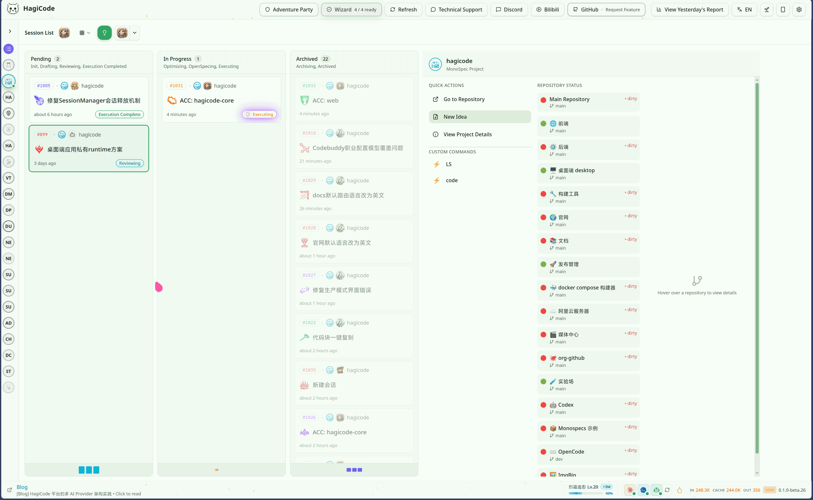
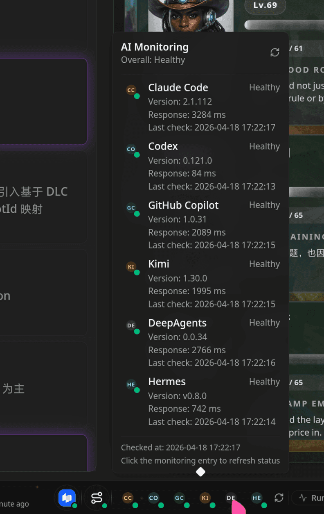
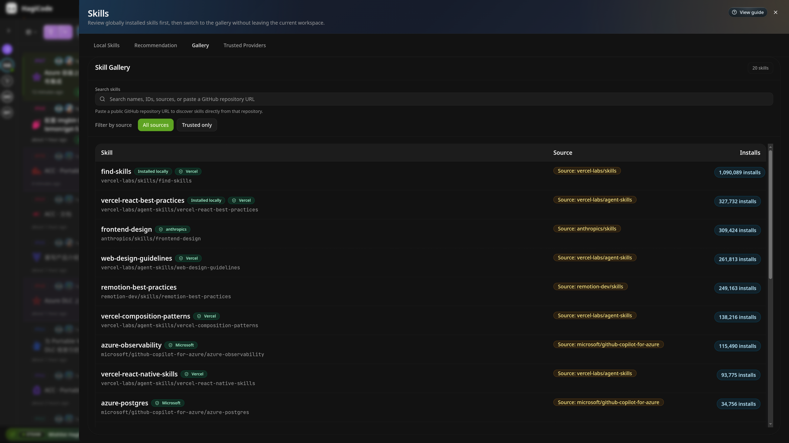
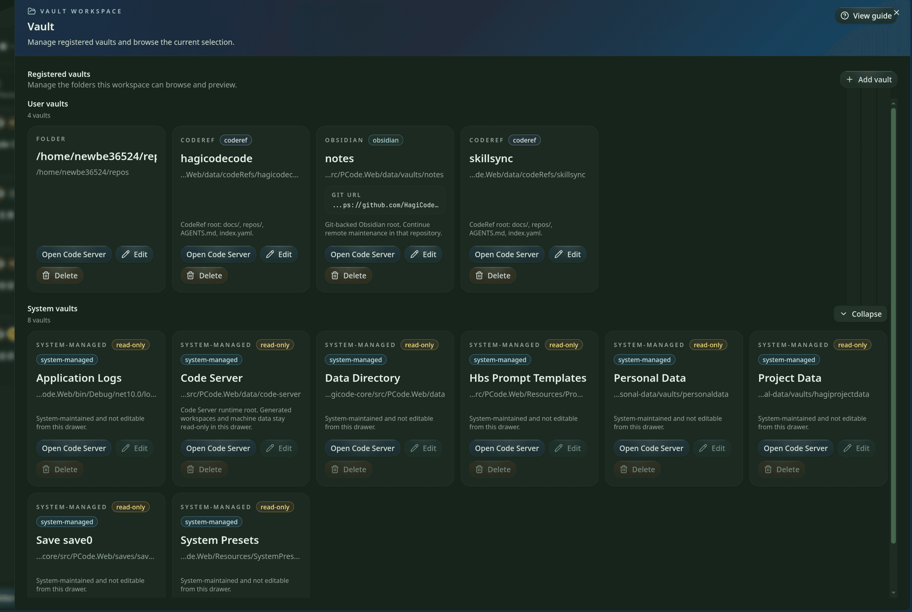
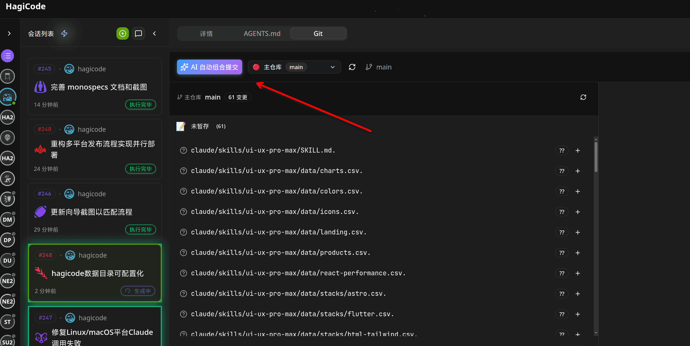

import { LinkCard, CardGrid } from '@astrojs/starlight/components';
import ProductVideoShowcase from '@/components/ProductVideoShowcase.astro';
import ProductOverviewLead from '@/components/ProductOverviewLead.astro';
import TaskFlow from '@/components/TaskFlow.astro';
import FeatureIndex from '@/components/FeatureIndex.astro';

HagiCode 让 AI 改代码时不丢上下文：**先读懂仓库，再划清范围，最后可追踪地执行。** 它是面向项目开发的 AI 工作台，接入你已有的 Agent CLI 和模型，不需要换编辑器。

<ProductOverviewLead
  primaryLabel="开始安装"
  primaryHref="/installation/"
  secondaryLabel="观看演示视频"
  secondaryHref="#product-video-showcase-zh-CN"
  facts={["支持 11 个 Agent CLI（Claude Code、Codex、GitHub Copilot 等）","Windows、macOS、Linux 均可使用","基础功能免费"]}
/>

## 核心特色一览

<FeatureIndex
  label="核心特色"
  items={[
    { title: "先理解，再动手", summary: "普通会话默认只读；复杂变更先走提案，再执行。", href: "#先理解再动手" },
    { title: "多仓库统一范围", summary: "MonoSpecs 把多个仓库当作一个项目，规格集中在主仓库。", href: "#多仓库统一范围" },
    { title: "沿用你的 Agent CLI", summary: "支持 11 个 Agent CLI，健康状态一目了然，不必换编辑器。", href: "#沿用你的-agent-cli" },
    { title: "Skills 扩展", summary: "搜索、安装前核对来源与命令，决定哪些来源可信。", href: "#skills-扩展" },
    { title: "Vault 与 Code Server", summary: "把仓库之外的资料带进会话，并在浏览器里编辑。", href: "#vault-与-code-server" },
    { title: "AI Compose Commit", summary: "按 Conventional Commits 分组生成提交，多仓库也适用。", href: "#ai-compose-commit" },
    { title: "进度看得见", summary: "英雄、成就、日报和 Token，让长期使用有反馈。", href: "#进度看得见" },
  ]}
/>

## 一次开发任务怎么走

以“修改一个涉及多个仓库的功能”为例：

<TaskFlow
  label="一次开发任务怎么走"
  nextLabel="下一步"
  steps={[
    { label: "先理解", image: "workspace", body: "在[普通会话](/quick-start/conversation-session)中分析现有代码。普通会话默认只读，需要修改文件时再切换到编辑模式。", alt: "HagiCode 工作台，展示会话列表、提交说明与顶部操作入口" },
    { label: "再定范围", image: "proposal", body: "对于复杂变更，在[提案会话](/quick-start/proposal-session)中选择项目和仓库，先整理目标、任务与验证方式，再推进执行。", alt: "新建提案抽屉，展示仓库选择与提案预览" },
    { label: "跟踪结果", image: "outcome", body: "在工作台回看会话和执行状态；需要整理提交时，可以使用 [AI Compose Commit](/guides/ai-compose-commit)。", alt: "提案工作流执行完成后的会话详情" },
    { label: "留下上下文", image: "board", body: "提案与提交记录可供回顾；需要跨仓库协作时，使用 [MonoSpecs](/guides/monospecs) 管理仓库关系与变更范围。", alt: "会话看板与 MonoSpecs 项目的仓库状态" },
  ]}
/>

你不必每次都走提案流程：只想了解代码或处理简单问题，可以从普通会话开始。HagiCode 的重点是让任务需要更多上下文时，仍有一条可追踪的推进路径。

## 特色详解

### 先理解，再动手

HagiCode 把“看懂代码”和“改动代码”拆成两种会话，让你按任务大小选择，而不是一律让 AI 直接动手。

- **普通会话**：默认只读，适合了解仓库、排查问题、回答“这段逻辑在哪”。需要修改文件时，再切换到编辑模式。
- **提案会话**：适合复杂变更。先选择项目和仓库范围，整理目标、任务与验证方式，确认后再推进执行。
- **会话看板**：提案与审核、执行、归档三条泳道，一眼看到每个会话走到了哪一步；可在经典、执行流看板、仪表盘看板等布局间切换。

了解更多：[创建普通会话](/quick-start/conversation-session) · [创建提案会话](/quick-start/proposal-session) · [会话看板说明](/user-guide/sessions)

### 多仓库统一范围

如果一个需求要同时改前端、后端和文档，MonoSpecs 让 HagiCode 把它们当作一个项目来理解。

- 在 `.hagicode/monospecs.yaml` 中登记子仓库的位置、Git 地址和显示名称。
- 变更规格（OpenSpec）集中放在主仓库，子仓库的代码目录保持干净。
- 创建提案时可以选择涉及哪些子仓库；项目页会显示每个仓库的分支与未提交变更。

了解更多：[MonoSpecs 指南](/guides/monospecs)

### 沿用你的 Agent CLI

HagiCode 不替换你的工具链，而是把它们放进同一个工作台。

- **Agent = CLI + 模型 + 可选的性格文本**。你可以创建多个 Agent，按执行场景分配，并设置兜底班组。
- 支持 11 个 Agent CLI，包括 Claude Code、Codex、GitHub Copilot 等；工作台里可以直接查看每个 CLI 的版本、响应时间和健康状态。
- 通过 [OmniRoute](/related-software-installation/omniroute/)，可以把多个 OpenAI 兼容工具和模型接到同一个本地网关，CLI 与模型的接入各自独立管理。

了解更多：[Agents 工作台](/user-guide/agents) · [AI Agent CLI 安装与支持范围](/related-software-installation/ai-agent-cli/)

### Skills 扩展

Skills 面板把“本机已有的技能”和“技能库里可装的技能”放在同一个入口。

- **本地技能**：查看这台机器上已安装的技能，批量检查更新。
- **技能库**：按关键字和来源搜索，并能看到技能是否已安装。
- **可信来源**：安装前确认来源、信任状态和实际执行的命令，自行决定哪些来源被标记为可信。

了解更多：[Skills 使用指南](/guides/skills)

### Vault 与 Code Server

- **Vault** 是项目仓库之外、允许 HagiCode 浏览的文件夹，可存放参考文档、笔记和调研结果。支持文件夹、CodeRef、Obsidian 三种类型。
- 创建会话时，可以选择把哪些 Vault 纳入范围：标记为可编辑，AI 才会写入；否则只作为只读参考。
- **Code Server** 提供浏览器中的编辑入口，可直接从 Vault 或项目打开。

了解更多：[Vault 使用说明](/user-guide/vault) · [Vault 知识库实践](/blog/2026-04-10-vault-system-ai-knowledge-base/) · [浏览器编辑集成](/blog/2026-04-13-vscode-web-integration-browser-editing/)

### AI Compose Commit

在 Git 标签页点击“AI 自动组合提交”，HagiCode 会读取当前变更，按 Conventional Commits 生成提交信息。

- 相关改动会被分组成多个提交，而不是一个大杂烩。
- 在 MonoSpecs 项目中，会把变更提交到正确的子仓库。
- 自动追加 Co-Authored-By 标签，名称和邮箱可在项目级或全局级配置。

了解更多：[AI Compose Commit 使用指南](/guides/ai-compose-commit)

### 进度看得见

HagiCode 把英雄、成就、日报和 Token 做成反馈，让长期使用中的状态与进度更容易被看见，这也是它和普通 AI 编程工具不同的地方。你可以在[冒险团介绍](/adventure-team-introduction)里看看英雄如何编组、副本如何推进；设计思路见[游戏化设计文章](/blog/2026-03-16-gamifying-ai-coding/)。这部分是工作台体验的一部分，不想用时，也可以只把它当作普通开发工具。

了解更多：[状态栏与进度](/user-guide/status-bar-and-progress)

## 适合谁

- **适合**：同时维护多个仓库、希望复杂改动先规划再执行的开发者和团队；已经在用 Claude Code、Codex 等 Agent CLI，想把它们放进同一个工作台的人。
- **不是必需品**：如果你只需要在编辑器里补全几行代码，现有工具已经够用。

<ProductVideoShowcase locale="zh-CN" />

## 三步开始

<CardGrid>
  <LinkCard
    title="1. 选择安装方式"
    href="/installation/"
    description="按操作系统和部署环境找到合适的入口。"
  />
  <LinkCard
    title="2. 完成初始化向导"
    href="/quick-start/wizard-setup"
    description="首次启动后配置基础设置，并创建至少一个项目。"
  />
  <LinkCard
    title="3. 创建普通会话"
    href="/quick-start/conversation-session"
    description="先只读理解项目，再决定是否进入编辑或提案流程。"
  />
</CardGrid>

## 获取方式与定价

基础功能免费。Desktop 和 Microsoft Store 是两种不同的获取方式，不是两档付费版本。Microsoft Store 渠道另有一次性购买的 Turbo Engine 增强包，用于解锁更高的提案并发上限，以及文档主题、自定义署名、品牌和头像等能力。具体解锁项目以 [Turbo Engine 增强包](/dlc/turbo-engine-dlc/)为准。

| 你的环境 | 建议入口 |
| --- | --- |
| Windows，且可以使用 Microsoft Store | [Microsoft Store 安装](/installation/windows-store) |
| Windows 手动安装，或 macOS、Linux 本地使用 | [Desktop 安装](/installation/desktop) |

Steam 主应用已退役，不是当前的安装渠道；详情见 [Steam 分发状态](/faq/steam-distribution-status/)。

## 为什么还要做成工作台

我是 HagiCode 的制作人俞坤。单次问答能解决眼前问题，但真实开发还需要理解项目、划定边界、推进变更、回看结果。我希望把这些原本分散的环节连在一起；游戏化反馈则让长期工作中的进度更容易被看见。你可以只使用其中一部分能力，不需要为了开始编码先学会所有模块。
