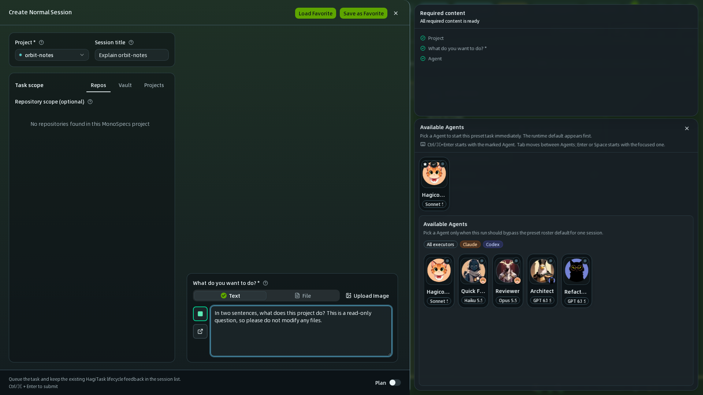
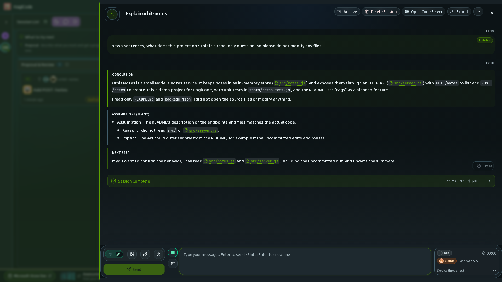
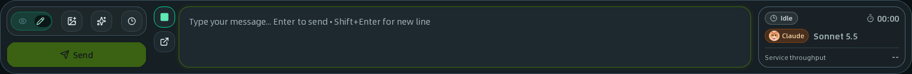
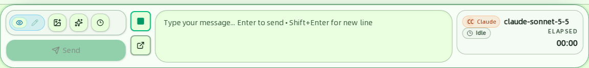
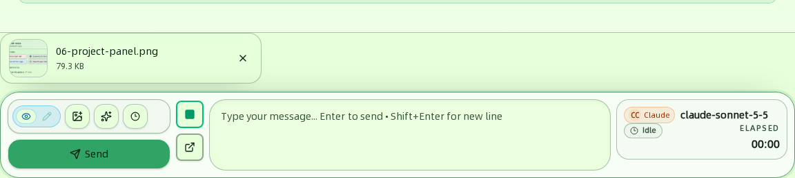
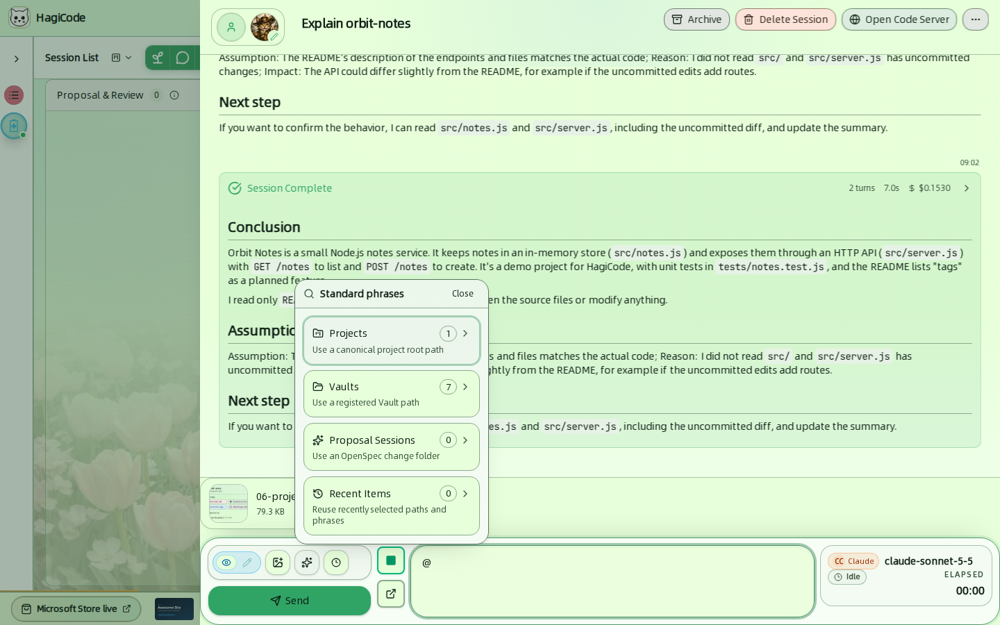

import { CardGrid, LinkCard } from '@astrojs/starlight/components';

普通会话是 HagiCode 最轻量的入口。选一个项目，提一个问题，让 Agent 阅读仓库并回答。是否允许 Agent 修改文件，由你按会话决定。

## 先决条件

开始普通会话之前，请确认你已经：

- 按照[安装指南](/installation)完成了任一种安装方式（Microsoft Store 或桌面版）
- 完成了[初始化向导设置](/quick-start/wizard-setup)，它会创建你的第一个 Agent 和至少一个项目
- 在会话看板上选中了该项目

## 普通会话适合做什么？

当你想先理解、后修改时，普通会话最合适。典型用途包括：

- 快速分析一个不熟悉的仓库
- 针对某个文件、模块或错误提出具体问题
- 不走提案流程，直接做一个小改动
- 发送前附上图片、标准用语或之前的消息

如果任务已经从“理解问题”进入“规划、评审并归档一次结构化变更”，请继续阅读[使用提案会话将主意转化为代码](/quick-start/proposal-session)。本页只介绍普通会话。

## 流程概览

| 阶段 | 你要做什么 | 会发生什么 |
| --- | --- | --- |
| 创建 | 点击 **Create Normal Session**（创建普通会话），描述你想做的事 | 抽屉收集项目、可选标题、范围和你的第一条消息 |
| 启动 | 从 **Available Agents** 中选一个 Agent | 会话立即开始，并出现在 **Execution**（执行）泳道 |
| 阅读 | 打开会话卡片 | Agent 阅读仓库并回答；**Session Complete**（会话完成）卡片汇总本次运行 |
| 决定 | 使用消息框旁边的模式开关 | 保持只读模式，或打开编辑模式，让 Agent 可以修改文件 |
| 补充上下文 | 使用图片、标准用语和历史按钮 | 下一条消息会带上更丰富的上下文 |

## 第 1 步：创建会话

选中你的项目，然后点击看板上方工具栏中的 **Create Normal Session**（创建普通会话，对话气泡图标）。

填写抽屉中的内容：

- **Project**（项目）（必填）– 默认为当前选中的项目。
- **Session title**（会话标题）– 选填；它会成为看板上卡片的标题。
- **Task scope**（任务范围）– 选填。**Repos**（仓库）把会话限定在 MonoSpecs 项目的若干仓库内，**Vault** 和 **Projects**（项目）可附加额外的参考资料。
- **What do you want to do?**（你想做什么？）（必填）– 你的第一条消息。**Upload Image**（上传图片）可以附加图片。

**Available Agents** 面板会在抽屉旁边打开。点击一个 Agent，会话就会**立即开始**。第一张卡片是运行时默认值；第二个列表可让你仅为本次运行选择另一个 Agent。你也可以按 `Ctrl/⌘ + Enter` 用键盘提交。

:::tip[先提问，不要先改动]
第一条消息可以这样写：“用两句话说明这个项目是做什么的，不要修改任何文件。”这是确认 Agent 和项目已正确连通的安全方式。
:::

## 第 2 步：阅读结果

新会话会以卡片形式出现在 **Execution** 泳道中，并带有状态徽标。点击它即可打开会话。

- **标题区**显示标题和 Agent，并带有 **Archive**（归档）、**Delete Session**（删除会话）、**Open Code Server**（打开 Code Server）以及一个 **…** 菜单。
- **对话**依次列出你的消息、折叠成紧凑账本行的 Agent 工具调用，以及它的回答。
- **Session Complete** 卡片会在每次运行结束时汇总轮数、耗时和费用。点击它可展开详情。
- 消息框右侧的 **Agent 状态卡片**显示 Agent CLI、模型、当前状态（例如 *Idle*（空闲））和已用时间。

在消息框中输入后续问题。按 `Enter` 发送，按 `Shift + Enter` 换行。

## 第 3 步：选择只读或编辑模式

消息框左侧的开关有两个位置。眼睛表示**只读**：Agent 可以查看和讲解，但不会修改文件。铅笔表示**编辑模式**：新消息更有可能修改文件或调整当前实现。

模式作用于你当前所在的会话，你可以在两条消息之间切换。**新建**的普通会话是否默认开启编辑模式，由 **Settings → Sessions and conversation → Chat View → Default to Edit Mode for Normal Chats**（设置 → 流程与交互 → 聊天视图 → 普通会话默认为编辑模式）控制。参见[设置](/user-guide/settings#chat-view聊天视图)。

更稳妥的做法很简单：先在只读模式下确认方向，真正需要改动时再切换到编辑模式。

## 第 4 步：发送前补充上下文

模式开关旁边的三个按钮可以为下一条消息补充上下文：

- **Insert an image attachment**（插入图片附件）– 附上截图、错误截屏或设计参考。图片会连同文件名和大小显示在消息框上方，发送前可以用 **×** 移除。
- **Standard Phrases**（标准用语）– 插入一个 `@` 引用。选择器提供 **Projects**（项目，规范的项目根路径）、**Vaults**（Vault，已登记的 Vault 路径）、**Proposal Sessions**（提案会话，即 OpenSpec 变更文件夹）和 **Recent Items**（最近条目）。
- **Import Recent History**（导入最近历史）– 复用本会话中的某条最近消息，不用重新输入。

图片适用于以下场景：

- 请 Agent 讲解一张界面截图
- 附上错误截图或设计稿，并补充后续说明
- 在切换到编辑模式之前提供视觉上下文

## 典型流程

1. 从工具栏**创建**会话，并选择一个 Agent。
2. 以**只读模式开始**，先问一个关于项目的问题。
3. **阅读回答**，然后继续追问。
4. 只有在需要直接修改文件时，才**打开编辑模式**。
5. **添加图片、标准用语或历史消息**，为下一条消息提供更多上下文。
6. 完成后**归档**会话，它会移到 **Archived**（归档）泳道。

如果任务现在需要规划、评审和归档的规范流程，请继续阅读提案会话指南。

## 下一步

<CardGrid>
  <LinkCard
    title="使用提案会话将主意转化为代码"
    href="/quick-start/proposal-session"
    description="当你已经理解项目、想把需求变成结构化计划时，请继续阅读这里。"
  />
  <LinkCard
    title="会话"
    href="/user-guide/sessions"
    description="完整介绍会话看板、布局和会话抽屉。"
  />
</CardGrid>
