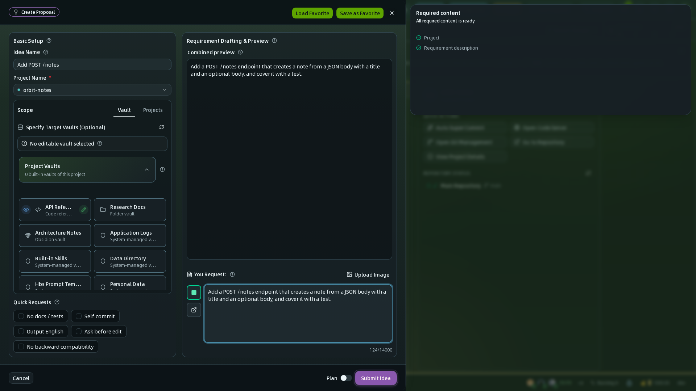
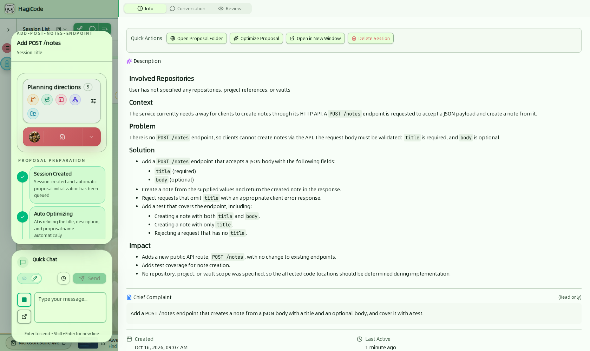
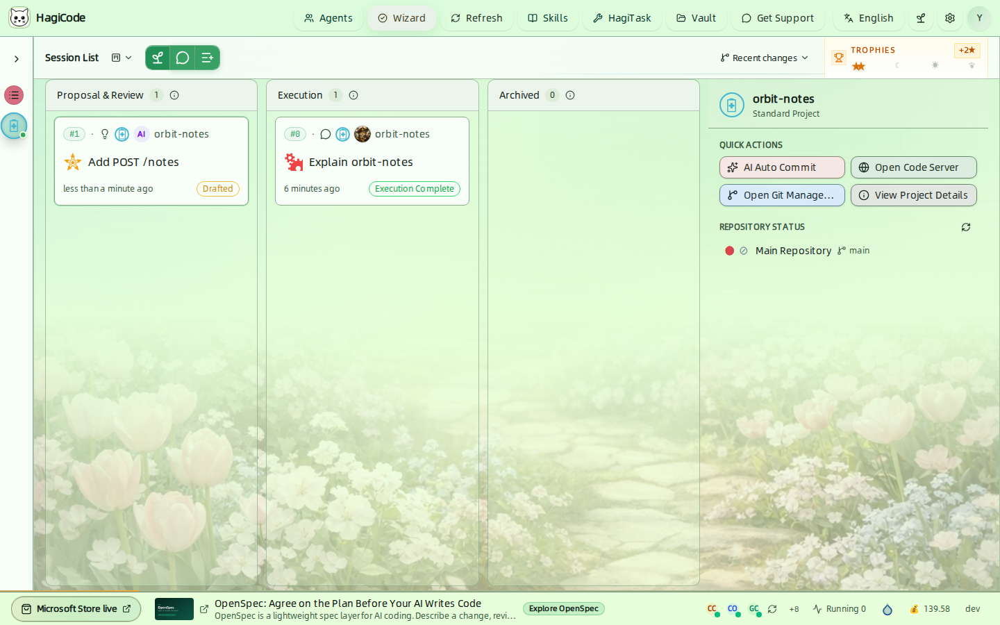

import { CardGrid, LinkCard } from '@astrojs/starlight/components';

当一个需求重要到不能只靠一条自由发挥的提示词来处理时，提案会话就是合适的入口。HagiCode 不会立即动手修改，而是先把需求整理成目标、范围、任务和验证标准，让你评审，之后才进入执行。

## 先决条件

开始提案会话之前，请确认你已经：

- 按照[安装指南](/installation)完成了任一种安装方式（Microsoft Store 或桌面版）
- 完成了[初始化向导设置](/quick-start/wizard-setup)，它会创建你的第一个 Agent 和至少一个项目
- 掌握了足够的项目上下文来描述这次变更；如果还没有，请先阅读[创建普通会话](/quick-start/conversation-session)
- 想了解提案会话背后的 OpenSpec 工作流，请先阅读 [OpenSpec 是什么](/related-software-installation/openspec/intro-openspec)

## 提案会话适合做什么

在以下情况下，提案会话最合适：

- 变更在开始编辑之前需要明确的范围
- 涉及多个仓库、模块或交付物
- 工作应拆分为可以逐步评审的步骤
- 你希望推理和执行的过程日后依然可见

如果你只需要了解仓库或做轻量讨论，普通会话更快。如果你需要结构和可追溯性，请继续阅读本页。

## 流程概览

| 阶段 | 你要做什么 | 会发生什么 |
| --- | --- | --- |
| 创建主意 | 点击 **New Idea**（新建主意），描述需求 | 创建提案会话，并排队等待自动优化 |
| 评审草稿 | 打开会话卡片 | HagiCode 优化标题和描述，并起草背景、问题、方案和影响 |
| 生成计划 | 点击 **Generate Plan**（生成规划） | Agent 编写 OpenSpec 计划文件 |
| 评审计划 | 在 **Review**（审查）标签页中阅读计划 | 在任何代码改动之前，由你确认或完善计划 |
| 执行并归档 | 运行计划，然后归档 | Agent 执行任务，完成的计划被归档 |

## 第 1 步：在 **New Idea** 抽屉中描述变更

选中你的项目，点击会话看板上方工具栏中的 **New Idea**（新建主意，嫩芽图标）。**Create Proposal**（创建提案）抽屉随即打开。

依次填写抽屉中的内容：

- **Idea Name**（主意名称）和 **Project Name**（项目名称）（必填）– 确认需求属于哪个项目。
- **Scope**（作用域）– 在 **Vault** 标签页中，标记 AI 可以编辑的 Vault；系统管理的 Vault 始终只能作为参考。在 **Projects**（项目）标签页中，可以把其他项目添加为上下文。
- **Quick Requests**（快捷需求）– 一键添加的内容，例如 *No docs / tests*（不含文档测试）、*Self commit*（自行提交）、*Output English*（输出中文，随界面语言变化）、*Ask before edit*（编辑前询问）和 *No backward compatibility*（不兼容旧版）。
- **You Request**（您的需求）– 用自然语言描述实际变更，最多 14,000 个字符。它上方的 **Combined preview**（组合预览）会显示将发送给 AI 的完整内容。

点击 **Submit idea**（提交主意）。如果这项工作同时涉及多个仓库，请在这里划定边界，而不是等到执行时再补充。

## 第 2 步：在详情视图中评审提案

提交之后，这个主意会以卡片形式出现在 **Proposal & Review**（提案与审核）泳道中，并带有状态徽标。点击它即可打开提案详情视图。

该视图把计划、进度和对话放在一起：

- **工作流步骤**（左侧）显示提案当前所处的位置。它们分为 **Proposal preparation**（提案准备，包含 *Session Created*（会话已创建）、*Auto Optimizing*（自动优化中）、*Drafting Ready*（起草已就绪））、**Review and refine**（审核完善，包含 *Generating Plan Files*（生成规划文件）、*Review Plan*（审阅规划））、**Execution complete**（执行完成，包含 *Executing Plan*（执行规划）、*Execution Completed*（执行完成））和 **Archive**（归档，包含 *Archiving*（归档中）、*Archived*（已归档））。
- **Planning directions**（规划方向）显示计划应探索哪些方向，例如变更地图、交互流程或架构。可以在 **Settings → Proposals and planning → Planning Direction**（设置 → 流程与交互 → 规划方向）中调整默认值。
- **Info**（信息）标签页（右侧）显示已起草的描述（*Context*、*Problem*、*Solution*、*Impact*，即背景、问题、方案、影响），以及你的原始需求（位于 **Chief Complaint**（用户主诉）下）。快捷操作可以 **Open Proposal Folder**（打开当前提案目录）、**Optimize Proposal**（优化提案）、**Open in New Window**（在新窗口打开）或 **Delete Session**（删除会话）。
- **Conversation**（对话）和 **Review** 标签页包含与 Agent 的讨论以及对生成计划的评审。
- **Quick Chat**（快捷聊天，左下角）让你无需离开当前视图就能向 Agent 发消息。

如果目标、范围或任务拆分在这里看起来不对，请在继续之前修正提案。这正是这套流程的意义所在。

## 第 3 步：生成、评审、执行并归档

草稿没问题后，点击 **Generate Plan**。Agent 会编写 OpenSpec 计划文件，会话进入 **Review Plan**，让你在任何代码改动之前检查结果。评审之后，会话继续进入 **Executing Plan**，最后到达 **Archiving** 和 **Archived**。

在难以撤销的步骤之前，例如生成提案、立即执行或归档，HagiCode 会要求确认。你可以在 **Settings → General → Confirm Prompts**（设置 → 流程与交互 → 确认提示）中调整这些提示。

执行之后，可以使用 [Super Commit](/guides/ai-compose-commit) 把最终的改动整理成清晰的提交信息。

## 第 4 步：在会话看板上跟踪提案

当一个项目有多个提案，或者提案与普通会话混在一起时，会话看板是最清晰的总览。

- **Proposal & Review** 存放正在起草、生成和评审的主意。
- **Execution**（执行）存放正在运行或已完成的会话。
- **Archived**（归档）把已完成的工作收起来，但仍可随时回看。

每张卡片都会显示它的状态，例如 *Optimizing*（优化中）、*Drafted*（已起草）、*Reviewing*（审阅中）、*Executing*（执行中）或 *Execution Complete*（执行完毕）。你可以用布局切换器切换看板布局，参见[会话](/user-guide/sessions)。

## 何时优先选择提案会话

在以下情况下，请先选择提案会话：

- 变更很复杂，你不希望 AI 过早地自由发挥
- 工作日后会被评审或与他人共享
- 涉及多个仓库、模块或角色
- 你希望执行历史和理由可以被复用

如果任务还很小、仍处于探索阶段，普通会话通常是更轻的路径。

## 下一步

<CardGrid>
  <LinkCard
    title="创建普通会话"
    href="/quick-start/conversation-session"
    description="如果在规划变更之前还需要先了解仓库，请从更轻量的普通会话流程开始。"
  />
  <LinkCard
    title="Super Commit"
    href="/guides/ai-compose-commit"
    description="提案执行完成后，继续阅读如何根据最终改动生成更清晰的提交信息。"
  />
</CardGrid>
