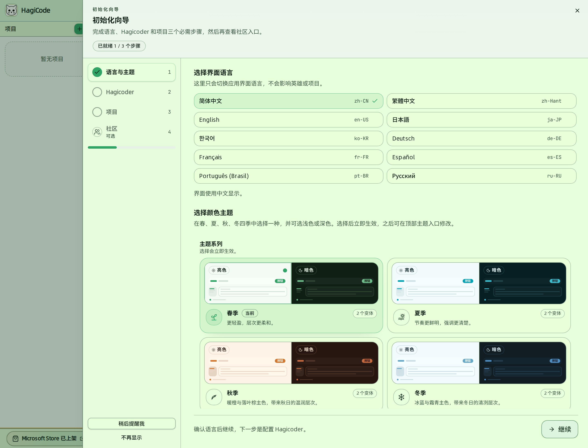
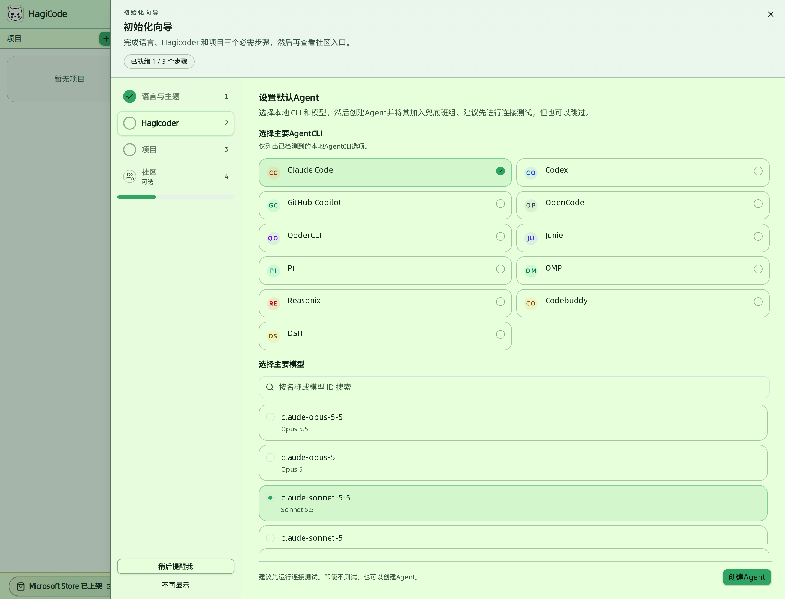
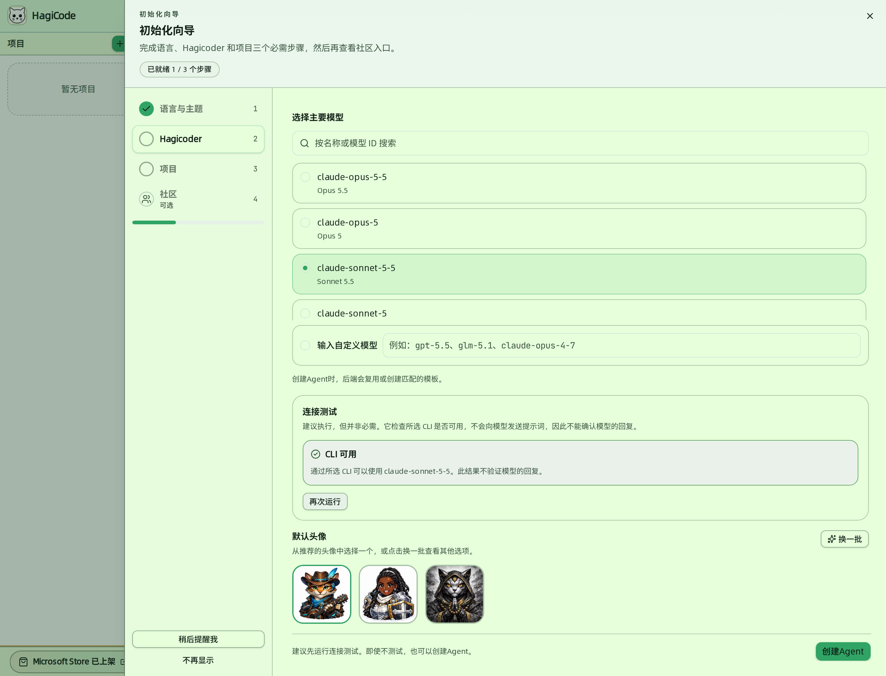
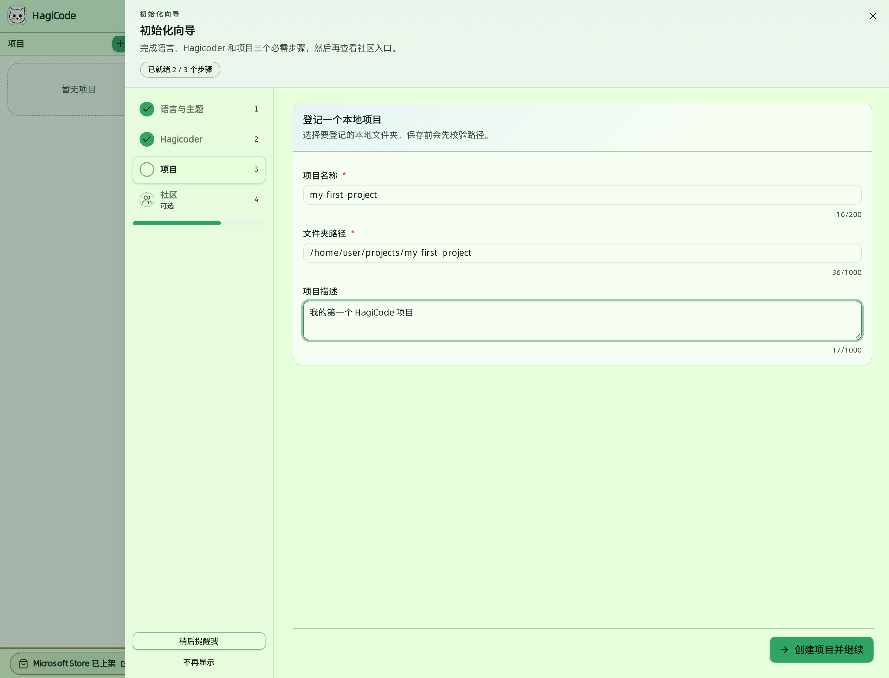
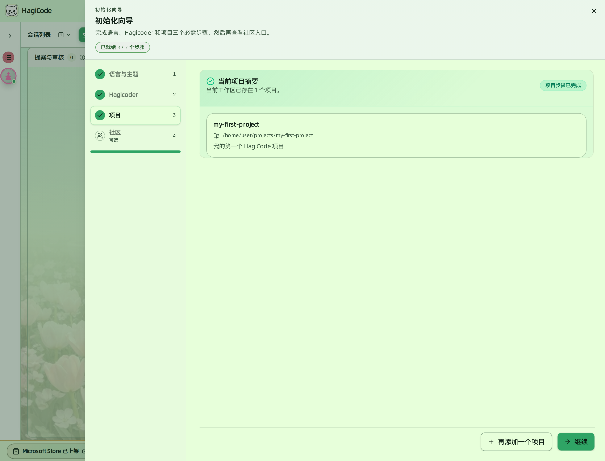
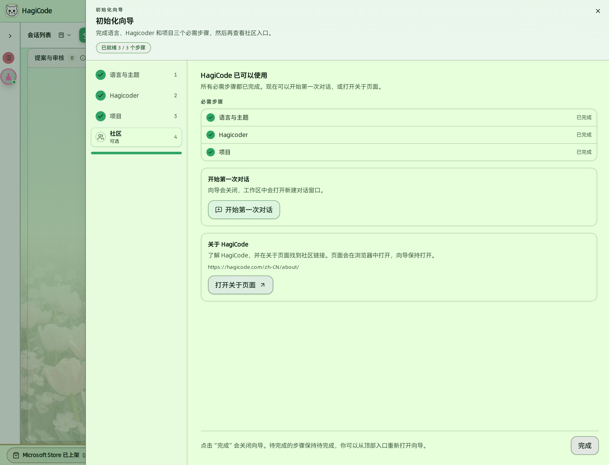

import { CardGrid, LinkCard } from '@astrojs/starlight/components';

无论通过 [Microsoft Store](/installation/windows-store)、[Desktop](/installation/desktop) 还是 [Docker Compose](/installation/docker-compose) 安装，首次打开 HagiCode 的 Web 界面时都会自动弹出 **初始化向导**。完成它之后，您会拥有一个可用的默认 Hagicoder 和至少一个项目，可以直接开始第一次会话。

:::note[它与 Desktop 的首次使用引导不同]
Desktop 首次启动时的“首次使用引导”（选择语言、确认法律文档、下载 Hagicode Server）发生在 Web 界面出现之前，见 [Desktop 安装](/installation/desktop#首次启动引导)。本页说明的是之后在 Web 界面里出现的初始化向导。
:::

## 开始之前

请先确认：

- **已安装并登录至少一个 Agent CLI**。向导只会列出运行 Hagicode Server 的这台机器上已检测到的 CLI，没有检测到时无法创建 Hagicoder。支持的 CLI 与安装方式见 [AI Agent CLI 安装](/related-software-installation/ai-agent-cli/)。
- **Desktop / Store 用户**：已按 [安装指南](/installation/#安装前准备) 安装 Node.js 24+ 与 Git。
- **Docker 用户**：已在 Docker Compose Builder 中配置好 API 提供商与 Token。
- 准备好一个要接入的本地仓库或工作目录：步骤 3 会让您登记它，路径必须真实存在。

## 向导总览

向导由 4 个步骤组成，左侧导航会显示当前进度，顶部的徽标显示“已就绪 N / 3 个步骤”。其中前 3 步是 **必需步骤**，第 4 步“社区”标记为 **可选**：

| 步骤 | 目标 | 完成标志 |
| --- | --- | --- |
| 1. 语言与主题 | 选择界面语言，并挑选一套季节配色 | 点击“继续”确认语言 |
| 2. Hagicoder | 选择 CLI 与模型，创建默认 Hagicoder | Agent 显示“已在兜底班组中” |
| 3. 项目 | 至少登记一个本地项目 | 项目步骤显示“项目步骤已完成” |
| 4. 社区（可选） | 开始第一次对话，或查看社区入口 | 点击“完成” |

左下角的“稍后提醒我”会先收起向导、之后再提醒；“不再显示”会关闭自动弹出。两种方式都可以随时从页面顶部的“向导”入口重新打开向导，未完成的步骤会保持待完成。

## 步骤 1：语言与主题

**目标**：确定界面语言和颜色主题。

1. 在“选择界面语言”中点选一种语言（支持 10 种）。这里只切换应用界面语言，不会影响英雄或项目。
2. 在“选择颜色主题”中为春、夏、秋、冬任一季节选择“亮色”或“暗色”变体。选择后立即生效，之后可以从页面顶部的主题入口再改。
3. 点击“继续”。确认语言后进入下一步 Hagicoder。

## 步骤 2：设置 Hagicoder

**目标**：创建默认 Agent，名字固定为 **Hagicoder**，并把它加入兜底班组。

如果系统里已经有 Agent，这一步会提示“找到 Agents”或直接显示“Agent 已在兜底班组中”：

- 已有 Agent 但不在兜底班组中时，可以点击“加入兜底班组”，也可以改为“创建新的 Agent”。向导不会自动替您加入。
- 已经在兜底班组中时，直接点击“下一步：创建项目”即可。

否则按下面的流程创建：

1. **选择主要 AgentCLI**：只显示本机已检测到的 CLI，选中的卡片右侧会出现对勾。
2. **选择主要模型**：
   - 在列表中选一个现有模型，可用上方的搜索框按名称或模型 ID 过滤。
   - 或在“输入自定义模型”里手动输入模型名，例如 `gpt-5.5`、`glm-5.1`、`claude-opus-4-7`，创建时后端会复用或新建匹配的模板。

   

3. **（建议）点击“运行连接测试”**：检查所选 CLI 是否可用。它 **不会** 向模型发送提示词，因此只能确认 CLI 能被调用，不能确认模型的回复。结果为“CLI 可用”即通过；测试失败或超时不会阻止创建，但在修复 CLI 之前它可能无法正常工作。
4. **（可选）选择默认头像**：从推荐头像中点选一个，或点击“换一批”查看其他选项。
5. 点击“创建 Agent”。成功后页面显示“Agent 已在兜底班组中”，所选 CLI 与模型会写入 Hagicoder 的默认配置。

   

6. 点击“下一步：创建项目”。

:::tip[支持哪些 CLI]
向导里能选的 CLI 取决于本机已安装并被检测到的 Agent CLI，不限于某一种。完整的支持范围与安装方式以 [AI Agent CLI 安装](/related-software-installation/ai-agent-cli/) 为准；其中 Hermes、Gemini、DeepAgents 需要先完成手动安装或认证。
:::

**常见问题**

- **提示“没有可用的本地 CLI”**：请先按 [AI Agent CLI 安装](/related-software-installation/ai-agent-cli/) 在这台电脑上安装并登录 CLI，然后点击“重新检测”。也可以点击“暂时跳过”，这一步会保持未完成，向导之后还会提醒您。
- **列表里没有我的 CLI**：确认它已安装并在运行 Hagicode Server 的环境中可用；Desktop 用户请重启 Desktop 以刷新 `PATH`。
- **连接测试失败**：页面会显示失败原因。常见原因包括 CLI 尚未登录或令牌无效。请先在终端里用该 CLI 跑一次最小对话，确认它本身可用，再点击“再次运行”。
- **Agent 已创建，但加入兜底班组失败**：页面会提供“重试加入兜底班组”，重试只会加入同一个 Agent，不会重复创建。

## 步骤 3：创建项目

**目标**：至少登记一个项目，让后续会话有可读的工作目录。向导会先检测是否已经有项目：没有时显示登记表单，已有时显示当前项目摘要。

1. 在“登记一个本地项目”中填写 **项目名称**（必填）、**文件夹路径**（必填）以及可选的 **项目描述**。字段与路径校验和主界面的“新建项目”对话框完全一致。
2. 点击“创建项目并继续”。路径会在保存时校验，校验通过后项目被创建，向导自动进入下一步。
3. 项目创建后再回到本步骤，会看到“当前项目摘要”和“项目步骤已完成”的标记。此时可以点击“继续”进入社区，也可以点击“再添加一个项目”登记更多项目（再用“添加项目”保存，或“取消”返回摘要）。

:::tip[想先用示例项目体验？]
向导里只提供登记本地项目。“演示项目”位于主界面的“新建项目”对话框的“演示项目”页签：它会自动克隆并注册官方 MonoSpecs Demo 仓库，默认路径为 `data/repos/monospecs-demo`，实际目录以运行时的数据目录（DataDir）配置为准。该方式需要 Git，并且能访问 GitHub。
:::

**常见问题**

- **提示“项目创建失败”**：确认文件夹路径正确且真实存在；Docker 部署时，填写的必须是容器内可访问的挂载目录，而不是宿主机上的路径。

## 步骤 4：社区

**目标**：确认准备就绪，并选择下一步做什么。这一步是可选的。

三个必需步骤都完成后，页面会显示“HagiCode 已可以使用”和三个必需步骤的完成状态：

- **开始第一次对话**：点击后向导关闭，工作区中会打开新建对话窗口。对话需要项目，如果还没有项目，这里会提示“请先创建项目”，并提供“前往项目步骤”的按钮。
- **关于 HagiCode**：点击“打开关于页面”会在浏览器中打开官网“关于”页，那里汇总了完整的社群入口，向导保持打开。
- **完成**：点击右下角“完成”会关闭向导。若还有必需步骤未完成，它们会保持待完成，您可以从页面顶部的“向导”入口重新打开。

## 下一步

<CardGrid>
  <LinkCard
    title="创建普通会话"
    href="/quick-start/conversation-session"
    description="先用默认只读模式让 AI 读懂项目，确认方向后再决定是否切到编辑模式。"
  />
  <LinkCard
    title="创建提案会话"
    href="/quick-start/proposal-session"
    description="需要拆分计划、评审方案时，使用提案会话把想法变成结构化的实施计划。"
  />
</CardGrid>
