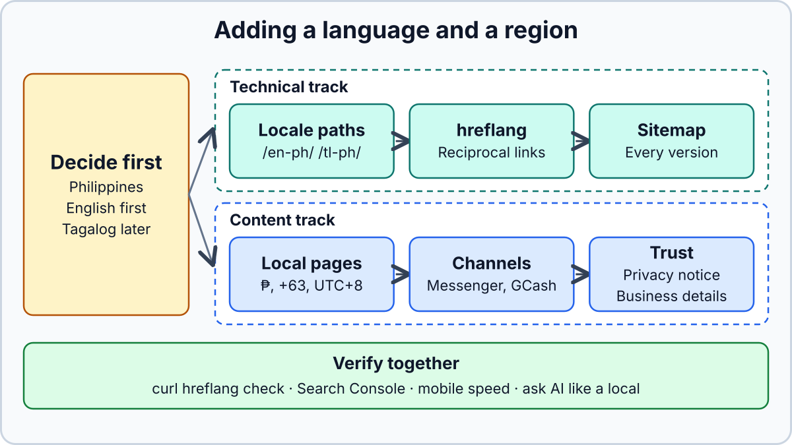

[Первое руководство](/ru-RU/blog/2026-11-23-mac-astro-site-claude-github-cloudflare/) проведёт вас от чистого Mac до запущенного в продакшн сайта на Astro. [Второе руководство](/ru-RU/blog/2026-11-25-astro-site-google-analytics-search-console-seo-claude/) подключает Google Analytics, Search Console, карту сайта, социальные теги и favicon. Теперь сайт запущен и его можно измерять, и теоретически поисковые системы уже могут его найти.

Чего ему по-прежнему не хватает, так это двух вещей: причины, по которой посетитель останется, и способа понять, что писать дальше. На эти вопросы нет ответа «раз и навсегда». Нужен цикл: смотреть на доказательства, решить, какое изменение сделать, сделать его, доказать, что оно работает, и извлечь уроки из результата.

В этом руководстве показано, как запускать этот цикл с помощью Claude Code, чтобы вы могли продолжать двигаться дальше самостоятельно. Готового списка задач здесь нет. Это способ работы, который вы сможете повторять каждую неделю.

Прочитав его, вы будете знать, как:

1. Научить Claude вашему сайту, чтобы каждая сессия начиналась с известной информации.
2. Пройти восьмиэтапный цикл для любого улучшения: изучение, планирование, исследование, выполнение, проверка, публикация, измерение, обучение.
3. Находить, проверять, устанавливать, тестировать и писать собственные навыки Claude (skill).
4. Применять цикл к шести направлениям работы: исследование рынка, контент, язык и регион, SEO, видимость в ИИ и конверсия.
5. Добавлять новые языки и региональные рынки; в качестве примера в этом руководстве используются Филиппины.
6. Делать цикл безопасным: источники, одобрение, конфиденциальность и разумный темп.

## Для кого это руководство

Оно для тех, кто уже прошёл первые два руководства: у вас есть сайт на Astro в репозитории GitHub, каждый push в `main` автоматически развёртывается, настроены Google Analytics и Search Console, и установлен Claude Code.

В примерах предполагается, что сайт на английском языке, ориентирован на посетителей из Филиппин, а домен — `example.com`. Замените рынок, язык и домен на свои. Этот подход не привязан к конкретной стране.

## Общая картина: один цикл и шесть направлений работы

### Цикл

От новой страницы до нового языка каждое улучшение проходит через одни и те же восемь этапов.


| Этап | Что делает Claude | Что делаете вы | Что остаётся после этапа |
| --- | --- | --- | --- |
| 1. Изучение | Читает сайт и заметки, проводит аудит текущего состояния, ничего не меняя | Решает, какой вопрос важнее всего | Отчёт аудита |
| 2. Планирование | Предлагает одну цель, шаги и способ проверить успех | Одобряет, сокращает или отклоняет | Файл плана |
| 3. Исследование | Собирает источники, сравнивает варианты, помечает непроверенное | Выборочно проверяет источники | Датированные исследовательские заметки |
| 4. Выполнение | Пишет контент или код небольшими шагами | Проверяет изменения | Изменения, ожидающие проверки |
| 5. Проверка | Собирает проект, открывает предпросмотр и запускает проверки | Смотрит на результаты | Чек-лист с пройденными проверками |
| 6. Публикация | Делает commit, push, ждёт развёртывания и проверяет сайт в сети | Одобряет публикацию | Версия в продакшне |
| 7. Измерение | Читает данные, которые вы экспортировали | Экспортирует данные | Снимок данных |
| 8. Обучение | Записывает, что сработало, и что пробовать дальше | Решает следующую цель | Обновлённые заметки и контекст |

Три правила помогают циклу оставаться честным.

1. **Одна небольшая цель за итерацию.** Одна страница, один набор заголовков, один язык. Маленькую итерацию легко проверить и легко откатить.
2. **Каждая итерация оставляет проверяемые доказательства.** Файл, вывод команды, число или ссылка. Если нельзя ничего показать, значит, ничего и не произошло.
3. **Решение за вами.** Claude отвечает за изучение, исследование, написание и проверку. Вы одобряете план до начала работы и результат до публикации.

### Шесть направлений работы

Цикл — это двигатель, а задачи, которые вы ему даёте, делятся на шесть направлений. У них общий контекст: ваши заметки, правила, навыки и репозиторий.


Каждое из направлений описано в отдельном разделе ниже. Сначала заложим основу.

## Шаг 1: научите Claude вашему сайту

Каждая сессия Claude начинается с нулевым знанием о вашем сайте, поэтому память — это файлы. Работают два типа файлов:

- `CLAUDE.md` в корне проекта. Claude Code читает его в начале сессии, поэтому храните здесь устойчивые факты и правила.
- Датированные заметки в `research/` и `plans/`, где записано, что вы узнали и что решили.

Один из возможных вариантов структуры каталогов:

```text
my-astro-site/
├── CLAUDE.md          # для кого сайт, тон, правила, процесс работы
├── research/          # датированные заметки с источниками и экспортированные метрики
├── plans/             # короткий план для каждой итерации
├── src/               # сам сайт
└── .claude/skills/    # навыки проекта (см. шаг 3)
```

Запустите Claude в папке проекта и попросите его составить этот файл. В Claude Code также есть команда `/init`, которая создаёт первую версию `CLAUDE.md` по репозиторию. В любом случае отредактируйте результат так, чтобы он соответствовал вашей реальной ситуации.

```text
Создай CLAUDE.md для этого сайта, а также пустые папки research/ и plans/, в каждой из которых лежит короткий README.

CLAUDE.md должен содержать:
- Для чего сайт, для кого он и одно действие, которое мы хотим, чтобы посетитель совершил.
- Основной рынок: Филиппины. Языки: сначала английский, позже филиппинский. Большинство посетителей пользуются телефонами.
- Тон: простой, дружелюбный, конкретный. Без преувеличений и без выдуманных цифр.
- Правила: у каждого факта в заметках или контенте должна быть ссылка на источник и дата, когда вы его увидели. Непроверенное помечать как «не проверено». Никогда не публиковать без моего одобрения плана и результата. Никогда не помещать персональные данные посетителей в заметки или промпты.
- Процесс: небольшие изменения, npm run build, commit, push в main, ожидание двух развёртываний, проверка живого сайта через curl.
- Где лежат файлы каждого типа.

Покажи мне файл перед сохранением.
```

Проверка: откройте новую сессию Claude и попросите: «Кратко расскажи, что ты знаешь об этом сайте». Ответ должен соответствовать `CLAUDE.md`. Если нет, проблема в неясном файле, а не в Claude.

## Шаг 2: восемь этапов на практике

### 1. Изучение

Начинайте с аудита только для чтения. Ничего не меняется, поэтому нечего откатывать.

```text
Изучи этот сайт и составь отчёт. Не меняй ни один файл.

Охвати: список страниц и связи между ними, назначение каждой страницы, заголовки и описания, где расположены призывы к действию, какие события отслеживаются, а также всё, что выглядит тонким, дублирующимся или сломанным.

Запиши отчёт в research/YYYY-MM-DD-audit.md и укажи пять самых важных улучшений, отсортированных по приоритету, с объяснением причин.
```

### 2. Планирование

Переключите Claude Code в режим планирования (Shift+Tab). Тогда он сможет читать и предлагать, но не редактировать. Хороший план помещается на одной странице.

```text
На основе research/YYYY-MM-DD-audit.md предложи одну цель для этой итерации.

Запиши в plans/YYYY-MM-DD-goal.md:
- Цель: одно предложение.
- Причина: доказательства из наших заметок или данных.
- Шаги: не больше пяти, каждый достаточно мал, чтобы его можно было проверить.
- Критерии приёмки: как мы поймём, что это сработало, включая то, что видно сразу после публикации, и то, что проявится через несколько недель.
- Чего не делаем: что явно исключено.
- Откат: как всё отменить.

После написания плана остановись и дождись моего одобрения.
```

Это первая точка одобрения. Сокращайте план, пока его можно будет изложить одним духом.

### 3. Исследование

Исследование рынка с ИИ и анализ конкурентов происходят здесь. Это также место, где ИИ легче всего введёт вас в заблуждение, поэтому зададим ему правила.

```text
Исследуй для этого плана такой вопрос: что люди на Филиппинах ищут и о чём спрашивают, когда ищут [ваша тема]? Что предлагают три ведущих конкурирующих сайта?

Правила:
- Используй только публичные страницы. Не входи никуда и не обходи никаких ограничений.
- У каждого утверждения должна быть ссылка на источник и дата, когда ты его увидел.
- Отдели «нашёл на странице» от «мой вывод».
- Не выдумывай статистику. Если цифры нет, так и напиши: «не проверено».
- Сохрани по шаблону в research/YYYY-MM-DD-topic.md.

Шаблон:
# Вопрос
# Результаты (утверждение, ссылка на источник, дата просмотра, уверенность: высокая, средняя или низкая)
# Не проверено
# Что это меняет в плане
```

Claude Code умеет искать в интернете и загружать страницы, и может попросить вашего одобрения на использование этих инструментов. Когда он закончит, откройте три источника и проверьте, действительно ли они подтверждают то, что записано в заметках. Если хоть одно не совпадает, не доверяйте всей заметке и попросите Claude переделать её.

Реальные вопросы клиентов — лучший материал для исследования. Можно поместить обращения в службу поддержки или обсуждения в сообществе в `research/`, но предварительно удалите имена, адреса электронной почты и любые персональные данные.

### 4. Выполнение

Теперь Claude пишет по плану, шаг за шагом.

```text
Сделай только шаг 1 из plans/YYYY-MM-DD-goal.md и ничего больше. Соблюдай CLAUDE.md. Запусти npm run build, и если сборка пройдёт, покажи мне diff.
```

При написании сначала нужен бриф, потом черновик, а потом ваша правка. Черновик ИИ — это только отправная точка. Делает страницу полезной то, что может написать только вы: реальные цены, реальные примеры, ваши собственные скриншоты, ваше мнение. Это добавляете вы.

### 5. Проверка

Проверка устроена как лестница. Каждая ступень ближе к реальному результату, но и приходит она позже.


Ступени 1–3 можно пройти сразу, и Claude сделает это за вас. Ступень 4 занимает день с внешними инструментами. Ступени 5 и 6 зависят от поисковых систем и посетителей, и им нужны дни или недели. Если ступень не пройдена, не заявляйте, что она пройдена. «Сборка прошла» не означает «опубликовано», а «опубликовано» не означает «работает».

```text
Проверь это изменение на трёх уровнях и сообщи, что именно ты проверил и что проверить не смог:
1. npm run build проходит без ошибок.
2. После развёртывания запроси живой URL через curl и подтверди код ответа, заголовок, описание, канонический линк и все блоки JSON-LD.
3. Запусти Lighthouse или PageSpeed для мобильной версии страницы и перечисли все показатели ниже 90.
```

### 6. Публикация

Публикация — вторая точка одобрения. После вашего одобрения Claude выполняет механическую работу и доказывает результат, как и в первых двух руководствах.

```text
Сделай commit с понятным описанием, запушь в main, дождись завершения workflow GitHub Pages и сборки Cloudflare, затем запроси живую страницу через curl и подтверди, что изменение там есть. Перечисли результаты каждой проверки.
```

Для важных новых страниц откройте Search Console, вставьте URL в поле проверки URL и запросите индексацию. Bing и другие поисковые системы также поддерживают протокол IndexNow для уведомления о новых страницах. Google IndexNow не использует.

### 7. Измерение

Claude не может войти в Google за вас. Самый простой и надёжный способ — экспортировать данные самостоятельно и положить их в репозиторий.

1. В Search Console откройте **Эффективность**, задайте диапазон дат, установите фильтр по стране на Филиппины и экспортируйте поисковые запросы и страницы.
2. В Google Analytics экспортируйте количество срабатываний ключевых событий.
3. Сохраните оба файла в `research/metrics/` с датой в имени.

```text
Прочитай самый свежий файл в research/metrics/ и сравни его с предыдущим снимком.

Запиши в research/YYYY-MM-DD-metrics.md: поисковые запросы, показы которых выросли или упали; страницы с большим числом показов и малым числом кликов; какие события сработали; и одну гипотезу для каждого заметного изменения. Каждая гипотеза должна быть явно помечена как гипотеза.
```

Для нового сайта цифры будут маленькими. Не переоценивайте изменения, основанные на нескольких кликах, смотрите на направление за несколько недель.

### 8. Обучение

Последний этап, который большинство пропускает, и именно он даёт циклу накопительный эффект.

```text
Заверши эту итерацию. Обнови CLAUDE.md или исследовательские заметки тем, что нужно знать в следующих итерациях: что мы пробовали, что показывают доказательства, что больше не будем пробовать и почему. Затем предложи следующую цель с доказательствами и остановись.
```

## Шаг 3: навыки — поиск, проверка, тестирование, накопление, распространение

Навык — это папка с файлом `SKILL.md`, который учит Claude повторяемой задаче. В начале файла стоит короткий блок front matter с полями `name` и `description`, а дальше идут подробные инструкции. Claude решает, когда использовать навык, по его описанию, а вы можете вызвать его напрямую командой `/skill-name`.


Навыки можно размещать в трёх местах:

| Область | Расположение | Подходит для |
| --- | --- | --- |
| Личная | `~/.claude/skills/<name>/SKILL.md` | Личные привычки, которые нужны во всех проектах |
| Проектная | `.claude/skills/<name>/SKILL.md` | Постоянные процессы этого сайта, общие через git |
| Плагин | Установка через `/plugin` | Навыки, которые упаковал и поддерживает кто-то другой |

Claude Code следит за личными и проектными папками навыков, поэтому новые навыки обычно появляются в текущей сессии. Если не появились, выполните `/reload-skills`. Команда `/skills` показывает доступные сейчас навыки.

### Поиск

Искать можно в трёх местах: в маркетплейсе плагинов (откройте `/plugin` для просмотра и добавьте маркетплейс командой `/plugin marketplace add owner/repo`), в каталогах навыков сообщества и в репозиториях GitHub. Есть наборы навыков для маркетинга, например для SEO-аудита, редактуры текстов, анализа конкурентов и оптимизации под AI-поиск. Публичный пример — репозиторий `coreyhaines31/marketingskills`, в котором есть `seo-audit` и `ai-seo`. Это сторонняя работа, поэтому относитесь к ней так же, как к любому коду, который написали не вы.

### Проверка

Навык — это инструкция, а иногда и скрипты, которые будут выполняться на вашей машине. Прочитайте его до установки.

```text
Я хочу оценить навыки seo-audit и ai-seo из репозитория coreyhaines31/marketingskills. Пока ничего не устанавливай.

Прочитай каждый SKILL.md и все скрипты или справочные файлы, которые он включает, затем скажи мне:
- Что делает этот навык, в двух предложениях.
- Какие инструменты или команды он требует, есть ли среди них команды оболочки.
- Читает или пишет ли он файлы за пределами этого проекта или делает ли сетевые запросы.
- Что выглядит не связанным с его заявленным назначением.

Затем посоветуй, устанавливать ли его.
```

Ваш чек-лист проверки: источник известен по имени, вы прочитали `SKILL.md`, нет скриптов, которые вы не понимаете, нет неожиданного сетевого доступа, назначение узкое.

### Установка и пробный запуск

Сначала устанавливайте в область проекта, чтобы не влиять на другую вашу работу. Используйте точные команды из README репозитория или попросите Claude сделать это и показать, какие команды он выполнил.

Затем протестируйте на реальной задаче и сравните:

```text
Проведи аудит главной страницы и одной статьи блога. Сначала ответь без каких-либо навыков. Затем повтори тот же аудит с навыком seo-audit. Сравни два отчёта: какие проблемы нашёл навык, которые пропустил обычный ответ, и где он ошибся или занялся «водой»? Сохрани сравнение в research/.
```

Если навык не срабатывает автоматически, вызовите его напрямую `/seo-audit` и проверьте, ясно ли в его `description`, для каких случаев он предназначен.

### Написание собственных навыков

Любой процесс, который вы повторяете, — это навык, который ждёт, чтобы его написали. Ниже навык, который публикует статью и доказывает, что она появилась в сети. Поскольку публикация имеет побочные эффекты, в нём задано `disable-model-invocation: true`, поэтому он запускается только когда вы вводите `/publish-post`.

```markdown
---
name: publish-post
description: Publish a finished blog post on this site and prove it is live. Use when the user asks to publish, ship or release a post.
disable-model-invocation: true
---

Publish the post the user names.

1. Run `npm run build`. Stop if it fails.
2. Check that the front matter has a title, description and date.
3. Commit with a clear message and push to `main`.
4. Wait for both deployments: `gh run watch` first, then the Cloudflare build.
5. Request the live URL with `curl -s` and confirm the title, description and JSON-LD block are present.
6. Report what you checked and what you could not check.
```

Сохраните его как `.claude/skills/publish-post/SKILL.md` и закоммитьте, после чего он станет частью проекта. Следующими кандидатами на навыки стоят еженедельный отчёт по метрикам, обновление данных о конкурентах и проверка hreflang.

### Распространение

Навыки проекта распространяются через commit. Чтобы делиться навыками между сайтами или с другими людьми, упакуйте их в плагин и опубликуйте файл маркетплейса. Подробности — в [документации Claude Code по плагинам](https://code.claude.com/docs/en/discover-plugins). Полный список параметров front matter — в [документации по навыкам](https://code.claude.com/docs/en/skills).

## Шаг 4: запуск цикла в шести направлениях

У всех направлений одна отправная точка: общий промпт ниже, который просит Claude провести одну итерацию цикла в выбранном вами направлении.

```text
Проведи одну итерацию улучшения этого сайта, сосредоточившись на [направлении].

1. Прочитай CLAUDE.md, а также самые свежие файлы в research/ и plans/.
2. Предложи одну цель для этой итерации и доказательства, которые её поддерживают. Остановись и дождись моего одобрения.
3. После одобрения сначала напиши файл плана, затем проведи исследование, выполни работу и проверь. Остановись перед публикацией и покажи мне результат.
4. После одобрения публикации опубликуй и проверь живой сайт.
5. Запиши, чему мы научились, и предложи следующую цель.
```

Движение информации в цикле устроено одинаково: источники становятся пониманием, понимание становится страницами, страницы приносят конверсии, а данные о конверсиях возвращаются к источникам.


### A. Исследование рынка и конкурентов

- **Цель:** знать, кому вы служите, какие вопросы они задают и что предлагают альтернативы.
- **Входные данные:** поисковые запросы из Search Console, вопросы клиентов, публичные страницы конкурентов и ответы AI-ассистентов на вопросы по вашей теме.
- **Пример итерации:** «Сравнить, как три конкурента объясняют цены, и что они не говорят».
- **Проверка:** у каждого утверждения есть источник и дата, и вы открыли три из них.
- **Результат:** исследовательская заметка, которая подаётся на вход плану контента.

### B. Контент и страницы вопросов и ответов

- **Цель:** отвечать на реальные вопросы лучше альтернатив.
- **Как:** одна страница на один реальный вопрос; первый абзац даёт прямой ответ, а подробности идут дальше. Добавляйте страницы, которые ясно описывают факты: что вы предлагаете, как это работает, сколько стоит, какие есть ограничения. Для вопросов формата «A или B» делайте страницы сравнения.
- **Вопросы должны иметь источник:** из Search Console, сообщений клиентов, обсуждений в сообществе и ответов AI-ассистентов. Не придумывайте вопросы ради заполнения шаблона.
- **Не массовое производство страниц.** У поисковых систем есть явная политика против большого количества низкокачественного созданного контента. Несколько хороших страниц лучше сотни тонких.
- **Проверка:** у каждой страницы есть цель, у каждого факта есть источник, и на ней есть то, что можете написать только вы.

### C. Язык и регион (на примере Филиппин)

Сначала определите рынок и язык, затем параллельно ведите две линии и проверьте всё вместе.



**Техническая линия.** Дайте каждому языку и региону отдельный путь URL, например `/en-ph/` для английского на Филиппинах. Свяжите каждую версию с остальными через `hreflang`. Правила Google конкретны:

- Язык — это код ISO 639-1, регион (необязательно) — код ISO 3166-1 alpha-2, например `en-PH`. Поддерживаются только коды языков ISO 639-1, поэтому `fil` для филиппинского языка недействителен. Если добавляете филиппинскую версию, используйте `tl` (тагальский) в виде `tl-PH` и проверьте её показатели в Search Console.
- Каждая версия должна перечислять себя и все остальные версии. Если страница X ссылается на страницу Y, страница Y должна ссылаться обратно на X, иначе эти теги будут проигнорированы.
- Добавьте запись `x-default` для посетителей, которые не подходят ни под одну версию.
- Всё это можно объявить в `<head>` страницы, в HTTP-заголовках или в карте сайта.

В Astro есть встроенная маршрутизация i18n, а интеграция карты сайта может добавлять альтернативные языковые версии. Попросите Claude сверяться с документацией для установленной вами версии, а не угадывать.

```text
Добавь английскую (Филиппины) версию сайта по пути /en-ph/ и подготовь почву для филиппинской версии в /tl-ph/ позже. Используй маршрутизацию i18n Astro, сверяйся с актуальной документацией для установленной версии, и:
- Добавь альтернативные ссылки hreflang для каждой страницы, которая существует в нескольких версиях, включая ссылку на саму себя и x-default.
- Пусть карта сайта перечисляет каждую языковую версию и её альтернативы.
- Добавь видимый переключатель языка. Не перенаправляй посетителей автоматически по IP-адресу.
- Собери, закоммить, запушь, дождись развёртывания, затем запроси две страницы через curl и выведи их ссылки hreflang, чтобы доказать, что каждая ссылается на соответствующую версию.
```

**Линия контента.** Перевод — это не локализация. Для Филиппин сначала подтвердите следующее по собственным аналитическим данным и отзывам клиентов, а не предполагайте:

- Цены в песо (₱), номера телефонов в формате `+63`, время по филиппинскому (UTC+8).
- Каналы связи и оплаты, которые люди реально используют, например Facebook Messenger или Viber, а также оплата через GCash или Maya.
- Страницы, которые быстро открываются на телефонах и при слабом соединении. Мобильные посетители обычно составляют большинство.
- Формулировки, которые люди реально используют, часто это смесь английского и филиппинского. Текст на филиппинском на ключевых страницах должен проверить носитель языка. Для страниц, которые должны приводить к сделке, одного ИИ-перевода недостаточно.
- Понятное заявление о конфиденциальности. На Филиппинах действует Закон о защите данных 2012 года (Republic Act 10173), который применяет Национальная комиссия по конфиденциальности (National Privacy Commission). Посмотрите сайт комиссии, чтобы узнать, какие требования относятся к вашему сайту. Также разместите реальную информацию о бизнесе, например зарегистрированное название и контакты, там, где её легко найти. Это общая информация, а не юридическая консультация.

**Проверка вместе.** После развёртывания с помощью `curl` убедитесь, что ссылки hreflang указывают друг на друга; в Search Console проверьте проблемы hreflang и индексации на новых путях; протестируйте страницу на среднем телефоне; и задайте AI-ассистенту целевой вопрос, как спросил бы местный житель, чтобы увидеть, появляетесь ли вы в ответе.

### D. SEO

Ежемесячный аудит проводится тем же циклом. Второе руководство заложило основу: карта сайта, канонические ссылки, метаданные и структурированные данные. Ежемесячная работа — выяснить, где что-то съехало или было пропущено.

```text
Проведи SEO-аудит сайта и сохрани упорядоченный по приоритету список в research/YYYY-MM-DD-seo.md. Проверь: отсутствующие на карте сайта страницы, повторяющиеся или пустые заголовки и описания, битые внутренние ссылки, страницы, на которые не ведёт ни одна внутренняя ссылка, изображения без alt-текста и самые медленные страницы на мобильных устройствах. Ничего не исправляй. Назови три самых полезных исправления по ожидаемой пользе.
```

Исправьте три вещи, проверьте, опубликуйте и двигайтесь дальше. Не гонитесь за идеальным результатом.

### E. Видимость в ИИ

AI-ассистенты и функции AI-поиска отвечают на вопросы, читая и пересказывая веб-страницы. Вы не можете гарантировать упоминание, но можете сделать так, чтобы ваши страницы было легче найти, понять и которым легче доверять.

- **Разрешите подходящие краулеры.** Компании, занимающиеся ИИ, публикуют названия своих краулеров, а некоторые отделяют поисковые или запускаемые пользователем запросы от обучения моделей. Посмотрите актуальную документацию каждой компании и решите, что должно быть разрешено в `robots.txt`. Разумный выбор — разрешить поисковые краулеры и по-разному относиться к краулерам обучения.
- **Пишите для ответов.** Используйте заголовки в виде вопросов, сначала давайте прямой ответ, приводите конкретные факты с цифрами и датами, а для сравнений используйте понятные таблицы.
- **Будьте последовательны в том, кто вы.** Используйте одинаковое название, описание и ссылки везде, добавьте структурированные данные `Organization` со ссылкой на официальную главную страницу и сохраните страницу «О нас» с реальными авторами.
- **Зарабатывайте упоминания в других местах.** Обзоры, обсуждения в сообществах и каталоги часто служат источниками, на которые ссылаются ассистенты. Это напрямую связано с работой в сообществе и внешними контактами.
- **`llms.txt` — необязательно.** Это предложенный файл, который помогает языковым моделям резюмировать ваш сайт. Пока нет надёжных доказательств, что основные продукты AI-поиска на него опираются, поэтому считайте его недорогим дополнением, а не приоритетом.
- **Измеряйте, задавая вопросы.** Ведите фиксированный список из 10–20 вопросов, включая формулировки, которыми пользуются люди на Филиппинах. Раз в месяц задавайте их нескольким ассистентам, записывайте, упоминаетесь ли вы и какие источники они цитируют, и следите в Google Analytics за трафиком с AI-продуктов.

```text
Создай research/ai-answer-checks.md и перечисли 15 вопросов, которые посетители с Филиппин задали бы по нашей теме, сформулированных естественно. Добавь колонки: ассистент, дата, упомянуты ли мы, какой источник он цитирует. Затем проверь сайт по пунктам о видимости в ИИ из этого руководства и перечисли три самых больших пробела.
```

### F. Конверсия и масштабирование бизнеса

- **Выберите одну основную конверсию.** Подписка, консультация, загрузка или покупка. Всё остальное должно ей служить.
- **Сопоставьте с событиями.** Используйте отслеживание событий из второго руководства, чтобы видеть, сколько людей приходит и где они уходят.
- **Один ясный призыв к действию на страницу.** Размещайте предпочтительный для людей канал связи там, где его легко найти, например ссылку на Messenger.
- **Меняйте одно за раз.** Claude может предложить гипотезы и написать разные варианты, а решать, какой тестировать, будете вы. Значимые тесты требуют реального трафика, поэтому на небольшом сайте лучше делать очевидные улучшения и наблюдать за трендом.
- **Думайте о конфиденциальности.** Перед сбором контактов добавьте согласие и пояснение о конфиденциальности.

```text
Предложи три гипотезы конверсии для главной страницы. Для каждой укажи: что меняем, какие доказательства это поддерживают, какое событие покажет, работает ли она, и какое число будет считаться успехом. Ничего не строй, пока я не выберу одну.
```

## Шаг 5: ритм и защитные меры

### Разумный ритм

| Когда | Что делать |
| --- | --- |
| После каждой публикации | Проверить живые страницы. Для важных новых страниц запросить индексацию. |
| Каждую неделю | Экспортировать данные Search Console и Analytics, пройти этапы измерения и обучения, выбрать одну цель. |
| Каждый месяц | SEO-аудит, проверка ответов ИИ, обновление заметок о конкурентах, обзор того, какими навыками вы реально пользовались. |
| Каждый квартал | Пересмотреть гипотезы об аудитории и рынке, удалить или объединить слабые страницы, решить, добавлять ли язык. |

Чтение данных можно автоматизировать. У Claude Code есть неинтерактивный режим `claude -p "промпт"`, который можно запускать из планировщика. Ограничьте инструменты, которые он может использовать, и разрешите писать только в `research/`. Публикация должна оставаться ручной.

### Защитные меры

- **У фактов должны быть источники.** Нет источника, нет утверждения. Всегда выборочно проверяйте.
- **Два одобрения.** Одобряйте план до начала работы и результат до публикации.
- **Минимум прав.** Не давайте Claude больше доступа, чем нужно задаче. Перед установкой навыка проверяйте его.
- **Не храните персональные данные.** Не вставляйте в промпты или заметки персональные данные посетителей или клиентов.
- **Качество важнее количества.** Сотня сгенерированных страниц, которые ничего не говорят, может навредить всему сайту.
- **Останавливайтесь и учитесь.** Если итерация не сработала, запишите причину, откатите изменение и двигайтесь дальше. Задокументированная неудача — тоже прогресс.

## Частые вопросы

- **Цифры Claude из исследования не совпадают с тем, что нашли вы.** Считайте их непроверенными. Для каждой цифры нужны ссылка на источник и дата, перепроверьте. Если подтвердить нечем, удалите утверждение.
- **Навык не срабатывает.** Проверьте, ясно ли в его `description`, когда его использовать, вызовите его напрямую через `/skill-name`, а для нового навыка выполните `/reload-skills`. Навык с `disable-model-invocation: true` запускается только при вашем вызове.
- **Claude забывает между сессиями.** Это нормально. Храните важное в `CLAUDE.md` или `research/`.
- **Трафик слишком мал, чтобы увидеть эффект.** Растяните временной горизонт и опирайтесь в основном на ступени лестницы 1–4. Добавьте качественные проверки: спросите пятерых реальных пользователей или перечитайте сообщения клиентов.
- **hreflang, похоже, не работает.** Проверьте, что каждая версия ссылается на себя и на все остальные, что коды корректны, и что URL абсолютные и возвращают 200.
- **Ни один AI-ассистент не упоминает ваш сайт.** Для нового сайта это нормально. Продолжайте создавать страницы, которые отвечают на реальные вопросы, зарабатывайте упоминания в других местах и измеряйте по одному и тому же списку вопросов.

## Что можно сделать на этой неделе

1. Создайте `CLAUDE.md`, `research/` и `plans/` (шаг 1).
2. Проведите одну итерацию изучения и планирования и выберите одну цель (шаг 2).
3. Выберите одно направление из шага 4 и запустите для него общий промпт.
4. Превратите один процесс, который вы только что повторили, в навык проекта.

Схема такая же, как в конце первых двух руководств: опишите конечное состояние, пусть Claude внесёт изменения, пусть он запушит и дождётся, докажите результат на живом сайте и подтвердите его внешними инструментами. Это руководство добавляет исследование в начале и обучение в конце, а затем цикл повторяется.
