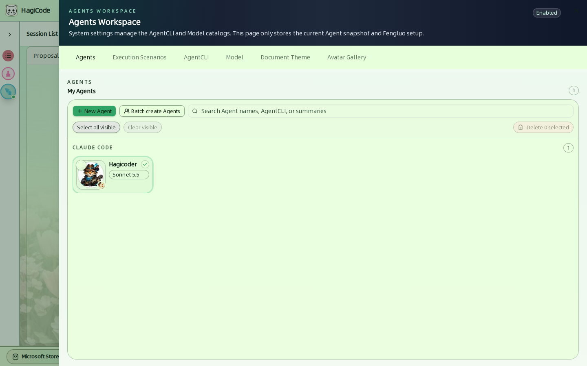
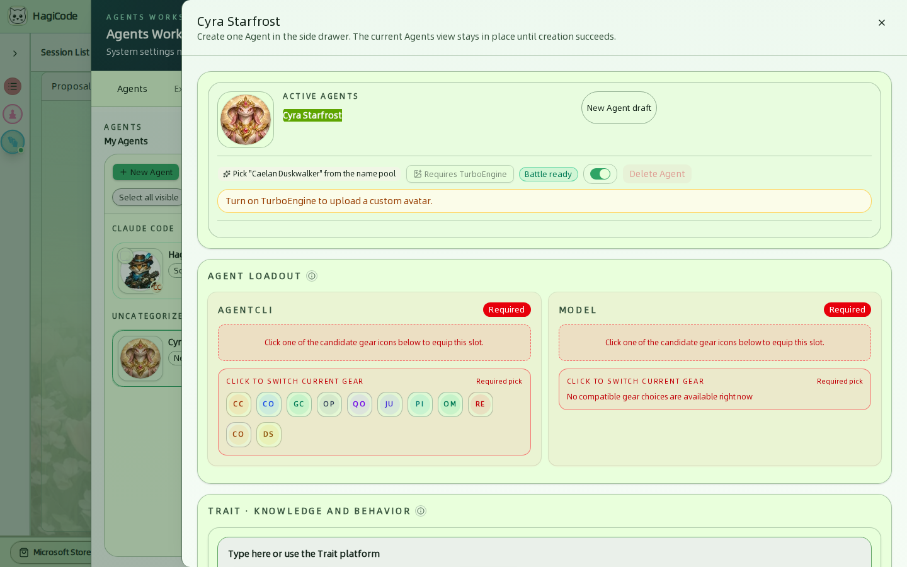
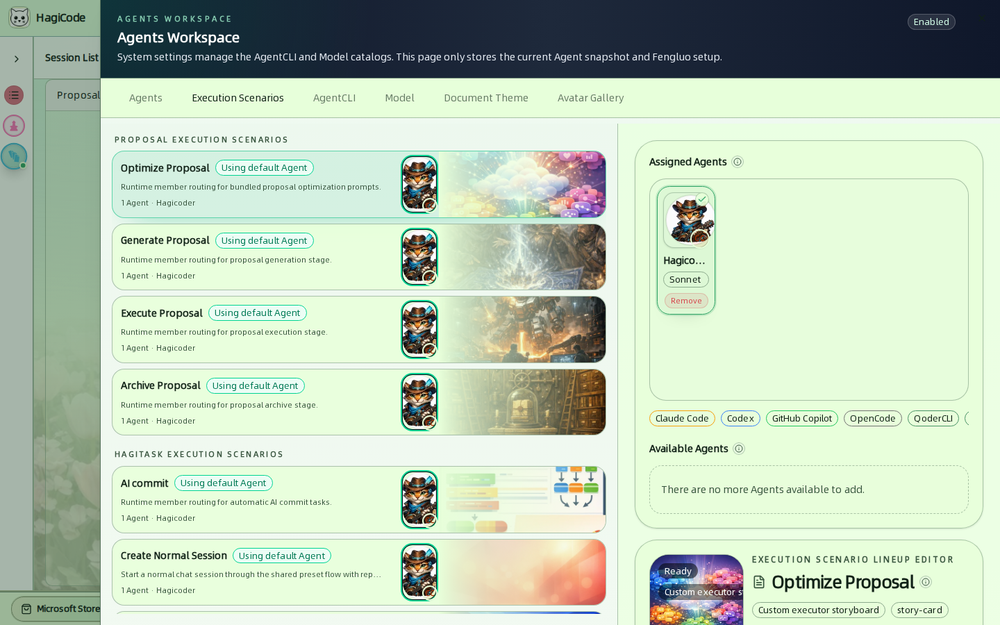
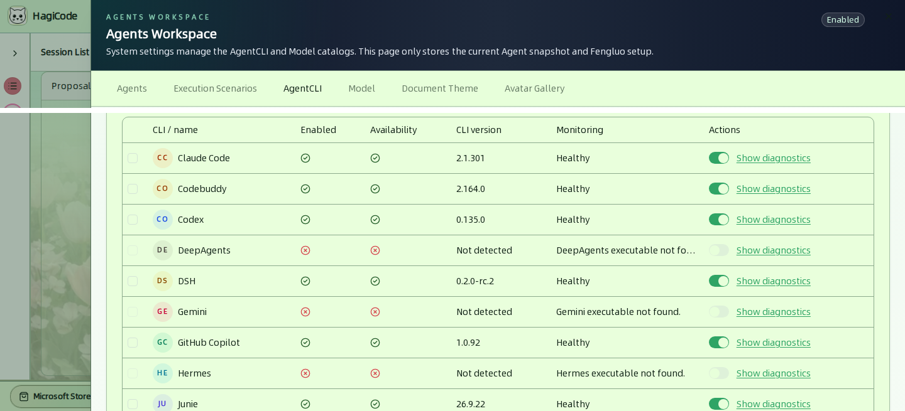
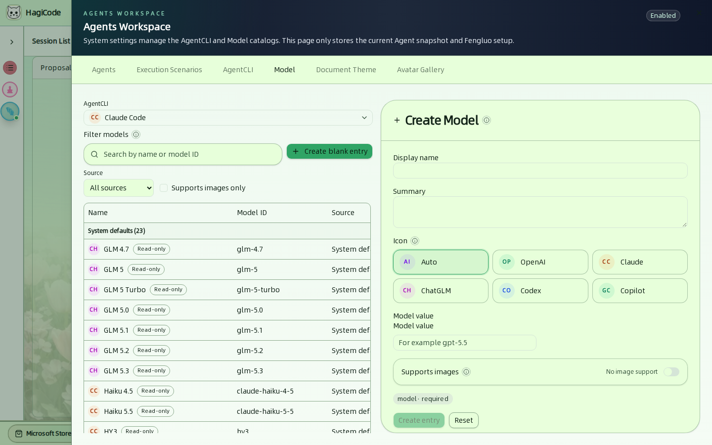
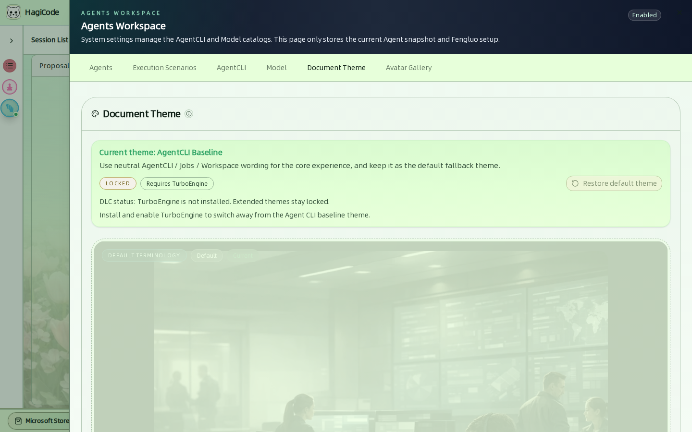
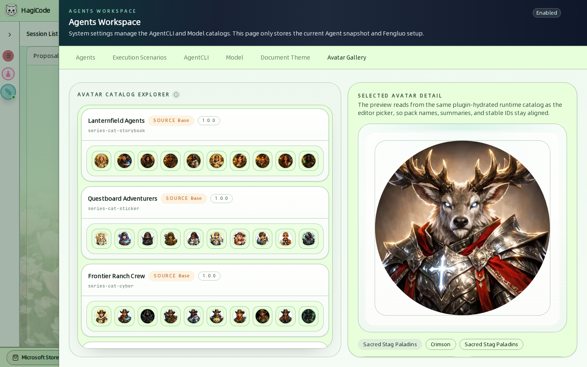

import { CardGrid, LinkCard } from '@astrojs/starlight/components';

HagiCode 中的 **Agent** 是一个开箱即用的工作者：由一个 Agent CLI（例如 Claude Code）、一个模型和可选的性格文本组成。会话由 Agent 运行，所以开始工作之前至少需要一个 Agent。

点击顶栏中的 **Agents**（中文界面：Agents）打开 **Agents Workspace**（Agents 工作台）。它有六个标签页。

| 标签页 | 用途 |
| --- | --- |
| [Agents](#agents-标签页) | 创建和管理你的 Agent。 |
| [Execution Scenarios（执行场景）](#执行场景) | 决定由哪些 Agent 运行哪类工作。 |
| [AgentCLI](#agentcli) | 查看哪些 Agent CLI 已安装、是否健康、是否启用。 |
| [Model（模型）](#模型) | 浏览并扩充每个 Agent CLI 的模型目录。 |
| [Document Theme（文案主题）](#文案主题) | 选择界面的文案主题。 |
| [Avatar Gallery（头像画廊）](#头像画廊) | 浏览头像包。 |

:::note
AgentCLI 和模型目录属于系统级。Agents 标签页只保存你当前的 Agent 及其编组。
:::

## Agents 标签页

**My Agents**（我的Agents）列出你的 Agent，并按它们使用的 Agent CLI 分组。每张卡片显示头像、名称、模型，以及表示 CLI 的小徽标。

- **New Agent**（新建Agent）打开创建抽屉。
- **Batch create Agents**（批量创建Agents）一次创建多个。
- **Search**（搜索）按 Agent 名称、AgentCLI 或简介过滤。
- **Select all visible**（全选当前可见）、**Clear visible**（清除当前可见）和 **Delete N selected**（删除已选 N 项）用于批量删除。

### 创建 Agent

该抽屉一次创建一个 Agent。创建成功之前，Agents 视图保持原样。

- **Name and avatar** – 会从名称池中建议一个随机名称。上传自定义头像需要 TurboEngine DLC。
- **Agent loadout**（Agent装备栏）– 两个必填槽位。点击候选图标即可装备：
  - **AgentCLI** – 由哪个命令行工具运行 Agent。
  - **Model**（模型）– 该 CLI 使用的模型。列表只显示与所选 CLI 兼容的模型。
- **Trait · knowledge and behavior**（特质 · 知识与行为）– 自由文本，或来自特质平台（Trait platform）的特质，用来塑造 Agent 的工作方式。
- **Soul · language style**（灵魂 · 语言风格）– 自由文本，或来自灵魂平台（Soul platform）的灵魂，用来塑造 Agent 的说话风格。
- **Battle ready**（出战状态）开关 – 启用或停用该 Agent。

## 执行场景

对应 **Execution Scenarios** 标签页。

场景决定每类工作选用哪个 Agent。它们按出现的位置分组：

| 分组 | 场景 |
| --- | --- |
| **Proposal**（提案阶段执行场景） | Optimize Proposal（优化提案）、Generate Proposal（生成提案）、Execute Proposal（执行提案）、Archive Proposal（归档提案） |
| **HagiTask**（Hagitask 执行场景） | Super Commit（超级提交）、Create Normal Session（创建普通会话）、Create Research Investigation Task（创建代码调研任务） |
| **Chat**（聊天执行场景） | Conversation Title Optimization（会话标题优化） |

**Fallback Crew**（兜底班组）是安全网。当某个场景自己的编组里没有合适的 Agent 时，HagiCode 会从兜底班组中随机尝试符合条件的成员。它是必需的：**在兜底班组至少有一个已启用的 Agent 之前，其他所有场景都保持锁定。**初始化向导会自动把你的第一个 Agent 加进去。

点击某个场景即可编辑。**Assigned Agents**（已编组Agents）显示编组里有谁，**Available Agents**（可加入Agents）显示可以加入的成员，筛选标签可按 Agent CLI 缩小列表。运行时会随机尝试符合条件的成员，所以界面上的显示顺序并不代表优先级。

## AgentCLI

该标签页列出 HagiCode 能驱动的所有命令行工具：Claude Code、Codebuddy、Codex、DeepAgents、DSH、Gemini、GitHub Copilot、Hermes、Junie、Kimi、Kiro、OMP、OpenCode、Pi、QoderCLI 和 Reasonix。

对于每个 CLI，你可以看到：

- **Enabled**（已启用）和 **Availability**（可用状态）– CLI 必须安装在运行 HagiCode 的机器上才可用。
- **CLI version**（CLI 版本）– 检测到的版本；找不到可执行文件时显示 *Not detected*（未探测）。
- **Monitoring**（监测）– 最近一次健康检查，例如 *Healthy*（健康）。
- **Show diagnostics**（展开诊断信息）– 检查结果背后的详细信息，在 CLI 未被检测到时很有用。
- 一个用于启用或停用该 CLI 的**开关**。使用复选框配合 **Enable selected**（启用所选项）和 **Disable selected**（禁用所选项）可一次修改多个；筛选器可以只显示 *Available*（可用）或 *Unavailable*（不可用）的 CLI。

如果已安装的 CLI 没有被检测到，请确认它的可执行文件位于运行 HagiCode 的进程的 `PATH` 中，然后重新加载。参见 [AI Agent CLI 安装](/related-software-installation/ai-agent-cli)。

## 模型

对应 **Model** 标签页。

在顶部选择一个 **AgentCLI** 即可查看它的模型。表格显示每个模型的名称、模型 ID、来源，以及是否支持图片。

- **System defaults**（系统默认）条目是只读的，由 HagiCode 维护。
- **Custom**（自定义）条目属于你自己。用 **Create Model**（新增模型）表单创建：*Display name*（展示名称）、*Summary*（摘要）、*Icon*（图标）、CLI 所需的 *Model value*（模型值），以及是否 *Supports images*（支持图片）。**Create blank entry**（新建空白条目）从一个空白行开始。
- 可以按名称或模型 ID 过滤，按来源（*All sources*（所有来源）、*Custom*、*System default*）过滤，或只看 *Support images only*（仅支持图片）的模型。

## 文案主题

对应 **Document Theme** 标签页。

文案主题会改变界面的用词。**AgentCLI Baseline**（AgentCLI 基线）使用中性措辞，例如 *Agents*、*Jobs*（作业）和 *Workspace*（工作台），是默认主题。其他主题（例如 *Fantasy Adventure*（奇幻冒险）措辞）需要 TurboEngine DLC；它们的预览仍然可见，但处于锁定状态。**Restore default theme**（恢复默认主题）会回到基线主题。

## 头像画廊

对应 **Avatar Gallery** 标签页。

浏览可用于 Agent 的头像包。选择一个头像包和一个头像，即可查看它的预览、插件来源、版本和稳定 ID。

<CardGrid>
  <LinkCard title="AI Agent CLI 安装" href="/related-software-installation/ai-agent-cli" description="安装并验证 Agent 使用的命令行工具。" />
  <LinkCard title="初始化向导设置" href="/quick-start/wizard-setup" description="在首次启动时创建你的第一个 Agent。" />
  <LinkCard title="会话" href="/user-guide/sessions" description="用 Agent 开始工作。" />
</CardGrid>
