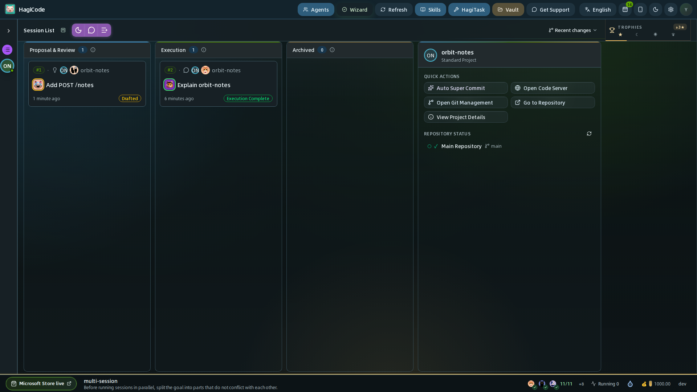
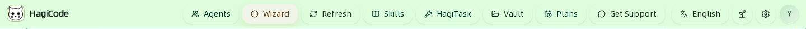
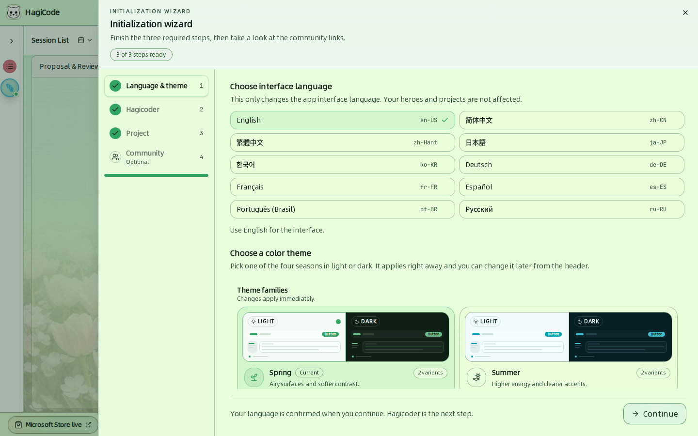
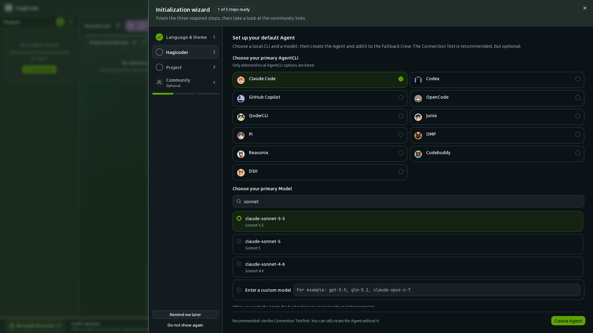

import { CardGrid, LinkCard } from '@astrojs/starlight/components';

本节是 HagiCode 工作台的操作手册，按界面模块逐一说明。你可以直接打开与当前所用功能对应的页面。

## 工作台一览

工作台默认打开**会话看板**。下图使用一个名为 `orbit-notes` 的小型演示项目，其中有一个已完成的会话。

界面分为五个区域：

| 区域 | 位置 | 用途 | 指南 |
| --- | --- | --- | --- |
| **顶栏**（Header） | 顶部边缘 | 打开工作区级模块：Agents、Wizard、Skills、HagiTask、Vault、Plans、设置、语言、主题和个人资料 | [顶栏](#顶栏) |
| **项目栏**（Project rail） | 左侧边缘 | 在全部项目与单个项目之间切换，并新建项目 | [项目](/user-guide/projects) |
| **会话看板**（Session board） | 中间 | 以泳道展示会话，并提供新建会话的按钮；可切换为五种视图 | [会话](/user-guide/sessions)、[视图](/user-guide/views) |
| **项目面板**（Project panel） | 右侧 | 所选项目的快捷操作和仓库状态 | [项目](/user-guide/projects) |
| **状态栏**（Status bar） | 底部边缘 | 提示、Agent CLI 健康状态、运行中会话、休息提醒、日薪计数器和构建版本 | [状态栏与进度](/user-guide/status-bar-and-progress) |

## 顶栏

顶栏始终可见。其中的按钮会在当前页面之上打开抽屉或对话框，所以不会丢失看板上的位置。

| 按钮 | 打开的内容 |
| --- | --- |
| **Agents**（中文界面：Agents） | Agents 工作台：你的 Agent、执行场景、AgentCLI 列表、模型目录、文案主题和头像画廊。参见 [Agents](/user-guide/agents)。 |
| **Wizard**（向导） | 四步初始化向导。参见[首次启动](#首次启动初始化向导)。 |
| **Refresh**（刷新） | 重新加载当前页面的内容。 |
| **Skills**（技能） | 统一的技能模块，包含 Local Skills、Gallery 和 Trusted Providers。参见[技能与 HagiTask](/user-guide/skills-and-hagitask)。 |
| **HagiTask**（中文界面：HagiTask） | HagiTask 管理，用于管理任务预设。参见[技能与 HagiTask](/user-guide/skills-and-hagitask)。 |
| **Vault**（中文界面：Vault） | Vault 管理器，用于管理 HagiCode 可以浏览和预览的文件夹。参见 [Vault](/user-guide/vault)。 |
| **Plans**（计划，日历图标；窄窗口下只显示图标，悬停提示 Scheduled plans） | 计划管理器，用于管理定时自动启动会话的计划。参见[计划任务](/user-guide/scheduled-plans)。 |
| **Get Support**（获取技术支持） | 在浏览器中打开社区与支持页面。 |
| **Language**（语言） | 切换界面语言。HagiCode 提供十种界面语言，包括简体中文。 |
| **Theme**（主题，叶子图标） | 打开主题选择器。参见[外观、主题与语言](/user-guide/settings#外观主题与语言)。 |
| **Settings**（配置，齿轮图标；打开的对话框标题为“设置”） | 打开设置对话框。参见[设置](/user-guide/settings)。 |
| **Profile**（个人资料，圆形头像） | 打开个人资料抽屉，包含积分、历史时间线和快捷入口。参见[状态栏与进度](/user-guide/status-bar-and-progress#个人资料)。 |

## 首次启动：初始化向导

全新安装后，**Initialization wizard**（初始化向导）会自动打开。你也可以随时通过顶栏的 **Wizard** 按钮重新打开。向导共四步，并会显示三个必需步骤中已就绪的数量。

1. **Language & theme**（语言与主题） – 选择界面语言和季节配色主题，两者都会立即生效。
2. **Hagicoder** – 选择本地 Agent CLI 和模型，创建你的第一个 Agent，并把它加入 **Fallback Crew**（兜底班组）。建议做一次连接测试，但不是必需的。
3. **Project**（项目） – 登记第一个项目的文件夹。
4. **Community**（社区）（可选） – 开始第一次对话，或打开“关于”页面。

完整流程以及各字段的含义，参见[初始化向导设置](/quick-start/wizard-setup)。

## 接下来去哪里

<CardGrid>
  <LinkCard title="项目" href="/user-guide/projects" description="新建项目，查看详情、MonoSpecs、标准用语和 Git 状态。" />
  <LinkCard title="会话" href="/user-guide/sessions" description="新建主意和对话，读懂看板，并在会话内工作。" />
  <LinkCard title="视图" href="/user-guide/views" description="在经典、两种看板、矩阵和指挥视图之间切换，并了解各自适合的场景。" />
  <LinkCard title="Agents" href="/user-guide/agents" description="创建你的 Agent，把它们分配到执行场景，并检查 AgentCLI 健康状态。" />
  <LinkCard title="技能与 HagiTask" href="/user-guide/skills-and-hagitask" description="从画廊安装技能和任务预设。" />
  <LinkCard title="Vault" href="/user-guide/vault" description="登记会话可以读取和写入的文件夹。" />
  <LinkCard title="设置" href="/user-guide/settings" description="逐组说明所有设置，从通知到 Git 和 OmniRoute。" />
  <LinkCard title="计划任务" href="/user-guide/scheduled-plans" description="用计划让提案和 HagiTask 在设定的时间自动开始。" />
  <LinkCard title="状态栏与进度" href="/user-guide/status-bar-and-progress" description="Agent CLI 健康状态、并发、成就、休息提醒和日薪计数器。" />
</CardGrid>
