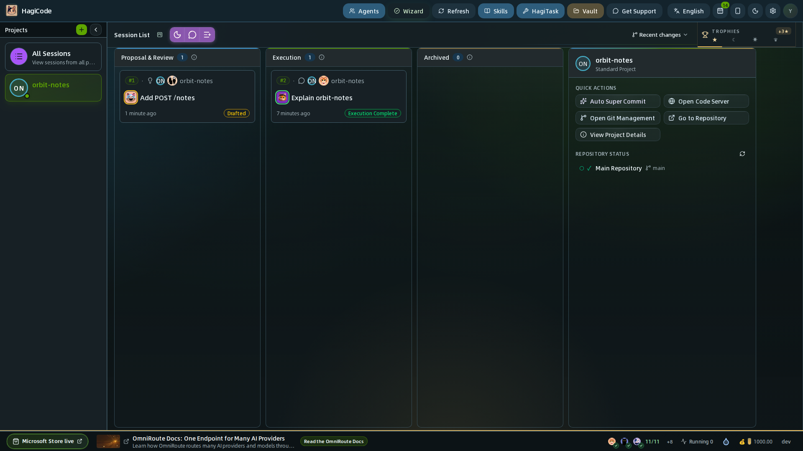
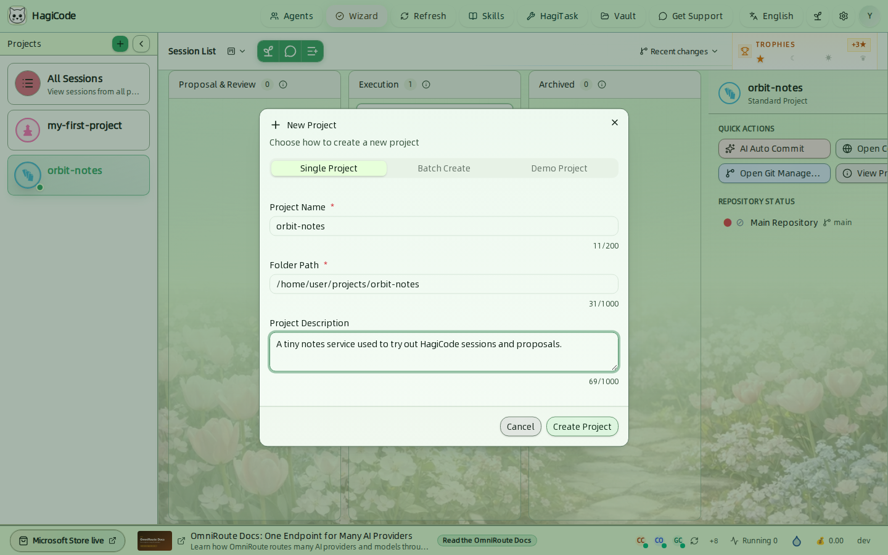
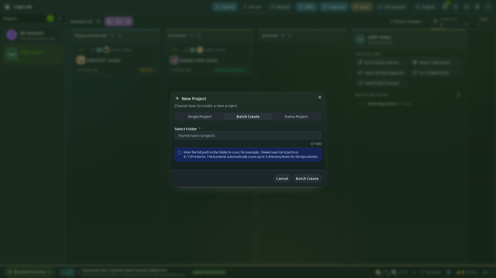
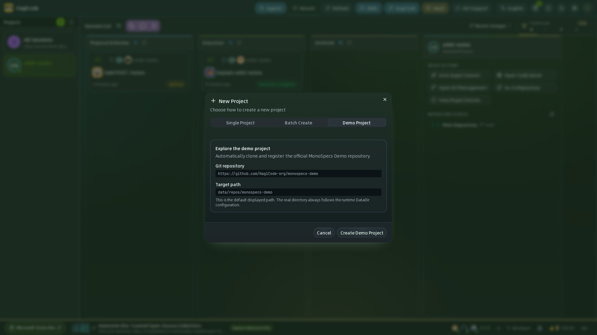
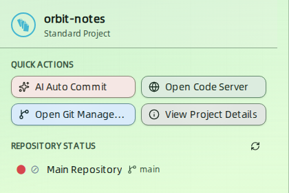
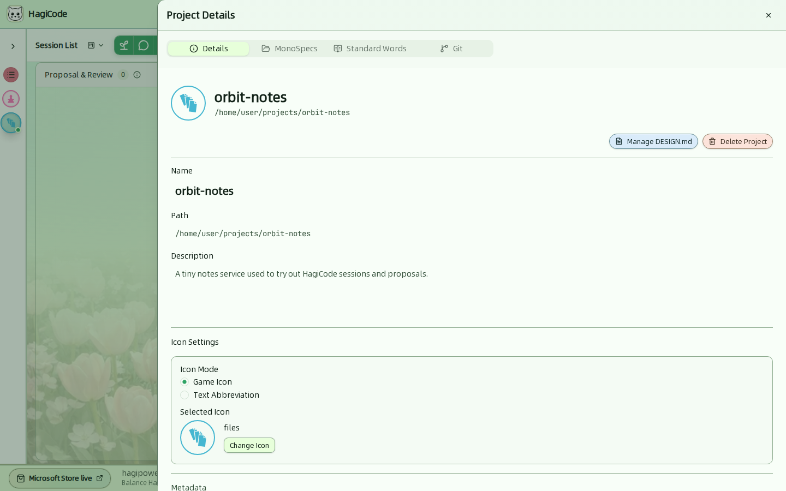
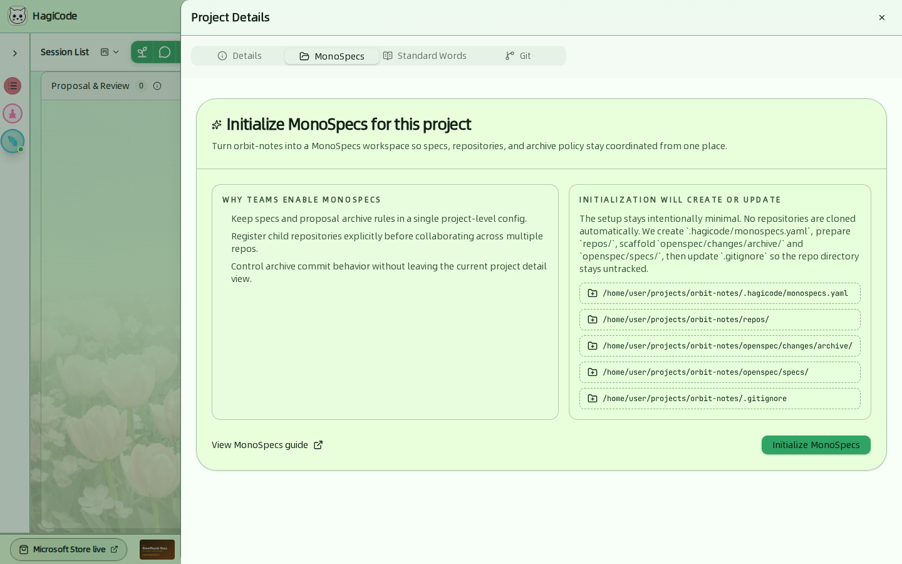
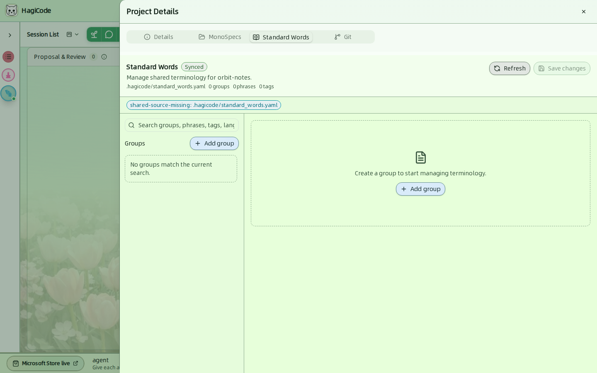
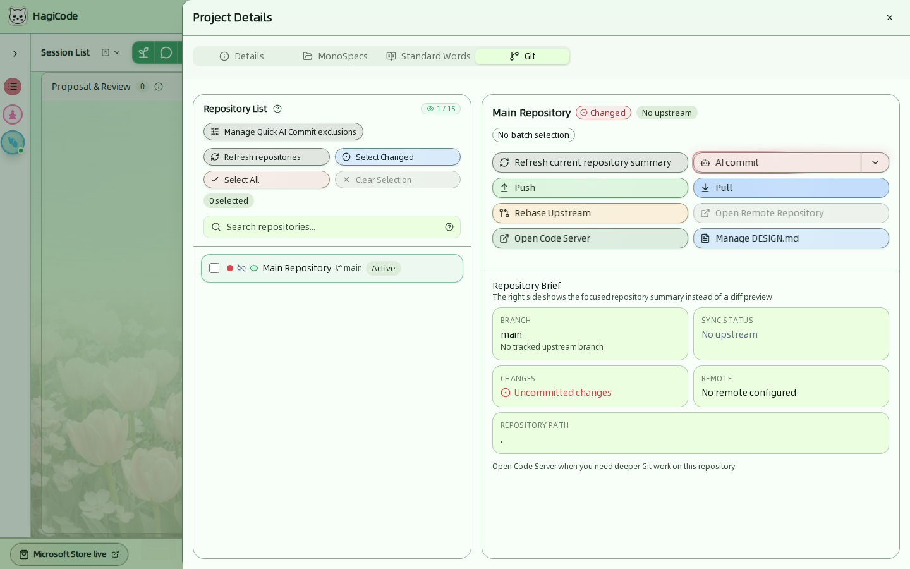

import { CardGrid, LinkCard } from '@astrojs/starlight/components';

**项目**就是 HagiCode 工作所在的文件夹。会话、Git 状态、标准用语和 MonoSpecs 设置都归属于某个项目，所以工作台左侧边缘的项目栏是大多数工作的起点。

## 项目栏

项目栏默认折叠，每个项目只显示一个圆形图标。点击项目栏顶部的小箭头即可展开。

- **All Sessions**（全部会话）在同一个看板上显示所有项目的会话。
- 点击某个项目，看板会只显示该项目的会话，并在项目面板中展示它。
- 绿色的 **+** 按钮用于新建项目。它旁边的箭头可再次折叠项目栏。

:::tip[哪些项目会进入“All Sessions”看板？]
在 **Settings → Process & Interaction → Session List**（设置 → 流程与交互 → 会话列表）中，可以把范围从 *All Projects*（全部项目）切换为 *Custom Selection*（自定义选择）的若干项目。参见[设置](/user-guide/settings)。
:::

## 新建项目

点击项目栏中的 **+**，打开 **New Project**（新建项目）对话框。它提供三种添加项目的方式。

### 单个项目

磁盘上已有项目文件夹时使用这种方式。对应 **Single Project**（单个项目）标签页。

| 字段 | 说明 |
| --- | --- |
| **Project Name**（项目名称） | 必填，最多 200 个字符。 |
| **Folder Path**（文件夹路径） | 必填，最多 1000 个字符。填写文件夹的绝对路径，例如 `/home/user/projects/orbit-notes`。 |
| **Project Description**（项目描述） | 选填，最多 1000 个字符。 |

当路径中包含 `.hagicode/monospecs.yaml` 时，对话框会识别出来，并为该项目显示 MonoSpecs 指引。参见 [MonoSpecs](/guides/monospecs)。

### 批量新建

多个仓库放在同一个父文件夹下时使用这种方式。对应 **Batch Create**（批量新建）标签页。

填写父文件夹的完整路径。HagiCode 会向下扫描最多三层目录查找 Git 仓库，并把找到的每个仓库登记为一个项目。

### 演示项目

想在连接自己的代码之前先体验 HagiCode 时使用这种方式。对应 **Demo Project**（演示项目）标签页。

HagiCode 会克隆官方 MonoSpecs Demo 仓库（`https://github.com/HagiCode-org/monospecs-demo`）并登记为项目。这需要你的机器上装有 Git。界面中显示的是默认路径，实际文件夹取决于你的运行时数据目录。

## 项目面板

选中一个项目后，看板右侧会显示该项目的项目面板。

**Quick actions**（快速操作）

| 按钮 | 作用 |
| --- | --- |
| **自动超级提交** | 为项目启动一次 AI 辅助提交。参见 [超级提交](/guides/ai-compose-commit)。 |
| **Open Code Server**（打开 Code Server） | 在基于浏览器的代码编辑器中打开项目。 |
| **Open Git Management**（打开 Git 管理） | 打开项目详情抽屉的 Git 标签页。 |
| **View Project Details**（查看项目详情） | 打开项目详情抽屉。 |

**Repository status**（仓库状态）列出项目的每个仓库及其当前分支。彩色圆点表示工作区状态；截图中的圆点是红色，因为 `src/server.js` 有未提交的更改。点击刷新按钮可重新读取状态。

看板工具栏中的 **Recent changes**（最近变更）菜单列出最近有变更的仓库。仓库有变更之前，它显示“暂无最近变更”。

## 项目详情

点击 **View Project Details** 打开抽屉。它有四个标签页。

### 详情

对应 **Details**（详情）标签页。

- **Name**（名称）、**Path**（路径）和 **Description**（描述）：项目的基本信息。
- **Icon Settings**（图标设置）：为项目头像选择 *Game Icon*（游戏图标）或 *Text Abbreviation*（文本缩写）。**Change Icon**（更改图标）会打开图标选择器。
- **Manage DESIGN.md**（管理 DESIGN.md）：管理项目的 `DESIGN.md` 文件。
- **Delete Project**（删除项目）：输入项目名称确认后删除项目。确认对话框会列出将被永久删除的内容：项目中的所有会话以及这些会话中的所有消息。此操作无法撤销。

### MonoSpecs

MonoSpecs 会把项目变成一个协调规格与多个仓库的工作区。对于尚未成为 MonoSpecs 工作区的项目，**Initialize MonoSpecs**（初始化 MonoSpecs）只会创建必需的内容，不会自动克隆任何仓库：

- `.hagicode/monospecs.yaml`
- 用于存放子仓库的 `repos/` 文件夹
- `openspec/changes/archive/` 和 `openspec/specs/`
- 对 `.gitignore` 的更新，使 `repos/` 文件夹保持不被跟踪

初始化之前请先阅读 [MonoSpecs 指南](/guides/monospecs)。

### 标准用语

对应 **Standard Words**（标准用语）标签页。

标准用语是项目共享的术语，存放在 `.hagicode/standard_words.yaml` 中。该标签页显示分组、短语和标签的数量，并支持搜索、**Add group**（新增分类）、从磁盘 **Refresh**（刷新）以及 **Save changes**（保存更改）。

### Git

Git 标签页是项目的 Git 控制台。

- **仓库列表**（左侧）显示被监控的仓库；计数（例如 `1 / 15`）把它们与 **Settings → Integration → Git**（设置 → 集成 → Git）中的监控上限作比较。批量操作可使用 **Select Changed**（选中有变更的仓库）、**Select All**（选中全部仓库）和 **Clear Selection**（清空选择），也可以按名称搜索。**Manage Super Commit All exclusions**（管理超级提交全部排除项）用来控制快速提交会跳过哪些文件。
- **仓库概要**（右侧）显示分支、同步状态、是否有未提交的更改、远程仓库和仓库路径。
- 针对当前聚焦仓库的操作：**Super Commit**（超级提交）、**Push**（推送）、**Pull**（拉取）、**Rebase Upstream**（Rebase 上游分支）、**Open Remote Repository**（打开远程仓库）、**Open Code Server** 和 **Manage DESIGN.md**。

这里的概要有意取代了 diff 预览。需要更深入的 Git 操作时，请使用 **Open Code Server**。

配置文件（Git Profile）、状态监控和默认超级提交动作等 Git 行为，在 **Settings → Integration → Git** 中配置。

<CardGrid>
  <LinkCard title="MonoSpecs 指南" href="/guides/monospecs" description="在一个项目中协调规格和多个仓库。" />
  <LinkCard title="Super Commit" href="/guides/ai-compose-commit" description="让 Agent 根据你的更改撰写提交信息。" />
  <LinkCard title="会话" href="/user-guide/sessions" description="在项目中开始工作。" />
</CardGrid>
