import { CardGrid, LinkCard } from '@astrojs/starlight/components';

**计划**（Plan，也叫 Scheduled plan，即“定时计划”）让 HagiCode 在你设定的时间自动开始一个会话，不需要你在场点击提交。典型用法：每个工作日凌晨 2 点跑一次代码审查、每天早上检查依赖更新，或者明天上午 10 点起草发布说明。

计划保存的是两样东西：一份**创建会话所需的全部输入**（与你平时在创建对话框里填写的完全一样），以及一份**时间表**。到点后，HagiCode 用与手动提交相同的流程创建会话，所以自动启动的会话和你亲手创建的没有区别。

## 基本概念

| 概念 | 含义 |
| --- | --- |
| **Type**（类型） | 计划分两种：**Proposal**（提案计划，到点后创建一个提案会话）和 **HagiTask**（到点后用某个 HagiTask 创建会话）。类型由你从哪个创建对话框保存计划决定。 |
| **Scope**（范围） | 计划保存时选择 **Team**（团队，进入版本控制）或 **Personal**（个人，文件名带 `.user.yaml`，可被版本控制忽略）。保存后范围不能再改。 |
| **Run once / Recurring**（单次 / 周期） | 单次计划只在一个时间点运行；周期计划在起止日期之间按天或按周重复运行。 |
| **Occurrence**（某一次） | 计划在日历上的一个具体时间点。单次计划只有一次；周期计划每到一个时间点就是一次，可以单独修改或删除，不影响其他次。 |
| **Next run**（下次运行） | 计划下一次自动启动的时间，按计划自己的时区显示。 |
| **Scheduled / Completed**（已安排 / 已完成） | 计划的状态。单次计划运行后、或周期计划走完结束日期后变为 Completed。 |
| **Enabled / Disabled**（已启用 / 已停用） | 每个计划都有一个启用开关。停用的计划保留在列表和日历里，但不会自动运行。 |

## 找到计划

计划有两个入口：顶栏的计划议程，适合快速看“接下来几天有什么”；项目详情里的 **Plans** 标签页，用来完整地查看和管理一个项目的计划。

### 顶栏的计划议程

从今天到之后三天（共四个本地日）内，只要有至少一个**已启用**计划的运行时间，顶栏就会出现一个日历图标按钮，右上角的数字是这段时间里的运行次数（超过 99 显示 `99+`）。窗口范围内没有任何计划时，按钮不会出现，也不占位置。

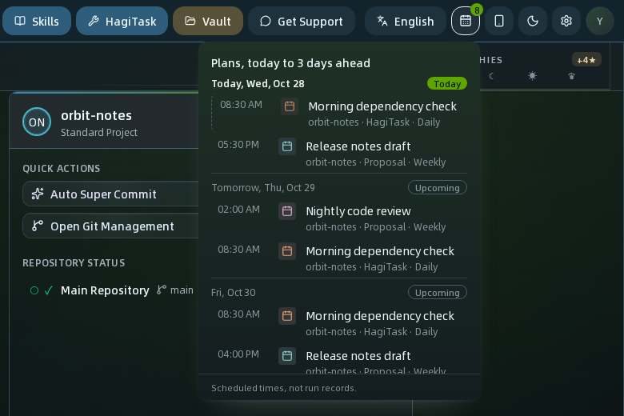

把鼠标停在按钮上、用键盘聚焦或点击它，都会弹出 **Plans, today to 3 days ahead**（今天起三天内的计划）议程：

- 按日期升序分组，只列出有运行时间的日期。每个日期标题带有 **Today** 或 **Upcoming**（晚于今天）标签，今天之前的日期不会列出。
- 每一行包含时间、计划图标和名称、项目名、类型（**Proposal** 或 **HagiTask**）和重复方式（**Once**、**Daily**、**Weekly**）。被单独改过时间的一次带有 **Modified**，已完成的单次计划带有 **Completed**；今天已经过去的行颜色更淡。
- 它覆盖你能读取的所有项目，但**只统计已启用的计划**，停用的计划不会出现在议程里，也不计入角标。
- 议程只列出**计划好的时间**，底部的 **Scheduled times, not run records.**（这是计划时间，不是运行记录）就是这个意思。

点击议程里的某一行，会打开该计划所属项目的项目详情抽屉，停在 **Plans** 标签页，并直接打开这个计划的编辑器。如果是周期计划，编辑器会停在 **Current event**（只改这一行显示的那一次），你可以随时切换为 **Overall plan**，见[编辑计划](#编辑计划)。

### 项目详情里的 Plans 标签页

在项目面板点击 **View Project Details**（查看项目详情），顶部标签依次是 **Details**、**MonoSpecs**、**Standard Words**、**Prompts**、**Plans** 和 **Git**。**Plans** 只管理当前这个项目的计划，顶部有两个视图：

- **Calendar**（日历）：按月、周或日程查看计划在什么时间点会运行。
- **All plans**（全部计划）：列出这个项目的每一个计划，可以启用、停用、立即运行、编辑和删除。

**Plans** 标签页只负责**查看和管理**已有计划，不能在这里新建：计划总是在创建提案或 HagiTask 的对话框里保存的。还没有任何计划时，**All plans** 会提示用创建对话框里的 **Plan** 开关来创建；手机宽度下则提示在更宽的屏幕上创建。切换到别的标签再回来，视图和日期范围会保持不变；切换到另一个项目则会从头开始。

## 在日历中查看计划

**Calendar** 默认显示当前月份，每个计划的每一个运行时间点都是日历上的一个条目，条目前面是计划自己的图标和颜色（见[图标与颜色](#图标与颜色)）。

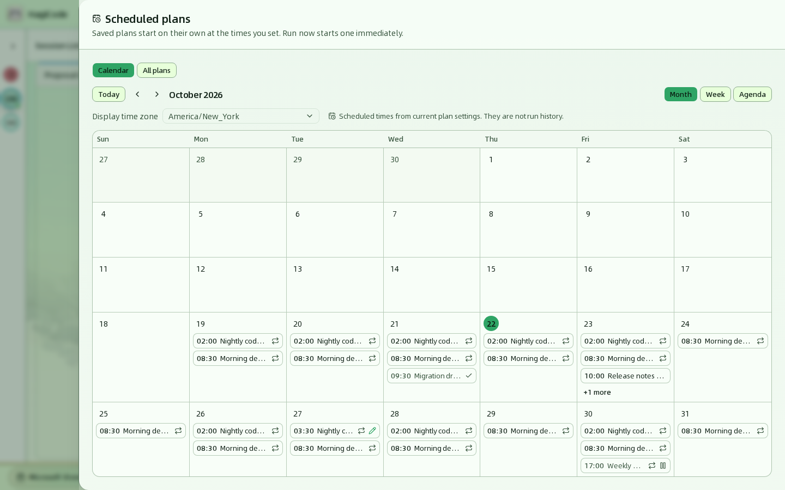

顶部的控件如下：

| 控件 | 作用 |
| --- | --- |
| **Today**（今天） | 回到包含今天的月、周或日程。 |
| **‹ / ›** | 切换到上一个或下一个周期：月视图按月，周视图和日程视图按周。 |
| **Month / Week / Agenda**（月 / 周 / 日程） | 切换视图。布局按标签页自身的宽度调整：太窄放不下网格时，月和周视图会在日历内部横向滚动，页面本身不会滚动。 |
| **Display time zone**（显示时区） | 日历使用哪个时区来排列和显示时间，默认是浏览器当前所在的时区。它只改变显示，不会改变计划本身的时区和实际运行时间。 |

三种视图显示的是同一批数据（只包含当前项目的计划）：

- **Month**：每个日期格最多显示 3 个条目，再多会出现 **+N more**（还有 N 个），点击会弹出当天的全部运行时间。
- **Week**：七列并排，每个条目可以显示完整的计划名称。
- **Agenda**：按日期分组的列表，只列出有运行时间的日期，条目右侧用文字标出状态。

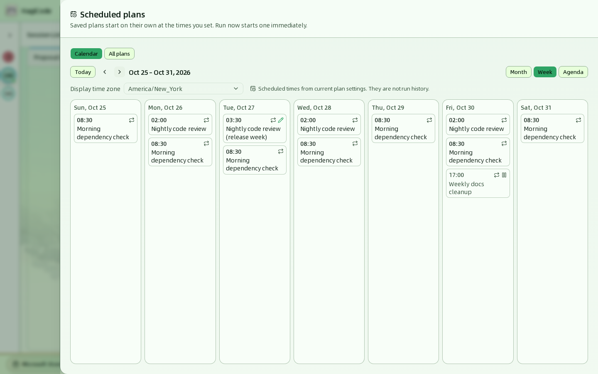

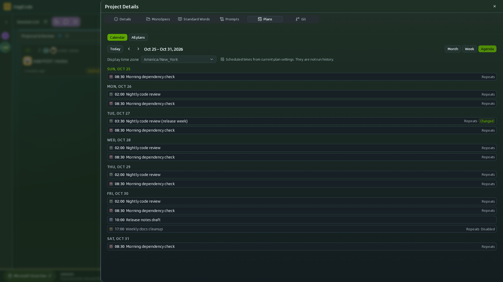

每个条目由**时间**和**计划名称**组成。月视图和周视图用图标标记状态，悬停可以看到文字说明；日程视图直接写出文字：

| 标记 | 含义 |
| --- | --- |
| 重复图标 / **Repeats** | 这是周期计划中的一次。 |
| 对勾 / **Completed** | 计划已经完成（例如单次计划已经运行过）。 |
| 暂停图标 / **Disabled** | 计划已停用，这个时间点不会自动运行。 |
| 铅笔图标 / **Changed** | 这一次被单独修改过，时间或内容和周期计划不同。 |

:::note
日历显示的是**按当前计划设置排出来的运行时间，不是运行历史**。页面上的 **Scheduled times from current plan settings. They are not run history.** 就是这个意思：计划被编辑过，或已经停用、完成后，日历仍然按它现在的设置排布，而不会记录以前运行过什么。已启动的会话请到会话看板查看。
:::

### 查看某一次的详情

点击任意条目，右侧会滑出这一次的详情抽屉。查看详情不需要打开编辑器。

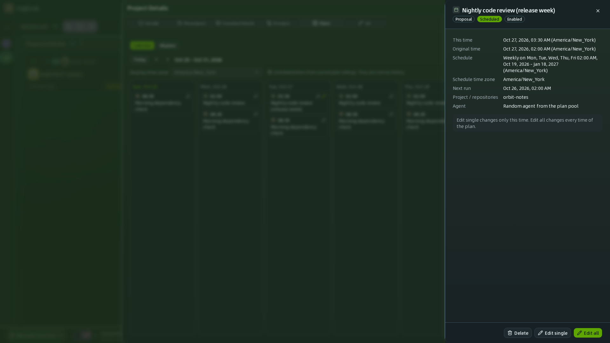

| 字段 | 说明 |
| --- | --- |
| 标题与徽标 | 计划名称、类型（**Proposal** 或 **HagiTask**）、状态（**Scheduled** 或 **Completed**）和 **Enabled** / **Disabled**。 |
| **This time**（这一次） | 这一次的运行时间，按显示时区排列。 |
| **Original time**（原定时间） | 只在这一次被改期时出现，显示周期计划原本安排的时间。 |
| **Schedule**（时间表） | 计划的完整时间表。 |
| **Schedule time zone**（计划时区） | 计划自己使用的时区。 |
| **Next run**（下次运行） | 整个计划真正的下一次运行时间，已完成的计划显示 `–`。注意它不一定等于“这一次”。 |
| **Project / repositories**（项目 / 仓库） | 计划保存的目标项目和仓库。 |
| **Agent** | 只在计划指定了 Agent 时出现，显示 **Random agent from the plan pool**。 |

抽屉底部的按钮取决于计划类型：

- **周期计划**：**Edit single** 只修改这一次，**Edit all** 修改整个计划，**Delete** 删除这一次或整个系列。抽屉里的说明写着 **Edit single changes only this time. Edit all changes every time of the plan.**
- **单次计划**：只有一个 **Edit** 和 **Delete**，**Edit** 直接打开整个计划的编辑器。

详见[编辑计划](#编辑计划)和[删除计划](#删除计划)。

## 创建计划

在创建提案和 HagiTask 的对话框里，都可以把“立即开始”换成“按计划开始”。普通会话（**Create Normal Session**）没有计划开关。

1. 像平时一样打开创建对话框，例如 **New Idea**（新建主意），填写主意名称、项目和需求。详细字段参见[会话](/user-guide/sessions#新建主意提案)。
2. 看对话框右下角，提交按钮旁边有一个 **Plan**（计划）开关，默认关闭。

   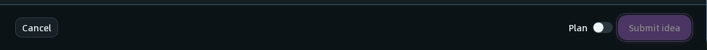

3. 打开 **Plan** 开关，对话框会切换为计划模式：
   - 左上角的标签从 **Create Proposal** 变为 **Proposal plan**（提案计划）。
   - **Basic Setup** 顶部出现必填的 **Plan name**（计划名称），例如“Weekly release check”，最多 200 个字符。
   - 出现 **Schedule**（时间安排）区域。
   - 提交按钮变为 **Save plan**（保存计划）。

   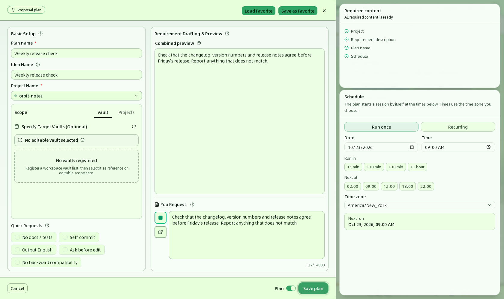

4. 在 **Schedule** 里设置运行时间，详见[设置时间表](#设置时间表)。HagiTask 计划还需要选择一个 Agent，详见[为 HagiTask 计划选择 Agent](#为-hagitask-计划选择-agent)。
5. 点击 **Save plan**。HagiCode 会显示 **Plan saved**（计划已保存）提示，点击 **View plans**（查看计划）可直接打开这个项目的 **Plans** 标签页。

   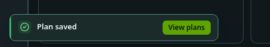

**Schedule** 区域最上方还有 **Team / Personal** 两个按钮，选择这个计划保存为团队计划还是个人计划，默认 **Team**。**Personal** 计划保存为 `.hagicode/plans/*.user.yaml`，可以用 `.gitignore` 把这类文件排除在版本控制之外；保存之后范围只读，不能再改。

**Required content**（必填内容）清单会实时告诉你还缺什么：提案计划检查 **Project**、**Requirement description**、**Plan name** 和 **Schedule**；HagiTask 计划检查 **Project**、该 HagiTask 自己的必填输入、**Plan name**、**Schedule** 和 **Agent**。全部完成时显示 **All required content is ready**。

:::note[窗口宽度与布局]
窗口足够宽（约 1464 像素以上）时，**Required content** 和 **Schedule** 作为两张卡片显示在抽屉右侧。窗口较窄时，**Schedule** 区域移到抽屉底部、提交按钮上方，**Required content** 折叠成一个可展开的条。两种布局里的内容和规则完全相同。
:::

:::note
计划不能包含图片。如果表单里已经附加了图片，**Plan** 开关会被禁用，并提示先移除图片再保存为计划。
:::

## 设置时间表

**Schedule** 区域的两个按钮决定运行方式：**Run once**（单次运行）和 **Recurring**（周期运行）。无论哪种方式，区域最下方的 **Next run** 都会实时显示按当前设置计算出的下次运行时间；如果显示 **Not scheduled**（未安排），说明当前设置下没有可运行的时间，需要调整日期或时间。

### 单次运行

只在一个时间点运行一次。

| 字段 | 说明 |
| --- | --- |
| **Date**（日期）和 **Time**（时间） | 运行的日期与时刻，默认是明天 09:00。必须晚于当前时间。 |
| **Run in**（多久后） | 快捷按钮：`+5 min`、`+10 min`、`+30 min`、`+1 hour`，从现在起算。 |
| **Next at**（下一次） | 快捷按钮：`02:00`、`09:00`、`12:00`、`18:00`、`22:00`，选当天或次日最近的这个时刻。 |
| **Time zone**（时区） | 日期和时间所使用的时区，默认是浏览器当前所在的时区。 |

### 周期运行

在起止日期之间，按天或按周重复运行。

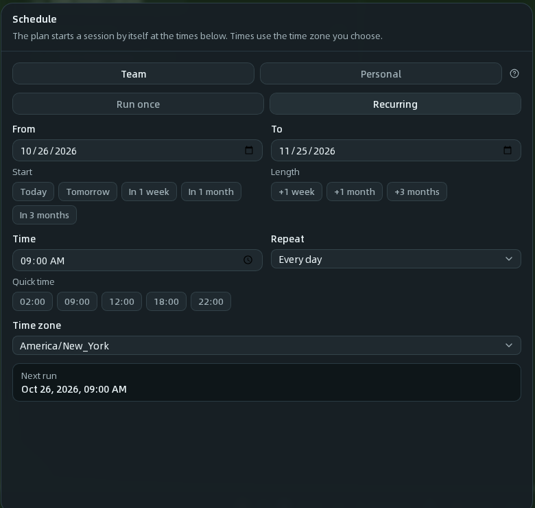

| 字段 | 说明 |
| --- | --- |
| **From**（开始）和 **To**（结束） | 周期的起止日期，两端的日期都包含在内。默认从今天开始，持续一个月。**Start** 下的 `Today`、`Tomorrow`、`In 1 week`、`In 1 month`、`In 3 months` 用来快速设置开始日期，**Length** 下的 `+1 week`、`+1 month`、`+3 months` 用来快速设置时长。 |
| **Time**（时间） | 每次运行的时刻，格式 `HH:mm`。**Quick time** 提供 `02:00`、`09:00`、`12:00`、`18:00`、`22:00` 快捷选择。 |
| **Repeat**（重复） | **Every day**（每天）或 **Every week**（每周）。 |
| **On**（星期） | 选择 **Every week** 时出现，用 `Mon` 到 `Sun` 选择在星期几运行，至少选一天。 |
| **Time zone**（时区） | 时间所使用的时区。每次运行都以这个时区的本地时间为准，所以每天 02:00 的计划在夏令时切换前后仍然是 02:00。 |

:::tip
想让计划“长期有效”，把 **To** 设得远一些即可，例如点 **+3 months**。到了结束日期之后，计划会变为 **Completed**，不再运行。
:::

## 为 HagiTask 计划选择 Agent

提案计划不需要选 Agent。**HagiTask 计划必须选择一个 Agent**，因为到点自动启动时没有人可以临时挑选：

- 在计划模式的对话框里，会出现 Agent 选择区，说明是“选择本计划运行时使用的 Agent，计划启动时会沿用这一选择”。点击一个 Agent 即可选中。
- 底部栏会显示 `Agent: 名称`；还没选时显示 `No agent selected yet.`（尚未选择智能体），此时无法保存计划。
- 目前每个计划只能选择一个 Agent。创建 Agent 参见 [Agents](/user-guide/agents)。

## 图标与颜色

每个计划都可以有自己的**图标**和**颜色**，方便在日历、列表和顶栏议程里一眼区分。**Plan name** 旁边有一个外观字段：

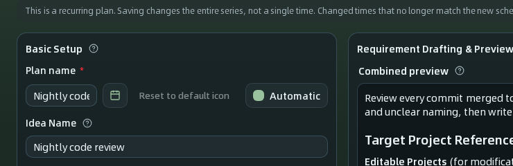

- 点图标按钮打开 Lucide 图标选择器，选一个图标并确认；点 **Reset to default icon** 恢复默认的日历图标。
- 颜色可以选 **Automatic**（自动，按计划编号稳定地挑一个颜色，每个视图里都一样），也可以从色板里选一个固定颜色。
- 外观属于**整个计划**。只改某一次（**Current event**）时不显示这个字段，也不会改动它。

## 编辑计划

编辑有三个入口：顶栏议程里点某一行；**Calendar** 里某一次的详情抽屉中点 **Edit single** / **Edit all**（单次计划只有 **Edit**）；或 **All plans** 里计划那一行的 **Edit**。无论哪个入口，HagiCode 都会先读取这个计划最新保存的内容，再打开与创建时相同的对话框（计划模式）。已保存的计划始终是计划，**Plan** 开关处于锁定状态，不能改回普通任务。

### 单次计划

直接打开编辑器，修改名称、内容、Agent 或时间后点击 **Save plan**。单次计划只有一个范围，编辑器里没有 **Edit scope** 开关。

### 周期计划：Current event 与 Overall plan

编辑已有的周期计划时，底部栏的 **Plan** 开关旁边有一个 **Edit scope**（编辑范围）开关，两个选项同一时间只选中一个，当前选中的带有对勾：

| 选项 | 作用范围 |
| --- | --- |
| **Current event**（当前这一次） | 只改你正在编辑的这个时间点，计划的其他次保持不变。会写明是哪一次。 |
| **Overall plan**（整个计划） | 改整个周期计划的每一次。之前被单独修改过、但不再符合新时间表的那些次，会被重置。 |

不同入口默认停在不同的范围：

| 入口 | 默认范围 |
| --- | --- |
| 顶栏议程里的某一行 | **Current event**，对应这一行显示的那一次 |
| 日历详情里的 **Edit single** | **Current event** |
| 日历详情里的 **Edit all** | **Overall plan** |
| **All plans** 里的 **Edit** | **Overall plan** |

无论从哪里进入，都可以在编辑器里随时切换：

- **切换不会关闭编辑器，也不会丢掉你填的内容。** 你改过的字段在两个范围之间保持你输入的值；没改过的字段显示新范围自己的值。
- 从 **All plans** 进入并选择 **Current event** 时，指的是计划的下一次运行；如果计划已经没有未来的运行时间，**Current event** 会变灰并显示原因，只能编辑 **Overall plan**。
- **保存只写入保存那一刻选中的范围。**

选中 **Overall plan** 时，抽屉顶部会提示 **This is a recurring plan. Saving changes the entire series, not a single time.**，提醒你保存会影响所有次。

选中 **Current event** 时，抽屉顶部会写明“Saving changes only this time, …”，时间表区域只剩下这一次的**日期、时间和时区**，不能再改成周期。你可以修改这一次的运行时间、名称、需求内容和 Agent；没有改动的字段仍然跟随整个计划。

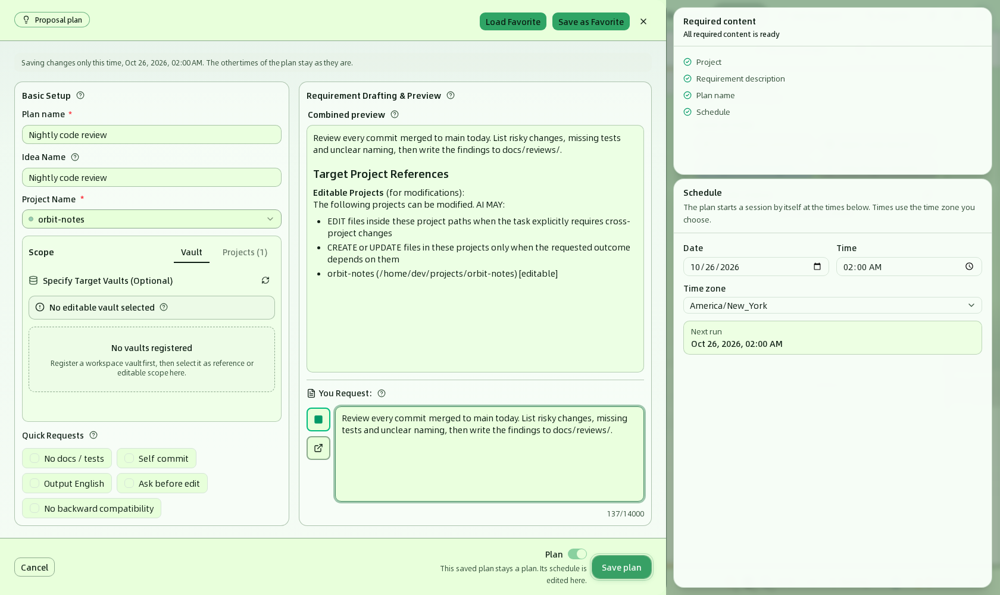

保存后回到日历，被改动的那一次会带上铅笔图标（**Changed**），日历顶部显示 **Saved.**。

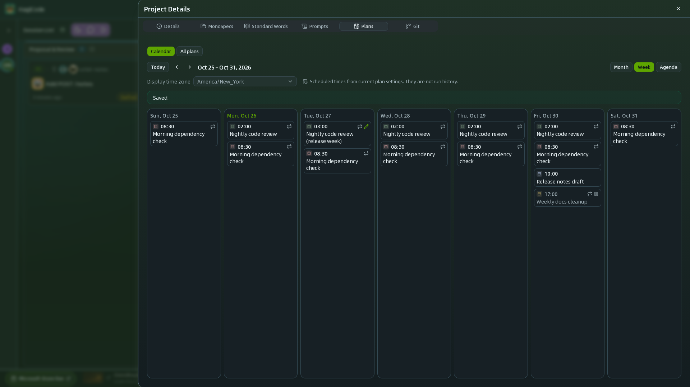

:::note
保存后，如果这个计划在当前显示的月、周或日程里没有任何运行时间，日历会提示 `"…" has no scheduled time in this period`，并给出 **All plans** 按钮，计划的详情仍然可以从那里查看。
:::

## 删除计划

删除同样有两个入口，并且都会先确认。

- **从日历删除**：在某一次的详情抽屉里点 **Delete**。周期计划会先弹出 **Delete this time or the series** 范围选择：

  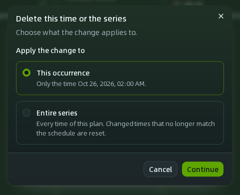

  选 **This occurrence** 并点 **Continue**，会出现 **Delete this time?** 确认；选 **Entire series** 则确认删除整个计划。单次计划只有一个范围，直接进入删除确认。

  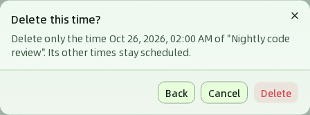

- **从 All plans 删除**：点计划那一行的 **Delete**，确认后删除整个计划。

  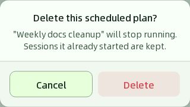

删除某一次，只会让这一个时间点不再运行；删除整个计划，计划就停止运行。**无论哪种删除，已经启动的会话都会保留。**

## 在 All plans 中管理计划

切换到 **All plans** 会看到所有计划，每一行是一个计划。

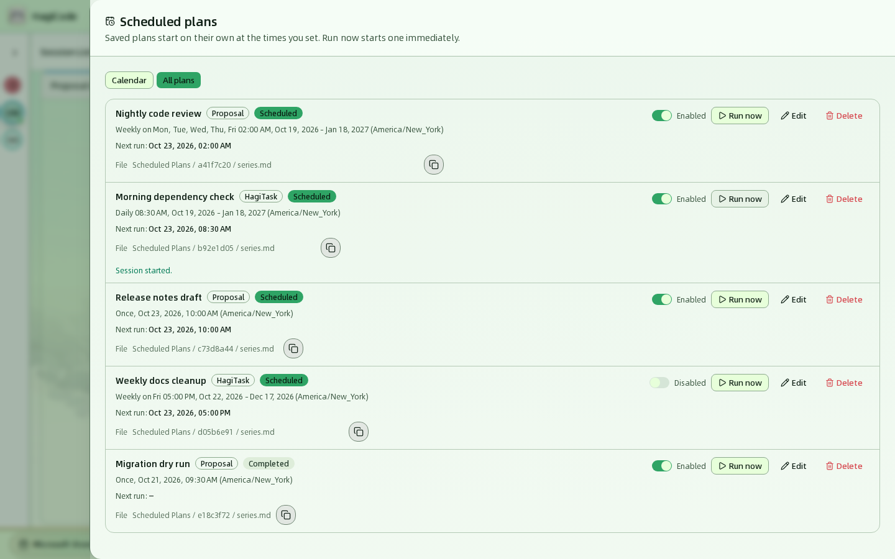

列表上方的 **All / Team / Personal** 按钮按范围筛选，括号里是各自的数量。每一行包含：

- **名称**，以及 **Proposal** 或 **HagiTask** 类型徽标、**Team** 或 **Personal** 范围徽标和 **Scheduled** 或 **Completed** 状态徽标。
- **时间表摘要**，例如 `Weekly on Mon, Tue, Wed, Thu, Fri 02:00 AM, Oct 19, 2026 - Jan 18, 2027 (America/New_York)`。
- **Next run**（下次运行）。已完成的计划显示 `–`。
- **Definition file**（定义文件）：计划定义文件的完整路径，位于项目的 `.hagicode/plans/` 下，团队计划是 `<名称>.yaml`，个人计划是 `<名称>.user.yaml`。右侧的按钮用来复制这个路径，复制成功会提示 **File path copied**。

行右侧的控件：

| 控件 | 作用 |
| --- | --- |
| **Enabled / Disabled** 开关 | 启用或停用计划。停用后计划不会自动运行，但会保留在列表和日历里。再次启用时，HagiCode 会从当前时间重新计算下次运行，停用期间错过的时间点不会补跑。 |
| **Run now**（立即运行） | 马上用保存的输入创建一次会话，成功后该行显示 **Session started.**（会话已启动）。它不会改变计划的时间表和 **Next run**，已停用或已完成的计划也可以手动运行。 |
| **Edit**（编辑） | 编辑整个计划，见[编辑计划](#编辑计划)。 |
| **Delete**（删除） | 删除整个计划，见[删除计划](#删除计划)。 |

## 计划文件

除了上面的**定义文件**（计划本身的保存位置），保存计划时 HagiCode 还会把计划的内容同步成 Markdown 文件，放进由 HagiCode 自动管理的 **Scheduled Plans** 保险库（Vault），不需要你自己创建。每个计划一个以编号命名的文件夹：

- `series.md`：整个计划的配置和需求文字。
- `occurrence-<时间>.md`：每个带有自己内容的“被修改的某一次”各有一份。

这些文件是根据计划生成的**副本**，方便你查看、检索或在别处引用；HagiCode 会按计划的最新内容重写它们，并在计划被删除时清理。要修改计划，请在 **Plans** 标签页里编辑：直接改这些副本不会改变计划，改动也会被覆盖。保险库本身参见 [Vault](/user-guide/vault)。

## 计划何时运行

- **只在 HagiCode 运行时执行。** HagiCode 每 30 秒检查一次是否有到点的计划，所以实际启动时间可能比设定时间晚最多约 30 秒。
- **错过的时间点只补跑一次。** 如果计划到点时 HagiCode 没有运行（比如电脑关机），下次启动 HagiCode 后会立即运行一次，然后按时间表安排下一次。错过了多少个时间点都只补一次，不会批量补跑。
- **失败不会重试。** 如果自动运行时无法创建会话（例如项目已被移除，或所选 Agent 不可用），这次运行会被跳过，计划仍按时间表等待下一次。需要补救时，修复问题后点击 **Run now** 手动运行；手动运行失败时，该行会显示 **Run now failed:** 和原因。
- **单次计划运行后变为 Completed。** 如果想再次使用，点击 **Edit** 设置一个新的未来时间。直接用开关启用已过期的单次计划会被拒绝，因为运行时间已在过去。
- **每个计划都会创建新会话。** 提案计划创建提案会话，HagiTask 计划创建 HagiTask 会话，它们会像手动创建的会话一样出现在会话看板上。

## 常见问题

**保存计划时提示“运行时间必须晚于当前时间”或“请至少选择一个星期”。**
这是表单校验。表单会在对应字段下方显示原因：单次计划的时间要晚于现在；周期计划的结束日期不能早于开始日期，按周重复时至少要选一个星期，并且起止范围内至少有一次可运行的时间。

**Plan 开关是灰色的。**
表单里已经附加了图片，而计划不支持图片。移除图片后开关即可使用。

**日历上没有我刚保存的计划。**
日历只显示当前月、周或日程范围内的时间点。切换到包含这些日期的月份，或到 **All plans** 查看这个计划。

**日历上的时间和我设置的不一样。**
日历用 **Display time zone** 排列时间，默认是浏览器时区。计划自己的时区显示在详情的 **Schedule time zone** 里，实际运行始终按计划的时区计算。

**计划到点了却没有运行。**
依次检查：计划是否为 **Enabled**；**Next run** 是否是你预期的时间（尤其是时区）；HagiCode 在那个时间点是否在运行；计划使用的项目或 Agent 是否仍然存在；这一次是否被单独删除了。日历显示的是计划设置，不是运行记录，不能用来确认“有没有跑过”。

**计划保存在哪里？**
每个计划保存为所属项目 `.hagicode/plans/` 文件夹中的一个文件：团队计划是 `<名称>.yaml`，个人计划是 `<名称>.user.yaml`。文件格式和手动创建的方法见项目文档的 `.hagicode` 数据文件一节。运行状态（例如下次运行时间）保存在本机，不写入计划文件。旧版全局 `scheduled-plans.json` 不再读取，其中的计划不会自动迁移。

<CardGrid>
  <LinkCard title="会话" href="/user-guide/sessions" description="了解会话看板，以及计划自动启动的会话会出现在哪里。" />
  <LinkCard title="技能与 HagiTask" href="/user-guide/skills-and-hagitask" description="安装 HagiTask，之后即可为它们创建 HagiTask 计划。" />
  <LinkCard title="Agents" href="/user-guide/agents" description="创建 HagiTask 计划所需要的 Agent。" />
  <LinkCard title="工作台总览" href="/user-guide" description="回到整个工作台的导览。" />
</CardGrid>
