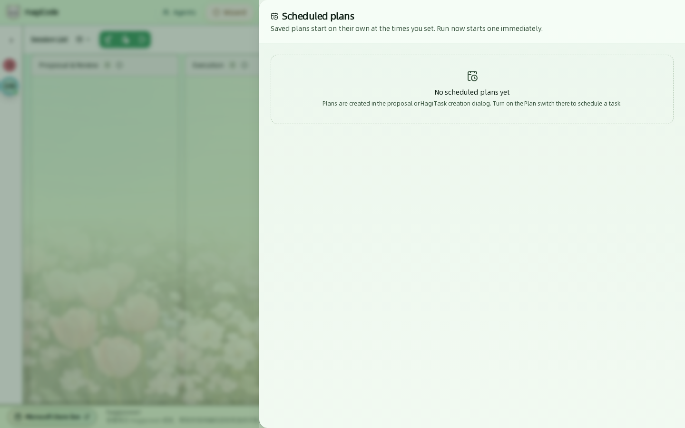
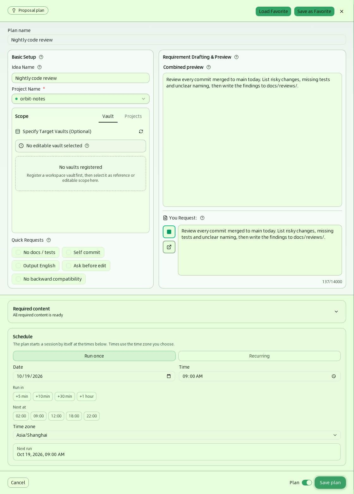
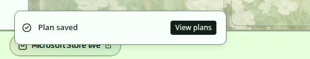
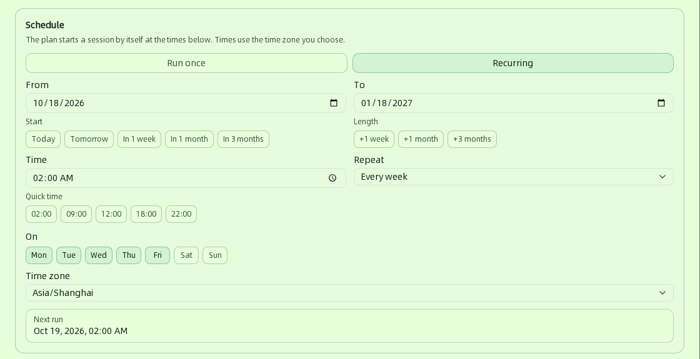
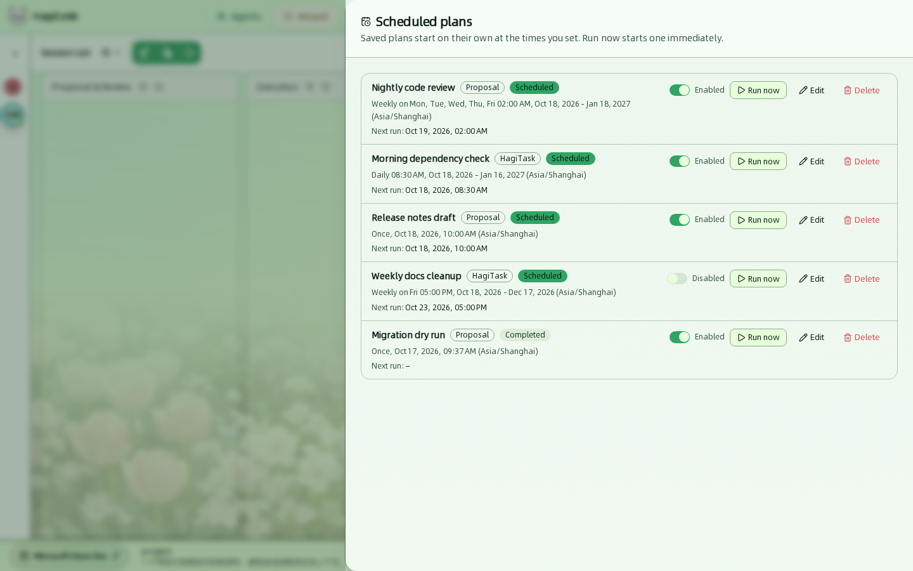
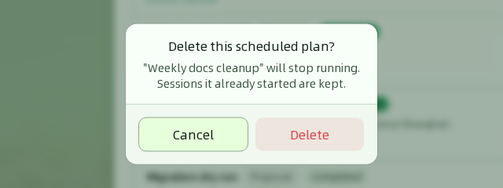

import { CardGrid, LinkCard } from '@astrojs/starlight/components';

**计划**（Plan，也叫 Scheduled plan，即“定时计划”）让 HagiCode 在你设定的时间自动开始一个会话，不需要你在场点击提交。典型用法：每个工作日凌晨 2 点跑一次代码审查、每天早上检查依赖更新，或者明天上午 10 点起草发布说明。

计划保存的是两样东西：一份**创建会话所需的全部输入**（与你平时在创建对话框里填写的完全一样），以及一份**时间表**。到点后，HagiCode 用与手动提交相同的流程创建会话，所以自动启动的会话和你亲手创建的没有区别。

## 基本概念

| 概念 | 含义 |
| --- | --- |
| **Type**（类型） | 计划分两种：**Proposal**（提案计划，到点后创建一个提案会话）和 **HagiTask**（到点后用某个 HagiTask 创建会话）。类型由你从哪个创建对话框保存计划决定。 |
| **Run once / Recurring**（单次 / 周期） | 单次计划只在一个时间点运行；周期计划在起止日期之间按天或按周重复运行。 |
| **Next run**（下次运行） | 计划下一次自动启动的时间，按你设置的时区显示。 |
| **Scheduled / Completed**（已安排 / 已完成） | 计划的状态。单次计划运行后、或周期计划走完结束日期后变为 Completed。 |
| **Enabled / Disabled**（已启用 / 已停用） | 每个计划都有一个启用开关。停用的计划保留在列表里，但不会自动运行。 |

## 打开计划管理器

顶栏的 **Plans**（计划）按钮会打开计划管理器。窗口较窄时按钮只显示日历图标，悬停会提示 **Scheduled plans**（定时计划）。

第一次打开时列表是空的。管理器只负责**查看和管理**已有计划，不能在这里新建：计划总是在创建提案或 HagiTask 的对话框里保存的。

## 创建计划

在创建提案和 HagiTask 的对话框里，都可以把“立即开始”换成“按计划开始”。普通会话（**Create Normal Session**）没有计划开关。

1. 像平时一样打开创建对话框，例如 **New Idea**（新建主意），填写主意名称、项目和需求。详细字段参见[会话](/user-guide/sessions#新建主意提案)。
2. 看对话框右下角，提交按钮旁边有一个 **Plan**（计划）开关，默认关闭。

   

3. 打开 **Plan** 开关，对话框会切换为计划模式：
   - 左上角的标签从 **Create Proposal** 变为 **Proposal plan**（提案计划）。
   - 顶部出现必填的 **Plan name**（计划名称），例如“夜间代码审查”，最多 200 个字符。
   - 底部出现 **Schedule**（时间安排）区域。
   - 提交按钮变为 **Save plan**（保存计划）。

   

4. 在 **Schedule** 里设置运行时间，详见[设置时间表](#设置时间表)。HagiTask 计划还需要选择一个 Agent，详见[为 HagiTask 计划选择 Agent](#为-hagitask-计划选择-agent)。
5. 点击 **Save plan**。HagiCode 会显示 **Plan saved**（计划已保存）提示，点击 **View plans**（查看计划）可直接打开计划管理器。

   

:::note
计划不能包含图片。如果表单里已经附加了图片，**Plan** 开关会被禁用，并提示先移除图片再保存为计划。
:::

## 设置时间表

**Schedule** 区域的两个按钮决定运行方式：**Run once**（单次运行）和 **Recurring**（周期运行）。无论哪种方式，区域最下方的 **Next run** 都会实时显示按当前设置计算出的下次运行时间；如果显示 **Not scheduled**（未安排），说明当前设置下没有可运行的时间，需要调整日期或时间。

### 单次运行

只在一个时间点运行一次。

| 字段 | 说明 |
| --- | --- |
| **Date**（日期）和 **Time**（时间） | 运行的日期与时刻，默认是明天 09:00。必须晚于当前时间。 |
| **Run in**（多久后） | 快捷按钮：`+5 min`、`+10 min`、`+30 min`、`+1 hour`，从现在起算。 |
| **Next at**（下一次） | 快捷按钮：`02:00`、`09:00`、`12:00`、`18:00`、`22:00`，选当天或次日最近的这个时刻。 |
| **Time zone**（时区） | 日期和时间所使用的时区，默认是浏览器当前所在的时区。 |

### 周期运行

在起止日期之间，按天或按周重复运行。

| 字段 | 说明 |
| --- | --- |
| **From**（开始）和 **To**（结束） | 周期的起止日期，两端的日期都包含在内。默认从今天开始，持续一个月。**Start** 下的 `Today`、`Tomorrow`、`In 1 week`、`In 1 month`、`In 3 months` 用来快速设置开始日期，**Length** 下的 `+1 week`、`+1 month`、`+3 months` 用来快速设置时长。 |
| **Time**（时间） | 每次运行的时刻，格式 `HH:mm`。**Quick time** 提供 `02:00`、`09:00`、`12:00`、`18:00`、`22:00` 快捷选择。 |
| **Repeat**（重复） | **Every day**（每天）或 **Every week**（每周）。 |
| **On**（星期） | 选择 **Every week** 时出现，用 `Mon` 到 `Sun` 选择在星期几运行，至少选一天。 |
| **Time zone**（时区） | 时间所使用的时区。每次运行都以这个时区的本地时间为准，所以每天 02:00 的计划在夏令时切换前后仍然是 02:00。 |

:::tip
想让计划“长期有效”，把 **To** 设得远一些即可，例如点 **+3 months**。到了结束日期之后，计划会变为 **Completed**，不再运行。
:::

## 为 HagiTask 计划选择 Agent

提案计划不需要选 Agent。**HagiTask 计划必须选择一个 Agent**，因为到点自动启动时没有人可以临时挑选：

- 在计划模式的对话框里，会出现 **Available Agents**（可用 Agent）区域，说明是“选择本计划运行时使用的 Agent，计划启动时会沿用这一选择”。点击一个 Agent 即可选中。
- 底部栏会显示 `Agent: 名称`；还没选时显示 `No agent selected yet.`（尚未选择智能体），此时无法保存计划。
- 目前每个计划只能选择一个 Agent。创建 Agent 参见 [Agents](/user-guide/agents)。

## 管理已有计划

打开 **Plans** 会看到所有计划。每一行是一个计划。

每一行包含：

- **名称**，以及 **Proposal** 或 **HagiTask** 类型徽标和 **Scheduled** 或 **Completed** 状态徽标。
- **时间表摘要**，例如 `Weekly on Mon, Tue, Wed, Thu, Fri 02:00 AM, Oct 18, 2026 - Jan 18, 2027 (Asia/Shanghai)`。
- **Next run**（下次运行）。已完成的计划显示 `–`。

行右侧有四个控件：

| 控件 | 作用 |
| --- | --- |
| **Enabled / Disabled** 开关 | 启用或停用计划。停用后计划不会自动运行，但会保留在列表里。再次启用时，HagiCode 会从当前时间重新计算下次运行，停用期间错过的时间点不会补跑。 |
| **Run now**（立即运行） | 马上用保存的输入创建一次会话，成功后该行显示 **Session started.**（会话已启动）。它不会改变计划的时间表和 **Next run**，已停用或已完成的计划也可以手动运行。 |
| **Edit**（编辑） | 打开与创建时相同的对话框（计划模式），修改名称、内容、Agent 或时间表后点击 **Save plan**。已保存的计划始终是计划，**Plan** 开关处于锁定状态，不能改回普通任务。 |
| **Delete**（删除） | 删除计划前会先确认。删除只会让计划停止运行，**它已经启动的会话会保留**。 |

## 计划何时运行

- **只在 HagiCode 运行时执行。** HagiCode 每 30 秒检查一次是否有到点的计划，所以实际启动时间可能比设定时间晚最多约 30 秒。
- **错过的时间点只补跑一次。** 如果计划到点时 HagiCode 没有运行（比如电脑关机），下次启动 HagiCode 后会立即运行一次，然后按时间表安排下一次。错过了多少个时间点都只补一次，不会批量补跑。
- **失败不会重试。** 如果自动运行时无法创建会话（例如项目已被移除，或所选 Agent 不可用），这次运行会被跳过，计划仍按时间表等待下一次。需要补救时，修复问题后点击 **Run now** 手动运行；手动运行失败时，该行会显示 **Run now failed:** 和原因。
- **单次计划运行后变为 Completed。** 如果想再次使用，点击 **Edit** 设置一个新的未来时间。直接用开关启用已过期的单次计划会被拒绝，因为运行时间已在过去。
- **每个计划都会创建新会话。** 提案计划创建提案会话，HagiTask 计划创建 HagiTask 会话，它们会像手动创建的会话一样出现在会话看板上。

## 常见问题

**保存计划时提示“运行时间必须晚于当前时间”或“请至少选择一个星期”。**
这是表单校验。表单会在对应字段下方显示原因：单次计划的时间要晚于现在；周期计划的结束日期不能早于开始日期，按周重复时至少要选一个星期，并且起止范围内至少有一次可运行的时间。

**Plan 开关是灰色的。**
表单里已经附加了图片，而计划不支持图片。移除图片后开关即可使用。

**计划到点了却没有运行。**
依次检查：计划是否为 **Enabled**；**Next run** 是否是你预期的时间（尤其是时区）；HagiCode 在那个时间点是否在运行；计划使用的项目或 Agent 是否仍然存在。

**计划保存在哪里？**
所有计划保存在 HagiCode 系统管理的配置目录下的 `scheduled-plans.json` 文件中，不依赖浏览器，所以换一个浏览器打开同一个 HagiCode 也能看到。

<CardGrid>
  <LinkCard title="会话" href="/user-guide/sessions" description="了解会话看板，以及计划自动启动的会话会出现在哪里。" />
  <LinkCard title="技能与 HagiTask" href="/user-guide/skills-and-hagitask" description="安装 HagiTask，之后即可为它们创建 HagiTask 计划。" />
  <LinkCard title="Agents" href="/user-guide/agents" description="创建 HagiTask 计划所需要的 Agent。" />
  <LinkCard title="工作台总览" href="/user-guide" description="回到整个工作台的导览。" />
</CardGrid>
