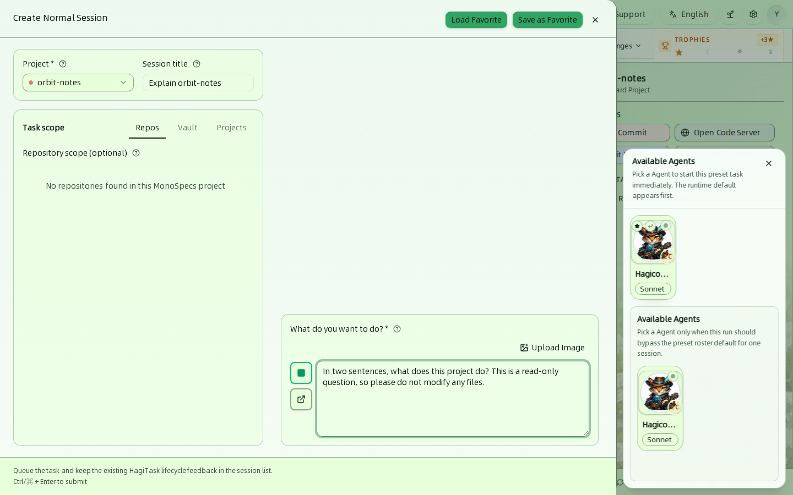
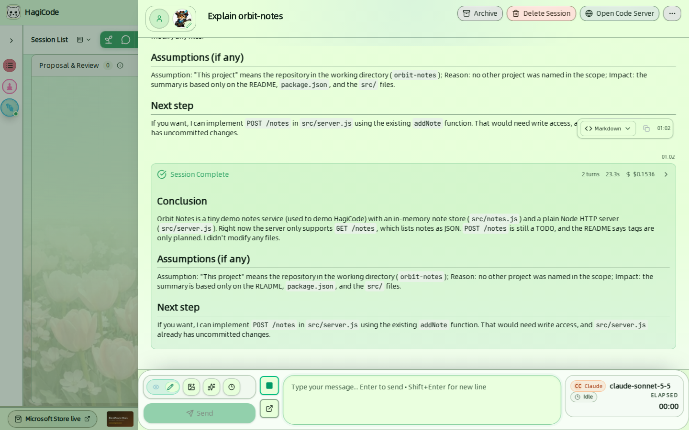
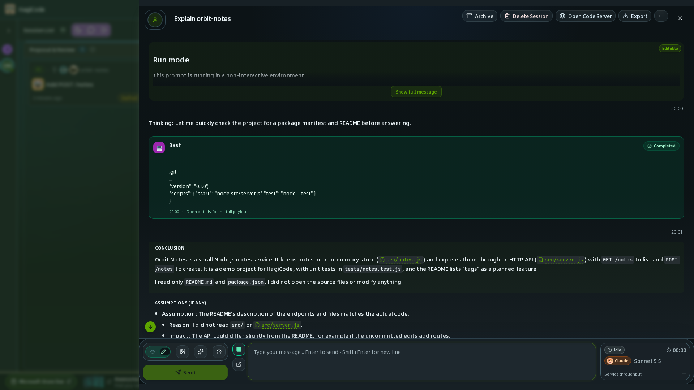

import { CardGrid, LinkCard } from '@astrojs/starlight/components';

**会话**是与 Agent 协作完成的一个工作单元。会话看板是工作台的中心：它显示每个会话当前所处的位置，并提供开始新会话的按钮。

## 会话看板

看板有三条泳道：

| 泳道 | 会出现什么 |
| --- | --- |
| **Proposal & Review**（提案与审核） | 正在起草、生成并作为提案审核的主意。 |
| **Execution**（执行） | 正在运行或已完成的会话，包括普通会话。 |
| **Archived**（归档） | 你已归档的会话，仍可随时回看。 |

每张卡片显示会话编号、所属项目、表示类型的图标、标题、最近变更时间，以及状态徽标，例如 **Executing**（执行中）或 **Execution Complete**（执行完毕）。点击卡片即可打开会话。每条泳道标题旁的计数表示其中的会话数量，泳道标题上的箭头可折叠该泳道。

### 工具栏

泳道上方的工具栏有四个控件：

- **布局模式切换器**（*Session List*（会话列表）旁边的小图标）：在五种视图之间切换。参见[视图](/user-guide/views)。
- **New Idea**（新建主意，嫩芽图标）：开始一个提案。
- **Create Normal Session**（创建普通会话，对话气泡图标）：开始一次对话。
- **More HagiTasks**（更多 HagiTask，列表图标）：打开 HagiTask 工作区，使用其他任务预设。参见[技能与 HagiTask](/user-guide/skills-and-hagitask)。

**Recent changes**（最近变更）菜单和 **Trophies**（奖杯）小组件位于工具栏右端。参见[项目](/user-guide/projects)和[状态栏与进度](/user-guide/status-bar-and-progress)。

### 布局模式

| 模式 | 徽标 | 适用场景 |
| --- | --- | --- |
| **Classic**（经典） | Focused（专注） | 紧凑的会话列表，旁边是项目列和详情列。 |
| **Execution Flow Kanban**（执行流看板） | Flow（流程） | 泳道加右侧完整的操作区。本指南使用的就是这种布局。 |
| **Dashboard Kanban**（操作台看板） | Compact（精简） | 更轻量的看板，按状态分组，为会话概览留出更多空间。 |
| **Project × Status Matrix**（项目 × 状态矩阵） | Matrix（矩阵） | 一张网格总览所有项目的会话状态和需要关注的数量。 |
| **Command View**（指挥视图） | Command（指挥） | 在实时磁贴墙上同时盯着多个运行中的会话，并就地回答它们的提问。 |

每种视图的详细说明和切换方法，参见[视图](/user-guide/views)。

## 新建主意（提案）

点击 **New Idea** 打开 **Create Proposal**（创建提案）抽屉。适合值得先做计划的变更：你描述想要的内容，HagiCode 起草提案，你在执行前审核。[使用提案会话将主意转化为代码](/quick-start/proposal-session)的演练会带你走完从提案到归档的完整流程。

**左列：Basic Setup**（基础设置）

- **Idea Name**（主意名称）和 **Project Name**（项目名称），均为必填。
- **Scope**（作用域）有两个标签页。**Vault** 让你 *Specify Target Vaults (Optional)*（指定目标 Vault（可选））：标记 AI 可以编辑的 Vault，系统管理的 Vault 只能作为参考。**Projects**（项目）可以把其他项目添加为上下文。
- **Quick Requests**（快捷需求）是一键添加到你需求中的内容：*No docs / tests*（不含文档测试）、*Self commit*（自行提交）、*Output English*（输出中文，随界面语言变化）、*Ask before edit*（编辑前询问）和 *No backward compatibility*（不兼容旧版）。

**右列：Requirement Drafting & Preview**（需求编写与预览）

- **You Request**（您的需求）用来描述变更，最多 14,000 个字符。**Upload Image**（上传图片）可以附加图片。
- **Combined preview**（组合预览）显示将发送给 AI 的完整文本，方便你在提交前检查。
- **Submit idea**（提交主意）创建提案会话。**Load Favorite**（加载收藏）和 **Save as Favorite**（另存为收藏）可复用已保存的设置。
- 抽屉右下角的 **Plan**（计划）开关会把“立即提交”换成“按计划提交”：保存后，HagiCode 会在你设定的时间自动创建这个提案会话。参见[计划任务](/user-guide/scheduled-plans)。

## 新建普通会话

点击 **Create Normal Session** 与 Agent 开始一次普通对话。用它来了解仓库、提问，或在不走提案的情况下做小改动。

| 字段 | 说明 |
| --- | --- |
| **Project**（项目） | 必填。默认为当前选中的项目。 |
| **Session title**（会话标题） | 选填，作为卡片上显示的标签。 |
| **Task scope**（任务范围） | **Repos**（仓库）把会话限定在 MonoSpecs 项目的若干仓库内。**Vault** 和 **Projects**（项目）可附加额外的参考资料。 |
| **What do you want to do?**（你想做什么？） | 必填，是会话的第一条消息。**Upload Image** 可以附加图片。 |

**Available Agents** 面板列出你的 Agent。选择其中一个，会话就会**立即开始**；第一项是运行时默认值。第二个列表可让你仅为本次运行选择另一个 Agent。如果没有列出任何 Agent，请先在 [Agents](/user-guide/agents) 中创建。按 `Ctrl/⌘ + Enter` 可以用键盘提交。

:::note[从只读问题开始]
本指南中的示例会话向演示项目提了一个只读问题，大约 23 秒完成，没有修改任何文件。编辑模式按会话单独控制，见下文。
:::

## 在会话中工作

点击卡片打开会话抽屉。

**标题区**：标题、Agent 的头像，以及 **Archive**（归档，把会话移到 Archived 泳道）、**Delete Session**（删除会话）、**Open Code Server**（打开 Code Server）按钮和一个包含更多操作的 **…** 菜单。

**对话**：你与 Agent 的消息按顺序排列。Agent 工作时，你可以跟进它的操作：工具调用会以卡片形式显示。

运行结束后，**Session Complete**（会话完成）卡片会汇总本次运行的轮数、耗时和费用。点击它可展开详情。

**消息框**：位于底部。

- **Edit / Readonly**（编辑 / 只读）开关用来打开或关闭编辑模式。开启编辑模式后，新消息更有可能修改文件。新建的普通会话是否默认开启编辑模式，在 **Settings → Process & Interaction → Chat View**（设置 → 流程与交互 → 聊天视图）中设置。
- 有用于 **图片**、**Standard Phrases**（标准用语，即 `@` 选择器）和 **Import Recent History**（导入最近历史）的按钮。
- **Send**（发送）提交消息。按 `Enter` 发送，按 `Shift + Enter` 换行。

**Agent 状态卡片**：位于消息框右侧，显示 Agent CLI 和模型（例如 `claude-sonnet-5-5`）、当前状态（例如 *Idle*（空闲））以及已用时间。

<CardGrid>
  <LinkCard title="创建普通会话" href="/quick-start/conversation-session" description="一步一步完成你的第一次对话。" />
  <LinkCard title="使用提案会话将主意转化为代码" href="/quick-start/proposal-session" description="从主意到归档的完整提案流程。" />
  <LinkCard title="Agents" href="/user-guide/agents" description="创建运行会话的 Agent。" />
</CardGrid>
