import { CardGrid, LinkCard } from '@astrojs/starlight/components';

点击顶栏中的**齿轮图标**打开**设置**（**Settings**，顶栏按钮提示为“配置”，对话框标题为“设置”）。左侧列出各分组及其标签页，右侧显示所选标签页。有些标签页会在你修改时自动保存，有些则有自己的 **Save**（保存）按钮。

分组可以折叠，HagiCode 会记住你让哪些保持展开。

| 分组 | 标签页 |
| --- | --- |
| [Common（常用）](#common常用) | General Settings（通用设置） |
| [Project（项目）](#project项目) | Project Icon（项目图标） |
| [Process & Interaction（流程与交互）](#process--interaction流程与交互) | Comments（批注）、Notifications（通知）、Quick Actions（快速操作）、Kanban Right Panel（看板右区）、Proposal Creation（提案创建）、Planning Direction（规划方向）、Proposal Stage Diagram（提案阶段图）、Mermaid Appearance（Mermaid 图表外观）、Session List（会话列表）、Confirm Prompts（确认提示）、Common Requirements（常用主诉）、Error Retry（错误重试）、AgentCLI Interactive Control（AgentCLI 交互控制）、Chat View（聊天视图）、Standard Phrases（标准用词）、Haginput |
| [Integration（集成）](#integration集成) | Break Reminder（休息提醒）、Salary Tracker（时薪挂机）、GitHub、Git、OmniRoute、TokenMonitor、Code Server、Status Bar Scroll（状态栏滚动） |
| [Game（游戏）](#game游戏) | Achievements（成就） |
| [System（系统）](#system系统) | Data Management（数据管理）、Danger Zone（危险区域）、About（关于） |
| [Debug（调试）](#debug调试) | Debug（调试） |

:::note
有些控件只有在启用 TurboEngine DLC 后才可用，未启用时会显示为锁定状态。
:::

## Common（常用）

### General Settings（通用设置）

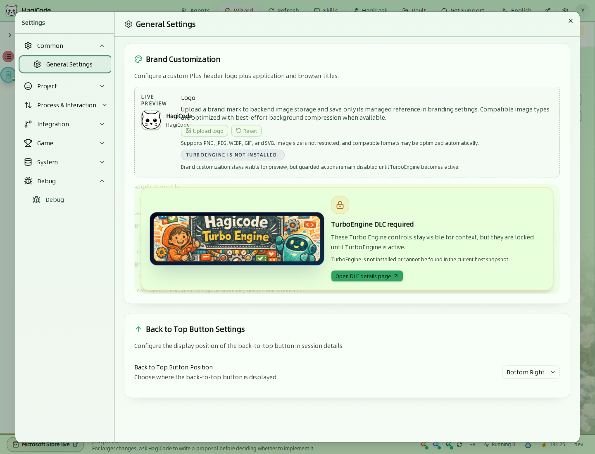

- **Brand Customization**（品牌自定义）用于设置自定义的顶栏 Logo、应用标题、品牌跳转链接和浏览器标题，并实时预览效果。这些控件可以预览，但在 TurboEngine DLC 启用之前处于锁定状态。
- **Back to Top Button Settings**（回到顶部按钮设置）选择“回到顶部”按钮在会话中的位置，例如 *Bottom Right*（右下角）。

## Project（项目）

### Project Icon（项目图标）

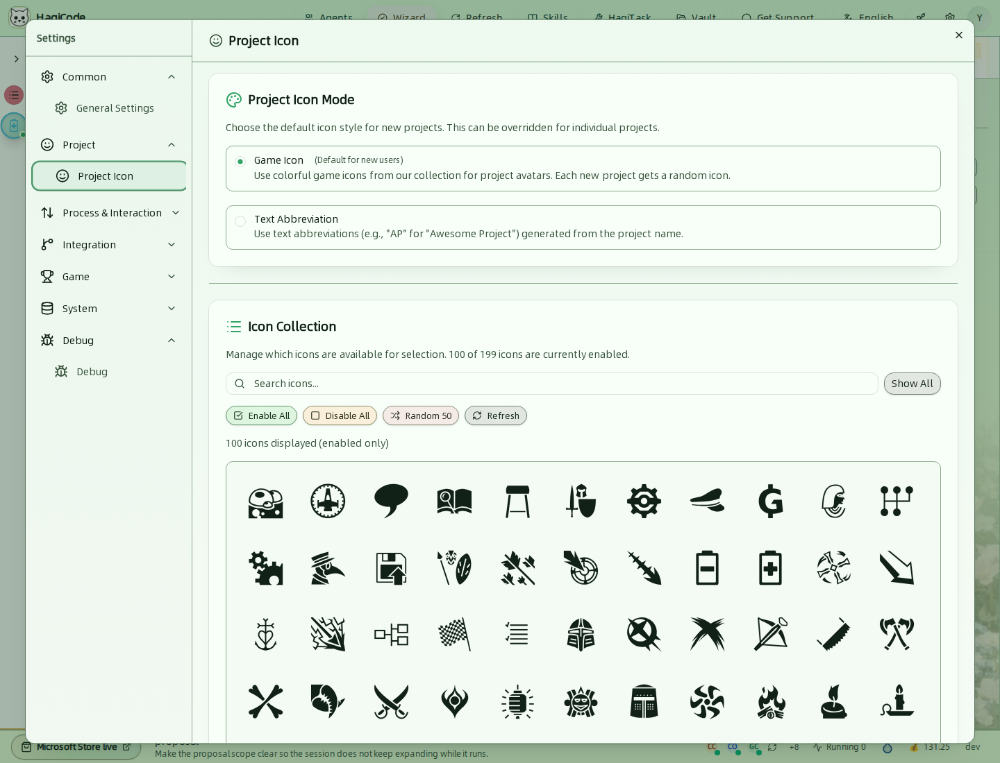

- **Project Icon Mode**（项目图标模式）设置新项目的默认样式：*Game Icon*（游戏图标，随机的彩色图标，为默认值）或 *Text Abbreviation*（文本缩写，取项目名称的首字母）。单个项目可以在[项目详情](/user-guide/projects#详情)中覆盖它。
- **Icon Collection**（图标集合）控制哪些图标可以被选中。可以使用 **Show All**（显示全部）、**Enable All**（全部启用）、**Disable All**（全部禁用）、**Random 50**（随机 50 个）和 **Refresh**（刷新），也可以点击某个图标来切换它。

## Process & Interaction（流程与交互）

这一组控制会话、提案和看板的行为。

### Comments（批注）

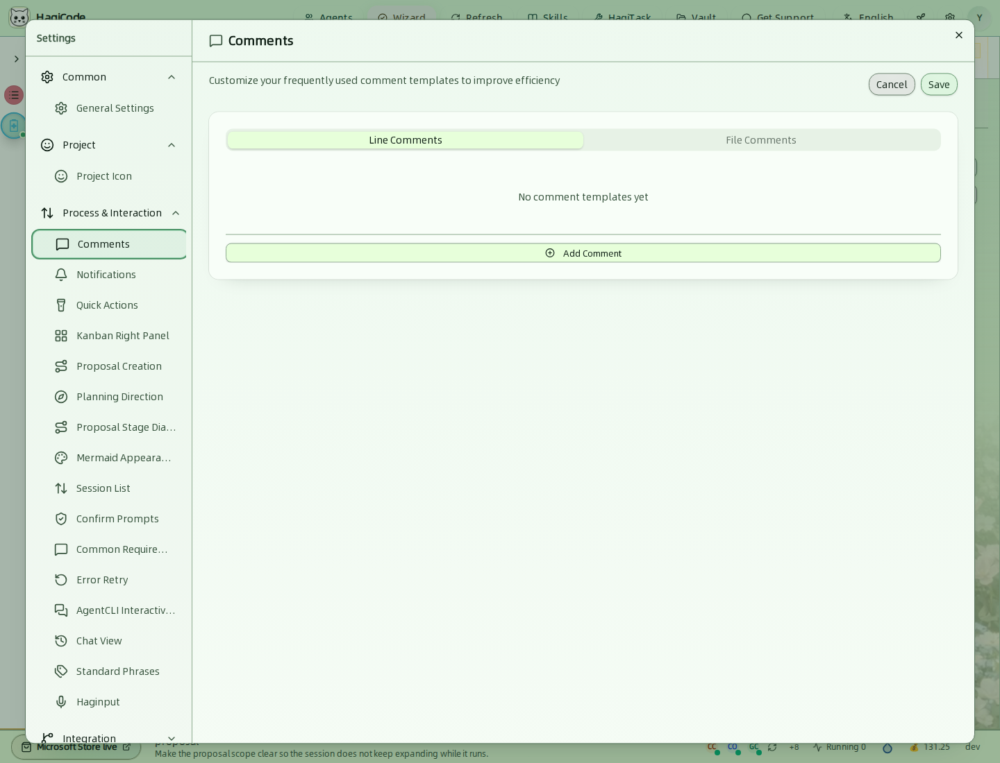

保存你常用的评注模板，分为两个列表：**Line Comments**（行评注）和 **File Comments**（文件评注）。用 **Add Comment**（添加评注）创建模板，用 **Save** 保存修改。

### Notifications（通知）

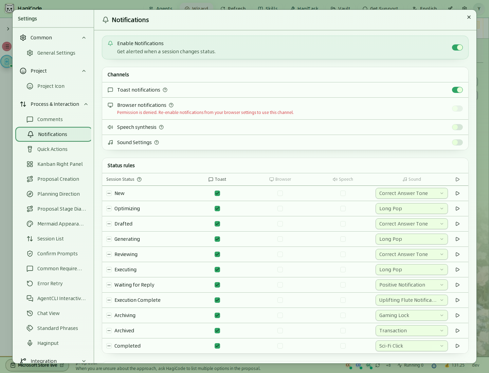

先打开通知，再选择渠道：**Toast notifications**（Toast 通知）、**Browser notifications**（浏览器通知，浏览器必须允许）、**Speech synthesis**（语音合成）和 **Sound Settings**（音效设置）。**Status rules**（状态规则）表格让你为每种会话状态（例如 *New*（新建）、*Drafted*（已起草）、*Executing*（执行中）、*Waiting for Reply*（等待回复）、*Execution Complete*（执行完成）或 *Archived*（已归档））选择触发哪些渠道以及播放哪个声音。播放按钮可以试听声音。

### Quick Actions（快速操作）

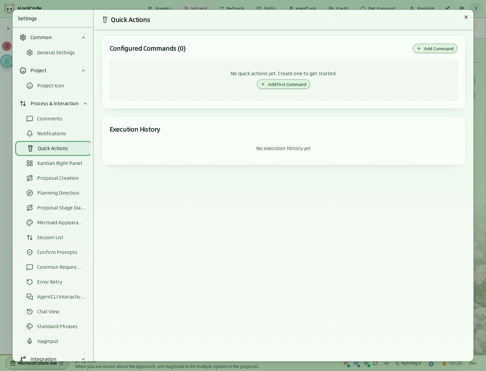

**Configured Commands**（已配置命令）列出你用 **Add Command**（添加命令）添加的自定义命令。**Execution History**（执行历史）记录它们的运行时间。

### Kanban Right Panel（看板右区）

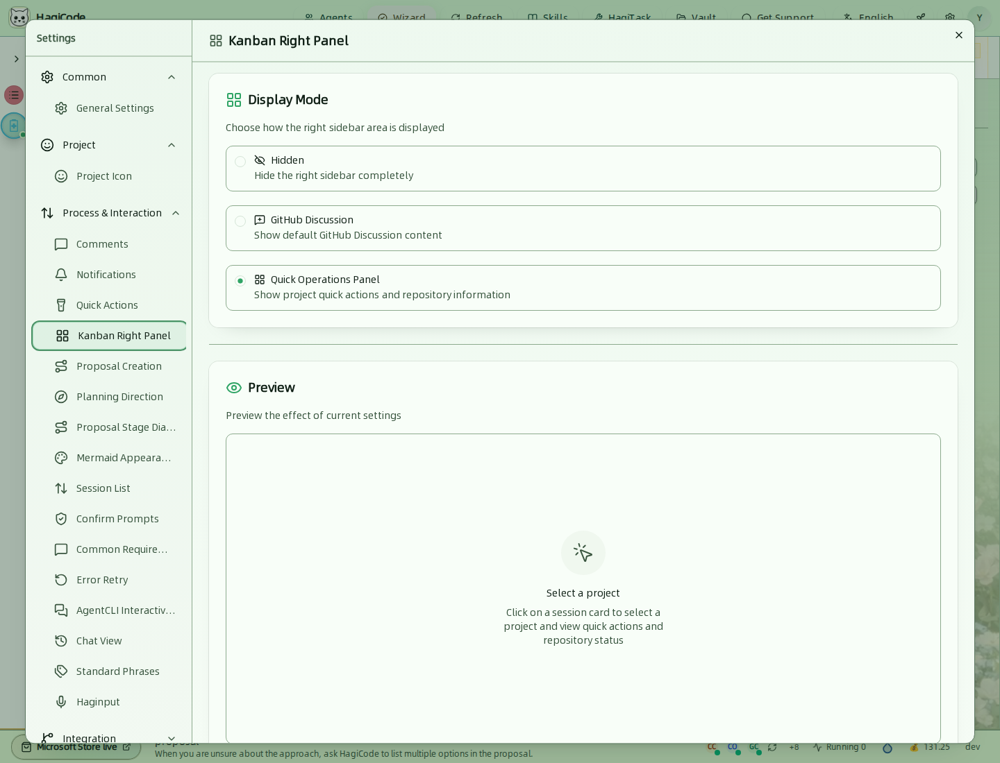

选择会话看板右侧显示什么：*Hidden*（隐藏）、*GitHub Discussion*，或带有快捷操作和仓库状态的 *Quick Operations Panel*（快速操作面板，默认值）。实时的 **Preview**（预览效果）会显示设置后的样子。

### Proposal Creation（提案创建）

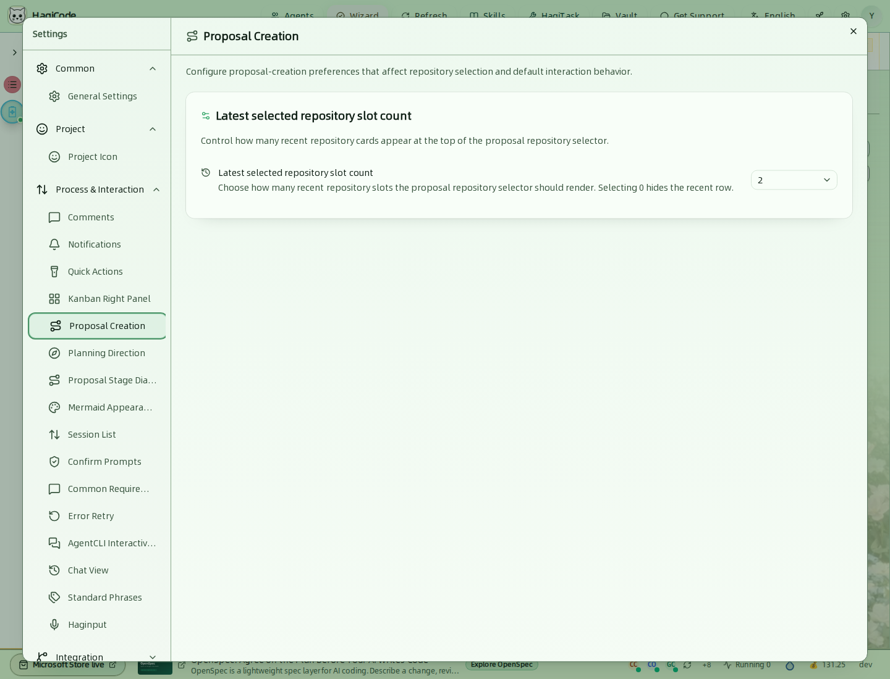

设置提案仓库选择器顶部显示多少张最近仓库卡片。选择 `0` 可隐藏这一行。

### Planning Direction（规划方向）

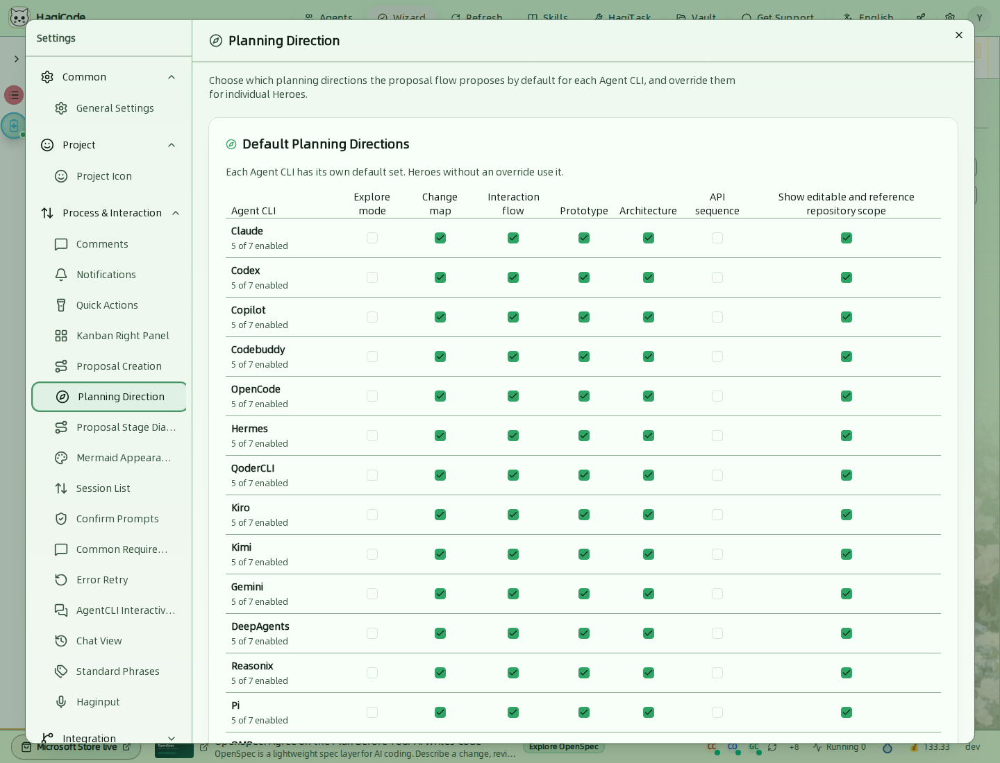

这是一个矩阵，列出提案流程默认为每个 Agent CLI 提出的规划方向：探索模式、变更地图、交互流程、原型、架构、API 时序，以及可编辑和仅参考的仓库范围。单个 Agent 可以覆盖这些默认值。

### Proposal Stage Diagram（提案阶段图）

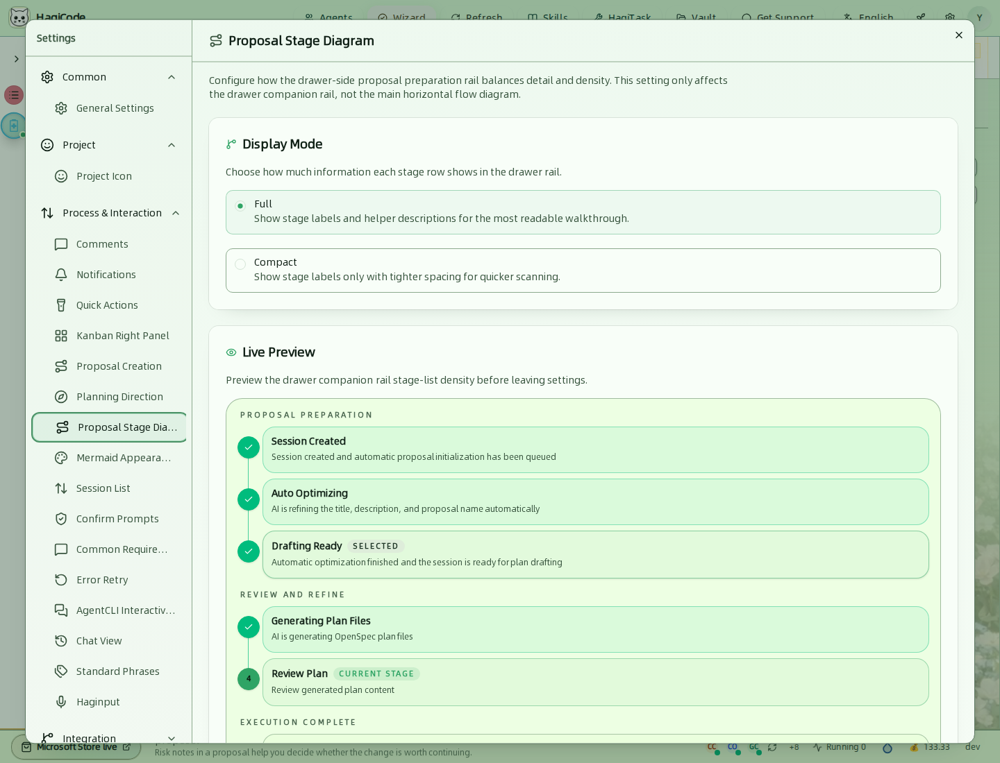

设置提案抽屉中阶段列表的详细程度：*Full*（完整）显示阶段标签和说明，*Compact*（精简）只显示标签。这只影响抽屉的侧边栏，不影响主流程图。

### Mermaid Appearance（Mermaid 图表外观）

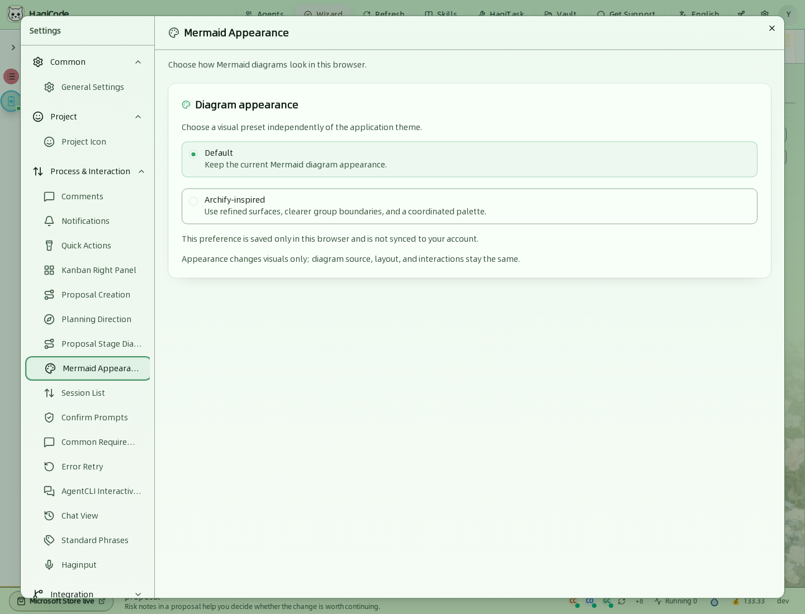

选择 Mermaid 图表的外观：*Default*（默认）或 *Archify-inspired*（Archify 风格）。该选择只保存在当前浏览器中，只改变视觉效果。

### Session List（会话列表）

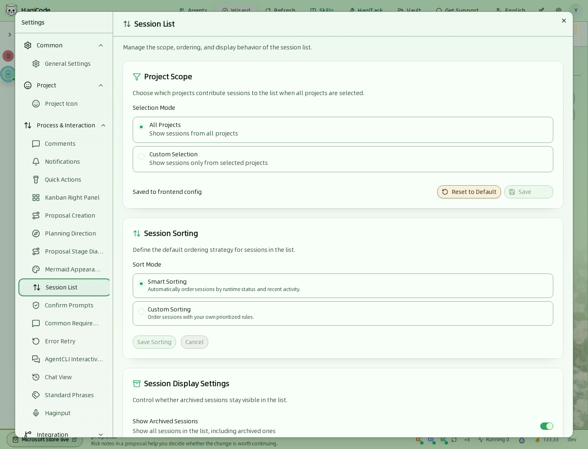

- **Project Scope**（项目范围）选择哪些项目进入 *All Sessions* 看板：*All Projects*（全部项目）或 *Custom Selection*（自定义选择）。点击 **Save** 应用。
- **Session Sorting**（会话排序）可选 *Smart Sorting*（智能排序，按运行状态和最近活动排序）或 *Custom Sorting*（自定义排序，使用你自己的优先级规则）。
- **Session Display Settings**（会话显示设置）包括已归档的会话是否继续显示在列表中。

### Confirm Prompts（确认提示）

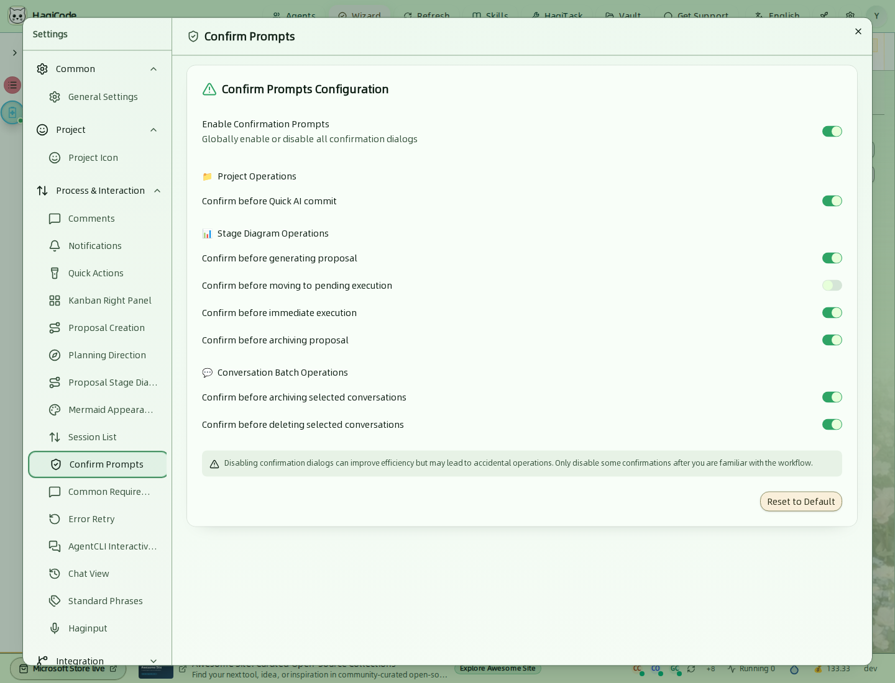

一个总开关，加上每个确认对话框各一个开关：快速 AI 提交之前；生成提案、将其移到待执行、立即执行或归档之前；以及归档或删除所选会话之前。关闭提示可以少点几次，但出错的代价会更高。**Reset to Default**（恢复默认设置）会恢复默认值。

### Common Requirements（常用主诉）

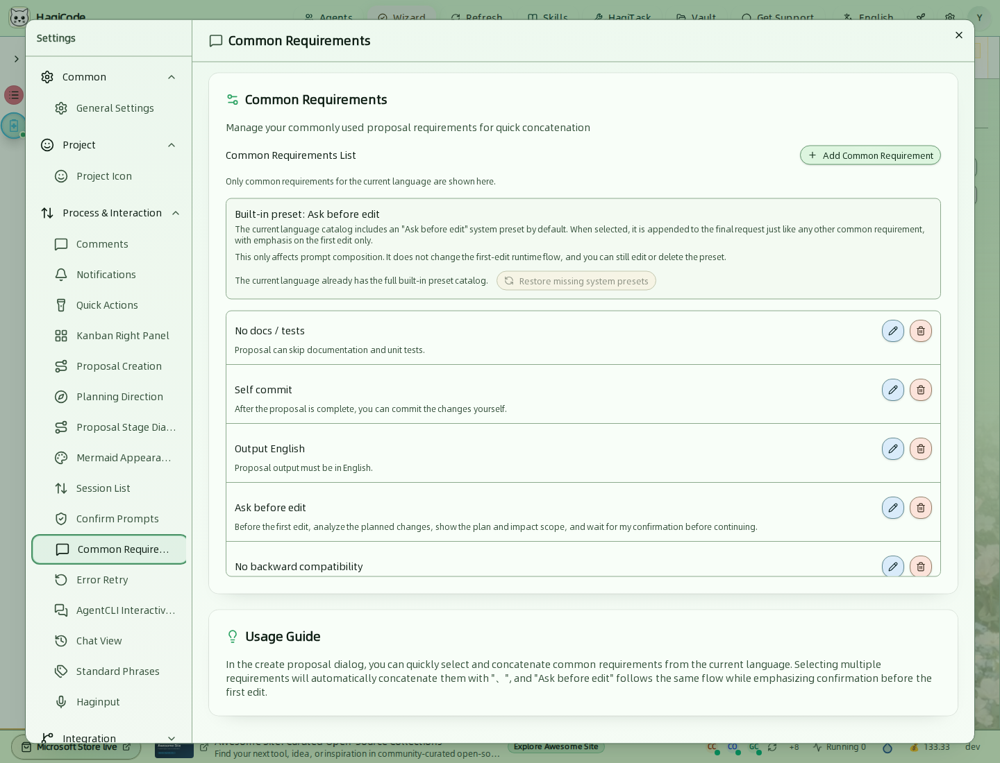

可复用的要求片段，可一键添加到提案需求中，例如 *No docs / tests*（不含文档测试）、*Self commit*（自行提交）、*Output English*（输出中文，随界面语言变化）、*Ask before edit*（编辑前询问）和 *No backward compatibility*（不兼容旧版）。只会列出当前界面语言对应的要求。用 **Add Common Requirement**（添加常用要求）创建你自己的要求，并用编辑和删除按钮管理它们。

### Error Retry（错误重试）

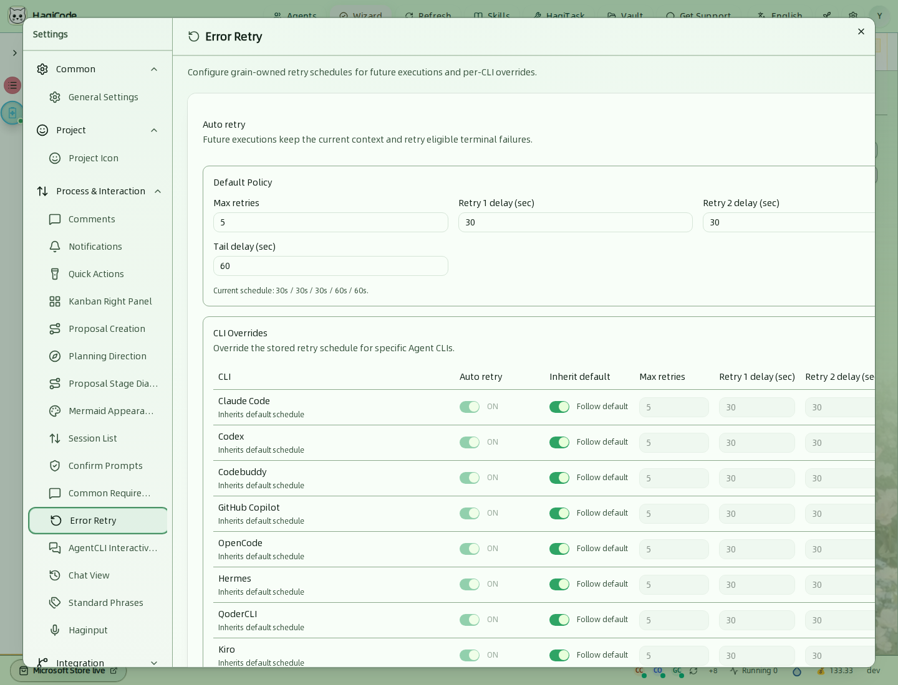

失败运行的自动重试。**Default Policy**（默认策略）设置最大重试次数和每次重试前的延迟，后续尝试使用末尾延迟。默认的重试间隔依次为 30、30、30、60 秒。**CLI Overrides**（CLI 覆盖项）让每个 Agent CLI 可以沿用默认策略，或使用自己的间隔。

### AgentCLI Interactive Control（AgentCLI 交互控制）

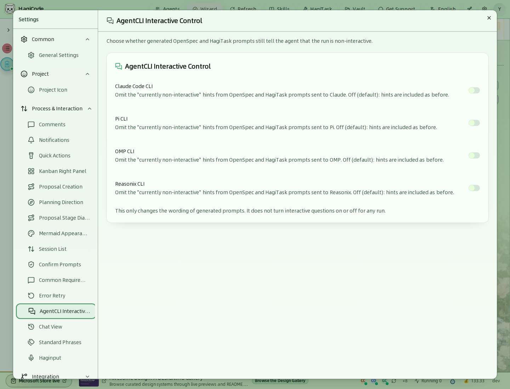

每个 Agent CLI 一个开关，决定生成的 OpenSpec 和 HagiTask 提示词是否仍然告知 Agent 本次运行是非交互的。开关关闭时（默认）会包含这条提示。这只会改变生成提示词的措辞。

### Chat View（聊天视图）

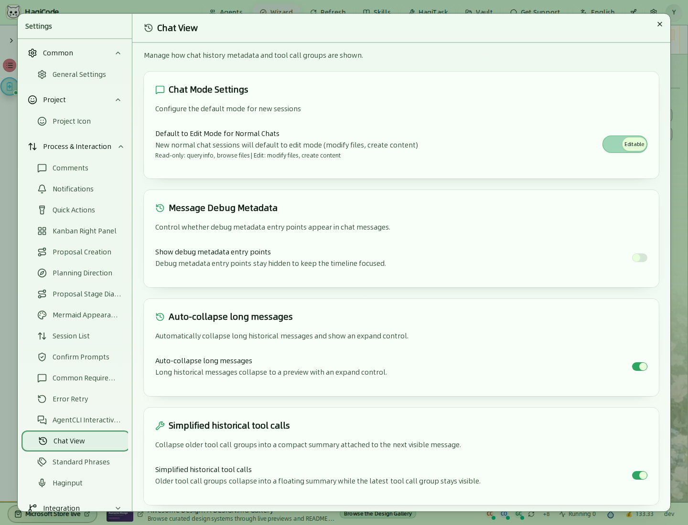

- **Default to Edit Mode for Normal Chats**（普通会话默认为编辑模式）决定新建的普通会话是以编辑模式（Agent 可以修改文件）开始，还是以只读模式开始。
- **Show debug metadata entry points**（显示调试元数据入口）会在聊天消息中增加调试入口。
- **Auto-collapse long messages**（自动折叠超长消息）会把较长的历史消息显示为预览，并带有展开控件。
- **Simplified historical tool calls**（简化历史工具调用）会把较早的工具调用折叠为一段简短摘要，附在下一条可见消息上。

### Standard Phrases（标准用词）

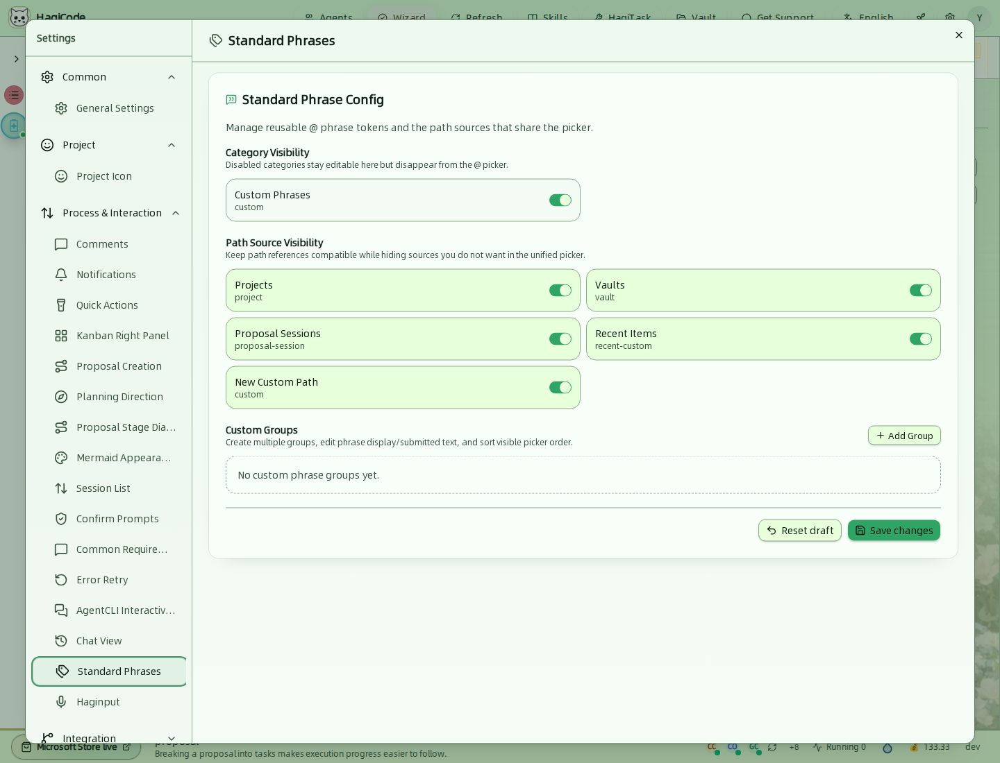

管理消息框中可复用的 `@` 短语标记。选择哪些分类和路径来源（项目、Vault、提案会话、最近项目、自定义路径）出现在 `@` 选择器中，并用 **Add Group**（新增分组）创建自定义短语分组。

### Haginput

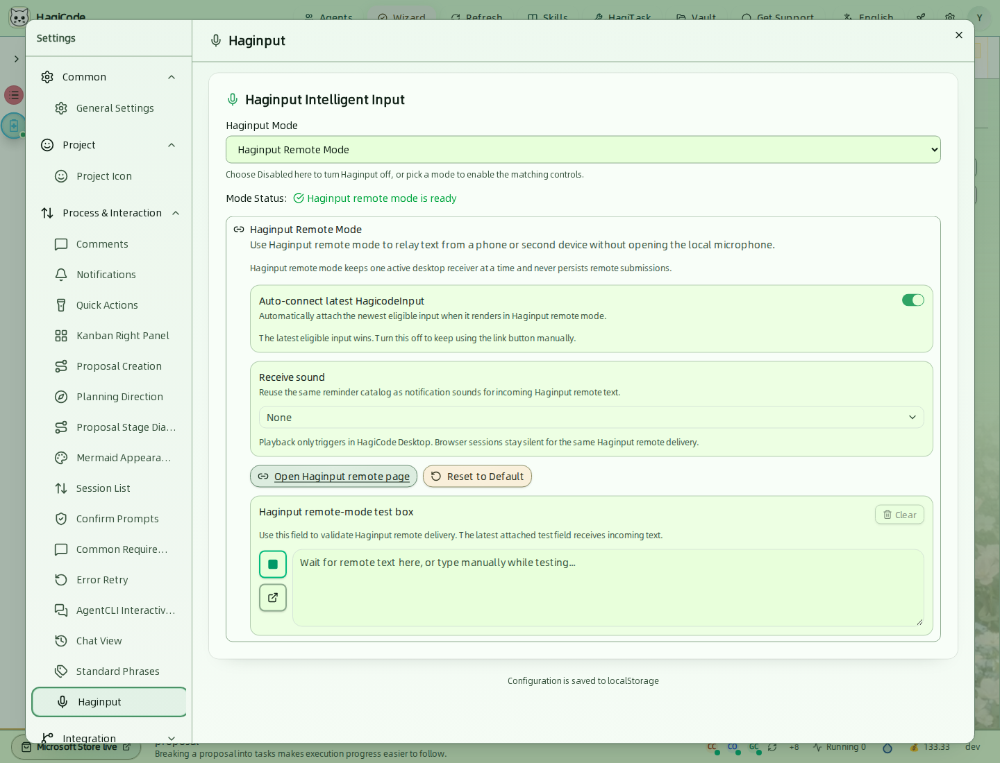

智能输入。可选择 **Disabled**（已关闭）、**Doubao Local Voice**（豆包本地语音）或 **Haginput Remote Mode**（Haginput 远程模式），后者可以在不打开本地麦克风的情况下，从手机或第二台设备转发文字。该标签页显示模式状态、自动连接选项、收到文字时的提示音和一个测试框。

## Integration（集成）

### Break Reminder（休息提醒）

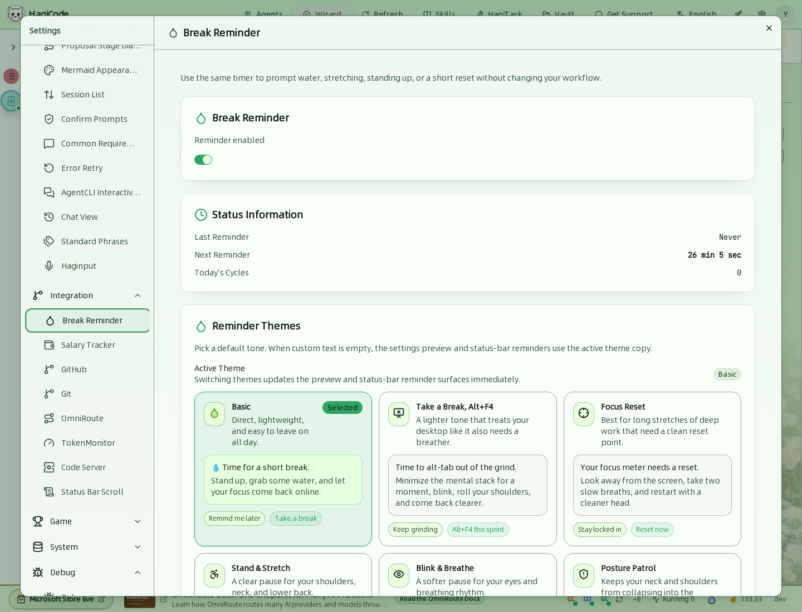

一个提醒你喝水、拉伸或站起来活动的计时器。它显示上一次和下一次提醒以及今天的循环次数，并可选择提醒主题，例如 *Basic*（基础样式）。提醒会显示在[状态栏](/user-guide/status-bar-and-progress#休息提醒)中。

### Salary Tracker（时薪挂机）

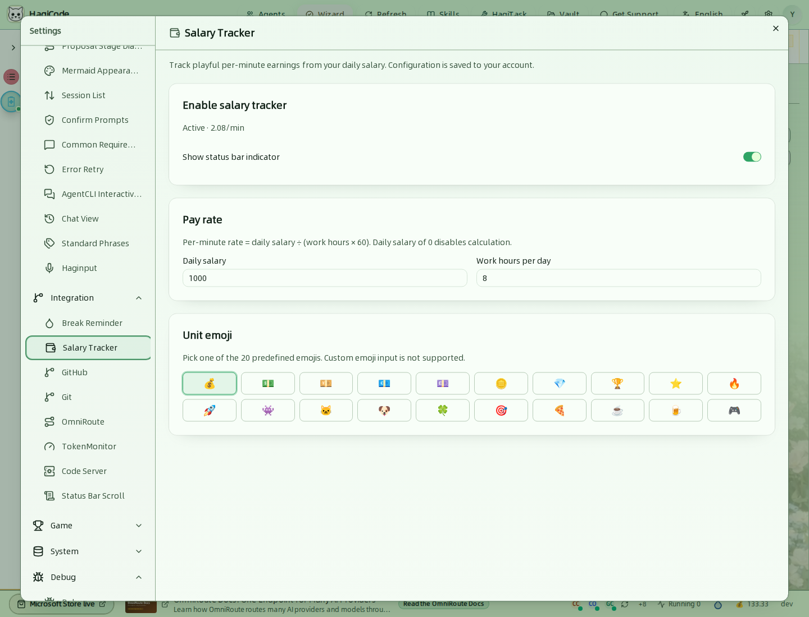

一个有趣的按分钟计算收入的计数器。填写 **Daily salary**（日薪）和 **Work hours per day**（每日工时）；每分钟收益等于日薪除以（工时 × 60），日薪为 `0` 时关闭计算。从 20 个单位 emoji 中选一个，并选择状态栏是否显示该指示器。

### GitHub

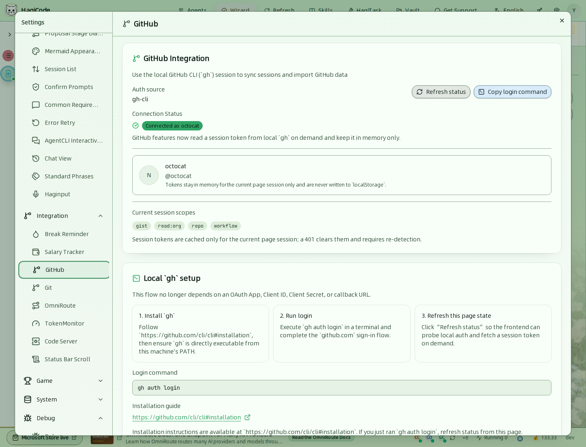

使用你本地的 GitHub CLI（`gh`）会话来同步会话并导入 GitHub 数据。该标签页显示连接状态和已授予的权限范围，并提供 **Refresh status**（刷新状态）和 **Copy login command**（复制登录命令）。令牌只在当前页面会话期间保留在内存中，从不写入本地存储。如果 `gh` 尚未登录，请按标签页上显示的 *Local `gh` setup*（本地 `gh` 配置步骤）操作。

### Git

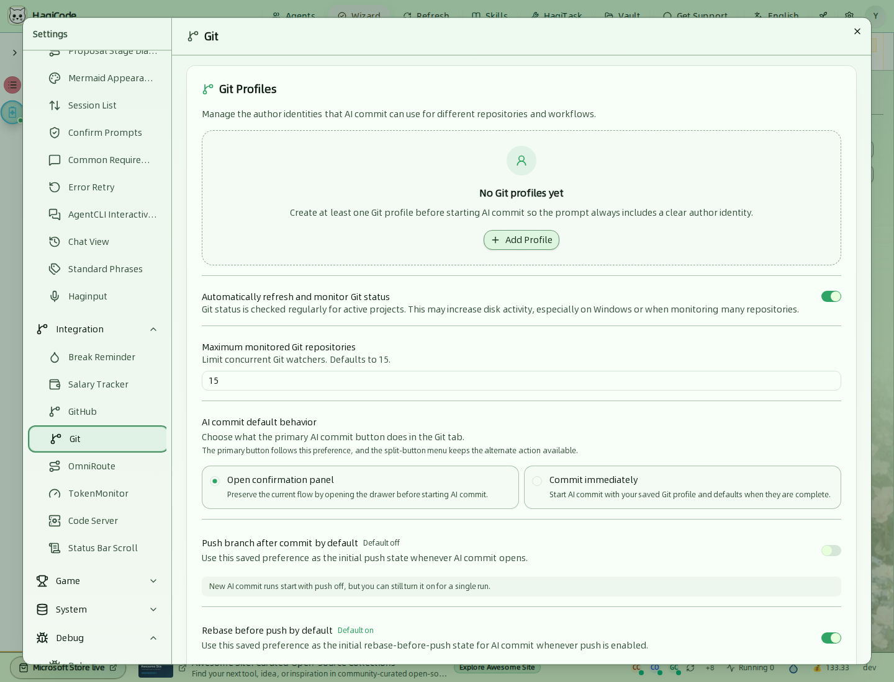

- **Git Profiles**（Git Profile）保存 AI 提交可以使用的作者身份。开始 AI 提交之前请至少创建一个，这样提示词总能写明明确的作者。
- **Automatically refresh and monitor Git status**（自动刷新并监控 Git 状态）会定期检查活跃项目。这可能增加磁盘活动，尤其是在 Windows 上或仓库很多时。**Maximum monitored Git repositories**（最大监控 Git 仓库数）限制同时监视的数量（默认 15）。
- **AI commit default behavior**（AI 提交按钮默认行为）决定主 AI 提交按钮的动作：先 *Open confirmation panel*（打开确认面板），或使用已保存的 Profile 和默认值 *Commit immediately*（立刻提交）。其他选项设置提交后默认是否推送或 rebase。

### OmniRoute

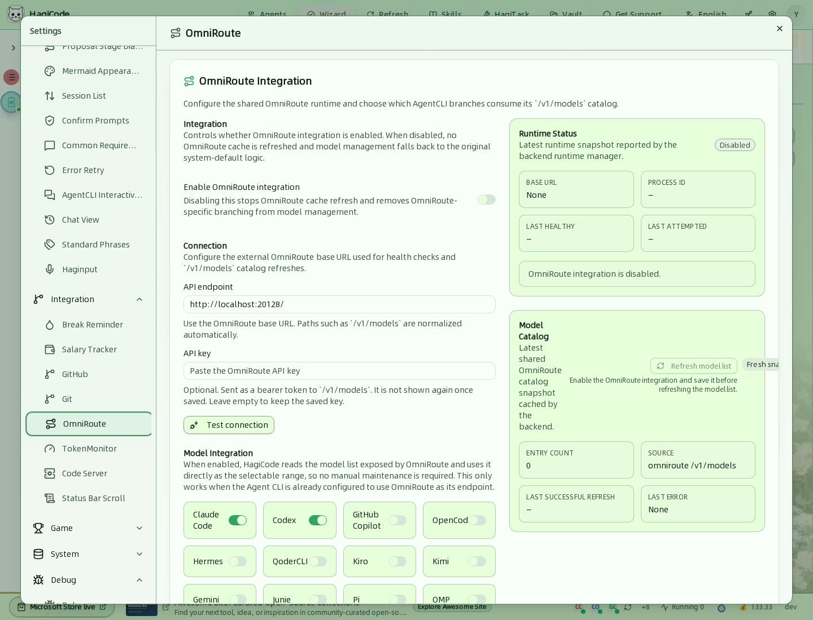

启用共享的 OmniRoute 集成。设置 **API endpoint**（API 端点）和可选的 **API key**（API 密钥），使用 **Test connection**（测试连接），并选择哪些 Agent CLI 使用 OmniRoute 的模型目录。右侧显示运行状态和已缓存的模型目录。集成关闭时，模型管理会回退到最初的系统默认值。安装方法参见 [OmniRoute](/related-software-installation/omniroute)。

### TokenMonitor

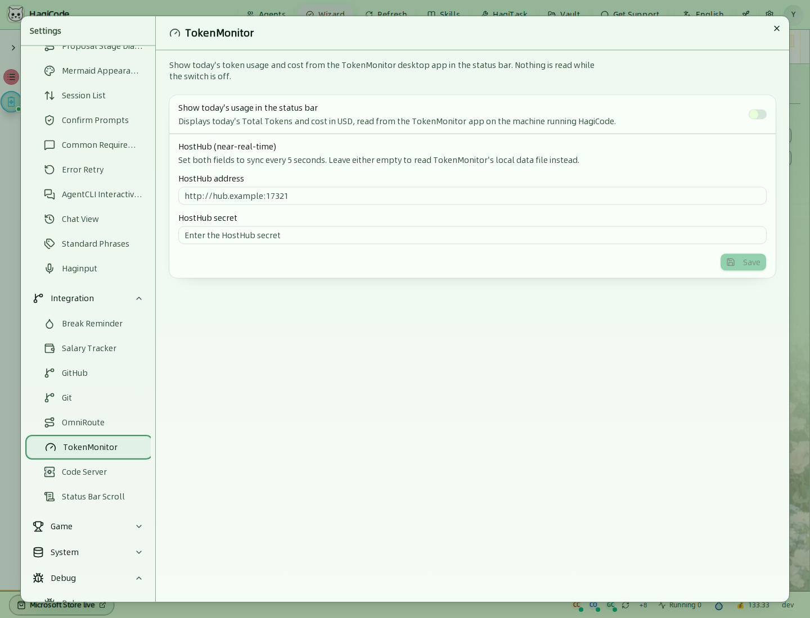

在状态栏中显示来自 TokenMonitor 桌面应用的今日 token 用量和费用。开关关闭时不会读取任何内容。要获得近实时更新，请同时填写 **HostHub address**（HostHub 地址）和 **HostHub secret**（HostHub 密钥）；任意一个留空，则改为读取 TokenMonitor 的本地数据文件。

### Code Server

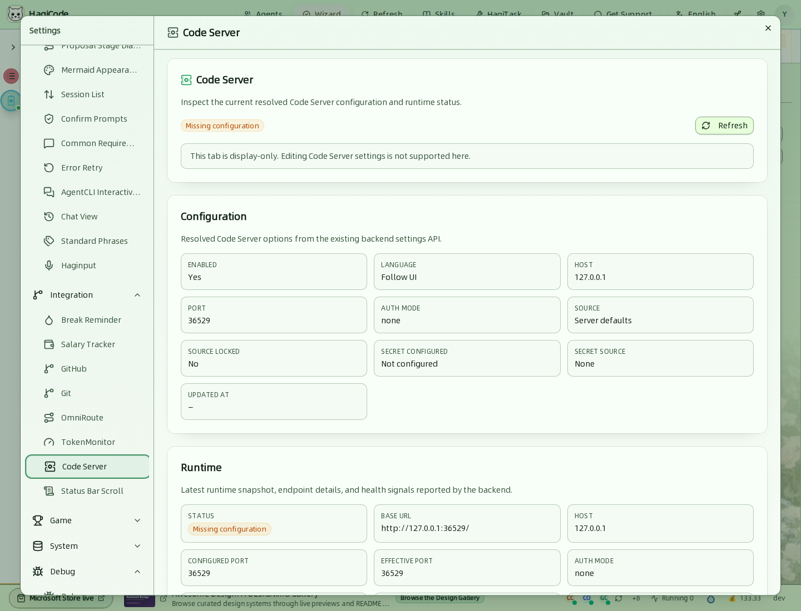

只读展示解析后的 Code Server 配置（主机、端口、认证模式、来源）和最新的运行时快照。这里不支持编辑 Code Server 设置。

### Status Bar Scroll（状态栏滚动）

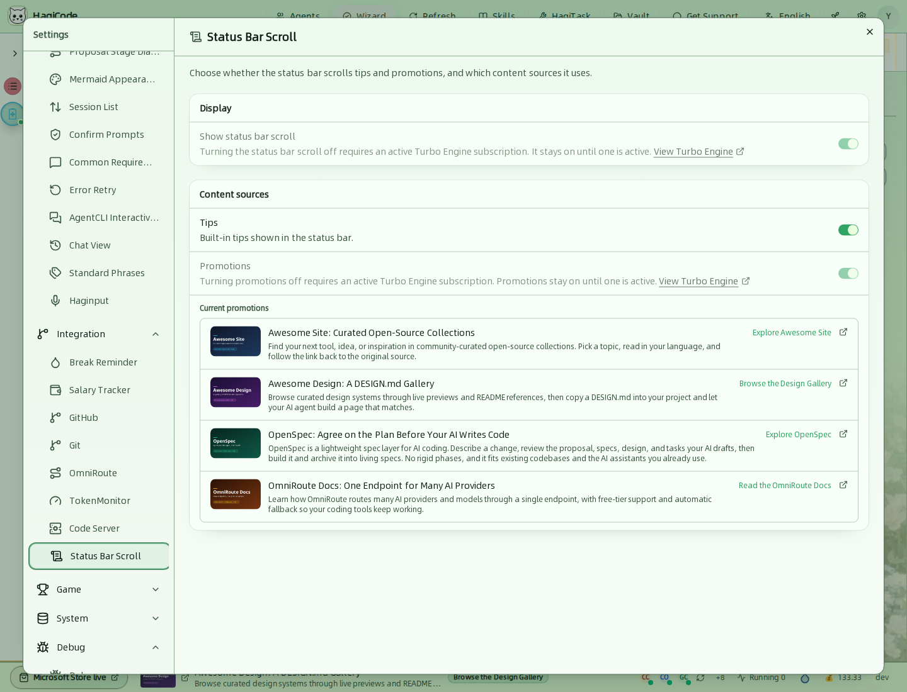

选择状态栏是否滚动，以及使用哪些来源：**Tips**（提示）和 **Promotions**（推广）。关闭滚动或推广需要有效的 TurboEngine 订阅。该标签页会列出当前的推广内容。

## Game（游戏）

### Achievements（成就）

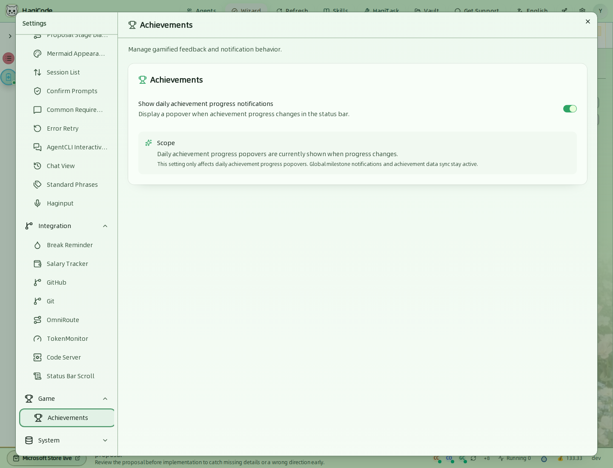

用于开关状态栏中每日成就进度的弹出提示。无论是否开启，全局里程碑通知和数据同步都保持启用。参见[状态栏与进度](/user-guide/status-bar-and-progress#奖杯与成就殿堂)。

## System（系统）

### Data Management（数据管理）

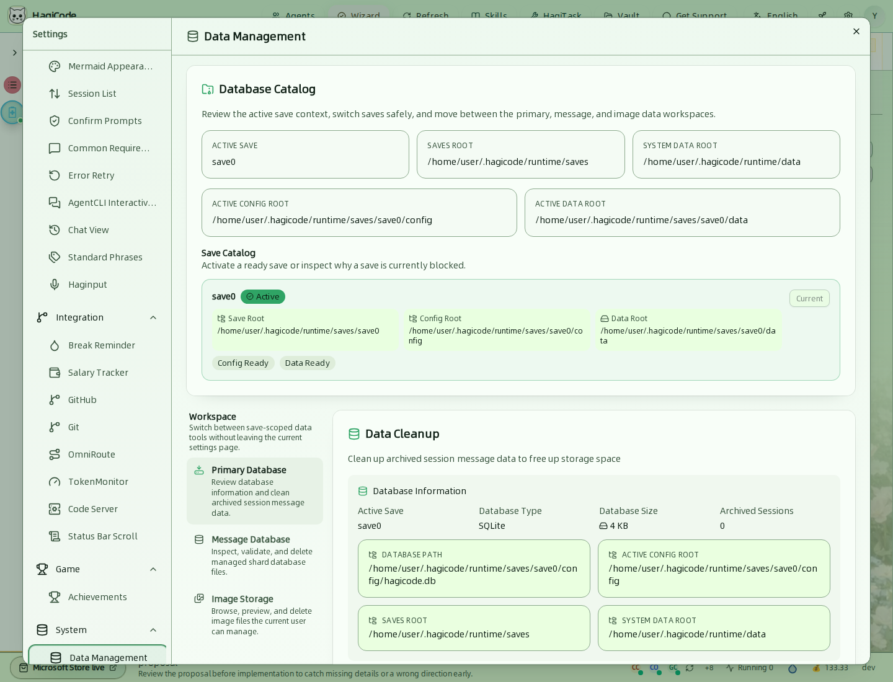

显示当前存档及其数据文件夹（存档根目录、配置目录、数据目录）。**Save Catalog**（存档目录）列出存档，并让你安全地启用一个就绪的存档。**Workspace**（工作区）切换器可在 *Primary Database*（主数据库）、*Message Database*（Message 数据库）和 *Image Storage*（图片存储）工具之间切换。**Data Cleanup**（数据清理）显示数据库信息，并清理已归档的会话消息数据以释放存储空间。

### Danger Zone（危险区域）

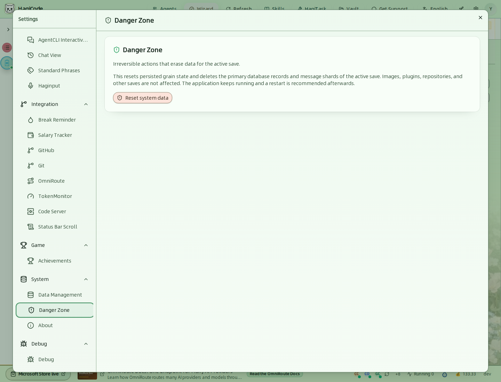

**Reset system data**（重置系统数据）会重置持久化状态，并删除当前存档的主数据库记录和消息分片。图片、插件、仓库和其他存档不受影响。应用会继续运行，之后建议重启。此操作无法撤销。

### About（关于）

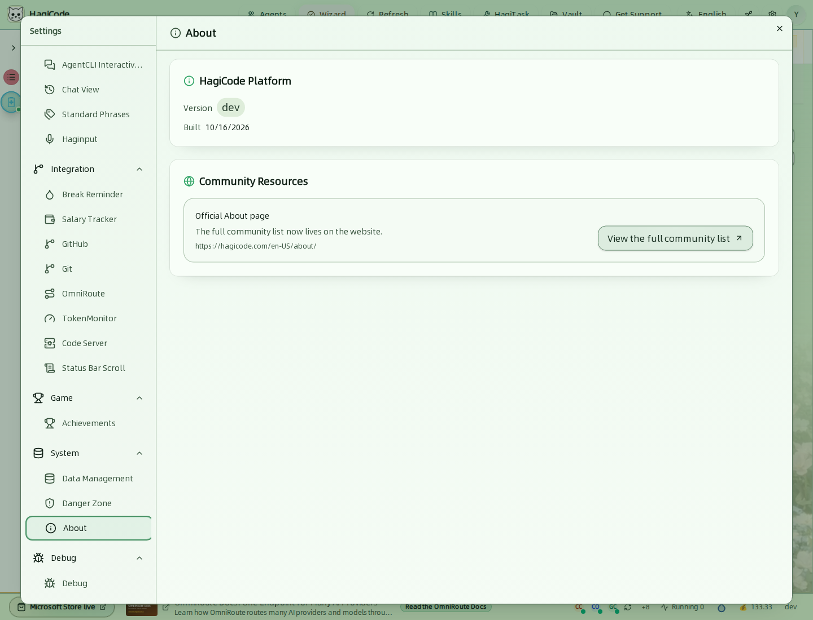

显示版本和构建日期，并链接到包含完整社区列表的官方“关于”页面。

## Debug（调试）

### Debug（调试）

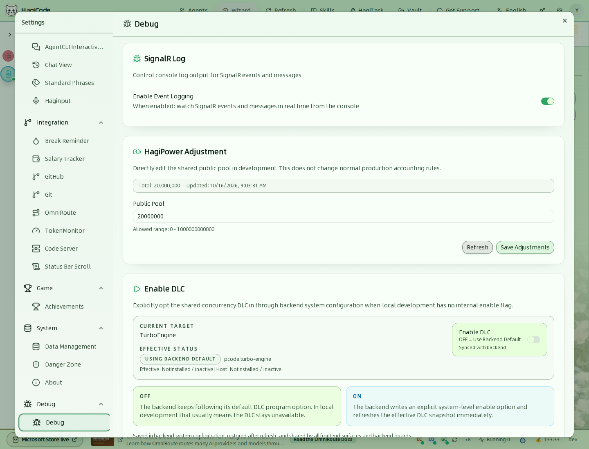

面向开发构建的工具：

- **SignalR Log**（SignalR 日志）会把 SignalR 事件和消息实时打印到控制台。
- **HagiPower Adjustment**（HagiPower 调整）在开发环境中直接编辑共享的公共池。它不会改变正常的生产环境计算。
- **Enable DLC**（启用 DLC）通过后端配置显式地让 TurboEngine DLC 启用或停用，因为本地开发环境没有内部的启用开关。

正常使用时不需要这个标签页。

## 外观、主题与语言

顶栏中的两个按钮无需打开设置就能改变 HagiCode 的外观。

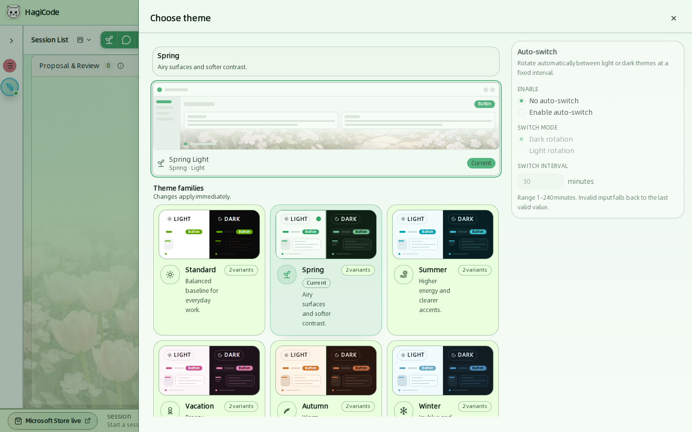

**Theme**（主题）打开主题选择器（**Choose theme**，选择主题）。每个主题系列都有 **Light**（亮色）和 **Dark**（暗色）两种变体，并立即生效。系列包括 Standard（标准）、Spring（春季）、Summer（夏季）、Vacation（暑假）、Autumn（秋季）、Winter（冬季）、Lunar New Year（新年）、Soccer（足球）、Cyberpunk（赛博）、School（学校）和 Space Travel（星际）。**Auto-switch**（自动切换）会按 1 到 240 分钟的固定间隔在浅色或深色主题之间轮换。

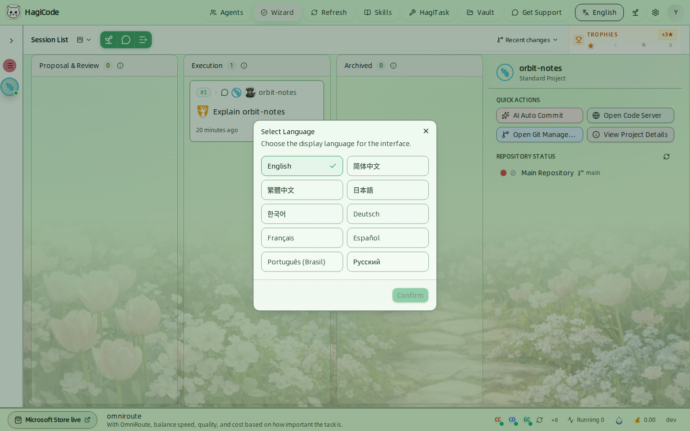

**Language**（语言）打开语言对话框（**Select Language**，选择语言）。选择一种语言并点击 **Confirm**（确认）。HagiCode 支持 English、简体中文、繁體中文、日本語、한국어、Deutsch、Français、Español、Português (Brasil) 和 Русский。

<CardGrid>
  <LinkCard title="状态栏与进度" href="/user-guide/status-bar-and-progress" description="休息提醒、日薪计数器和 token 用量显示在哪里。" />
  <LinkCard title="Agents" href="/user-guide/agents" description="Agent CLI、模型和执行场景。" />
  <LinkCard title="OmniRoute" href="/related-software-installation/omniroute" description="安装并验证 OmniRoute 网关。" />
</CardGrid>
