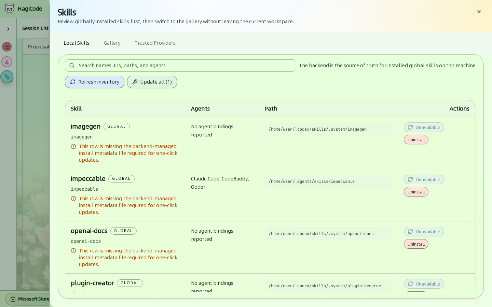
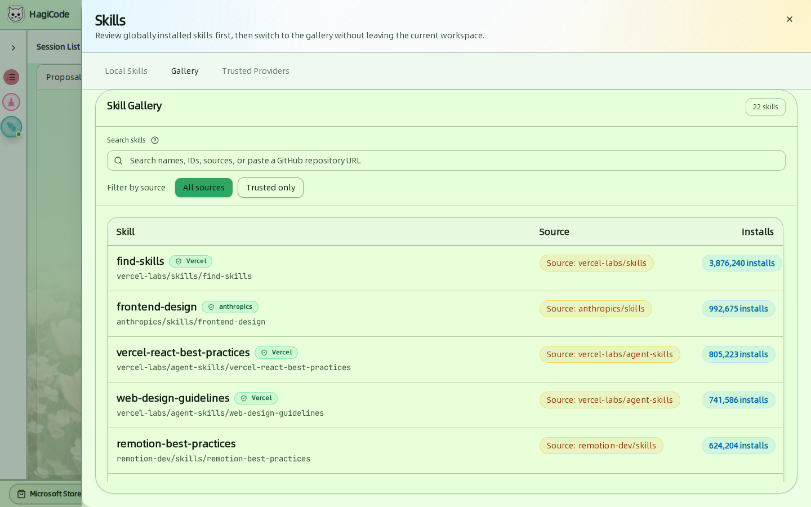
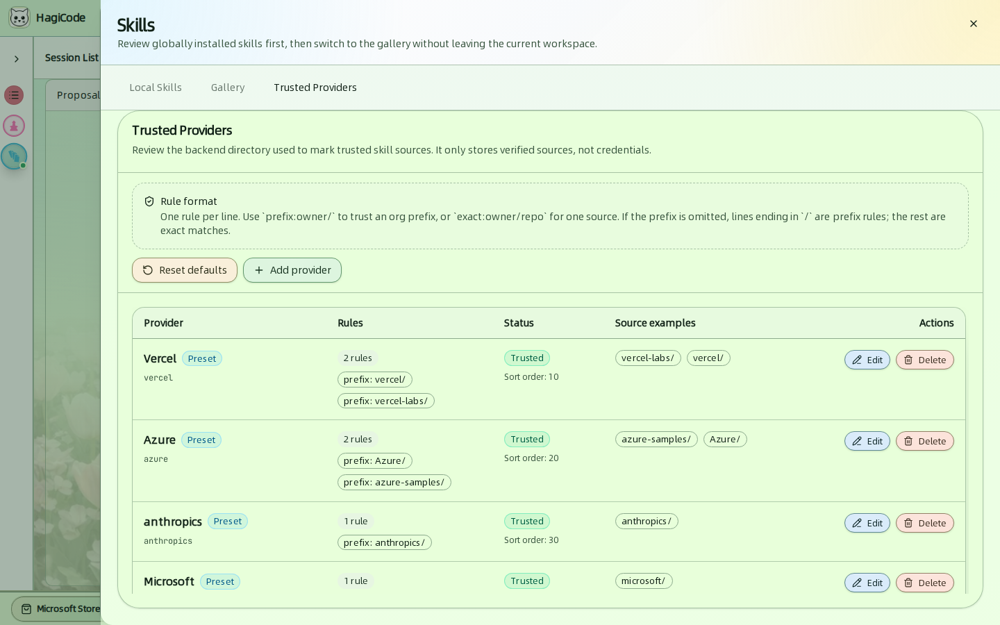
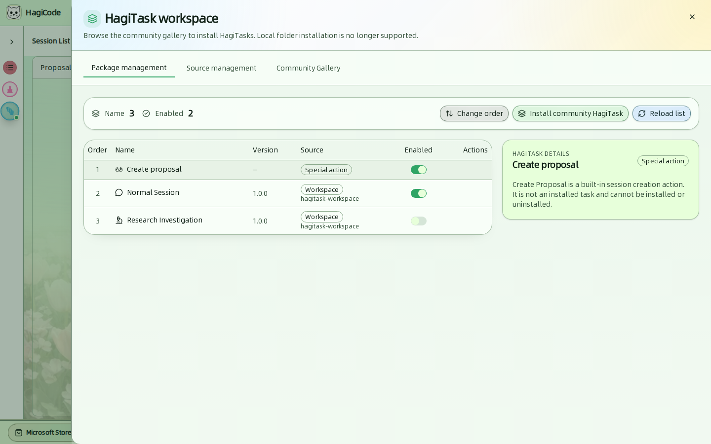
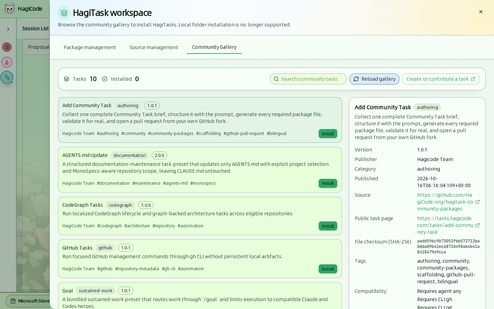

import { CardGrid, LinkCard } from '@astrojs/starlight/components';

技能和 HagiTask 都能扩展 Agent 的能力，两者都从顶栏打开。

- **技能**是 Agent CLI 会加载的可复用指令包，例如设计规范或框架最佳实践。
- **HagiTask** 是 HagiCode 通过会话流程运行的任务预设，例如 *Normal Session*（普通会话）或 *Research Investigation*（代码调研）。

## 技能

点击顶栏中的 **Skills**（技能）。抽屉有三个标签页。更详细的演练参见 [Skills 使用指南](/guides/skills)。

### Local Skills（本地技能）

后端是这台机器上已安装全局技能的唯一可信来源。

- **Refresh inventory**（刷新库存）会重新扫描机器。**Update all**（全部更新）会更新所有可更新的技能。
- 表格显示每个 **Skill**（技能）、它绑定到哪些 **Agents**（代理）、它的 **Path**（路径），以及可用的 **Actions**（操作）：**Update**（更新）和 **Uninstall**（卸载）。
- 带警告的行缺少一键更新所需的安装元数据文件，所以它的更新操作显示 *Unavailable*（不可更新）。

### Gallery（画廊）

可以按名称、ID、来源搜索技能库，也可以粘贴 GitHub 仓库 URL。**Trusted only**（仅授信）会把列表限制为你信任的提供者的技能。每一行显示技能、它的来源和被安装的次数。安装前，打开某一行即可查看确切的安装命令。

### Trusted Providers（授信提供者）

授信提供者决定哪些来源会获得 *Trusted* 标签。该目录只保存已验证的来源，从不保存凭据。每行写一条规则：

- `prefix:owner/` 信任某个所有者的全部仓库。
- `exact:owner/repo` 信任单个仓库。

默认带有 Vercel、Azure、anthropics 和 Microsoft 等预设。使用 **Add provider**（添加提供者）、**Edit**（编辑）、**Delete**（删除）或 **Reset defaults**（重置默认列表）来修改它们。

## HagiTask

点击顶栏中的 **HagiTask**，或点击会话看板上的 **More HagiTasks**（更多 HagiTask），打开 **HagiTask workspace**。它同样有三个标签页。

### Package management（包管理）

列表显示每个已安装的预设及其 **Order**（顺序）、**Name**（名称）、**Version**（版本）、**Source**（来源）和 **Enabled**（已启用）开关。用开关打开或关闭某个预设。

- **Create proposal**（创建提案）是内置的特殊操作。它始终存在，无法安装或卸载。
- **Normal Session**（普通会话）和 **Research Investigation**（代码调研）是工作区预设。
- **Change order**（更改排序）可调整列表顺序。**Install community HagiTask**（安装社区 HagiTask）会跳转到画廊。**Reload list**（重新加载列表）会重新读取各来源。

点击某一行，可在右侧查看它的详情。

### Community Gallery（社区市场）

浏览由 HagiCode 团队和社区发布的预设，例如 *CodeGraph Tasks*、*GitHub Tasks* 和 *AGENTS.md Update*。每个条目显示它的分类、版本、标签和所需的 CLI 工具。点击 **Install**（安装）即可添加。**Create or contribute a task**（创建或贡献 Task）会打开贡献指南，而 *Add Community Task* 预设会带你一步步编写任务。

### Source management（来源管理）

**Source management** 标签页显示预设的加载来源：内置预设和社区文件夹。**Add folder source**（添加文件夹来源）可登记另一个文件夹，**Reload sources**（重新加载来源）会重新扫描它们。不再支持从本地文件夹安装单个任务；请从社区画廊安装。

<CardGrid>
  <LinkCard title="Skills 使用指南" href="/guides/skills" description="一步一步安装一个技能。" />
  <LinkCard title="HagiTask 介绍" href="/guides/hagitask/introduction" description="HagiTask 是什么以及如何使用。" />
  <LinkCard title="Vault" href="/user-guide/vault" description="调研任务把输出写到哪里。" />
</CardGrid>
