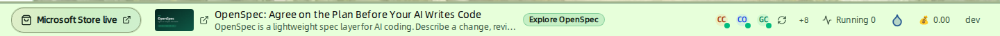
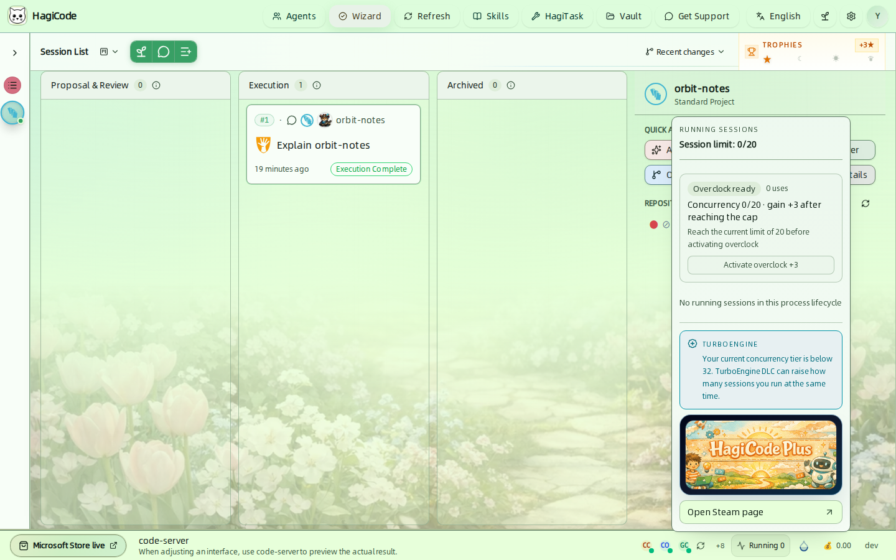
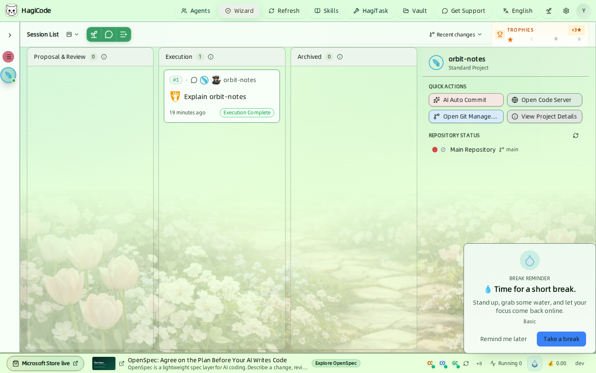
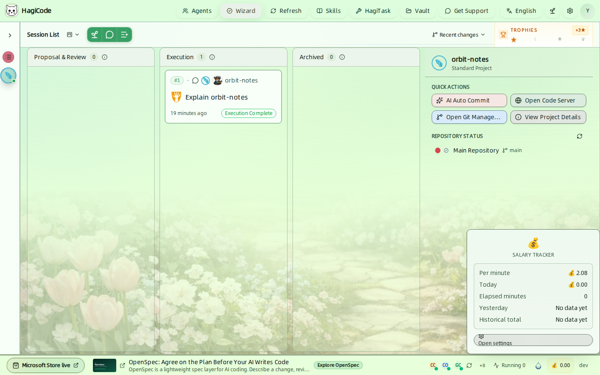
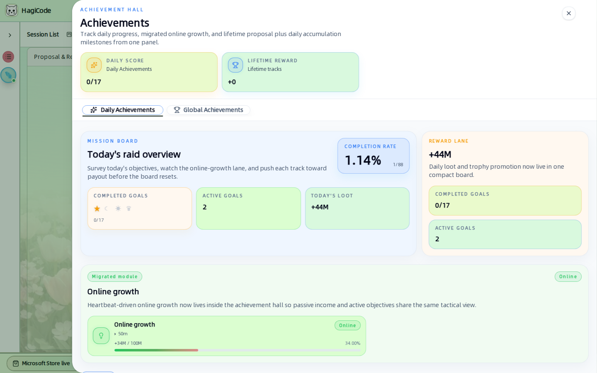
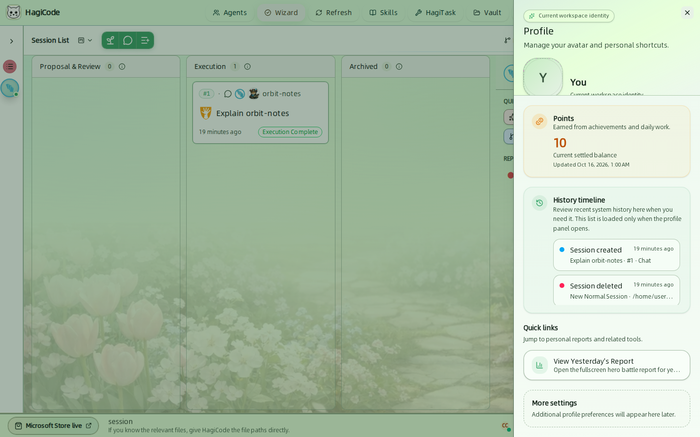

import { CardGrid, LinkCard } from '@astrojs/starlight/components';

工作台底部边缘和顶部的几个小组件会在不打扰你的前提下随时告知信息。本页介绍状态栏、奖杯与成就殿堂，以及你的个人资料。

## 状态栏

从左到右依次是：

| 项目 | 显示什么 |
| --- | --- |
| **Microsoft Store badge** | 指向 HagiCode 在 Microsoft Store 上架页面的链接。 |
| **滚动的提示和推广** | 一次滚动显示一条提示或推广。提示讲解如何使用 HagiCode；推广链接到相关项目。你可以在 **Settings → Integration → Status Bar Scroll**（设置 → 集成 → 状态栏滚动）中关闭滚动或选择内容来源。 |
| **Agent CLI 健康状态** | 小徽标，例如 `CC`、`CO` 和 `GC`，分别代表 Claude Code、Codex 和 GitHub Copilot，健康时带有绿点。`+N` 表示另外还有多少个工具。点击这些徽标可刷新健康检查。 |
| **Running sessions**（运行中会话） | 当前正在运行的会话数量。点击可查看详情。 |
| **Break reminder**（休息提醒） | 一个水滴图标，显示当前提醒间隔还剩多少。 |
| **Salary tracker**（时薪挂机） | 单位 emoji 和今天累计的金额。计数器及其状态栏指示器开启时显示。 |
| **Version**（版本） | 构建版本，例如开发构建中显示 `dev`。 |

### 运行中会话

HagiCode 会限制同时运行的会话数量，默认是 20。弹出层显示当前数量与上限的对比，并列出运行中的会话。

- **Overclock**（超频）会把上限提高 3。达到当前上限后才可使用；弹出层会显示已使用的次数。
- TurboEngine DLC 可以进一步提高并发档位。

### 休息提醒

计时器触发时，会出现一张卡片，显示当前提醒主题的消息。**Take a break**（休息一下）表示已确认，**Remind me later**（稍后提醒）表示延后提醒。在 **Settings → Integration → Break Reminder**（设置 → 集成 → 休息提醒）中配置间隔和语气。

### 日薪计数器

点击 emoji 可以查看每分钟收益、今日总额、已用分钟、昨日总额和历史总额。**Open settings**（打开设置）会跳转到 **Settings → Integration → Salary Tracker**（设置 → 集成 → 时薪挂机），在那里设置日薪和工时。

## 奖杯与成就殿堂

会话看板右上角的 **Trophies**（奖杯）小组件会用星星显示你的进度。四颗星（星）组成一个月（月），四个月组成一个日（日），四个日组成一个冠（冠）。标题旁的数字表示距离下一次晋升还差多少颗星。

点击它即可打开 **Achievement Hall**（成就殿堂）。

- **Daily Achievements**（每日成就）是每天重置的目标，例如开始并完成提案、Agent 产出和工具活动。标题处显示每日得分，例如 `0/17`。
- **Global Achievements**（全局成就）是跨天累积的终身里程碑。
- **Mission Board**（任务大厅）汇总当天的情况：完成率、进行中的目标和奖励通道。
- **Online growth**（在线增长）记录 HagiCode 运行期间累积的进度。

你在这里以及日常工作中获得的积分会显示在个人资料中。每日进度弹出提示可以在 **Settings → Game → Achievements**（设置 → 游戏 → 成就）中关闭。

## 个人资料

点击顶栏最右侧的圆形头像，打开你的个人资料抽屉。

- **Avatar**（头像）– 上传不超过 10 MB 的 JPEG、PNG、WEBP 或 GIF 图片。
- **Points**（积分）– 你当前已结算的余额，来自成就和日常工作。
- **History timeline**（历史时间线）– 最近的系统历史，例如创建或删除的会话。仅在打开抽屉时才会加载。
- **Quick links**（快捷入口）– 例如 **View Yesterday's Report**（查看昨日报告），会打开昨天的全屏英雄战报。

<CardGrid>
  <LinkCard title="设置" href="/user-guide/settings" description="配置休息提醒、日薪计数器和状态栏。" />
  <LinkCard title="工作台总览" href="/user-guide" description="回到整个工作台的导览。" />
</CardGrid>
