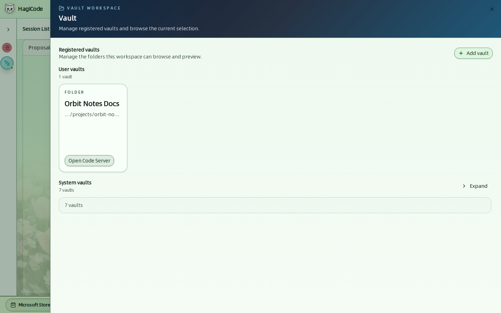
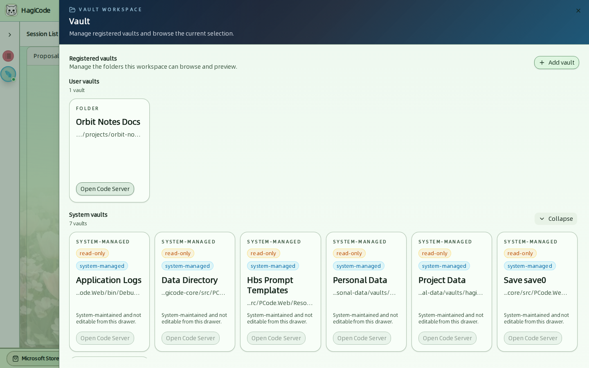
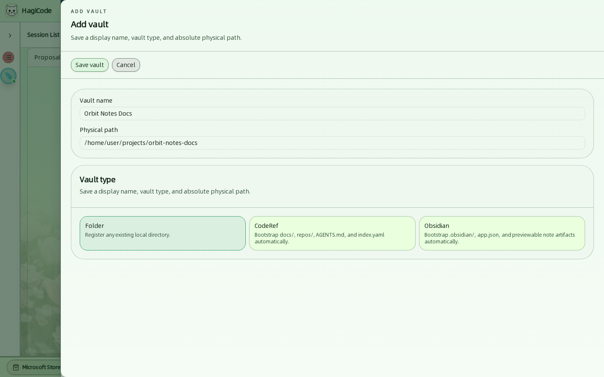

import { CardGrid, LinkCard } from '@astrojs/starlight/components';

**Vault** 是 HagiCode 被允许在项目仓库之外浏览和预览的文件夹。可以用 Vault 存放参考文档、笔记、调研输出，以及其他希望会话读取或写入的内容。

点击顶栏中的 **Vault**（中文界面：Vault）打开 **Vault Workspace**（Vault 工作区）。

## 已登记的 Vault 和系统 Vault

工作区有两个分组：

- **Registered vaults**（已注册 Vault）是你添加的文件夹。每张卡片显示 Vault 类型、名称、缩短后的路径，以及一个 **Open Code Server**（打开 Code Server）按钮，用于在浏览器编辑器中编辑该文件夹。
- **System vaults**（系统 Vault）由 HagiCode 创建和维护。点击 **Expand**（展开）查看它们。

在这个抽屉中，系统 Vault 是**只读**的。它们包括应用日志、数据目录、提示词模板、个人数据、项目数据、当前存档和系统预设。在会话范围中，它们只算作参考资料。

## 添加 Vault

点击 **Add vault**（添加 Vault），填写 **Vault name**（Vault 名称）和绝对路径 **Physical path**（物理路径），选择 **Vault type**（Vault 类型），然后点击 **Save vault**（保存 Vault）。

| Vault 类型 | 作用 |
| --- | --- |
| **Folder**（文件夹） | 按原样登记任意已有的本地目录。 |
| **CodeRef**（代码引用） | 自动创建 `docs/`、`repos/`、`AGENTS.md` 和 `index.yaml`。可用作调研任务的输出 Vault。 |
| **Obsidian** | 自动创建 `.obsidian/`、`app.json` 和可预览的笔记产物，使该文件夹可作为 Obsidian Vault 使用。 |

:::caution[保存前先选择类型]
点击 **Save vault** 之前，请先选择三种 Vault 类型之一。在编写本指南所用的版本中，未选择类型就保存会失败，并显示一条无法读懂的错误，而不是校验提示。
:::

## 在会话中使用 Vault

Vault 会出现在[创建提案抽屉和创建普通会话抽屉](/user-guide/sessions)的**范围**（Scope，即界面中的“作用域”或“任务范围”）里。如果任务应该更新 Vault 中的文件，就把它标记为**可编辑**（editable）；否则 AI 会把它当作只读的参考资料。由系统管理的 Vault 始终只作参考。

<CardGrid>
  <LinkCard title="会话" href="/user-guide/sessions" description="把 Vault 附加到新主意或新会话的范围中。" />
  <LinkCard title="技能与 HagiTask" href="/user-guide/skills-and-hagitask" description="代码调研任务会写入 CodeRef Vault。" />
</CardGrid>
