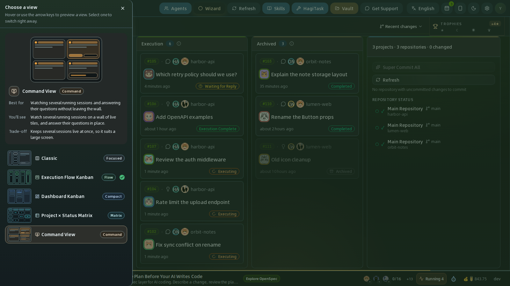
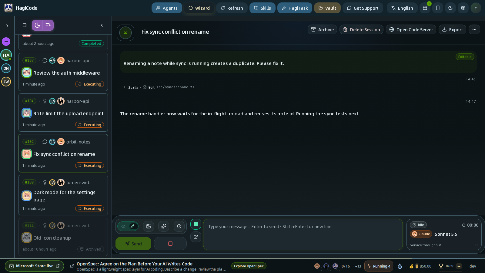
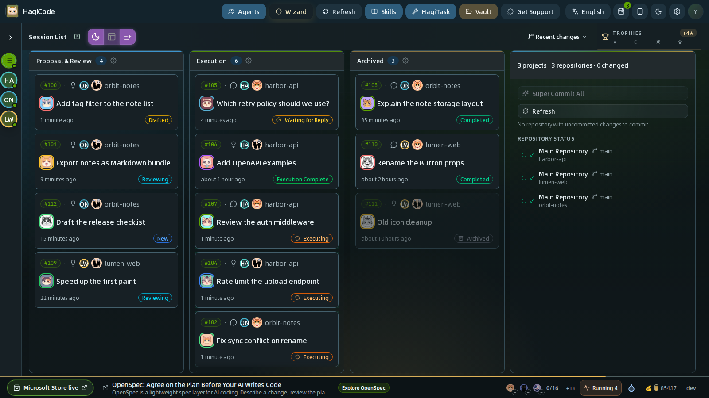
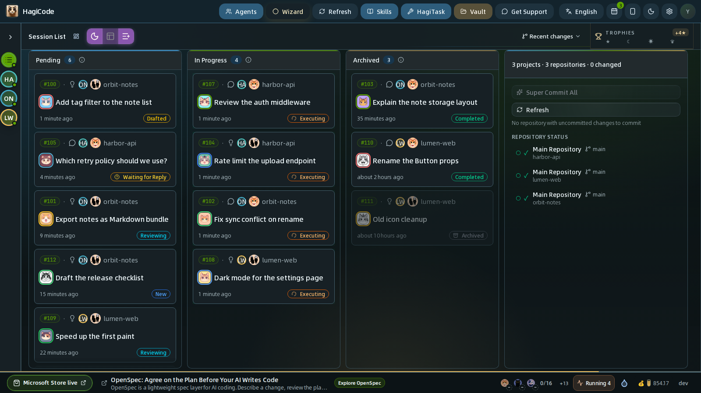
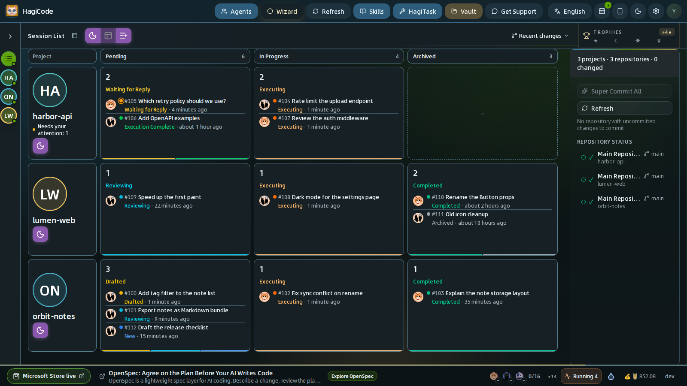
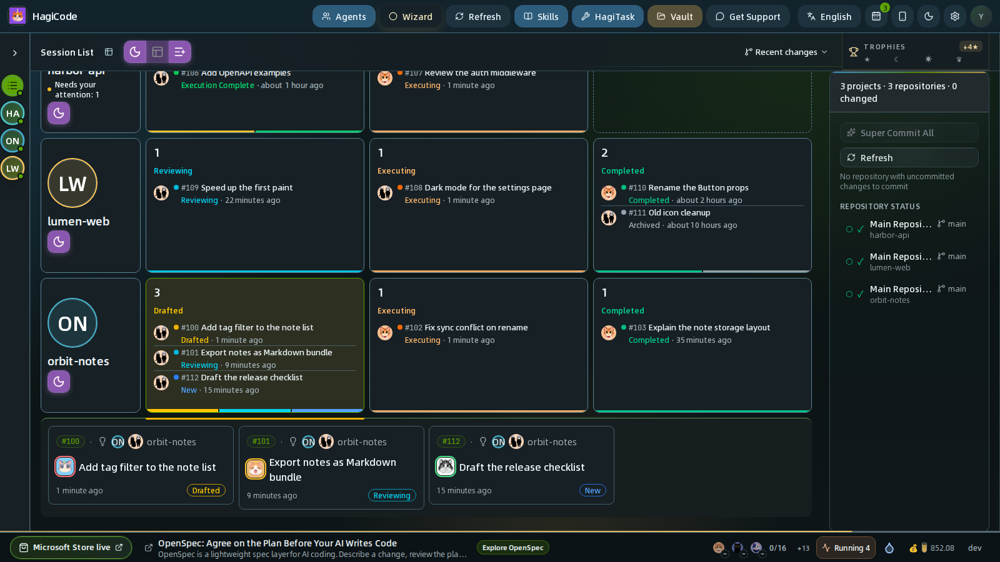
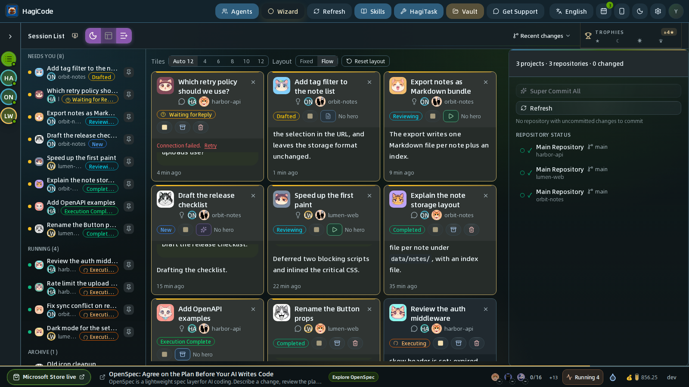

import { CardGrid, LinkCard } from '@astrojs/starlight/components';

HagiCode 用**五种视图**展示同一批会话。每种视图回答不同的问题：*这个会话在说什么？*、*我的工作进展到哪了？*、*哪个项目需要我？*，或者*正在运行的会话此刻在做什么？* 切换视图不会改变你的会话，只改变会话区域的布局方式。

## 切换视图

**布局模式切换器**是会话工具栏最左端、*Session List*（会话列表）旁边的小图标。图标始终显示你当前所在的视图。

1. 点击切换器，左侧会打开 **Choose a view**（选择视图）抽屉。
2. 把鼠标移到某个视图上，或用方向键（`↑` `↓` `←` `→`、`Home`、`End`）在列表中移动，即可预览。顶部的舞台会拼出该视图的缩略图，并说明 **Best for**（适合）、**You'll see**（你会看到）和 **Trade-off**（取舍）。
3. 点击某个视图即可立即切换。抽屉随即关闭，当前视图会带有对勾和 *Current*（当前）标记。

HagiCode 会在当前浏览器中记住你的选择，下次打开工作台时自动恢复。

:::note[窄窗口只显示一个列表]
窗口宽度低于 1024 px（包括平板和手机）时，HagiCode 只显示单个会话列表并隐藏切换器，会话在抽屉中打开。窗口恢复到足够宽时，你选择的视图会自动回来。
:::

## 五种视图一览

| 视图 | 徽标 | 适合 | 取舍 |
| --- | --- | --- | --- |
| **Classic**（经典） | Focused（专注） | 一次处理一个会话，对话就在列表旁边打开。 | 只聚焦一个会话，整体流程不太容易看清。 |
| **Execution Flow Kanban**（执行流看板） | Flow（流程） | 跟踪工作从排队到完成，并在操作面板中直接操作。 | 占用空间最多：泳道加右侧面板。 |
| **Dashboard Kanban**（操作台看板） | Compact（精简） | 无需区分提案阶段，快速扫一眼所有会话的状态。 | 泳道按状态分组，提案阶段不会被拆开。 |
| **Project × Status Matrix**（项目 × 状态矩阵） | Matrix（矩阵） | 同时管理很多项目时，一眼找出哪个项目需要你。 | 会话被汇总成数字，查看单个会话要多一步。 |
| **Command View**（指挥视图） | Command（指挥） | 同时盯着多个运行中的会话，并在墙上直接回答它们的提问。 | 同时保持多个会话实时，更适合大屏幕。 |

## 经典（Classic）

经典视图是三栏布局：**项目栏**、紧凑的**会话列表**和**详情栏**。点击一个会话，它的详情会在第三栏打开，包含 **Info**（信息）、**Conversation**（对话）和 **Review**（审核）标签页以及消息框，因此无需离开页面就能阅读和回复。点击项目栏中的项目，会在同一栏显示项目详情。列表顶部的箭头可以折叠列表，给对话腾出更多空间。

当你一次只处理一个会话时，选择经典视图。它是唯一要求窗口至少 1024 px 宽、并让对话常驻屏幕的视图；在另外四种看板视图中，会话会在看板上方的抽屉里打开。

## 执行流看板（Execution Flow Kanban）

执行流看板按会话从主意到完成的过程排列，共有三条泳道：

| 泳道 | 其中的会话 |
| --- | --- |
| **Proposal & Review**（提案与审核） | 正在优化、起草、撰写或审核的主意。 |
| **Execution**（执行） | 正在执行、正在等待你回复或已执行完毕的会话。 |
| **Archived**（归档） | 正在归档、已完成或已归档的会话。 |

每张卡片显示会话编号、所属项目、类型图标、标题、最近活动时间和状态徽标。点击卡片，会话会在抽屉中打开。右侧是项目面板：它汇总所有项目；在项目栏中选中某个项目后，它会显示该项目的快捷操作和仓库状态。你可以在 *Settings → Appearance and interface → Kanban Right Panel*（设置 → 流程与交互 → 看板右区）中更改或隐藏这个面板，参见[设置](/user-guide/settings)。

本指南其余部分使用的就是这种视图。

## 操作台看板（Dashboard Kanban）

操作台看板使用同样的卡片，但按**状态**而不是工作流阶段分组：

| 泳道 | 其中的会话 |
| --- | --- |
| **Pending**（待处理） | 等你处理的会话：新建、已起草、审核中、等待回复或已执行完毕。 |
| **In Progress**（进行中） | Agent 此刻正在处理的会话。 |
| **Archived**（归档） | 已完成或已归档的会话。 |

当你只想知道什么需要关注、什么在运行、什么已完成，而不需要拆分提案阶段时，就用它。向你提问的会话会落在 **Pending**，所以这条泳道就是你的待办清单。

## 项目 × 状态矩阵（Project × Status Matrix）

矩阵把**项目放在行**，把操作台看板的泳道——**Pending**、**In Progress**、**Archived**——放在列。每个单元格显示该项目在这条泳道里有多少个会话，以及其中最紧急的状态。项目列包含项目名称、头像、**Needs your attention**（需要你关注）的数量（等待你回复或看起来卡住的会话），以及新建会话的按钮。

- 点击只有**一个**会话的单元格，会直接打开该会话。
- 点击有**多个**会话的单元格，会在该行下方展开它们的卡片。再次点击单元格即可收起。
- 用方向键在单元格之间移动。
- 在项目栏中选中单个项目，只显示它那一行；**View all projects**（查看所有项目）可回到完整网格。

当你同时跨很多项目工作时，矩阵是回答“哪个项目需要我？”最快的方式。

## 指挥视图（Command View）

指挥视图是面向运行中会话的控制墙，由三部分组成：

**会话侧栏**（左）把所有会话分组：

| 分组 | 其中的会话 |
| --- | --- |
| **Needs You**（需要你） | 没有在运行、也没有归档的会话：等待你回复的、新建的、已起草的、审阅中的、已完成的等等。 |
| **Running**（运行中） | Agent 正在处理的会话，不论它沉默了多久。 |
| **Archived**（归档） | 已归档的会话。 |

点击一行，会把该会话放到墙上并在抽屉中打开；点击它的图钉按钮，则只放到墙上而不打开。

**墙**（中）是由**实时磁贴**组成的网格。每个磁贴显示会话标题、项目、状态、快捷操作按钮、对话最新的几条内容，以及会话最近一次有动作是多少秒前。Agent 提问时，提问卡片会直接出现在磁贴里，你可以就地回答。点击磁贴会在抽屉中打开完整会话，点击磁贴上的 **×** 则把它从墙上移除。

墙上方的 **Tiles**（磁贴数）选择器决定墙的大小：**4**、**6**、**8**、**10** 或 **12** 个磁贴，或者 **Auto**（自动，按你的会话数量调整墙的大小）。打开指挥视图时，HagiCode 会按优先级用你未归档的会话填满墙，最多 12 个：先是等你回复的，然后是运行中的，最后是其余的。之后墙会保持你的布置：固定一个会话即可添加，点 **×** 即可移除。选择 **Auto** 则把墙交还给 HagiCode，它会根据你的会话自动保持填满。

**Layout**（布局）选择器决定手动固定的磁贴在会话状态变化时怎么动：**Fixed**（固定）让磁贴保持原来的位置；**Flow**（流动）让待处理的会话往前移、运行中的往后移。**Reset layout**（重置布局）会清空墙，并载入所选项目的会话；没有选中项目时，则自动跟随所有项目的会话。

**项目面板**（右）与其他看板视图中的是同一个面板。

当多个 Agent 同时运行、你主要需要留意并回答它们时，选择指挥视图。由于它会同时保持多个会话实时，所以最适合大屏幕。

## 我该用哪种视图？

- **一次处理一个对话** → 经典。
- **跟踪每个任务从提案到完成** → 执行流看板。
- **快速看一眼状态** → 操作台看板。
- **项目很多，想知道哪个需要你** → 项目 × 状态矩阵。
- **多个 Agent 同时运行，想在它们提问时立刻回答** → 指挥视图。

你可以随时切换，不会丢失任何内容。很多人默认使用执行流看板，在多个会话同时运行时再打开指挥视图。

<CardGrid>
  <LinkCard title="会话" href="/user-guide/sessions" description="新建主意和普通会话，并在会话内工作。" />
  <LinkCard title="项目" href="/user-guide/projects" description="项目面板、项目详情、MonoSpecs 和 Git 状态。" />
  <LinkCard title="设置" href="/user-guide/settings" description="控制右侧面板和其他会话看板选项。" />
</CardGrid>
