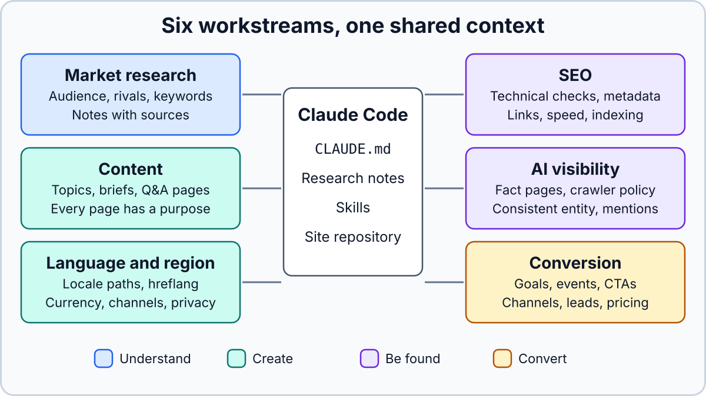
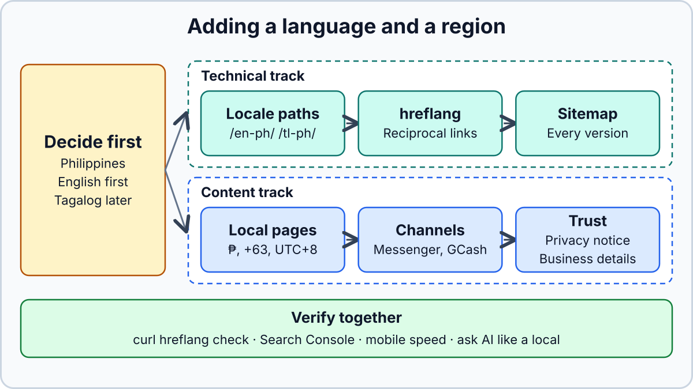

[第一篇指南](/zh-Hant/blog/2026-11-23-mac-astro-site-claude-github-cloudflare/)帶你從一台乾淨的 Mac 做出了上線的 Astro 網站。[第二篇指南](/zh-Hant/blog/2026-11-25-astro-site-google-analytics-search-console-seo-claude/)接入了 Google Analytics、Search Console、網站地圖、社群標籤和 favicon。現在網站已經上線、可以衡量，理論上也能被搜尋引擎找到。

它還缺少兩樣東西：讓訪客留下來的理由，以及知道下一步該寫什麼的辦法。這兩個問題不會有一次性的答案，需要一個循環：看證據，決定一個改動，做出來，證明它有效，再從結果裡學習。

本指南展示如何用 Claude Code 運行這個循環，讓你以後可以自己持續推進。這裡沒有固定的清單，而是一種你每週都能重複的工作方式。

讀完之後，你會知道如何：

1. 讓 Claude 記住你的網站，使每次會話都從已知資訊開始。
2. 為任何改進運行八階段循環：探索、計畫、調研、執行、驗證、發布、度量、學習。
3. 尋找、審查、安裝、測試並編寫自己的 Claude 技能（skill）。
4. 把循環應用到六條工作線：市場調研、內容、語言與區域、SEO、AI 可見度和轉換。
5. 新增語言和區域市場，本文以菲律賓為例。
6. 讓循環保持安全：來源、批准、隱私和合理的節奏。

## 本指南適合誰

適合已經完成前兩篇指南的人：你有一個位於 GitHub 倉庫中的 Astro 網站，每次推送到 `main` 都會自動部署，已經設定好 Google Analytics 和 Search Console，並安裝了 Claude Code。

範例假設網站使用英語，面向菲律賓的訪客，網域為 `example.com`。請把市場、語言和網域換成你自己的。這套方法與國家無關。

## 全貌：一個循環，六條工作線

### 循環

從一個新頁面到一種新語言，每個改進都經過同樣的八個階段。


| 階段 | Claude 做什麼 | 你做什麼 | 留下什麼 |
| --- | --- | --- | --- |
| 1. 探索 | 閱讀網站和筆記，審計現狀，不改任何東西 | 決定哪個問題最重要 | 一份審計報告 |
| 2. 計畫 | 提出一個目標、步驟和成功的檢驗方式 | 批准、刪減或否決 | 一份計畫檔案 |
| 3. 調研 | 收集來源、比較選項，標註未經核實的內容 | 抽查來源 | 帶日期的研究筆記 |
| 4. 執行 | 分小步編寫內容或程式碼 | 審閱改動 | 待驗證的改動 |
| 5. 驗證 | 建置、預覽並運行檢查 | 查看結果 | 一份通過的檢查清單 |
| 6. 發布 | 提交、推送、等待部署並檢查線上網站 | 批准發布 | 一個線上版本 |
| 7. 度量 | 讀取你匯出的資料 | 匯出資料 | 一份資料快照 |
| 8. 學習 | 記錄哪些有效、接下來試什麼 | 決定下一個目標 | 更新後的筆記與上下文 |

有三條規則讓循環保持誠實。

1. **每一輪只做一個小目標。** 一個頁面、一組標題、一種語言。小的一輪容易驗證，也容易撤銷。
2. **每一輪都留下可以檢查的證據。** 一個檔案、一段命令輸出、一個數字、一個連結。指不出來，就等於沒發生。
3. **決定權在你。** Claude 負責探索、調研、寫作和檢查。你在動手之前批准計畫，在上線之前批准結果。

### 六條工作線

循環是引擎，你要它處理的事情可以分成六條工作線。它們共用同一份上下文：你的筆記、規則、技能和倉庫。



後面每條工作線都有單獨的小節。先打好基礎。

## 步驟 1：讓 Claude 記住你的網站

Claude 每次會話開始時對你的網站一無所知，檔案就是它的記憶。有兩類檔案起作用：

- 專案根目錄的 `CLAUDE.md`。Claude Code 在會話開始時會讀取它，所以把穩定的事實和規則放在這裡。
- `research/` 和 `plans/` 中帶日期的筆記，記錄你學到了什麼、決定了什麼。

一個可行的目錄佈局：

```text
my-astro-site/
├── CLAUDE.md          # 網站為誰服務、語氣、規則、工作流程
├── research/          # 帶來源的日期筆記，以及匯出的指標
├── plans/             # 每一輪一份簡短計畫
├── src/               # 網站本身
└── .claude/skills/    # 專案技能（見步驟 3）
```

在專案資料夾中啟動 Claude，讓它起草這個檔案。Claude Code 也有 `/init` 命令，可以根據倉庫生成第一版 `CLAUDE.md`。無論哪種方式，都要把結果改成符合你自己的實際情況。

```text
請為這個網站建立 CLAUDE.md，並建立空的 research/ 和 plans/ 資料夾，每個資料夾放一份簡短的 README。

CLAUDE.md 需要包含：
- 網站的用途、服務對象，以及我們希望訪客採取的那一個行動。
- 主要市場：菲律賓。語言：先英語，之後再加菲律賓語。大多數訪客使用手機。
- 語氣：樸實、友好、具體。不誇張，不編造數字。
- 規則：筆記或內容中的每個事實都要有來源網址和你看到它的日期。無法核實的內容標記為「未核實」。未經我批准計畫和結果，絕不發布。絕不把訪客的個人資料放進筆記或提示詞。
- 工作流程：小改動、npm run build、提交、推送到 main、等待兩處部署完成、用 curl 驗證線上網站。
- 各類檔案放在哪裡。

儲存之前先給我看這個檔案。
```

檢查：打開一個新的 Claude 會話，說「總結你對這個網站的了解」。回答應該與 `CLAUDE.md` 一致。如果不一致，問題出在檔案不清楚，而不是 Claude。

## 步驟 2：八個階段的實際做法

### 1. 探索

從唯讀審計開始。什麼都不會改，所以沒有需要撤銷的東西。

```text
請探索這個網站並匯報。不要修改任何檔案。

涵蓋：頁面列表和頁面之間的連結關係、每個頁面的用途、標題和描述、行動號召的位置、已經追蹤了哪些事件，以及任何看起來單薄、重複或損壞的地方。

把報告寫入 research/YYYY-MM-DD-audit.md，並給出最值得改進的五件事，按優先級排序並說明原因。
```

### 2. 計畫

把 Claude Code 切換到計畫模式（按 Shift+Tab 切換模式），這樣它可以閱讀和提議，但不能編輯。好的計畫一頁就夠。

```text
請根據 research/YYYY-MM-DD-audit.md，為這一輪提出一個目標。

寫入 plans/YYYY-MM-DD-goal.md，包含：
- 目標：一句話。
- 原因：來自我們筆記或資料的證據。
- 步驟：最多五步，每一步小到可以驗證。
- 驗收標準：我們如何知道它有效，包括發布之後立刻能看到的，以及幾週之後才能看到的。
- 不做什麼：明確排除在外的事。
- 回滾：如何撤銷。

寫完計畫後停下來，等待我的批准。
```

這是第一個批准點。把計畫刪減到你能一口氣講清楚為止。

### 3. 調研

AI 市場調研和競品調研就發生在這裡，也是 AI 最容易誤導你的地方，所以要給它規則。

```text
請為這個計畫調研下面的問題：菲律賓的人在尋找 [你的主題] 時會搜尋和詢問什麼？排名前三的競爭網站提供什麼？

規則：
- 只使用公開頁面。不要登入任何地方，也不要繞過任何限制。
- 每個論斷都要有來源網址和你看到它的日期。
- 把「在頁面上找到的」和「我的推斷」分開。
- 不要編造統計數字。找不到數字就寫「未核實」。
- 按下面的範本儲存到 research/YYYY-MM-DD-topic.md。

範本：
# 問題
# 發現（論斷、來源網址、查看日期、可信度：高、中或低）
# 未核實
# 這對計畫有什麼改變
```

Claude Code 可以搜尋網頁和抓取頁面，可能會請你批准這些工具。完成之後，打開其中三個來源，檢查它們是否真的支持筆記裡的說法。只要有一個對不上，就對整份筆記保持懷疑，讓 Claude 重做。

真實的客戶問題是最好的調研輸入。可以把客服問題或社群討論放進 `research/`，但先去掉姓名、郵箱和任何個人資訊。

### 4. 執行

現在由 Claude 按計畫一步一步寫。

```text
請只做 plans/YYYY-MM-DD-goal.md 的第 1 步，不要做別的。遵守 CLAUDE.md。運行 npm run build，通過後把 diff 給我看。
```

寫作時，先要簡報，再要草稿，然後由你修改。AI 草稿只是起點。讓一個頁面值得閱讀的，是只有你才有的部分：真實的價格、真實的案例、你自己的截圖、你自己的觀點。這些要由你來補。

### 5. 驗證

驗證是一個階梯。每一級都更接近真實結果，出結果也更慢。


第 1 到 3 級當場就能完成，Claude 可以替你做。第 4 級當天用外部工具完成。第 5 和 6 級取決於搜尋引擎和訪客，需要幾天甚至幾週。沒爬到的那一級，就不要聲稱爬到了。「建置成功」不等於「已經上線」，「已經上線」也不等於「有效」。

```text
請在三個層面驗證這個改動，並匯報你檢查了什麼、哪些沒能檢查：
1. npm run build 通過，沒有錯誤。
2. 部署完成後，用 curl 請求線上網址，確認狀態碼、標題、描述、canonical 連結以及所有 JSON-LD。
3. 對該頁面的手機版運行 Lighthouse 或 PageSpeed 檢查，列出所有低於 90 分的項目。
```

### 6. 發布

發布是第二個批准點。你批准之後，由 Claude 完成機械性的工作並證明結果，就像前兩篇指南中那樣。

```text
請用清晰的說明提交，推送到 main，等待 GitHub Pages 工作流和 Cloudflare 建置都完成，然後用 curl 請求線上頁面，確認改動已經在上面。逐項匯報檢查結果。
```

對於重要的新頁面，打開 Search Console，把網址貼到網址檢查框中，請求編入索引。Bing 等搜尋引擎還支持用 IndexNow 協議通知新頁面。Google 不使用 IndexNow。

### 7. 度量

Claude 不能替你登入 Google。最簡單可靠的辦法是自己匯出資料，放進倉庫。

1. 在 Search Console 中打開 **效果**，設定日期範圍，把國家/地區篩選為菲律賓，匯出搜尋詞和頁面。
2. 在 Google Analytics 中匯出關鍵事件的次數。
3. 把兩份檔案儲存到 `research/metrics/`，檔名帶上日期。

```text
請讀取 research/metrics/ 中最新的檔案，並與上一次快照比較。

寫入 research/YYYY-MM-DD-metrics.md，涵蓋：展示次數上升或下降的搜尋詞、展示多但點擊少的頁面、觸發了哪些事件，以及對每個明顯變化的一個假設。每個假設都要標明是假設。
```

對於新網站，數字會很小。不要過度解讀只有幾次點擊的變化，要看幾週內的方向。

### 8. 學習

最後一個階段是大多數人會跳過的，也是讓循環產生複利的關鍵。

```text
請結束這一輪。把以後幾輪應該知道的內容更新到 CLAUDE.md 或研究筆記中：我們試了什麼、證據說明什麼、哪些不會再試以及原因。然後提出下一個目標並附上證據，然後停下。
```

## 步驟 3：技能：尋找、審查、測試、沉澱、分享

技能是一個帶有 `SKILL.md` 檔案的資料夾，用來教 Claude 做一件可重複的任務。檔案開頭有一小段包含 `name` 和 `description` 的 front matter，後面是具體說明。Claude 透過描述來判斷什麼時候該用這個技能，你也可以輸入 `/skill-name` 直接調用。


技能可以放在三個位置：

| 範圍 | 位置 | 適合 |
| --- | --- | --- |
| 個人 | `~/.claude/skills/<name>/SKILL.md` | 在所有專案中使用的個人習慣 |
| 專案 | `.claude/skills/<name>/SKILL.md` | 這個網站的固定流程，透過 git 共享 |
| 外掛 | 用 `/plugin` 安裝 | 由別人打包和維護的技能 |

Claude Code 會監視個人和專案的技能資料夾，所以新技能通常會在當前會話中出現。如果沒有出現，運行 `/reload-skills`。輸入 `/skills` 可以查看當前可用的技能。

### 尋找

有三個地方可以找：外掛市場（打開 `/plugin` 瀏覽，用 `/plugin marketplace add owner/repo` 新增市場）、社群技能目錄，以及 GitHub 倉庫。有面向行銷工作的技能集合，例如 SEO 審計、文案編輯、競品調研和 AI 搜尋最佳化。一個公開的例子是 `coreyhaines31/marketingskills` 倉庫，其中包含 `seo-audit` 和 `ai-seo`。它是第三方作品，所以要像對待任何不是你自己寫的程式碼一樣對待它。

### 審查

技能是說明，有時還帶有會在你機器上運行的腳本。安裝之前先讀一遍。

```text
我想評估 coreyhaines31/marketingskills 倉庫裡的 seo-audit 和 ai-seo 技能。現在先不要安裝任何東西。

請閱讀每個 SKILL.md 以及它包含的所有腳本或參考檔案，然後告訴我：
- 這個技能做什麼，用兩句話說明。
- 它要求運行哪些工具或命令，其中有沒有 shell 命令。
- 它是否讀取或寫入本專案之外的檔案，或發起網路請求。
- 任何看起來與其聲明的用途無關的地方。

然後建議我是否安裝。
```

你的審查清單：能說出名字的來源、你讀過的 `SKILL.md`、沒有你看不懂的腳本、沒有意外的網路存取，以及用途單一。

### 安裝並試跑

先安裝到專案範圍，這樣不會影響你的其他工作。按倉庫自己的 README 使用準確的命令，或者讓 Claude 來做並把它運行的命令給你看。

然後用一個真實的任務測試並對比：

```text
請審計首頁和一篇部落格文章。先不使用任何技能直接回答。然後使用 seo-audit 技能再做一次同樣的審計。比較兩份報告：技能發現了哪些普通回答遺漏的問題，又有哪些地方出錯或湊字數？把比較結果儲存到 research/。
```

如果技能不會自動觸發，用 `/seo-audit` 直接調用，並檢查它的 `description` 是否清楚地說明了適用場景。

### 沉澱自己的技能

你每次重複的流程，都是一個等著被寫出來的技能。下面這個技能發布一篇文章並證明它已經上線。因為發布有副作用，它設定了 `disable-model-invocation: true`，所以只有在你輸入 `/publish-post` 時才會運行。

```markdown
---
name: publish-post
description: Publish a finished blog post on this site and prove it is live. Use when the user asks to publish, ship or release a post.
disable-model-invocation: true
---

發布使用者指定的文章。

1. 運行 `npm run build`。失敗就停止。
2. 檢查 front matter 中有標題、描述和日期。
3. 用清晰的說明提交，並推送到 `main`。
4. 等待兩處部署：先 `gh run watch`，再等 Cloudflare 建置。
5. 用 `curl -s` 請求線上網址，確認標題、描述和 JSON-LD 區塊都存在。
6. 匯報你檢查了什麼，以及哪些沒能檢查。
```

把它儲存為 `.claude/skills/publish-post/SKILL.md` 並提交，它就成了專案的一部分。接下來值得寫成技能的有：每週指標報告、競品更新和 hreflang 檢查。

### 分享

專案技能透過提交來共享。要在多個網站之間或與他人共享技能，把它們打包成外掛並發布一個市場檔案，具體方法見 [Claude Code 外掛文件](https://code.claude.com/docs/en/discover-plugins)。完整的 front matter 選項見[技能文件](https://code.claude.com/docs/en/skills)。

## 步驟 4：在六條工作線上運行循環

它們的起點都一樣：下面的總提示詞，讓 Claude 在你指定的工作線上運行一輪循環。

```text
請為這個網站運行一輪改進，聚焦於 [工作線]。

1. 閱讀 CLAUDE.md，以及 research/ 和 plans/ 中最新的檔案。
2. 提出這一輪的一個目標和支持它的證據。停下來等待我的批准。
3. 我批准之後，先寫計畫檔案，再做調研，然後執行，最後驗證。在發布之前停下，把結果給我看。
4. 我批准發布之後，發布並驗證線上網站。
5. 記錄我們學到的東西，並提出下一個目標。
```

資訊在循環中的流動方式是一致的：來源變成洞察，洞察變成頁面，頁面帶來轉換，轉換資料又回到來源。


### A. 市場與競品調研

- **目標：** 知道你服務的是誰、他們問什麼，以及替代方案提供什麼。
- **輸入：** Search Console 的搜尋詞、客戶問題、競品的公開頁面，以及 AI 助手對你的主題給出的回答。
- **一輪的例子：**「比較三個競品如何解釋定價，以及它們沒有說什麼。」
- **檢查：** 每個論斷都有來源和日期，並且你打開過其中三個。
- **產出：** 一份餵給內容計畫的研究筆記。

### B. 內容與問答頁

- **目標：** 比替代方案更好地回答真實問題。
- **做法：** 每個真實問題一個頁面，第一段直接給出答案，後面再展開細節。增加把事實說清楚的頁面：你提供什麼、怎麼運作、多少錢、有什麼限制。為「A 還是 B」這樣的問題製作比較頁。
- **問題要有來源**：來自 Search Console、客戶訊息、社群討論，以及 AI 助手給出的回答。不要為了填範本而編造問題。
- **不要批量生產頁面。** 搜尋引擎對大量低價值的生成內容有明確的政策。幾個好頁面勝過一百個單薄的頁面。
- **檢查：** 每個頁面都有目的，每個事實都有來源，並且包含只有你能寫出來的內容。

### C. 語言與區域（以菲律賓為例）

先確定市場和語言，然後並行運行兩條線，最後一起驗證。



**技術線。** 給每種語言和區域一個獨立的 URL 路徑，例如 `/en-ph/` 表示菲律賓的英語。用 `hreflang` 把每個版本與其他所有版本互相連結。Google 的規則很具體：

- 語言是 ISO 639-1 代碼，可選的區域是 ISO 3166-1 alpha-2 代碼，例如 `en-PH`。只支持 ISO 639-1 的語言代碼，所以菲律賓語的 `fil` 無效。如果要新增菲律賓語版本，使用 `tl`（他加祿語），寫成 `tl-PH`，並在 Search Console 中確認它的表現。
- 每個版本必須列出自己和所有其他版本。如果頁面 X 指向頁面 Y，頁面 Y 必須指回 X，否則這些標籤會被忽略。
- 為不匹配任何版本的訪客新增 `x-default` 條目。
- 你可以在頁面 head、HTTP 標頭或網站地圖中聲明這一切。

Astro 內建了國際化路由，它的網站地圖整合也可以把語言替代版本寫入網站地圖。讓 Claude 根據你已安裝的版本查閱文件，不要憑猜測。

```text
請在 /en-ph/ 路徑下新增網站的英語（菲律賓）版本，並為以後在 /tl-ph/ 下新增菲律賓語版本做好準備。使用 Astro 的 i18n 路由，按我們安裝的版本查閱當前文件，並且：
- 為每個有多個版本的頁面新增 hreflang 替代連結，包括指向自身的連結和 x-default。
- 讓網站地圖列出每個語言版本及其替代版本。
- 新增可見的語言切換器。不要按 IP 位址自動重新導向訪客。
- 建置、提交、推送、等待部署，然後用 curl 請求兩個頁面並印出它們的 hreflang 連結，證明每個頁面都連結到對應的版本。
```

**內容線。** 翻譯不等於在地化。針對菲律賓，請先用你自己的分析資料和客戶回饋確認以下幾點，不要想當然：

- 以披索（₱）標價，電話號碼使用 `+63` 格式，時間使用菲律賓時間（UTC+8）。
- 人們實際使用的聯絡和支付管道，例如 Facebook Messenger 或 Viber，以及用 GCash 或 Maya 付款。
- 頁面在手機和弱網路下載入要快。手機訪客通常佔多數。
- 人們真正使用的措辭，常常是英語和菲律賓語混用。關鍵頁面上的菲律賓語文字要請母語者審校。對於要促成成交的頁面，只靠 AI 翻譯不夠。
- 清晰的隱私聲明。菲律賓有《2012 年資料隱私法》（Republic Act 10173），由國家隱私委員會（National Privacy Commission）執行，請查看該委員會的網站，了解哪些要求適用於你的網站。另外，把真實的商家資訊，例如註冊名稱和聯絡方式，放在訪客能找到的地方。以上是一般性資訊，不構成法律意見。

**一起驗證。** 部署之後，用 `curl` 確認 hreflang 連結是互相指向的；在 Search Console 中檢查新路徑上的 hreflang 和收錄問題；在一部中階手機上測試頁面；並用當地人的口吻向 AI 助手提出你的目標問題，看看你有沒有出現。

### D. SEO

用同樣的循環做每月審計。第二篇指南打好了基礎：網站地圖、canonical 連結、中繼資料和結構化資料。每月的工作是找出哪些地方跑偏了或被遺漏了。

```text
請審計網站的 SEO，並把按優先級排序的清單儲存到 research/YYYY-MM-DD-seo.md。檢查：網站地圖中缺失的頁面、重複或缺失的標題和描述、損壞的內部連結、沒有任何內部連結指向的頁面、沒有 alt 文字的圖片，以及手機上最慢的頁面。先不要修復任何東西。按預期價值給我最值得做的三個修復。
```

修三件事，驗證，發布，然後繼續往前走。不要追求滿分。

### E. AI 可見度

AI 助手和 AI 搜尋功能透過閱讀並總結網頁來回答問題。你無法保證被提到，但可以讓你的頁面更容易被找到、讀懂和信任。

- **允許合適的爬蟲。** AI 公司會公布它們爬蟲的名稱，有些還把搜尋或使用者觸發的抓取與模型訓練分開。查閱每家公司當前的文件，然後決定 `robots.txt` 應該允許什麼。允許搜尋類爬蟲、同時區別對待訓練類爬蟲，是合理的選擇。
- **為回答而寫。** 使用問題式的標題，先給出直接的答案，給出帶數字和日期的具體事實，用清晰的表格做比較。
- **對「你是誰」保持一致。** 在所有地方使用同樣的名稱、簡介和連結，新增帶有官方首頁連結的 `Organization` 結構化資料，並保留一個有真實作者的「關於」頁面。
- **在別處贏得提及。** 評測、社群討論和目錄頁面往往是助手引用的對象。這與社群和外聯工作直接相關。
- **`llms.txt` 是可選的。** 它是一個為語言模型總結你網站的提議檔案。目前沒有可靠證據表明主流 AI 搜尋產品依賴它，所以把它當作低成本的附加項，不要當作優先事項。
- **透過提問來度量。** 保留一份固定的 10 到 20 個問題清單，包括菲律賓使用者的說法。每月向幾個助手提問，記錄你是否被提到以及它們引用了哪些來源，並在 Google Analytics 中留意來自 AI 產品的引薦流量。

```text
請建立 research/ai-answer-checks.md，列出 15 個菲律賓訪客會就我們的主題提出的問題，措辭要自然。留出這些欄位：助手、日期、我們是否被提到、它引用的來源。然後對照本指南中的 AI 可見度要點審計網站，並列出最大的三個差距。
```

### F. 轉換與商業擴展

- **選定一個主要轉換。** 訂閱、諮詢、下載或購買。其他一切都為它服務。
- **與事件對應。** 使用第二篇指南中的事件追蹤，這樣你能看到有多少人到達，以及他們在哪裡流失。
- **每個頁面一個清晰的行動號召。** 把人們偏好的聯絡管道放在容易觸達的位置，例如一個 Messenger 連結。
- **一次只改一件事。** Claude 可以提出假設並寫出不同的版本，由你決定試哪一個。有意義的測試需要真實的流量，所以在小網站上，優先做明確的改進並觀察趨勢。
- **注意隱私。** 在收集潛在客戶之前，先新增同意和隱私說明。

```text
請為首頁提出三個轉換假設。對每一個說明：改動內容、它所依據的證據、將顯示它是否有效的事件，以及達到什麼數字才算成功。在我選定一個之前，不要建構任何東西。
```

## 步驟 5：節奏與護欄

### 合理的節奏

| 什麼時候 | 做什麼 |
| --- | --- |
| 每次發布之後 | 驗證線上頁面。為重要的新頁面請求編入索引。 |
| 每週 | 匯出 Search Console 和 Analytics 的資料，運行度量和學習階段，選定一個目標。 |
| 每月 | SEO 審計、AI 回答檢查、更新競品筆記，回顧你實際用過哪些技能。 |
| 每季 | 重新審視受眾和市場的假設，刪除或合併薄弱的頁面，決定是否新增一種語言。 |

讀取資料的部分可以自動化。Claude Code 有非互動模式 `claude -p "提示詞"`，可以從排程器中運行。限制它能使用的工具，並且只讓它寫入 `research/`。發布要保持手動。

### 護欄

- **事實需要來源。** 沒有來源就沒有論斷。始終要抽查。
- **批准兩次。** 動手之前批准計畫，上線之前批准結果。
- **最小權限。** 不要給 Claude 超出任務需要的存取權限。安裝技能之前先審查。
- **不要放入個人資料。** 不要把訪客或客戶的個人資料貼到提示詞或筆記中。
- **品質優先於數量。** 一百個什麼也沒說的生成頁面可能會損害整個網站。
- **及時止損並學習。** 如果一輪失敗了，寫下原因，回滾改動，繼續往前。有記錄的失敗也是進步。

## 常見問題

- **Claude 的調研數字與我找到的對不上。** 把它們當作未經核實。為每個數字要來源網址和日期，重新檢查。如果給不出，就刪掉這個論斷。
- **技能不觸發。** 檢查它的 `description` 是否清楚地說明了何時使用，用 `/skill-name` 直接調用，如果是新技能就運行 `/reload-skills`。設定了 `disable-model-invocation: true` 的技能只有在你調用時才會運行。
- **Claude 在會話之間會忘事。** 這是正常的。把重要的內容放進 `CLAUDE.md` 或 `research/`。
- **我的流量太小，看不出效果。** 拉長週期，主要依靠階梯的第 1 到 4 級。增加定性檢查：問五位真實使用者，或者閱讀你的客戶訊息。
- **hreflang 似乎不起作用。** 檢查每個版本是否都連結了自己和其他所有版本、代碼是否有效，以及網址是否是絕對位址並返回 200。
- **沒有 AI 助手提到我的網站。** 對新網站來說這很正常。繼續製作能回答真實問題的頁面，在別處贏得提及，並用同一份問題清單持續度量。

## 本週可以做什麼

1. 建立 `CLAUDE.md`、`research/` 和 `plans/`（步驟 1）。
2. 運行一輪探索和計畫，選定一個目標（步驟 2）。
3. 從步驟 4 中選一條工作線，對它運行總提示詞。
4. 把你剛剛重複做過的一個流程變成專案技能。

模式與前兩篇指南的結尾一樣：描述最終狀態，讓 Claude 做出修改，讓它推送並等待，在線上網站證明結果，再用外部工具確認。本指南只是在前面加上調研，在後面加上學習，然後再來一遍。
